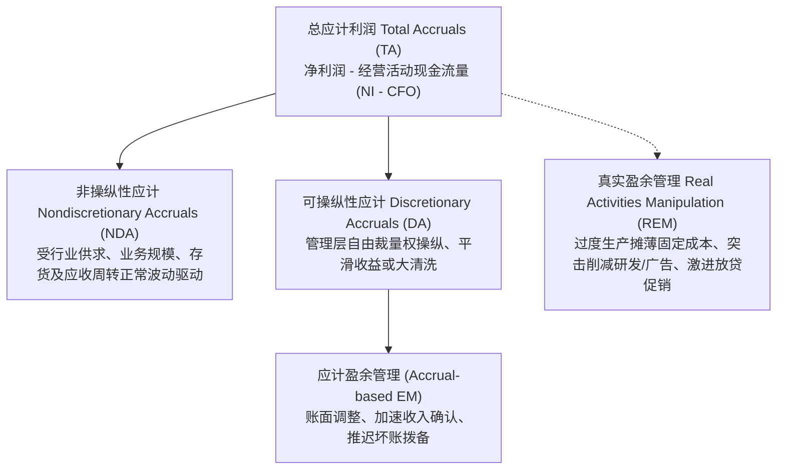
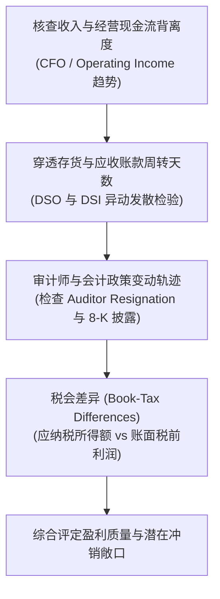

# Lec 08 盈余管理侦测与实务量化检验 (Earnings Management: Detection and Quantitative Testing)

> MIT Sloan School of Management · 15.535 Business Analysis Using Financial Statements · 讲义 08

## TL;DR

- 应计项二分法将总应计拆解为受经济环境驱动的非操纵性应计（NDA）与管理者主观操纵的可操纵应计（DA）。
- 修正琼斯模型通过剥离应收账款净增额消除收入确认操纵，以计量经济学残差隔离可操纵应计项。
- 贝尼斯 M-Score 综合八大财务异象指标，以概率测算模型识别系统性财务舞弊公司。
- 真实盈余管理通过超负荷生产、压缩酌量性支出与激进折扣达成盈余目标，以牺牲长期价值为代价。

## 应计项分解理论与盈余操纵哲学

权责发生制赋予了企业管理层在收入确认时点、费用配比归属以及资产减值估计方面的广泛职业判断空间。这种自由裁量权在理想状态下能够熨平瞬时现金流波动，使净利润更精准地反映企业当期真实的经济附加值。然而，在以契约激励（管理层薪酬挂钩）、资本市场压力（达到分析师盈余预期）以及融资合规约束（债务契约条款）为主导的外部环境下，管理层具有强烈的动机滥用裁量权，通过盈余管理（Earnings Management）扭曲报告业绩。

法务会计与实证会计学研究的核心突破，在于将企业的总应计项（Total Accruals, $TA$）从结构上解构为两个正交组成部分：**非操纵性应计（Nondiscretionary Accruals, $NDA$）**与**可操纵性应计（Discretionary Accruals, $DA$）**。

在总应计项计算中，基于资产负债表法或现金流量表法可得出基础恒等式：

$$TA_{t} = NI_{t} - CFO_{t}$$

其中 $NI_{t}$ 为当期净利润，$CFO_{t}$ 为经营活动产生的现金流量净额。若企业当期净利润显著高于经营现金流，其差额即完全体现为正向净应计资产的增加。非操纵性应计反映了公司在当前营业规模与固定资产配置下，维持正常商业运转所必然产生的应计变化（例如伴随销售增长而合理上升的应收账款与存货）；而可操纵应计则是排除正常经济变量影响后的异常偏差，是衡量盈余操纵强度的关键代理变量。

::: definition [可操纵应计 (Discretionary Accruals, DA)]
可操纵应计是指在企业报告的总应计利润中，无法由宏观经济走势、行业技术特征、主营业务收入变动以及长期资产折旧磨损等客观经济基本面所解释的残差部分。它集中体现了管理层利用会计准则弹性进行跨期利润平滑、巨额冲销（Big Bath）或提前确认收益的人为干预程度。
:::

## 经典计量模型：琼斯模型与修正琼斯模型

为了在统计上从总应计中剥离出客观商业活动产生的非操纵性部分，学术界发展了一系列横截面与时间序列计量回归模型。其中由 Jennifer Jones 于 1991 年提出的琼斯模型，以及由 Dechow、Sloan 和 Sweeney 于 1995 年完善的**修正琼斯模型（Modified Jones Model）**构成了现代财务舞弊实证检验的基石。

### 琼斯模型的基本架构与局限

原始琼斯模型假定非操纵性应计主要受两类变量决定：一是反映业务运营规模变动的营业收入变动额（$\Delta REV$），它决定了流动资产与流动负债的正常变动；二是固定资产原值（$PPE$），它决定了每期刚性发生的非操纵性折旧摊销费用。为了消除企业规模差异带来的异方差性，所有变量均除以上期期末总资产（$A_{t-1}$）进行无量纲标准化：

$$\frac{TA_{it}}{A_{i,t-1}} = \alpha_{1} \left(\frac{1}{A_{i,t-1}}\right) + \alpha_{2} \left(\frac{\Delta REV_{it}}{A_{i,t-1}}\right) + \alpha_{3} \left(\frac{PPE_{it}}{A_{i,t-1}}\right) + \epsilon_{it}$$

通过对同行业在特定会计年度的所有可比公司进行普通最小二乘法（OLS）横截面回归，估计出参数 $\hat{\alpha}_1, \hat{\alpha}_2, \hat{\alpha}_3$。

然而，原始琼斯模型存在一个致命漏洞：它假设所有营业收入变动都是客观真实的。如果管理层通过提前开具发票、虚假赊销等手段蓄意虚增应收账款来粉饰收入，该虚假收入将直接计入 $\Delta REV$，导致估计出的非操纵性应计被系统性高估，从而掩盖真实的可操纵应计。

### 修正琼斯模型的改进机制

Dechow 等人对模型进行了关键修正：他们指出，在估计非操纵性应计的预测阶段，必须从营业收入增量中扣除应收账款增量（$\Delta REC$）。这一假设的核心逻辑在于：管理层通过信用政策放水或直接伪造提单确认的激进收入，几乎全部以未收回的应收账款形态停留在资产负债表上。

::: theorem [修正琼斯模型 (Modified Jones Model)]
修正琼斯模型的参数估计与预测分两步执行：

第一步：利用样本行业横截面数据估计基准参数 $\hat{\alpha}_1, \hat{\alpha}_2, \hat{\alpha}_3$：
$$\frac{TA_{it}}{A_{i,t-1}} = \alpha_{1} \left(\frac{1}{A_{i,t-1}}\right) + \alpha_{2} \left(\frac{\Delta REV_{it}}{A_{i,t-1}}\right) + \alpha_{3} \left(\frac{PPE_{it}}{A_{i,t-1}}\right) + \epsilon_{it}$$

第二步：在预测目标公司 $i$ 在 $t$ 期的非操纵性应计比率 $NDA_{it}$ 时，强制扣除应收账款变动：
$$NDA_{it} = \hat{\alpha}_{1} \left(\frac{1}{A_{i,t-1}}\right) + \hat{\alpha}_{2} \left(\frac{\Delta REV_{it} - \Delta REC_{it}}{A_{i,t-1}}\right) + \hat{\alpha}_{3} \left(\frac{PPE_{it}}{A_{i,t-1}}\right)$$

第三步：计算目标公司的可操纵应计比率 $DA_{it}$：
$$DA_{it} = \frac{TA_{it}}{A_{i,t-1}} - NDA_{it}$$
:::

若 $DA_{it} > 0$，表明公司存在正向调增利润的可操纵应计；$DA_{it}$ 偏离行业常模越远，表明财报盈余中的人为操纵成分越高。

::: example
某高科技制造公司期初总资产 $A_{t-1} = 10$ 亿元。当期报告净利润 $NI_t = 1.2$ 亿元，经营现金流净额 $CFO_t = 0.2$ 亿元。因此总应计利润 $TA_t = 1.2 - 0.2 = 1.0$ 亿元，总应计率 $TA_t / A_{t-1} = 0.10$。
同行业横截面回归参数估计结果为：$\hat{\alpha}_1 = 0.02$, $\hat{\alpha}_2 = 0.15$, $\hat{\alpha}_3 = -0.08$。
当期公司营业收入增加 $\Delta REV_t = 3.0$ 亿元，但应收账款激增 $\Delta REC_t = 2.4$ 亿元；期末固定资产原值 $PPE_t = 4.0$ 亿元。

若按修正琼斯模型测算：
1. 现金口径收入变动率：$(\Delta REV_t - \Delta REC_t) / A_{t-1} = (3.0 - 2.4) / 10 = 0.06$。
2. 固定资产资产占比：$PPE_t / A_{t-1} = 4.0 / 10 = 0.40$。
3. 估计的非操纵性应计率：
   $$NDA_t = 0.02 \times \frac{1}{10} + 0.15 \times 0.06 - 0.08 \times 0.40 = 0.002 + 0.009 - 0.032 = -0.021$$
4. 可操纵应计率：
   $$DA_t = 0.10 - (-0.021) = +0.121$$
这表明在该公司报告的 1.2 亿元净利润中，相当于期初总资产 12.1%（即 1.21 亿元）的数额均来自管理层利用会计裁量权产生的异常正向应计。
:::

## 贝尼斯八因子舞弊识别模型（Beneish M-Score）

与琼斯模型聚焦单一应计残差不同，印第安纳大学教授 Messod Beneish（1999）开发了一套结合多维资产负债表与利润表比率的概率预测模型——**Beneish M-Score**。该模型因成功提前一年识别出安然公司（Enron）极其严重的财务欺诈而名声大噪。

M-Score 是一个由 8 个财务异象变量线性加权构成的综合得分：

$$M\text{-Score} = -4.84 + 0.920 \times DSRI + 0.528 \times GMI + 0.404 \times AQI + 0.892 \times SGI + 0.115 \times DEPI - 0.172 \times SGAI + 4.037 \times TATA + 0.0327 \times LVGI$$

下表梳理了 8 个输入变量的经济学机理及其操纵警示阈值：

| 变量名称 | 计算公式 | 理论经济学含义与舞弊征兆 |
| :--- | :--- | :--- |
| **DSRI** 应收账款指数 | $\frac{REC_t / REV_t}{REC_{t-1} / REV_{t-1}}$ | 应收账款增速异于营收增速。比值显著大于 1 预示激进赊销、提前确认未达标收入或虚构订单。 |
| **GMI** 毛利率指数 | $\frac{GrossMargin_{t-1}}{GrossMargin_t}$ | 前期毛利率除以当期毛利率。若比值大于 1 表明当期盈利能力恶化，管理层操纵保壳或掩盖滑坡动力更强。 |
| **AQI** 资产质量指数 | $\frac{1 - (CurrentAssets_t + PPE_t + Securities_t)/TotalAssets_t}{1 - (CurrentAssets_{t-1} + PPE_{t-1} + Securities_{t-1})/TotalAssets_{t-1}}$ | 衡量非硬资产（长期待摊费用、无形资产、商誉）膨胀速度。比值大于 1 表明费用过度资本化，资产虚高。 |
| **SGI** 销售增长指数 | $\frac{REV_t}{REV_{t-1}}$ | 高成长公司面临成长放缓预期时，为避免估值倍数断崖，虚增利润的冲动最强烈。 |
| **DEPI** 折旧率指数 | $\frac{DeprRate_{t-1}}{DeprRate_t}$ | 前期折旧率除以当期折旧率。比值大于 1 说明当期折旧放缓，管理层调慢折旧进度或延长资产寿命以虚增利润。 |
| **SGAI** 销售管理费用指数 | $\frac{SGA_t / REV_t}{SGA_{t-1} / REV_{t-1}}$ | 比值大于 1 表明期间费用控制失控，经营杠杆转负，存在向下修正预期。 |
| **LVGI** 杠杆指数 | $\frac{LTD_t + CurrentLiab_t / TotalAssets_t}{LTD_{t-1} + CurrentLiab_{t-1} / TotalAssets_{t-1}}$ | 负债率上升加剧债务契约违约风险，管理层面临更苛刻的放贷机构审计约束。 |
| **TATA** 总应计对总资产比率 | $\frac{TotalAccruals_t}{TotalAssets_t}$ | 应计利润在总资产中的相对占比，直接衡量非现金收益对报告利润的渗透率。 |

::: definition [Beneish M-Score 判别规则]
- **正常/低舞弊概率**：$M\text{-Score} < -1.78$。得分越低（更负），财报被操纵的概率越小。
- **高舞弊风险**：$M\text{-Score} > -1.78$。模型将该区间分类为可能存在系统性盈余操纵的舞弊企业。
:::

在 2001 年安然暴雷前夕，其计算出的 M-Score 高达 **-1.49**，远超 -1.78 的警戒红线，AQI 与 DSRI 均出现恶性异动。

## 真实盈余管理（REM）与应计盈余管理（AEM）的博弈

随着监管部门对传统应计舞弊（如延迟计提折旧、跨期收入转移）的审计手段日趋成熟，萨班斯-奥克斯利法案（SOX Act 2002）极大地提高了管理层伪造会计凭证的法律诉讼成本。这迫使越来越多的企业转向更为隐蔽、更难被审计机构定罪的**真实盈余管理（Real Activities Manipulation, REM）**（Roychowdhury, 2006）。

### 真实盈余管理的三大典型战术

1. **过度生产（Overproduction）**：
   在完全成本法（Absorption Costing）核算规则下，制造费用等固定生产成本分摊于所有产出单位。管理层通过开足马力超负荷生产远超当期市场需求的存货，使得单位产品的固定成本被大幅稀释。当售出少量存货时，营业成本账面偏低，而未售出的大量存货则将巨额固定制造费用隐匿在资产负债表的存货科目中。这一操作直接导致未来存货跌价风险剧增，并占用大量流动资金。
2. **削减酌量性支出（Cutting Discretionary Expenditures）**：
   突击大幅压缩研发（R&D）、品牌广告营销以及员工技能培训支出。由于这些支出在发生当期直接费用化，缩减开支能立竿见影地提高当期经营利润，但严重透支了企业的核心竞争优势与长期护城河。
3. **加速销售与突击放贷促销（Accelerating Sales via Aggressive Price Discounts）**：
   在会计期末向客户提供超常规价格折扣或极度宽松的信用账期，诱导客户透支下一季度的采购需求。虽然推高了当期营业收入，但大幅恶化了毛利率，并引发后续周期的销售断崖式滑坡。

::: pitfall [将“真实盈余管理”误判为“卓越经营改善”]
许多分析师极易将过度生产带来的单位毛利率上升解读为“规模经济效应显现”，或将大幅削减研发费用解读为“精益管理与成本控制卓越”。这种分析偏差极其危险。必须将毛利率上升与存货周转天数（DSI）的异常飙升结合审视：若毛利率改善伴随着产成品存货的非正常积压，则极大概率是过度生产粉饰报表的恶果。
:::

## 法务会计与分析师尽调核查框架

在实际对冲基金做空与股权投资并购尽职调查中，专业分析师不应仅仅依赖单一度量指标，而应建立立体交叉审计核验体系。

### 核心核查维度实务要领

- **税会差异（Book-Tax Difference, BTD）排查**：企业在向税务局申报应纳税所得额时倾向于做低利润以避税，而在向资本市场披露财报时倾向于做高利润。若账面会计利润（Book Income）与税务所得额（Taxable Income）的剪刀差持续扩大，且无法由法定加速折旧等公开税优政策合理解释，往往说明企业利用了激进的应计手法夸大财务账面收益。
- **大清洗与饼干罐准备金（Big Bath & Cookie-Jar Reserves）**：新任 CEO 上任首期往往倾向于进行“大清洗”，将未来数年的潜在损失一次性确认为超额坏账准备或商誉减值，压低基期业绩。随后在经营好转期逐步释放这些高估的拨备（从“饼干罐”中掏取储备），人工制造连续多年稳健增长的虚假假象。

## 我的理解

::: insight [权责发生制的宿命：从“信息增量”到“博弈修罗场”]
权责发生制诞生的初衷，是为了破除收付实现制下现金流瞬时错配对商业本质的遮蔽，通过权责划分提供更具预测价值的经济真实全貌。然而，这一制度设计的原罪在于：它不可避免地将信息生产的最终解释权拱手让给了拥有信息优势的管理层。

当资本市场将市盈率（P/E）和每股收益（EPS）作为资源配置与高管身价考核的核心标尺时，财报就不再是一张客观的商业体检单，而是演变成为管理层与资本市场参与者之间高强度的动态博弈修罗场。应计盈余管理是“在账面上玩魔术”，它受制于资产负债表存量的刚性反转压力——虚增的应收总有一天要核销，压低的折旧未来终将吞噬残值。

真正令人忧虑的是从“账面魔术（AEM）”被逼向“真实业务扭曲（REM）”的演变。为了掩盖账面谎言，企业不惜真实浪费现金去过度生产积压存货，不惜裁撤前沿实验室的研发团队以保全季度财报。此时，会计准则的弹性非但没有弥合信息不对称，反而反向恶化了真实世界的资源配置效率。作为严谨的商业分析师，剥离这层精心编织的数字幻觉，寻找被扭曲的底层经济实质，正是财务报表分析最迷人也最硬核的价值所在。
:::
