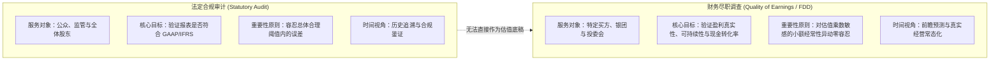
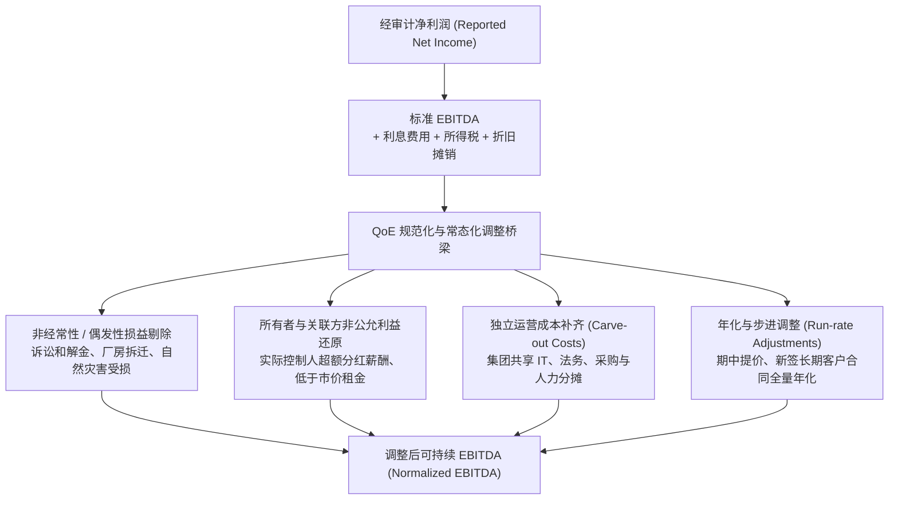
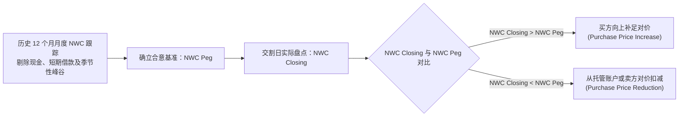
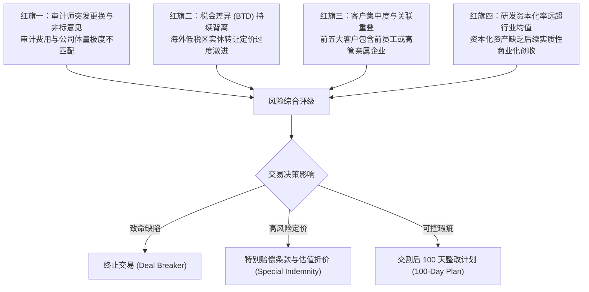

# Lec 09 商业尽职调查与财务报表体检 (Financial Due Diligence and Earnings Quality)

> MIT Sloan School of Management · 15.535 Business Analysis Using Financial Statements · 讲义 09

## TL;DR

- 财务尽调并非合规审计，其核心是以买方估值与杠杆融资为导向测算可持续的调整后 EBITDA。
- 盈利质量分析通过剔除非经常损益、平滑关联方薪酬与年化当期变动，还原底层现金盈利能力。
- 营运资本基准（NWC Peg）设定防范交割前营运资金抽逃，交割结算机制确保买卖双方对等交付。
- 维护性资本支出与成长性资本支出的穿透拆分，是校准自由现金流转化率的试金石。

## 财务尽职调查与法定合规审计的本质边界

在企业并购（M&A）、私募股权投资（Private Equity）以及杠杆收购（LBO）中，买方决策者最常面临的认知误区是：“既然标的企业已拥有四大或权威审计机构出具的标准无保留意见审计报告，为什么还需要耗费巨资聘请专门的交易咨询团队开展财务尽职调查（Financial Due Diligence, FDD）？”

这种混淆忽视了法定审计与交易尽调在目标、视点、责任边界与方法论上的根本分歧。

在 8 到 12 倍的并购估值乘数（EV/EBITDA）下，标的公司财报中一笔未被揭示的 500 万美元虚增或隐匿成本，直接意味着 4000 万到 6000 万美元的并购溢价损失，以及杠杆收购后高额偿债现金流的枯竭。因此，FDD 的核心产出物并非审计意见，而是**盈利质量报告（Quality of Earnings Report, QoE）**、**营运资本分析（Working Capital Analysis）**与**净负债穿透清单（Net Debt Bridge）**。

::: definition [财务尽职调查 (Financial Due Diligence, FDD)]
财务尽职调查是并购与股权投资中由买方或卖方委托展开的深度财会分析。其核心是通过穿透历史账目、业务驱动动因、关联交易与现金流收付明细，剔除历史会计失真与非经常性偶发事件，重构出标的资产在独立运营条件下的可持续盈利基准（Normalized / Adjusted EBITDA），为交易定价、合同陈述与保证条款（R&W）以及交割后整合提供事实依据。
:::

## 盈利质量（QoE）核心调整方法论：从报告净利润到调整后 EBITDA

在并购交易估值中，买方通常以经调整的税息折旧及摊销前利润（Adjusted EBITDA）作为定价基准。QoE 调整流程严谨遵循以下三步递进推演：

### 核心调整项的分类与量化逻辑

1. **非经常性损益（Non-recurring / One-off Items）**：
   - 剔除突发性法律诉讼和解费、政府一次性特许补贴、重组遣散费以及由于并购筹划自身发生的投行与律师中介费用。
   - 剔除突发性自然灾害停工损失以及由于供应链短期瘫痪导致的非常规空运加急运费。
2. **所有者及关联交易常态化（Owner / Related-Party Adjustments）**：
   - 在未上市私营企业中，创始人往往通过虚高或过低的薪酬调节利润。若创始人年薪为 300 万美元，而市场化聘任职业经理人只需 80 万美元，则应在 EBITDA 中向上调增 220 万美元；反之，若创始人不领薪水，则须向下扣除 80 万美元常态化薪酬。
   - 审查标的公司向关联方租赁办公楼或仓储设施的租金是否低于或高于公允市场价格，按公允水平平抑。
3. **分拆独立运营成本（Carve-out / Standalone Costs）**：
   - 若标的业务为跨国集团分拆剥离出的业务线，其历史报表中的财务、ERP 维护、法务和人力资源成本常以极低的集团内部管理费分摊体现。一旦独立运作，必须补足建立自主职能后台所需的增量经常性运营成本（向下调减 EBITDA）。
4. **运行速度调整（Run-rate Adjustments）**：
   - 若标的公司在财年中期（如 7 月 1 日）对核心客户实施了不可逆的 5% 结构性提价，则下半年的提价效应在历史全年仅反映了一半。尽调人员需将下半年实现的增量利润测算年化，作为未来稳态的盈利能力加回。

::: example
某工业设备企业报告财年 EBITDA 为 2,500 万美元。交易尽调中识别出以下明细事实：
1. 报表中包含一笔厂房火灾保险赔偿净收益 300 万美元（偶发利好）。
2. 当年因更换 ERP 系统支付咨询顾问实施费 120 万美元（一次性非经常开支）。
3. 创始人向公司报销私人游艇与家庭旅行费用 80 万美元（列入销售及管理费用）。
4. 标的公司无专职法务与税务团队，此前由母公司免费提供支持；独立后需外聘法务顾问及增加内控人员，预计年化经常性支出 150 万美元。
5. 6 月 30 日关闭了一家持续亏损的海外子公司，该子公司在关闭前当年贡献净亏损 100 万美元（已永久停止运营）。

测算调整后可持续 EBITDA：
$$\text{Adjusted EBITDA} = 2,500 - 300 \text{ (保险收益)} + 120 \text{ (ERP支出)} + 80 \text{ (私人报销)} - 150 \text{ (独立法务成本)} + 100 \text{ (关停亏损)} = 2,450 \text{ 万美元}$$
若买方按 10 倍 EV/EBITDA 估值，未经尽调调整的估值为 2.5 亿美元，而真实可持续基准下的估值为 2.45 亿美元，纠偏了 500 万美元的溢价敞口。
:::

## 营运资本基准（NWC Peg）与交割机制

在并购交易中，“无现金、无负债”（Cash-Free, Debt-Free）是通行的对价约定基准。在此结构下，买方收购的是标的企业的资产组及其运营能力，卖方有权拿走账面留存现金，但必须清偿所有外部金融负债。然而，这里隐藏着一个重大博弈空间：**交割日企业必须留存多少营运资本以保证次日早晨正常开工？**

### 营运资本流失的道德风险

若缺乏严密的营运资本保护机制，卖方在签署协议到实际交割的过渡期内，有强烈的动机实施以下行为：
- 强行催收客户应收账款并将资金转为现金抽走；
- 停止采购生产原材料并消耗库存至危险红线；
- 恶意拖欠供应商应付账款，将账期从 30 天强行延长至 90 天。

这会导致交割当日买方接手一个空壳营运盘面，必须立即由自己注资数千万现金注入流动资产以避免工厂停产，变相向卖方转移了巨额价值。

### NWC Peg 设定与交割结算方程

为解决该博弈，交易双方须在并购协议（SPA）中约定**营运资本基准线（NWC Target / Peg）**，并在交割后开展多退少补的平账结算（Working Capital True-Up）。

::: theorem [营运资本交割结算恒等式]
营运资本的定义严格聚焦于**经营性流动资产**与**经营性流动负债**的差额：
$$NWC = (\text{应收账款} + \text{存货} + \text{预付账款}) - (\text{应付账款} + \text{应付职工薪酬} + \text{应交税费})$$
注意：公式中严禁计入现金（Cash）和短期计息债务（Short-term Debt）。

交割时最终支付的股权购买对价（Equity Purchase Price）按如下公式结算：
$$\text{Equity Value} = \text{Enterprise Value} + \text{Closing Cash} - \text{Closing Debt} + (NWC_{\text{Closing}} - NWC_{\text{Peg}})$$
:::

若交割日实际营运资本高于基准，买方补偿卖方多留存的流动资产价值；若低于基准，直接在应付对价中扣减，从而锁定了交割期运营的平稳过渡。

## 资本开支真伪鉴别：维护性（Maintenance）与成长性（Growth）拆解

在 DCF 估值与 LBO 杠杆偿债测算中，自由现金流转换率取决于资本开支（Capex）的规模。许多企业宣称其高昂的 Capex 全部是为未来扩张所做的“成长性投资”，而日常“维护性开支”极小，试图在 EBITDA 扣减后粉饰可分配现金流。尽职调查必须穿透固定资产台账，严密区分两类性质的开支。

| 维度 | 维护性资本支出 (Maintenance Capex) | 成长性资本支出 (Growth Capex) |
| :--- | :--- | :--- |
| **经济本质** | 维持现有产能、市场份额及设备安全运行所必需的置换与大修 | 为获取新客户、开辟新产品线或进入新地域而增加的增量产能 |
| **与折旧关系** | 长期来看应近似等于或略高于经济折旧（考虑通胀影响） | 与企业营收扩张斜率强相关，具备高度自由裁量权 |
| **下行期可控性** | 无法推迟，否则将引发设备瘫痪或客户流失 | 在宏观衰退或现金流告急时可主动冻结削减 |
| **尽调核查手段** | 审视单台设备大修周期、技术迭代报废率及法定安全合规要求 | 核验新厂房土地批文、新产线采购合同及新增产能爬坡台账 |

::: pitfall [将“维护性 Capex”包装为“成长性 Capex”]
管理层常通过将厂房常规修缮、老旧磨损数控机床的同等规格替换，以“工艺现代化升级”的名义归入成长性资本支出。若尽调人员信以为真并在估值中假设在平稳期该支出可以降至零，将导致企业在预测期遭遇严重的产能衰竭与现金流脱节。
:::

## 财务红旗（Red Flags）评分矩阵

专业交易尽职调查团队在进场 48 小时内，通常通过系统性的财务红旗评分矩阵对标的企业进行快速扫描，锁定深水区风险并决定尽调资源的配置优先级。红旗信号并非孤立存在，往往相互印证，构成立体风险画像。

### 四大核心警示红旗的实务核查要领

1. **审计师突发更换与异常解聘（Auditor Turnover）**：
   在拟交易前 12 至 24 个月内，标的企业无合理商业理由更换会计师事务所，尤其是从国际四大会计师事务所降级更换至不知名的小型区域所，或前任审计机构出具了带强调事项段的保留意见。此类信号往往暗示管理层与审计师在收入确认或坏账计提准则上发生不可调和的分歧。
2. **税会差异（Book-Tax Difference, BTD）异常扩大**：
   企业呈报给资本市场或潜在买方的税前会计利润持续攀升，而向税务局申报缴纳的企业所得税却长期处于低位，且无法通过合法的税收优惠政策（如国家级高新技术企业减免、固定资产加速折旧抵扣）予以合理解释。这表明企业存在极大的账面虚增收入或推迟计提费用的应计操纵风险。
3. **客户集中度过高与隐蔽关联方交易（Related-Party Overlap）**：
   前五大或前十大客户贡献了公司超过 60% 的总营收，且主要客户的注册地址、工商联系电话与标的公司的分支机构或董监高亲属高度重合。实务中需穿透核验资金最终穿梭路径，严防通过虚假自买自卖循环做大营收体量。
4. **激进的研发支出资本化与无形资产膨胀（Excessive Capitalization）**：
   在同行业普遍将研发活动支出全额费用化的情况下，标的企业将超过 50% 甚至更高比例的技术研发支出计入“开发支出”并在未来摊销。若核验发现相关专利在市场上已被竞品替代且未能产生可验证的现金流入，未来将面临巨额无形资产减值冲销，直接吞噬收购后的股东净资产。

## 我的理解

::: insight [尽职调查的底层认知：不是证明完美，而是给不确定性定价]
财务尽职调查绝不是一份“企业质量完美证明书”。商业世界的真实生态是：没有任何一家处于激烈竞争中的企业拥有毫无瑕疵的报表、无可挑剔的内控以及平滑完美的增长曲线。

合格的商业分析师从不期望找到“零瑕疵”的企业，而是要建立一个透视透镜——将管理层的粉饰外衣、历史包袱与商业周期的噪声逐层剥离，看清底层业务飞轮在裸奔时究竟能产生多少真金白银的自由现金流。

尽调报告中每一个 QoE 调整项，本质上都是一次买卖双方权利边界的重新界定；NWC Peg 的每一百万元博弈，都是在堵死信息不对称带来的套利漏洞。优秀的交易咨询绝不是阻止交易发生的刹车，而是为资本定价风险、构建安全边际（Margin of Safety）的最强锚点。当你能精准指出标的企业在哪些维度夸大了利润、在哪些科目隐藏了开支，并据此在并购协议中转化为对价扣减或特别补偿条款时，财务报表分析才真正完成了从“账面纸上谈兵”到“真实商业战役”的升华。
:::
