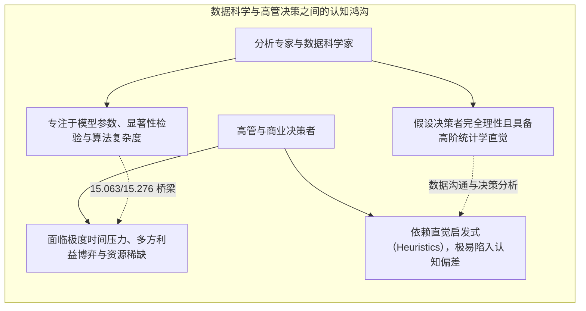

# Lec 1 数据驱动决策导论与分析哲学：量化模型与管理认知

> MIT 15.063 / 15.276 · Communicating with Data · 模块一：决策科学与分析哲学

## TL;DR

- 课程确立“数据分析不仅是计算工具，更是一种系统性管理思维方式”的核心哲学。
- 决策分析的核心矛盾在于：无论训练多么精良的资深高管，在面对不确定性与复杂概率时，都会系统性陷入认知偏差与直觉误区。
- 区分“优良决策（Good Decision）”与“良好结果（Good Outcome）”：管理评估必须基于决策制定时的信息结构与逻辑严密性，而非单一的事后运气。
- 建立从现实业务问题定义、量化概率建模、计算机模拟到管理层决策建议传达的完整分析沟通闭环。

## 数据沟通的挑战：计算与决策的鸿沟

在现代商业管理中，企业内部充斥着海量的报表、数据库记录与统计回归分析。然而，麻省理工学院斯隆管理学院（MIT Sloan）资深教授 John S. Carroll 指出：**商业实践中最常见的悲剧，不是缺乏精密算法，而是决策者无法理解数据背后的不确定性结构，或者分析人员无法将量化模型转化为管理行动**。

::: definition 决策分析 (Decision Analysis)
一种融合概率论、数理统计、效用理论与认知心理学的规范性分析框架，旨在帮助管理者在面临不确定性、复杂权衡与多阶段动态约束时，系统化识别最优行动策略。
:::

## 优良决策 vs 良好结果：概率世界的评价准则

在确定性世界中，行动与结果一一对应；但在充满随机扰动的商业世界中，**优秀的决策过程并不必然带来完美的结果，糟糕的决策也可能偶尔撞大运**。

::: insight 结果偏见（Outcome Bias）与管理问责陷阱
初级管理者最常犯的错误是以结果论英雄：
如果一名交易员下注了赢面仅有 5% 的高风险垃圾债券，最终靠小概率黑天鹅事件大赚一笔，管理层便奖赏其为“投资天才”；而如果另一位工程师基于严格的预期收益与对冲模型推进项目，却遭遇了五十年一遇的罕见地震导致交付延迟，便被痛斥为“能力不足”。

这种“结果偏见”会直接在企业内部催生鲁莽赌博文化，并系统性扼杀基于严密量化推导的理性决策。**高水平的组织评估，必须穿透外部随机性的迷雾，严格审查决策节点上的信息输入完整性、概率评估严密性与逻辑一致性。**
:::

## 课程分析架构与全景蓝图

15.063 / 15.276 围绕管理决策必须掌握的五大量化基石展开：

1. **决策树与逆向归纳法（Decision Trees & Rollback）**：将多阶段、多决策节点的复杂商业情境具象化为逻辑分支。
2. **概率运算法则与贝叶斯更新（Probability & Bayes' Theorem）**：在获得新市场信息或测试样本后，科学修正先验概率。
3. **连续与离散概率分布（Distributions: Binomial & Normal）**：用数学语言刻画业务波动、服务排队与质量缺陷率。
4. **蒙特卡洛模拟（Monte Carlo Simulation）**：克服解析计算瓶颈，通过计算机随机抽样洞察非线性风险分布。
5. **回归分析与因果推断（Linear Regression & Causality）**：从历史经验数据中提取驱动变量，评估敏感性与商业弹性。

## 我的理解

::: insight 数据沟通不是报表罗列，而是不确定性契约
在很多企业里，“用数据说话”被异化为一种防御性手段：分析师把厚达 80 页的数据透视表拍在桌上，试图以此免除自己的决策责任。

然而，数据本身从来不会自动做出决策。所有统计指标——无论是均值、方差还是置信区间——本质上都是对现实世界不确定性的数学抽象。

卓越的数据沟通者扮演的是“不确定性架构师”的角色：
他不仅向高管报告“这个方案平均能赚 200 万”，更清晰地阐明：“在 15% 的最悲观情境下，我们可能会亏损 80 万；但在投入 5 万美元购买期权后，我们可以将最大下行风险锁定在 10 万以内。”

把模糊的直觉焦虑，转化为清晰的概率分布与对冲成本，这就是量化沟通带给商业世界的最硬核价值。
:::
