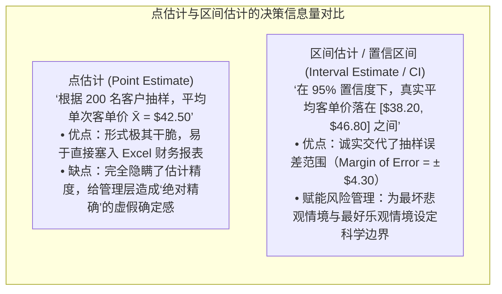
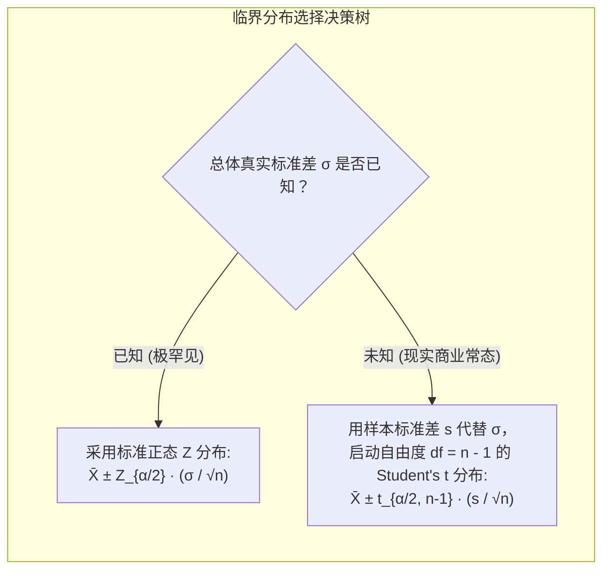
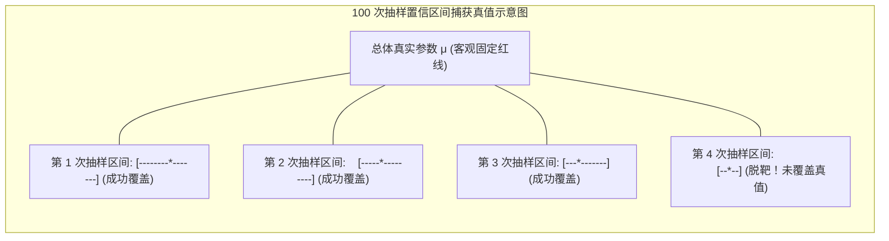

# Lec 10 统计抽样推断与置信区间：从样本数据推断总体真实参数

> MIT 15.063 / 15.276 · Communicating with Data · 模块十：参数估计与置信区间构建

## TL;DR

- 点估计（Point Estimate）给出单一最佳数值猜想，但无法反映抽样误差；区间估计（Interval Estimate）定量锁定了真实参数的置信边界。
- 基于中心极限定理构建双侧置信区间：当总体方差未知且样本量有限时，必须使用厚尾的斯图登特 $t$ 分布替代标准正态 $Z$ 分布。
- 厘清置信水平（Confidence Level）的频率学派哲学真谛：“$95\%$ 置信度”指大量重复抽样时构建的区间有 $95\%$ 覆盖真值，而非固定区间有 $95\%$ 概率包含真值。
- 掌握样本量预估公式（$n = (Z \cdot \sigma / \text{MOE})^2$），精准平衡市场调研预算与误差容忍限度（Margin of Error）。

## 点估计与区间估计的决策博弈

在企业经营中，决策者永远无法获知总体的全部真相：我们无法调研全美 3 亿消费者的所有手机支付习惯，也无法在芯片出厂前测试晶圆上的每一个晶体管。由于时间成本、人力开销以及某些测试本身的破坏性本质，我们只能通过随机抽样的 $n$ 个有限观测值，对总体真实均值 $\mu$ 或总体比例 $p$ 进行**统计推断（Statistical Inference）**。

传统的商业管理往往过分青睐单一的点估计。财务模型中填入的一个固定数字（例如“预期客单价 42.5 美元”），给管理层带来了虚假的安全感，似乎未来是可以被绝对锁定的。然而，这种确定性仅仅是数学抽象的假象。真实世界充满扰动，任何单次抽样得到的均值 $\bar{X}$ 都只是一个随机变量。如果不说明这个数字可能上下浮动多大，点估计就会沦为误导高管做出激进资本开支的陷阱。

区间估计的引入，正是为了在商业决策中建立对不确定性的科学度量衡：

通过区间估计，分析团队向管理层交付的不再是一个脆弱的孤立点，而是一条兼顾精度与置信度的决策安全带。高管能够清晰洞察：在最乐观的情境下收益能达到多少，在最悲观的情境下底线在哪里，从而从容制定弹性应对预案。

## 正态总体与未知方差下的 $t$ 分布构建

构建置信区间的基本形式为：
$$\text{置信区间} = \text{点估计值} \pm \text{临界系数} \times \text{标准误} = \bar{X} \pm (\text{Critical Value}) \times \text{SE}$$

::: definition 斯图登特 t 分布 (Student's t-Distribution)
由吉尼斯酿酒厂统计学家威廉·戈塞（William Sealy Gosset）以笔名“Student”提出。与标准正态分布相比，$t$ 分布呈对称单峰，但**尾部更厚（Fat Tails）**。当自由度 $df = n - 1$ 较小时，厚尾补偿了由于用样本标准差 $s$ 估算总体未知 $\sigma$ 所带来的额外不确定性；当 $n \to \infty$ 时，$t$ 分布渐近收敛于标准正态分布。
:::

## 置信区间的频率学派真谛与常见误读

“这个项目的 95% 置信区间是 [120 万, 180 万]”，这句话在管理层中最常遭遇灾难性的哲学误读：

::: pitfall 置信区间的经典认知谬误
- **严重错误理解**：“总体真实利润 $\mu$ 落在 [120 万, 180 万] 之间的概率是 $95\%$。”
  - *为什么错*：在经典频率学派看来，总体真值 $\mu$ 是一个**客观存在但未知的确定常数**（它不是随机变量，没有概率分布）。真值要么在区间里，要么不在区间里；谈论真值掉进某个具体静态区间的概率要么是 1，要么是 0。
- **严密科学解释**：“如果我们按照当前的抽样方法重复进行 100 次独立的市场调研，将构建出 100 个不同的置信区间。在这些区间中，**大约有 95 个区间能够成功捕获并覆盖总体真实参数 $\mu$**，而有 5 个区间会因为抽样坏运气而彻底偏离。”
:::

## 边际误差（MOE）与样本量确定性计算

在启动任何大型消费者调研或新药临床试验前，CFO 最关心的问题永远是：“我们到底需要采集多少个样本才能达到管理要求的精度？”

设双侧置信水平为 $1 - \alpha$，边际误差（Margin of Error, MOE）定义为半区间宽度：
$$\text{MOE} = Z_{\alpha/2} \cdot \frac{\sigma}{\sqrt{n}}$$

### 求解所需最小样本量 $n$：
两边平方并解方程，得到著名的**样本容量决定公式**：
$$n = \left(\frac{Z_{\alpha/2} \cdot \sigma}{\text{MOE}}\right)^2$$

::: example 某新能源汽车续航里程标定调研
某车企计划标定新车在寒冷气候下的平均实际续航里程 $\mu$。根据前期工程测算，续航标准差约为 $\sigma = 30$ 公里。管理层要求：在 **$95\%$ 置信度**（$Z_{0.025} = 1.96$）下，估计的边际误差不得超过 **$\text{MOE} = \pm 5$ 公里**。
问：至少需要对多少台量产车进行严苛实测？
- 代入公式：
  $$n = \left(\frac{1.96 \times 30}{5}\right)^2 = \left(\frac{58.8}{5}\right)^2 = (11.76)^2 \approx 138.3$$
- **管理决策**：必须向上取整至 **$n = 139$ 台车**。如果预算只够测试 50 台，则必须向管理层透明汇报：边际误差将不可避免地放宽至 $\pm 8.3$ 公里。
:::

## 我的理解

::: insight 置信区间是商业诚信的度量衡
在商业吹嘘泛滥的今天，乙方咨询公司或内部汇报人常常给出一个看似极具诱惑力的点估计：“上线这个功能，我们的转化率能提升 18.5%。”这种精确到小数点后一位的伪精确（Spurious Precision），往往只是为了掩盖背后样本极度匮乏的虚妄。

真正的专业主义，体现在主动向决策者呈递**置信区间**：
“领导，在 95% 置信度下，这项改动带来的转化率提升区间是 [2.1%, 34.9%]。”

这个看似“不够笃定”的区间，其实包含了千金难买的真实信息：
- 它诚实地告诉管理层：业务提升是统计显著为正的（下限 2.1% 大于 0），我们可以放心推进；
- 但同时它警示管理层：由于区间极其宽泛（从 2% 到 35%），说明当前的数据采样噪声极大，千万不能以 18.5% 为基准去提前透支营销预算或激进扩产。

敢于展示置信区间的宽度，是一个分析团队从“讨好老板的汇报工具人”蜕变为“捍卫企业资产安全的科学参谋”的标志。
:::
