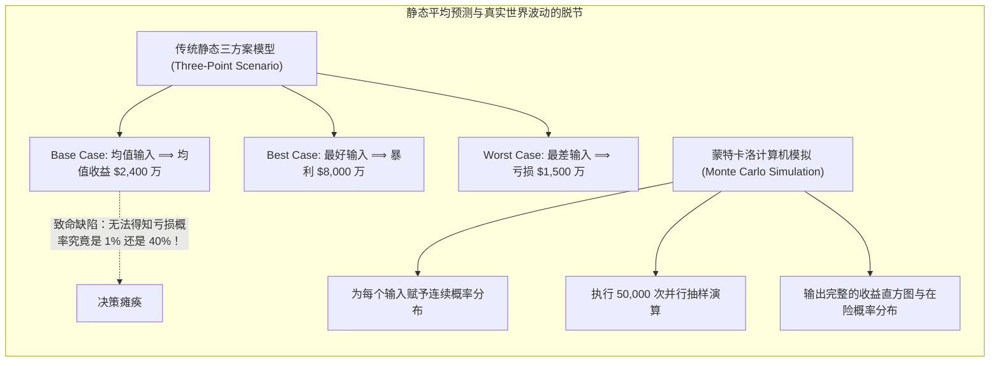
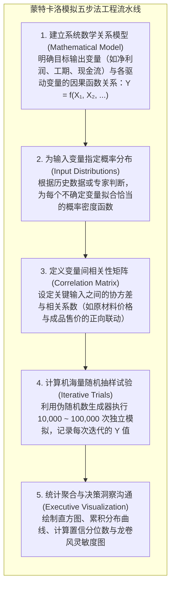

# Lec 11 蒙特卡洛模拟与商业风险建模：超越静态单点预测

> MIT 15.063 / 15.276 · Communicating with Data · 模块十一：计算机随机模拟与全景风险建模

## TL;DR

- 传统静态财务报表（基准案、乐观案、悲观案）存在致命的“平均数缺陷（Flaw of Averages）”：**基于各输入变量均值测算的系统输出，在数学期望上几乎总是错误的**。
- 蒙特卡洛模拟（Monte Carlo Simulation）通过计算机对成百上千个不确定性输入变量进行数万次随机抽样迭代，将点估计升级为全景输出概率分布。
- 掌握概率输入分布选型矩阵（三角分布、均匀分布、正态分布、对数正态分布），并严密刻画变量之间的关联耦合。
- 利用累积概率曲线（CDF）计算破产或亏损概率（$P(\text{NPV} < 0)$），借助龙卷风图（Tornado Chart）识别对系统方差贡献最大的关键主控风险。

## 静态电子表格的致命缺陷：平均值陷阱

在大多数企业的年度战略规划中，财务分析师习惯在 Excel 中建立复杂的净现值（NPV）模型：输入一个预期的平均市场销量、一个预期的平均原材料价格、一个预期的贴现率，最后导出一个光鲜亮丽的数字：“本项目预计 NPV 为 $\$2,400$ 万”。

斯坦福大学运筹学教授山姆·萨维奇（Sam Savage）将其痛斥为**“平均数之缺陷（The Flaw of Averages）”**：

::: definition 平均数之缺陷 (The Flaw of Averages)
在绝大多数包含非线性约束、阈值阻断或乘法关联的复杂商业系统中，**函数期望值不等于期望值的函数**：
$$\mathbb{E}[f(X_1, X_2, \dots, X_k)] \neq f(\mathbb{E}[X_1], \mathbb{E}[X_2], \dots, \mathbb{E}[X_k])$$
当函数 $f$ 为凸函数（Convex）时，基于均值算出的结果系统性低估期望（延生 Jensen 不等式）；当系统存在最大产能瓶颈或破产红线时，基于均值预测将导致对灾难性下行风险的极度麻痹。
:::

## 蒙特卡洛模拟的标准工程实施流水线

蒙特卡洛模拟最初由物理学家斯坦尼斯瓦夫·乌拉姆（Stanislaw Ulam）与约翰·冯·诺依曼在曼哈顿计划研发原子弹时提出。面对极度复杂的核裂变多体散射碰撞，当时的解析数学方程根本无法直接求解，乌拉姆灵机一动：为什么不用当时刚刚出现的电子计算机，按照微观粒子的碰撞概率连续扔数万次“轮盘赌”，然后统计宏观结果？这一天才思想迅速席卷了金融工程、运营管理与航空航天领域。

在现代商业决策分析中，蒙特卡洛模拟不再是象牙塔里的理论玩具，而是大型企业评估数十亿美元资本投资的标配工具。要完成一次严谨、可经受住审计检验的高质量模拟，团队必须遵循严格标准化的五步工程流水线：从最初梳理系统确定性算式，到为不确定变量匹配概率分布与协方差，再到计算机海量抽样与最终的高管可视化呈现：

这五大步骤中，最关键也是最考验业务深度的阶段在于前两步。数学模型 $f$ 必须精准反映企业真实的成本结构、产能上限与税务规则；而输入分布的设定，则要求分析团队深入一线工厂与销售网络，严密核验历史数据，杜绝主观拍脑袋。一旦输入分布失真，计算机运算的速度越快、抽样次数越多，输出的误导性结论扩散就越快。

## 常用输入概率分布选型指南

在商业软件（如 Crystal Ball, @RISK）或 Python 建模中，选对输入分布是模拟有效性的生命线：

| 概率分布类型 | 核心几何特征与参数 | 最佳商业应用场景 | 典型行业案例 |
|---|---|---|---|
| **三角分布 (Triangular)** | 设定最小值（Min）、最可能值（Mode）与最大值（Max）。计算极快，直观易懂。 | 缺乏海量历史数据、依赖一线专家经验定性估计的工程项目。 | 建筑施工工期预估、大型 IT 系统重构耗时评估。 |
| **均匀分布 (Uniform)** | 设定区间 $[a, b]$，区间内每个点的概率密度绝对相等。 | 信息极度匮乏，仅知道物理可行上下限，没有任何特定峰值倾向。 | 竞标对手在密封拍卖中的报价区间预测。 |
| **正态分布 (Normal)** | 设定均值 $\mu$ 与标准差 $\sigma$，关于中心绝对对称。 | 受大量微观独立随机因素叠加影响的宏观业务指标。 | 大宗成熟产品的季度市场总需求量、标准化流水线加工工时。 |
| **对数正态分布 (Lognormal)**| 严格非负（$X > 0$），具有明显的右长尾峰度。 | 不可能出现负值、且偶尔存在极端巨大暴发潜力的变量。 | 生物制药新药峰值销售额、高风险天使投资回报倍数。 |

## 模拟结果解读：累积概率曲线与龙卷风图

蒙特卡洛模拟完成后，分析团队向董事会汇报的核心资产绝非单一点估计，而是两张强力图表：

### 1. 累积频率曲线与盈亏平衡概率（P(NPV < 0)）
在累积曲线（CDF）上，横轴为净利润，纵轴为累积概率。
- 找到横轴零点（$\text{Profit} = 0$），直接读取纵轴概率值。
- 如果图表显示 $P(\text{NPV} < 0) = 28\%$，这意味着该项目即使平均回报为正，仍有高达 **$28\%$ 的概率会导致企业净亏损**！高管即可据此判断是否超出企业的风险承受底线。

### 2. 龙卷风灵敏度图（Tornado Chart）

::: insight 龙卷风图的管理战略价值
龙卷风图按照对目标变量方差贡献度从大到小排列，形如漏斗倒悬的龙卷风。它明确告诉管理层：**企业有限的尽调预算和管理精力应当投向哪里**。
- 在上面的案例中，市场渗透率贡献了超过一半的不确定性，企业应立即拨款加派团队开展深入用户调研；
- 而针对最底部的营销推广预算，耗费数周时间在会议室争论其几十万的增减毫无意义，因为它对大局的方差影响微不足道。
:::

## 我的理解

::: insight 模拟是从决定论傲慢走向概率谦逊的桥梁
在传统的管理文化中，很多 CEO 喜欢向属下索要“确定性”：“我不要听如果，你直接告诉我下半年能不能完成 1 个亿！”在长期的权力高压下，下属被迫学会了用假装笃定的语气交出一份精心粉饰的确定性数字，把所有未知的地雷深埋在沙土之下。

蒙特卡洛模拟是现代商业文明的一次伟大觉醒：
它教导管理者坦然承认——**在复杂的动态商业系统中，“精确的错误”远比“模糊的正确”更致命**。

当你开始用直方图和累积分布曲线来思考战略时，你的整个管理哲学就升维了：
你不再试图徒劳地去“消除不确定性”；
你学会了在不确定性的全景风暴中，计算底线概率、设计对冲期权、给关键路径留足冗余时间盒。

一个懂得用蒙特卡洛思维掌舵的企业，才真正拥有了穿越任何黑天鹅风暴的系统韧性。
:::
