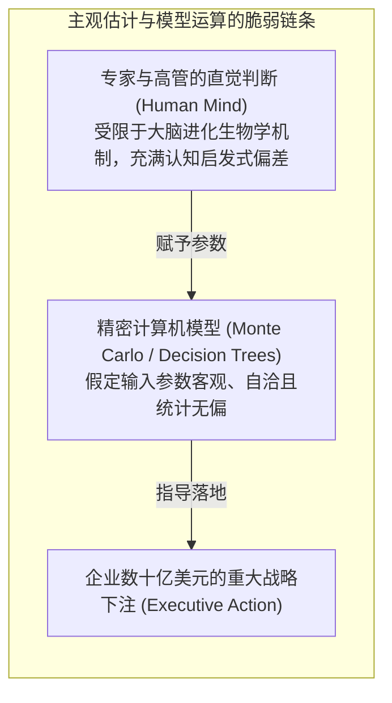
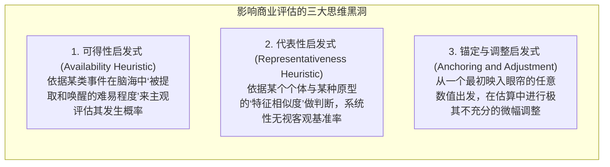
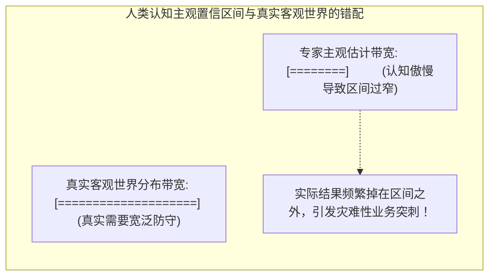

# Lec 12 主观估计偏差与不确定性判断：认知心理学与启发式陷阱

> MIT 15.063 / 15.276 · Communicating with Data · 模块十二：行为决策理论与专家判断校准

## TL;DR

- 在商业实战中，绝大部分概率分布参数与模型输入无法直接从历史数据中客观读取，必须依赖高管与专家的“主观判断与直觉估计”。
- 卡尼曼与特沃斯基（Kahneman & Tversky）的行为决策理论揭示：人类大脑在不确定性情境下普遍依赖“启发式算法（Heuristics）”，从而产生系统性、可预测的认知偏差。
- 过度自信（Overconfidence）与虚假精确（Overprecision）：当专家宣称给出“$90\%$ 置信区间”时，真实结果往往有 $30\%–40\%$ 落在区间之外，置信带宽严重过窄。
- 锚定效应（Anchoring）、可得性偏差（Availability）与代表性启发式（Representativeness）是扭曲管理层风险评估的三大思维黑洞。

## 主观概率的来源：模型的阿喀琉斯之踵

在前面的讲义中，我们掌握了决策树、贝叶斯更新与蒙特卡洛模拟等精密算法。然而，所有这些高阶数学模型都面临一个最致命的前提问题：**模型中的输入概率与分布参数究竟是从哪里来的？**

当苹果公司在 2007 年规划第一代 iPhone 的销量、或者某生物科技药企评估一种全新靶向抗癌药物的临床三期成功率时，世界上根本不存在所谓的“历史数据集”。这些关键参数只能来自**行业专家、一线工程师与资深高管的主观判断（Subjective Judgment）**。

如果专家的主观认知本身充满了系统性偏差，那么无论后续的计算机模拟多么精巧，输出的也只能是经过高科技包装的“数字垃圾（Garbage In, Garbage Out）”。

## 三大核心启发式偏差（Heuristics & Biases）

诺贝尔经济学奖得主丹尼尔·卡尼曼与阿莫斯·特沃斯基通过数十年的认知实验，系统解构了人类在面对不确定性时的三大心智捷径：

### 1. 可得性启发式（The Availability Heuristic）
- **心理机制**：凡是情绪震动大、近期刚刚发生、在新闻媒体上被高频曝光的事件，在大脑神经回路中的“检索成本极低”。
- **商业恶果**：
  - 如果上个月某竞品公司的核心数据库遭受了勒索病毒攻击并登上了科技头条，企业管理层会在接下来的安全预算评审中产生恐慌性过度投资；
  - 反之，对于长期潜伏、发生概率高但形式枯燥隐蔽的合规审计漏洞，管理层却视而不见，因为该类事件在记忆中“缺乏生动可得性”。

### 2. 代表性启发式与合取谬误（The Conjunction Fallacy）
- **经典琳达问题（Linda Problem）**：琳达 31 岁，单身，坦率直言且极其聪明，大学主修哲学，学生时代深切关注社会正义并参与反核示威。
  - *问题*：以下哪种情况的概率更大？
    - 选项 A：琳达是一名普通的银行柜员。
    - 选项 B：琳达是一名活跃于女权主义运动的银行柜员。
  - *实验结果*：超过 $85\%$ 的顶尖商学院受试者选择了选项 B！
  - *数理逻辑粉碎*：设 $T$ 为银行柜员，$F$ 为女权主义者。选项 B 是两个事件的交集（$T \cap F$），按照概率公理，**交集的概率绝不可能大于任何一个单一子集的概率**（$P(T \cap F) \le P(T)$）！人们之所以违背基础数学逻辑，仅仅是因为描述词与“女权主义者”的刻板印象（代表性）高度重合。

### 3. 锚定效应（Anchoring and Adjustment）
- 在年度预算编制中，各部门经理总是习惯以“去年的实际支出”作为锚点，在此基础上微调 $\pm 5\%$；即使外部宏观技术路线已经发生了颠覆性剧变，团队依然被牢牢锁死在历史数字的引力场中。
- 在商业采购谈判中，先发制人抛出一个极端激进的开价，能够对对方的心理预期形成不可逆转的拖拽效应。

## 过度自信与虚假精确（Overprecision）

在所有主观估计偏差中，对商业组织破坏力最大、最顽固的特质就是**过度自信（Overconfidence）**。

::: definition 虚假精确测试 (The 90% Confidence Interval Quiz)
心理学家要求资深工程师和高管对 10 个未知的商业或常识问题（如“亚马逊上一季度的净收入是多少？”、“从纽约到伦敦的直线飞行距离是多少？”）给出自己的“$90\%$ 主观置信区间”——即你有 $90\%$ 的把握真值会落在你的 $[L, R]$ 区间内。
- **理论预期**：10 道题目中，平均应该有 9 道题命中真值，最多脱靶 1 道；
- **全球实测现实**：无论是普通学生、华尔街交易员还是硅谷资深总监，**脱靶率普遍高达 $30\%–50\%$！平均只有 5 到 7 道题命中！**
:::

::: pitfall 虚假精确的管理学危害
专家给出的置信区间过于狭窄，意味着高管**严重低估了现实环境的极端波动范围**。其后果是：供应链安全库存设得太薄、项目交付工期预算打得太满、应急备用金预留不足。一旦现实出现正常范围内的统计波动，系统就会瞬间击穿破产。

## 主观估计纠偏的四大管理学工具箱

1. **认知校准训练（Calibration Training）**：
   - 强迫专家进行多轮置信区间自我测试与即时复盘，通过反馈打破“自己无所不知”的心理错觉，学会主动将区间宽度拉宽两倍。
2. **反向预警辩驳（Consider the Alternative）**：
   - 在专家给出一个笃定的估计后，提问：“假设现在已经是三年后，事实证明你的预测彻底错误且引发了巨额亏损，请写下导致这一灾难的三种最可能的客观原因。”这种“事前验尸（Premortem）”能够有效激活冷门长尾风险。
3. **费米分解法（Fermi Decomposition）**：
   - 将一个宏大、难以琢磨的复杂估计问题（如“全上海有多少家钢琴调音师？”），拆解为 4–5 个可被独立常识验证的微观子假设，利用误差相互抵消效应提高整体预测鲁棒性。
4. **德尔菲盲审法（The Delphi Method）**：
   - 专家之间彼此匿名独立提供书面估计与理由，禁止在早期召开圆桌讨论（防止产生权威压制与群体迷思），经过多轮中位数聚合逐步收敛共识。

## 我的理解

::: insight 智慧始于承认自己的无知
古希腊哲学家苏格拉底曾说：“我唯一知道的，就是我一无所知。”在量化决策的世界里，这句哲学名言具有最高的数理指导价值。

商业世界最可怕的不是“不知道”（Uncertainty），而是“自以为知道、且信誓旦旦写在 PPT 里”（Overconfidence）。

平庸的专家为了向老板维持“高深莫测”的权威人设，倾向于给出极窄的预测区间：“下半年原材料成本一定会落在 45 到 48 美元之间。”这种假装笃定能够短暂抚慰高管的焦虑，但最终往往带来毁灭性的被动。

真正的顶级科学家与高阶管理者，展现出一种深刻的**认知谦逊（Intellectual Humility）**。

在面对未来时，他们敢于直视董事会的眼睛，坦然承认：“先生们，对于这项颠覆性新技术，由于缺乏先验样本，我们的置信区间极其宽泛，可能在 30 到 90 美元之间浮动。正因如此，我们决不能孤注一掷押宝单一方案，我们必须在合同中保留柔性切换条款，并购买对冲期权。”

这种敢于承认未知的坦诚，不是懦弱，而是人类理性能在迷雾重重的商业商海中给出的最高级别的负责与清醒。
:::
