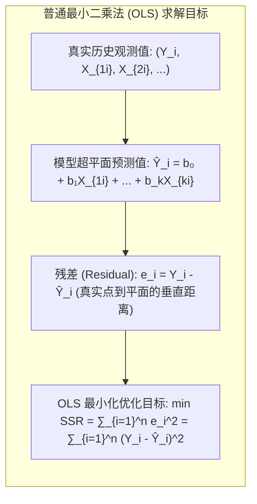
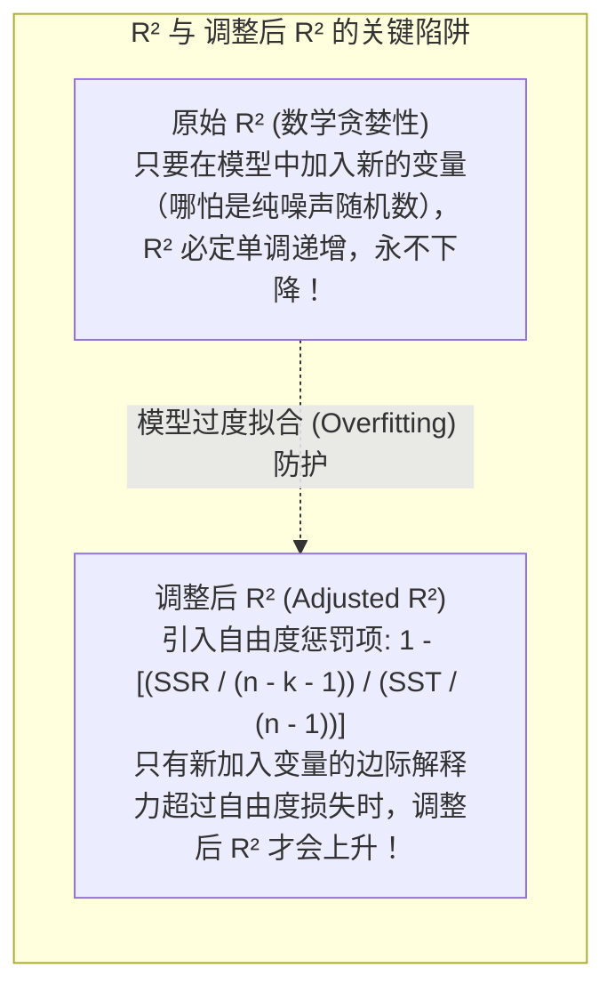
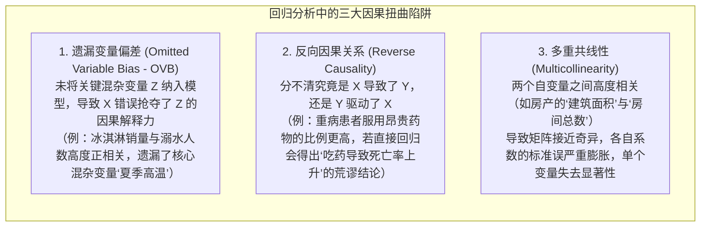

# Lec 13 多元线性回归分析与因果推断：从历史数据洞察商业驱动力

> MIT 15.063 / 15.276 · Communicating with Data · 模块十三：多元统计回归与实证因果建模

## TL;DR

- 线性回归（Linear Regression）是将海量历史观测数据提炼为具有解释力与预测力的量化函数因果关系的核心计量经济学工具。
- 普通最小二乘法（OLS）通过最小化残差平方和（SSR）求解最优拟合超平面，为每个自变量剥离其他变量影响后的“边际贡献（Marginal Effect）”。
- 严格辨析判定系数 $R^2$ 与调整后 $R^2$（Adjusted $R^2$）的统计内涵：$R^2$ 仅度量模型对因变量方差的解释比例，绝不直接代表模型的有效性或因果真实性。
- 掌握系数假设检验中的 $t$ 统计量与 $p$ 值：明确区分“统计显著性（Statistical Significance）”与“商业/经济实质意义（Economic Significance）”。
- 严防内生性偏差、遗漏变量偏差（OVB）与多重共线性（Multicollinearity），恪守“相关性绝不等于因果性”的科学红线。

## 普通最小二乘法（OLS）的数理几何哲学

多元线性回归模型假设因变量（Dependent Variable）$Y$ 与一组自变量（Independent Variables）$X_1, X_2, \dots, X_k$ 之间存在线性关系，并伴随不可观测的随机扰动项 $\epsilon$：

$$Y = \beta_0 + \beta_1 X_1 + \beta_2 X_2 + \dots + \beta_k X_k + \epsilon$$

::: definition 回归系数的边际解释 (Ceteris Paribus)
在多元回归中，系数 $\beta_j$ 的经济学含义是：**在控制模型中所有其他自变量保持严格不变（All Else Being Equal / Ceteris Paribus）的前提下**，自变量 $X_j$ 每增加 1 个单位，因变量 $Y$ 的期望变化量为 $\beta_j$ 个单位。
:::

## 拟合优度：判定系数 $R^2$ 与调整后 $R^2$

总变差平方和（SST）可以被正交分解为两部分：
$$\text{SST} = \text{SSR} + \text{SSE}$$
$$\sum (Y_i - \bar{Y})^2 = \sum (e_i)^2 + \sum (\hat{Y}_i - \bar{Y})^2$$
其中 SST 为因变量总波动，SSR 为未被模型解释的残差方差，SSE 为被模型解释的回归方差。

::: definition 判定系数 (R-Squared)
模型所解释的方差变动占因变量总方差的百分比：
$$R^2 = \frac{\text{SSE}}{\text{SST}} = 1 - \frac{\text{SSR}}{\text{SST}}, \quad 0 \le R^2 \le 1.0$$
:::

## 统计推断与系数显著性检验（$t$ 检验与 $p$ 值）

在商业报表中，高管面对回归软件输出的大段参数表，核心应审查三列数据：

| 变量名称 | 估计系数 (Coeff) | 标准误 (Std Error) | $t$ 统计量 ($t$-Stat) | $p$ 值 ($P > |t|$) | 业务决策解读 |
|---|---|---|---|---|---|
| **截距项 (Intercept)** | 12.450 | 2.150 | 5.79 | < 0.0001 | 基础底线水平。 |
| **广告投放额 ($X_1$)** | +0.485 | 0.092 | 5.27 | < 0.0001 | 极度显著正相关（$p < 0.01$）。广告每追加 1 万美元，销售额增加 0.485 万美元。 |
| **竞品价格指数 ($X_2$)** | -1.230 | 0.410 | -3.00 | 0.0035 | 高度显著负相关。竞品降价对本品具有显著抑制效应。 |
| **周二温度 ($X_3$)** | +0.012 | 0.085 | 0.14 | **0.8880** | **统计不显著（$p \gg 0.05$）**。无任何证据表明温度对产品销售产生系统性影响，该变量应从模型中剔除！ |

::: definition p 值的统计真谛 (The p-value Meaning)
在零假设 $H_0: \beta_j = 0$（即该变量对目标毫无实际影响）成立的假定前提下，由于抽样纯粹随机运气，偶然观测到当前这么大（或更大）估计系数的**极端概率**。
- 若 $p < 0.05$，代表在零假设下这是一个极其罕见的“二十里挑一”异常事件，因此我们有足够把握拒绝零假设，认定该变量具有**统计显著性**。
:::

## 商业因果推断的三大深渊陷阱

统计回归只是在数学上寻找变量之间的共变相关性，**它本身永远无法直接证明因果关系（Correlation $\neq$ Causation）**。在商业分析实践中，最容易诱导管理层做出荒谬战略决策的，就是把表面上的统计相关误当成了真实的因果杠杆。

从纯粹的统计公式出发，OLS 算法只负责在数学上计算使得误差平方和最小的切平面斜率，算法本身对业务变量之间的物理机制、时间先后顺序或制度因果关系完全盲目。如果不经过严密的经济学逻辑审视与计量检验，直接套用回归软件输出的结果，分析师极易跌入三大经典的因果扭曲深渊：

要破除这三大深渊，分析团队必须超越纯粹的数据表，建立计量因果推断（Causal Inference）意识。通过引入准自然实验（Natural Experiments）、双重差分法（Difference-in-Differences, DID）、工具变量（Instrumental Variables）或严密的 A/B 测试对照组，控制未被观测的混杂因素，确保我们捕捉到的是真正的边际政策效果，而非外部环境共振留下的统计假象。

## 向非技术高管汇报回归模型的沟通艺术

数据科学家常犯的错误是在幻灯片上堆满矩阵公式、DW 检验值与残差正态 QQ 图。向高管沟通时必须做到三点翻译：

1. **翻译为弹性与具体商业货币（Elasticity & Impact）**：
   - *低效汇报*：“$X_1$ 的偏回归系数为 $0.035$，$t$ 值为 $4.2$。”
   - *高管汇报*：“模型测算显示，广告投放的弹性为 $0.35$——这意味着我们每增加 $10\%$ 的数字营销预算，将稳定带来大约 $3.5\%$ 的季度新增收入，年化增量净现金流约为 $\$420$ 万。”
2. **区分统计显著性与商业实质意义**：
   - 某个变量即使拥有 $p < 0.0001$ 的极强显著性，如果其回归系数小到可以忽略不计（如增加 100 万美元投资只能换来 2 美元的收入），它在商业上也是毫无投资价值的。
3. **坦诚披露预测适用边界（Extrapolation Hazard）**：
   - 严肃警示高管：线性模型仅在历史数据的局部取值范围内有效；绝不能将模型参数无节制外推到从未发生过的极端极端情境中。

## 我的理解

::: insight 回归分析是现实世界的“减法艺术”
很多没有受过严谨实证训练的人，在看待世界时倾向于把任何单次成功归功于眼前最耀眼的单一因素：“我们今年的营收翻了一倍，全靠那个爆款短视频广告！”

而多元线性回归，是人类理性为了对抗这种浅薄归因所发明的一门“精密的减法艺术”。

当你把宏观经济增速、行业季节性周期、竞品降价促销、渠道自然渗透率等所有干扰变量全部作为自变量放进模型，并求解 OLS 超平面时，回归算法正在冷酷地一层一层剥掉外界赋予的光环：

“剔除宏观大盘的自然增长；
剔除春节假期的季节性拉动；
剔除渠道铺设的物理扩张；
最后……留给那个短视频广告的真实独立贡献，究竟是多少？”

正是这种在统计上严守“其他条件不变（Ceteris Paribus）”的冷峻克制，才使得管理者能够在纷繁复杂的商业泡沫中，精准识别真正具有因果推动力的业务飞轮。
:::
