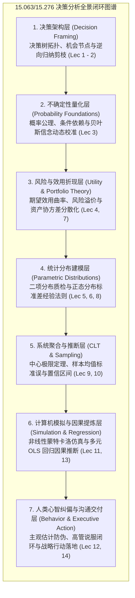
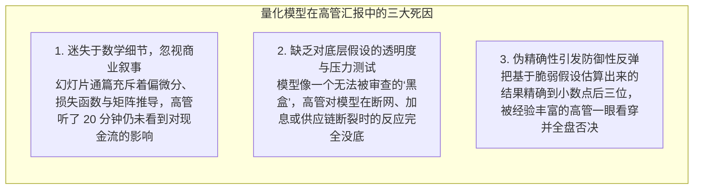
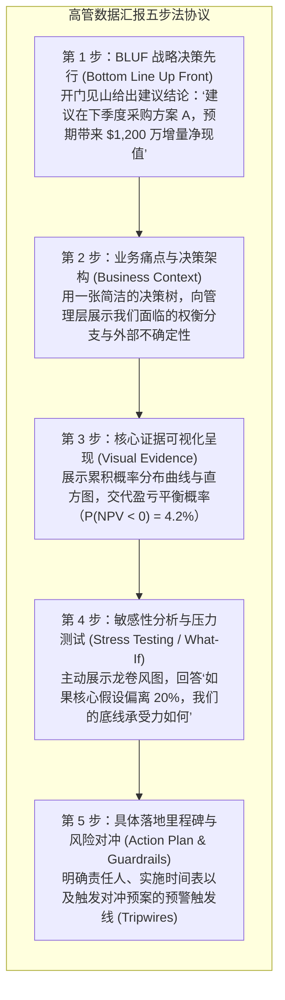

# Lec 14 量化决策综合汇报与管理沟通闭环：从数学模型到战略落地

> MIT 15.063 / 15.276 · Communicating with Data · 模块十四：全课程体系综合与数据说服闭环

## TL;DR

- 课程全景收敛：系统打通从“业务决策树架构 $\to$ 概率不确定性量化 $\to$ 风险效用折现 $\to$ 蒙特卡洛全景模拟 $\to$ 计量回归因果推断”的完整管理科学方法论链条。
- 破解量化汇报的终极死穴——“技术自恋陷阱”：高管在决策时最关心的永远不是算法的数学优美度，而是底层关键假设的稳健度与极端下行风险的兜底预案。
- 落地五步法高管数据汇报协议（BLUF 战略结论先行 $\to$ 业务痛点架构 $\to$ 核心证据可视化 $\to$ 敏感性与压力测试 $\to$ 落地行动路线图）。
- 确立数据治理与模型伦理规范：透明承认模型的认知边界与未知盲区，实现从“提供冰冷计算的分析员”向“共担商业风险的战略合伙人”的关键跃迁。

## 15.063 / 15.276 全课程数理决策知识图谱

回顾整门课程，我们并非孤立地学习几门互不相干的数学工具，而是沿着商业决策的生命周期，构建了一套环环相扣的**不确定性驾驭系统**。

在真实的商业世界中，管理者面对的挑战从来不是像教科书习题那样清晰分类好的。一个新药研发项目的启动，首先需要用决策树梳理多阶段审批与临床试验的逻辑分支；在评估试验通过率时，需要借助贝叶斯公式结合早期样本修正先验概率；在面临数亿美元投资时，需要借助冯·诺依曼效用函数计算企业的风险容忍度；在预测投产后的市场需求波动时，需要调用二项与正态连续分布；而在评估全球供应链并发瓶颈时，又必须借助蒙特卡洛多变量模拟；最后，通过历史销售回归提取驱动因子。

如果在分析过程中缺少了任何一个环节，整个决策链条就会出现脆弱的致命断层：缺少了决策树，就会迷失在无序的未来分支中；缺少了效用函数，就会忽视企业可能遭遇的毁灭性破产风险；缺少了蒙特卡洛模拟，就会被表面的平均值欺骗；而缺少了因果回归，就会把外部环境的偶然扰动误当成战略成果。

这种跨越不同数理工具的系统整合能力，正是 MIT Sloan 所强调的“以数据沟通决策”的核心胜任力图谱：

从第 1 讲到第 14 讲，七大核心层级由浅入深，形成了一座坚不可摧的逻辑金字塔。模型是中枢骨架，概率是不确定性度量语言，而对人类认知偏见的警惕与高管沟通协议，则是确保模型在现实组织土壤中生根发芽的最终保障。掌握了这套系统，管理者就能在任何复杂市场与技术变局面前，从容实现从被动响应到主动塑局的战略跃迁。

## 为什么绝大多数优秀的量化模型会在董事会折戟沉沙？

在企业实践中，无数耗资数百万美元构建的优秀算法或运筹优化模型，最终被管理层束之高阁。MIT Sloan 的长期调研揭示了三大核心死因：

::: definition 决策模型的本质 (George Box's Axiom)
“所有模型本质上都是错的，但其中有一部分是有用的（All models are wrong, but some are useful）。”
量化模型的目的绝非完美复刻混沌的物理现实，而是为管理者提供一个**在不确定性下进行结构化辩论与权衡比较的心智支架**。
:::

## 高管数据沟通五步法协议（The Executive Data Protocol）

向最高执行委员会汇报复杂的量化建模成果时，必须严格执行五阶段高信噪比沟通协议：

### 汇报实战：从被动防守到主动引导

| 传统低效的技术汇报话术 | 专业高管沟通话术示范 |
|---|---|
| “我们运行了 5 万次 Monte Carlo 抽样，调整后 R-squared 达到了 0.82，回归系数的 p 值全部小于 0.01。” | “模型量化分析表明，在考虑了宏观通胀与原材料波动的数万种情境后，该方案有 **$94\%$ 的高概率** 实现年化 $15\%$ 以上的投资回报率。” |
| “这个项目的预期净现值是 $\$1,438,291.42$ 美元。” | “基准情境下的预期回报约为 $\$1,400$ 万；在极端恶劣情况下，最坏亏损被锁定在 $\$200$ 万以内，完全处于企业风险容忍度 $R$ 的安全边界内。” |
| “数据表明我们的方案绝对没有任何风险。” | “该模型最脆弱的核心假设是第四季度的供应链履约率。如果该指标跌破 $80\%$，我们将触发备用物流预案。我们为此预留了 15 万美元的保险对冲基金。” |

## 我的理解

::: insight 从“算力提供者”到“风险共担者”的成人礼
在数据科学与商业分析的职业生涯中，几乎每个人都会经历两个境界的蜕变：

- **第一重境界是“工具人阶段”**：
  沉迷于掌握复杂的数学工具，渴望向所有人展示自己会解微分方程、会调超参数、能写出别人看不懂的复杂代码。这个阶段的分析师，骨子里是逃避商业责任的——一旦方案落地失败，他们会本能地推诿：“我的模型数学上是完全严密的，是你们业务团队执行不到位。”

- **第二重境界是“战略合伙人阶段”**：
  他们不再迷信任何单一工具。他们懂得用最质朴、最清晰的商业语言，把极其复杂的概率推导翻译为高管能够听懂的抉择。更重要的是，他们敢于在关键决策节点上，把自己的职业信誉与模型结论绑定在一起：
  “先生们，基于我们对过去三年数据的协方差分析与压力测试，我不仅为这个模型的逻辑负责，我更建议我们今天就启动这项投资。如果发生我们预判的最坏情境，我愿意亲自负责前线的应急对冲方案。”

当你从“站在模型背后推卸责任”，转变为“站在模型前面为组织分担风险”时，你就完成了从一名普通分析师向真正商业领袖的伟大飞跃。
:::
