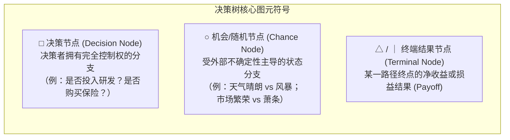
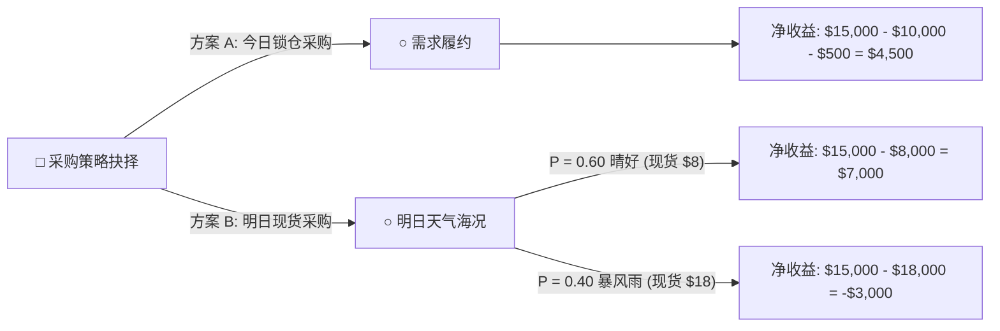

# Lec 2 决策分析与决策树模型：肯德尔龙虾案例

> MIT 15.063 / 15.276 · Communicating with Data · 模块二：决策树与动态决策分析

## TL;DR

- 决策树（Decision Tree）是将多阶段不确定性商业抉择转化为可视化逻辑拓扑的核心工具，按时间由左至右展开。
- 区分方框代表的“决策节点（Decision Nodes）”与圆形代表的“随机事件节点（Chance Nodes）”，遵循互斥完备（MECE）原则。
- 逆向归纳回溯法（Rollback Method）：从最右端终端收益出发，由右向左倒推计算机会节点的期望货币价值（EMV），在决策节点择优剪枝。
- 掌握完全信息价值（EVPI）与样本信息价值（EVSI）测算框架，量化企业购买外部市场调研与气象预警的最大支付意愿。

## 决策树的基本拓扑语法

面对包含未来多阶段随机事件的复杂商业投资（如新药研发上市、油田勘探钻井、供应链大宗采购），大脑的短期工作记忆极易因分支爆炸而瘫痪。决策树通过标准几何符号建立了一套通用的决策语法：

::: definition 互斥且穷尽原则 (MECE in Decision Trees)
在任何一个机会节点分支上，所列出的所有可能状态必须满足相互排斥且整体穷尽；所有出射分支的概率之和必须严格等于 1：
$$\sum_{i=1}^{n} P(S_i) = 1.0, \quad \forall i \neq j: S_i \cap S_j = \emptyset$$
:::

## 肯德尔龙虾案例（Kendall Crab and Lobster Case）

肯德尔海鲜分销公司面临一个典型的动态供应链抉择：明日有一场重要的客户宴请，必须在今日决定是否提前从缅因州捕鱼船队锁仓订购大量高品质活龙虾。

### 商业情境参数设定
1. **今日采购决策**：
   - **方案 A（锁定采购）**：以固定批发价 $\$10/\text{lb}$ 采购 1,000 磅活龙虾，需额外支付冷链仓储维护费 $\$500$。
   - **方案 B（等待明日现货）**：明日根据海况在现货市场即时采购。
2. **明日外部天气不确定性（机会节点）**：
   - 气象台预报明日有 $40\%$ 概率出现暴风雨（Storm），$60\%$ 概率海况晴好（Fair）。
   - **若出现暴风雨**：渔船无法出海，现货市场供给暴跌，龙虾价格将暴涨至 $\$18/\text{lb}$。
   - **若海况晴好**：捕捞丰收，现货价格将下跌至 $\$8/\text{lb}$。
3. **终端销售价格**：无论采购成本如何，向终端高档餐厅交付的协议零售价恒定为 $\$15/\text{lb}$（总收入为 $\$15,000$）。

## 逆向归纳回溯法（The Rollback Method）

计算最优策略必须从决策树最右端的终端节点向左逆推：

### 第一步：计算机会节点期望值（Expected Monetary Value, EMV）
对于方案 B 的机会节点 $C_2$：
$$\text{EMV}(C_2) = (0.60 \times \$7,000) + (0.40 \times -\$3,000) = \$4,200 - \$1,200 = \$3,000$$

### 第二步：在决策节点进行价值比较与剪枝
- 方案 A 的确定性净收益：$\$4,500$
- 方案 B 的期望净收益：$\$3,000$
- **决策结论**：
  $$\max(\text{EMV}_A, \text{EMV}_B) = \max(\$4,500, \$3,000) = \$4,500$$
  决策者应当选择**方案 A（今日提前锁仓）**，剪掉方案 B 的分支。

## 完全信息价值（EVPI）与信息购买上限

假设此时有一家顶级海洋遥感气象咨询公司宣称，他们拥有一套高精度军用卫星预测系统，能在今日清晨**百分之百准确预测明日是否发生暴风雨**。肯德尔公司最多愿意支付多少咨询费？

::: definition 完全信息价值 (Expected Value of Perfect Information, EVPI)
决策者在拥有预知未来随机事件的“水晶球”情境下的期望收益，与在当前无信息状态下的基准最优期望收益之间的绝对增量：
$$\text{EVPI} = \text{EMV}_{\text{with Perfect Information}} - \text{EMV}_{\text{without Information}}$$
:::

### EVPI 测算推演：
1. **若拥有完全信息**：
   - 卫星预测“暴风雨”（概率 $40\%$）：已知现货价格将暴涨至 $\$18$，今日提前锁仓，获利 $\$4,500$。
   - 卫星预测“晴好”（概率 $60\%$）：已知现货价格将跌至 $\$8$，明日现货采购，获利 $\$7,000$。
   - 完全信息下的期望值：
     $$\text{EMV}_{\text{PI}} = (0.40 \times \$4,500) + (0.60 \times \$7,000) = \$1,800 + \$4,200 = \$6,000$$
2. **计算 EVPI**：
   $$\text{EVPI} = \$6,000 - \$4,500 = \$1,500$$
3. **商业决策启示**：任何收费超过 $\$1,500$ 的天气咨询服务都必须坚决拒绝，因为该服务带来的信息价值上限就是 $\$1,500$。

## 我的理解

::: insight 决策树是打破组织内部“马后炮文化”的解药
在许多企业的年终复盘会上，最常见的恶劣现象是“事后诸葛亮（Hindsight Bias）”：
一旦项目出了问题，旁观者就会跳出来指责：“我早就知道天气会变坏，当初为什么不锁仓？”或者当某个高风险下注偶然获利时，大家便对其过程中的巨大破产风险视而不见。

决策树最大的管理价值，不是最终算出的那几个美元数字，而是它在组织内部确立了**“决策起跑线透明机制”**。

在项目启动的那一天，所有决策者坐在一起，把当时的全部事实分支、我们所假定的客观概率（$60\%$ vs $40\%$）、以及各分支的可能损益白纸黑字画在树上并签字归档。

这棵树冻结了当时的信息状态。未来哪怕小概率风暴真的发生了，团队也能心平气和地复盘：“当时基于 $40\%$ 的风暴概率，我们的决策在数学和商业逻辑上是完全最优的，这是概率世界的合理波动，而非管理渎职。”

只有拆除了“马后炮”的人身威胁，技术团队才敢于在未来做出大胆且理性的创新探索。
:::
