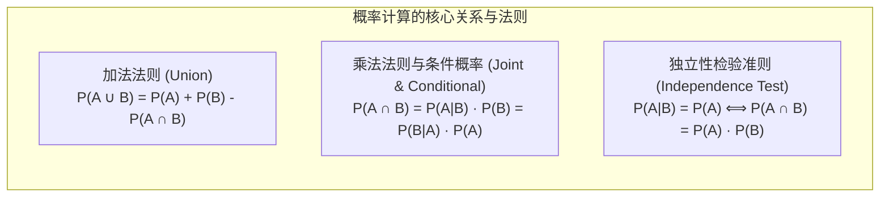
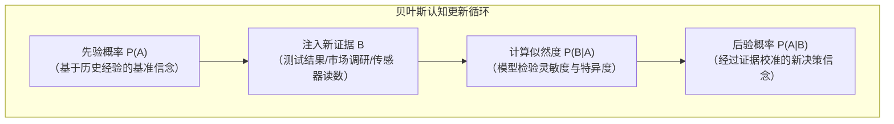

# Lec 3 概率基本法则与贝叶斯推断：从先验信念到后验决策

> MIT 15.063 / 15.276 · Communicating with Data · 模块三：概率基础与贝叶斯更新

## TL;DR

- 概率是量化商业世界未知风险的唯一样本空间语言，涵盖先验信念、条件依赖与联合分布三大基石。
- 严格辨析“互斥（Mutually Exclusive）”与“独立（Independent）”的本质差异：互斥事件之间存在强相关性，绝不可能相互独立。
- 掌握全概率公式与贝叶斯定理（Bayes' Rule），建立从“先验概率”吸收新测试证据、动态更新为“后验概率”的科学推断链路。
- 剖析商业决策中最隐蔽的认知陷阱——基准率谬误（Base Rate Fallacy）：阐明高准确率的算法或医疗测试在极低发病率背景下，虚警率（False Alarm）仍旧极高的数理机理。

## 概率论三大公理与核心运算法则

所有现代统计模型与量化决策分析，均建立在柯尔莫哥洛夫（Kolmogorov）概率公理之上。在样本空间 $\Omega$ 中，对于任意随机事件 $A$ 与 $B$：

1. **非负性**：$0 \le P(A) \le 1$
2. **规范性**：$P(\Omega) = 1.0$
3. **加法法则（Addition Rule）**：
   $$P(A \cup B) = P(A) + P(B) - P(A \cap B)$$
   若 $A$ 与 $B$ 为互斥事件（即 $A \cap B = \emptyset$），则 $P(A \cup B) = P(A) + P(B)$。

::: pitfall 互斥与独立的混淆死穴 (Mutual Exclusivity vs. Independence)
这是商业分析中最常见的概念灾难：
- **互斥（Mutually Exclusive）**：如果事件 $A$ 发生，事件 $B$ **绝对不可能发生**（$A \cap B = \emptyset$）。这意味着 $A$ 的出现提供了关于 $B$ 的极大信息（$P(B|A) = 0$）。
- **独立（Independent）**：事件 $A$ 是否发生，对事件 $B$ 发生的概率**毫无影响**（$P(B|A) = P(B)$）。
- **推论**：如果两个非零概率事件是互斥的，它们**绝不可能是独立的**；反之，若两个事件独立，它们绝不可能互斥。
:::

## 条件概率与全概率公式

在商业动态环境中，几乎所有决策都处于“给定某项已知背景”的条件概率情境下：

::: definition 条件概率 (Conditional Probability)
在已知事件 $B$ 已经发生的先验约束下，事件 $A$ 发生的条件概率定义为联合概率与边缘概率之比：
$$P(A|B) = \frac{P(A \cap B)}{P(B)}, \quad \text{其中 } P(B) > 0$$
:::

### 全概率公式（The Law of Total Probability）
若事件集合 $\{A_1, A_2, \dots, A_n\}$ 构成了样本空间 $\Omega$ 的一个互斥完备分割（MECE Partition），则对于任何观察事件 $B$：
$$P(B) = \sum_{i=1}^{n} P(B \cap A_i) = \sum_{i=1}^{n} P(B|A_i) P(A_i)$$

## 贝叶斯定理：动态修正认知的心智算法

托马斯·贝叶斯（Thomas Bayes）提出的逆概率公式，是人类在面对新事实、新样本和新测试数据时，科学更新信念的终极数学武器：

$$\text{后验概率 } P(A_i|B) = \frac{P(B|A_i) P(A_i)}{\sum_{j=1}^{n} P(B|A_j) P(A_j)} = \frac{\text{似然度 } \times \text{ 先验概率}}{\text{证据边际概率}}$$

## 经典实战：欺诈检测与基准率谬误（Base Rate Fallacy）

假设一家金融科技银行部署了一套顶级 AI 反欺诈监测系统，用于审查信用卡线上交易：
1. **基础环境基准率（Base Rate）**：在真实交易流中，欺诈交易极其罕见，占比仅为 $P(\text{Fraud}) = 0.5\%$（即 $0.005$），合规交易占比 $P(\text{Normal}) = 99.5\%$（$0.995$）。
2. **AI 模型性能指标**：
   - **真阳性率 / 召回率（Sensitivity）**：若一笔交易确实是欺诈，模型报警的概率高达 $P(\text{Alert}|\text{Fraud}) = 98\%$。
   - **假阳性率 / 误报率（False Positive Rate）**：若一笔交易是正常合规的，模型误报警的概率仅为 $P(\text{Alert}|\text{Normal}) = 2\%$。

### 高管直觉陷阱：
当风控后台突然弹出一条红色预警报警时，业务主管下意识认为：“这套算法的准确率高达 $98\%$，误报率只有 $2\%$，所以这笔交易是真实欺诈的概率肯定在 $95\%$ 以上！”

### 贝叶斯严密计算：
我们需要求解 $P(\text{Fraud}|\text{Alert})$：
1. **计算全概率 $P(\text{Alert})$**：
   $$\begin{aligned}
   P(\text{Alert}) &= P(\text{Alert}|\text{Fraud})P(\text{Fraud}) + P(\text{Alert}|\text{Normal})P(\text{Normal}) \\
   &= (0.98 \times 0.005) + (0.02 \times 0.995) \\
   &= 0.0049 + 0.0199 = 0.0248 \quad (2.48\%)
   \end{aligned}$$
2. **应用贝叶斯公式求解后验概率**：
   $$P(\text{Fraud}|\text{Alert}) = \frac{0.0049}{0.0248} \approx 0.1976 \quad (\approx 19.8\%)$$

::: insight 震撼的管理学启示
哪怕这套 AI 算法的召回率高达 $98\%$、假阳性率只有极低的 $2\%$，**一旦系统报警，该笔交易真实为欺诈的概率也仅有区区 $19.8\%$！超过 $80\%$ 的报警全都是误报！**

造成这种反直觉现象的根本原因就在于**极其庞大的正常交易基准率（Base Rate）**。$99.5\%$ 的正常交易基座即使产生微小的 $2\%$ 误判，其绝对误报数量（$0.0199$）也数倍于真实欺诈的总量（$0.0049$）。如果银行因为报警就直接冻结客户账户，将导致极其严重的客户投诉与业务瘫痪。
:::

## 我的理解

::: insight 贝叶斯思维是对抗教条主义的最高理性
在商业管理中，人们往往走入两个极端：
- 一派是**狂妄的教条主义者**：他们死抱过去的经验或个人直觉，对外部出现的新数据、新反馈视而不见，认为“市场数据一定是有噪声的，我的直觉绝不会错”；
- 另一派是**随风倒的机会主义者**：没有任何底层信念和原则，只要看到今天的一篇新闻或一次小样本测试波动，就立刻惊慌失措地推翻所有既定战略。

贝叶斯推断为现代管理者提供了一种极其优雅的中道智慧：

先验概率代表你对历史经验与商业规律的审慎沉淀；而贝叶斯更新规则，则是你拥抱新事实时的谦逊纪律。

它告诉你：面对新证据，你应当改变观点，但改变的幅度必须严格取决于**证据本身的信噪比（Likelihood Ratio）**以及**先验假定的坚固程度（Base Rate Weight）**。

正如凯恩斯那句名言：“当事实发生改变时，我会改变我的想法。您呢，先生？”这就是贝叶斯理性带给商业世界的终身修炼。
:::
