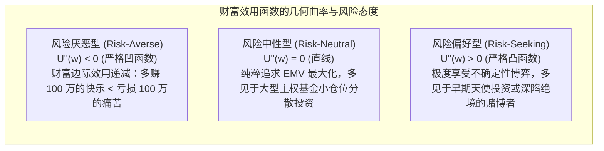
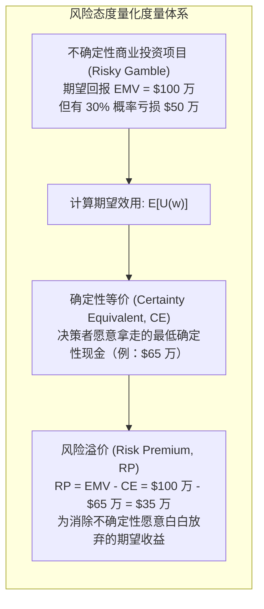

# Lec 4 效用理论与风险偏好：期望值与期望效用

> MIT 15.063 / 15.276 · Communicating with Data · 模块四：风险态度与冯·诺依曼效用理论

## TL;DR

- 期望货币价值（EMV）仅适用于小额、可重复且对资本金无致命冲击的常规中性决策；在面对重大下行破产风险时，EMV 彻底失效。
- 圣彼得堡悖论催生了期望效用理论（Expected Utility Theory）：金钱的边际效用递减，人们追逐的是主观效用的期望值而非名义金额。
- 风险偏好的三大几何形态：凹函数代表风险厌恶（Risk-Averse），线形代表风险中性（Risk-Neutral），凸函数代表风险偏好（Risk-Seeking）。
- 确定性等价（CE）与风险溢价（RP = EMV - CE）定量刻画了企业为规避未知商业动荡所愿意付出的实际代价与保险购买基准。

## 期望货币价值（EMV）的局限与圣彼得堡悖论

在 [Lec 2](./lec2.md) 中，我们利用期望货币价值（EMV）最大化准则做出了采购决策。然而，数学家丹尼尔·伯努利（Daniel Bernoulli）早在 1738 年就提出了著名的**圣彼得堡悖论（St. Petersburg Paradox）**：

::: definition 圣彼得堡博弈
连续抛掷一枚均匀硬币，如果第一次出现正面，游戏结束，获得奖励 $\$2$；如果第二次才出现正面，获得 $\$4$；如果在第 $n$ 次才首次出现正面，获得 $\$2^n$。请问：你愿意为参与这场游戏支付多少入场费？
:::

按照经典 EMV 计算：
$$\text{EMV} = \sum_{n=1}^{\infty} \left(\frac{1}{2}\right)^n \times 2^n = \sum_{n=1}^{\infty} 1 = 1 + 1 + 1 + \cdots = +\infty$$
该博弈的期望收益是**无穷大**！但现实中，即使是全球最富有的亿万富翁，也不会愿意为此游戏支付哪怕 $\$100$ 的入场门票。这无可辩驳地证明：**人类大脑对财富风险的评估，绝非基于名义金钱的线性相加**。

## 冯·诺依曼-摩根斯坦期望效用理论（vNM Utility）

冯·诺依曼（John von Neumann）与摩根斯坦（Oskar Morgenstern）在博弈论奠基著作中证明：在满足完备性、传递性、连续性与独立性公理的前提下，必然存在一个实数效用函数 $U(w)$，使决策者的最优选择等价于**最大化期望效用（Expected Utility, EU）**：

$$\max \mathbb{E}[U(\tilde{w})] = \sum_{i} P_i \cdot U(w_i)$$

## 确定性等价（CE）与风险溢价（RP）

为了将抽象的效用值换算为高管易于理解的美元金额，决策科学引入了两个核心金融量化指标：

::: definition 确定性等价 (Certainty Equivalent, CE)
决策者面对某项充满随机波动的不确定性商业资产或博弈时，认为其与某一确定的、无风险的固定现金回报“完全等价（无差异）”的该固定金额：
$$U(\text{CE}) = \mathbb{E}[U(\tilde{w})]$$
:::

::: definition 风险溢价 (Risk Premium, RP)
期望货币价值与确定性等价之间的绝对差额。对于风险厌恶型决策者，其风险溢价恒大于零（$RP > 0$），代表其为了睡个好觉所愿意承担的“风险折价”：
$$\text{RP} = \text{EMV} - \text{CE}$$
:::

## 企业级指数效用函数与风险容忍度参数 $R$

在商业实践中，最常用的企业效用函数是**负指数效用函数（Exponential Utility）**：

$$U(x) = 1 - e^{-x / R}$$

其中参数 $R$（Risk Tolerance）代表企业的**风险容忍度常数**（具有美元货币量纲）：
- **$R$ 的经验法则估算**：著名决策学者 Ronald Howard 指出，一家健康运营的企业，其风险容忍度参数 $R$ 通常大约等于其**年销售净利润的 $6\%$ 左右**，或者年营业收入的 $1\%–2\%$。
- **管理应用意义**：一旦企业董事会校准并确立了自身的 $R$ 参数，任何投资金额在 $R$ 数量级之内的创新项目，均可直接利用该数学公式计算其确定性等价 $CE$，彻底终结管理层主观拍脑袋的无休止争论。

## 我的理解

::: insight 企业的风险偏好是其资本负债表与生命周期的函数
在很多企业中，高管们常常在会议室里争论：“我们到底应该进取还是保守？”有人指责保守者“缺乏创业狼性”，有人批评进取者“赌徒心态”。这种基于性格的争吵毫无意义。

效用理论告诉我们：**任何主体的风险厌恶程度，本质上是其破产临界点（Ruin Barrier）与当前流动性储备的客观函数**。

- 当一家初创企业银行账户里只剩足够发两个月工资的 50 万美元时，一个“有 50% 概率赚 1000 万，但有 50% 概率亏 60 万”的项目就是致命毒药——因为哪怕期望收益高达 470 万，那 50% 的亏损也会直接触发破产清算；
- 但对于账上躺着 200 亿自由现金流的微软或苹果而言，同样的 60 万亏损仅仅是四舍五入的浮云，它们完全可以以纯粹的风险中性（Risk-Neutral）姿态捕捉其巨大的正期望值。

成熟的管理者绝不盲目谈论风险偏好。在决定冒险之前，永远先看一眼资产负债表底部的生命线：“这个最坏情境会把我们彻底踢出牌桌吗？”如果答案是否定的，勇敢地追逐期望收益；如果答案是肯定的，再高的利润率也是诱人上吊的绳索。
:::
