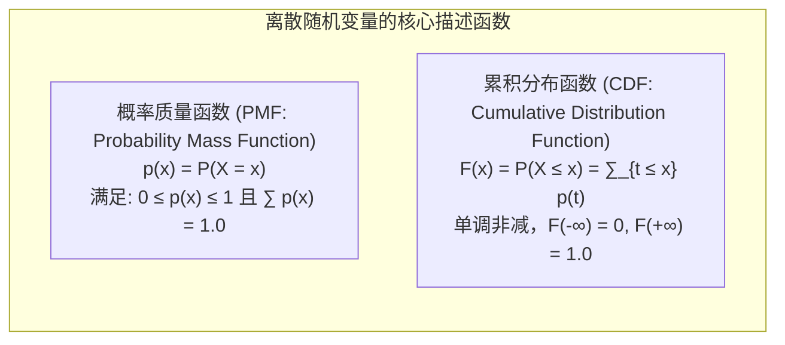
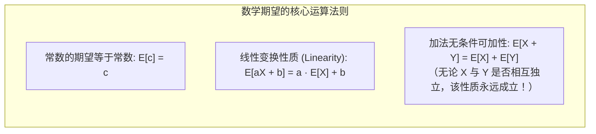

# Lec 5 离散概率分布与随机变量期望方差：波动性与商业度量

> MIT 15.063 / 15.276 · Communicating with Data · 模块五：随机变量与矩的数理度量

## TL;DR

- 随机变量（Random Variable）是将复杂的现实商业世界随机结果映射为严密数学实数的抽象桥梁。
- 概率质量函数（PMF）与累积分布函数（CDF）分别刻画了离散商业事件的“点概率”与“区间尾部风险”。
- 数学期望 $\mathbb{E}[X]$ 度量了大量重复运营情境下的长期平均回报，具有极其优美的线性性质（Linearity of Expectation）。
- 方差 $\text{Var}(X)$ 与标准差 $\sigma$ 定量度量了商业收益的波动性与不确定性风险，平移操作不改变波动，缩放操作按平方倍数放大方差。

## 随机变量与离散概率分布的数学刻画

在商业语境中，“明日进店客流量”、“某批次服务器故障数”、“下个季度的新增签约客户数”都无法用固定数值预先确定。为了进行数理建模，统计学引入了**随机变量（Random Variable, RV）**：

::: definition 离散型随机变量 (Discrete Random Variable)
定义在样本空间 $\Omega$ 上的实值函数 $X: \Omega \to \mathbb{R}$，其所有可能取值的集合是一个有限集或可数无穷集 $\{x_1, x_2, \dots, x_n, \dots\}$。
:::

### 商业应用中的 CDF 威力：破产与缺货概率
在评估供应链库存与流动性风险时，管理层往往不关心某一个精确孤立数值的概率，而是高度关心**尾部累积风险**：
- **缺货概率（Stockout Risk）**：若库存上限为 $K$，则缺货概率即为右侧尾部 $P(X > K) = 1 - F(K)$。
- **服务水平（Service Level）**：企业常设定的“$95\%$ 履约率”，即寻找最小的库存量 $K$ 使得 $F(K) \ge 0.95$。

## 数学期望：一阶矩与中心趋势度量

数学期望（Expected Value / Mean）代表了随机变量取值的概率加权中心：

$$\mu = \mathbb{E}[X] = \sum_{i} x_i \cdot p(x_i)$$

::: example 线性期望在零售毛利分析中的应用
某数码零售商下周的笔记本电脑销量为随机变量 $X$，预期均值 $\mathbb{E}[X] = 50$ 台。每台电脑的售价为 $\$1,200$，进货成本为 $\$800$，每周固定店面租金支出为 $\$5,000$。
问：下周的预期净利润 $\mathbb{E}[\text{Profit}]$ 是多少？
- 利润函数：$\text{Profit} = (1200 - 800)X - 5000 = 400X - 5000$
- 应用线性期望：
  $$\mathbb{E}[\text{Profit}] = 400 \cdot \mathbb{E}[X] - 5000 = 400 \times 50 - 5000 = \$20,000 - \$5,000 = \$15,000$$
  管理者无需知道销量的具体分布形态，仅凭均值即可瞬时得出预期净利！
:::

## 方差与标准差：二阶矩与波动性风险度量

仅有期望值无法完整描述商业风险——一个平均回报 100 万但波动在 0 到 200 万的项目，与一个平均回报 100 万且波动在 95 到 105 万的项目，具有截然不同的风险画像。

::: definition 方差与标准差 (Variance & Standard Deviation)
方差度量了随机变量与其均值之间的平均离散平方程度；标准差是方差的算术平方根，具有与随机变量完全相同的物理或货币量纲：
$$\sigma^2 = \text{Var}(X) = \mathbb{E}\left[(X - \mu)^2\right] = \sum_{i} (x_i - \mu)^2 p(x_i) = \mathbb{E}[X^2] - (\mathbb{E}[X])^2$$
$$\sigma = \text{SD}(X) = \sqrt{\text{Var}(X)}$$
:::

### 方差的代数运算法则与管理内涵

1. **常数平移不改变波动（Shift Invariance）**：
   $$\text{Var}(X + c) = \text{Var}(X)$$
   *管理内涵*：给全员增加一笔固定的底薪 $\$3,000$，全公司的薪酬波动性（方差）完全不变，因为所有人的薪酬被刚性同步抬升。
2. **比例缩放呈平方倍数放大（Scaling Quadratic Property）**：
   $$\text{Var}(aX) = a^2 \text{Var}(X) \implies \text{SD}(aX) = |a| \cdot \text{SD}(X)$$
   *管理内涵*：若通过 2 倍杠杆放大投资标的规模（$a = 2$），投资收益的方差将暴增至原来的 4 倍（标准差变为 2 倍）。

## 离散随机变量的变异系数（CV）

在跨项目、跨部门横向对比风险时，单纯比较标准差是不公允的（年营收 100 亿的大型事业部，其标准差自然远大于营收 1000 万的创新小组）：

::: definition 变异系数 (Coefficient of Variation, CV)
无量纲的相对风险度量指标，代表“每承担一单位均值收益，需要承受多少单位的波动风险”：
$$\text{CV} = \frac{\sigma}{|\mu|} = \frac{\text{Standard Deviation}}{\text{Mean}}$$
:::

## 我的理解

::: insight 均值是幻觉，方差才是生活的真实质感
在商业汇报中，最常见的沟通麻醉剂就是“平均数（Average）”。

项目经理会向高管汇报：“我们系统的平均响应时间只有 200 毫秒；”物流主管会报告：“包裹的平均配送时效是 1.8 天。”

然而，统计学泰斗阿诺德·沃斯（Arthur Conan Doyle 笔下神探的原型之一）曾指出：“一个身高一米八的人，淹死在一条平均深度只有半米宽的河里。”

在真实商业世界中，**摧毁用户口碑与造成客户退款的，从来不是均值，而是方差与极端长尾**：
- 用户不会因为系统在 99 次访问中都是 200ms 而欣喜若狂；
- 用户只会在第 100 次结账时遭遇了 15 秒卡死而愤怒卸载 App。

卓越的数据管理者在看报表时，视线永远第一时间跳过均值，直接审视方差、P99 峰值与变异系数。管理方差、平抑波动、消灭长尾异常，这才是商业运营工程学最深厚的功力。
:::
