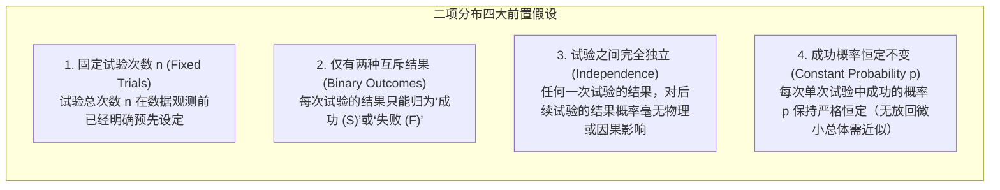
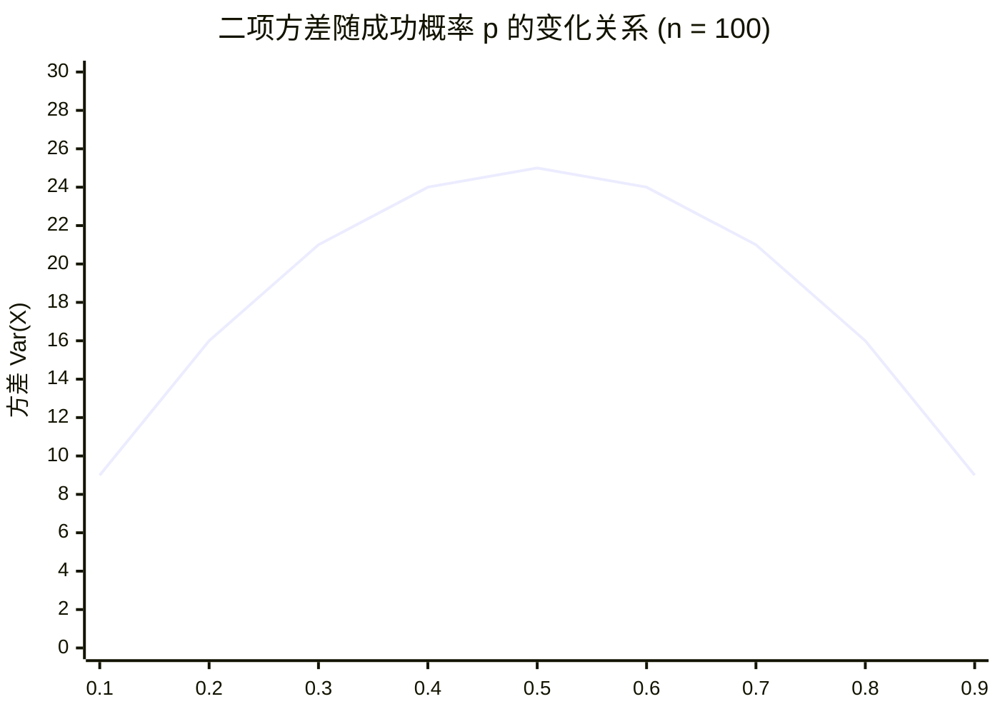
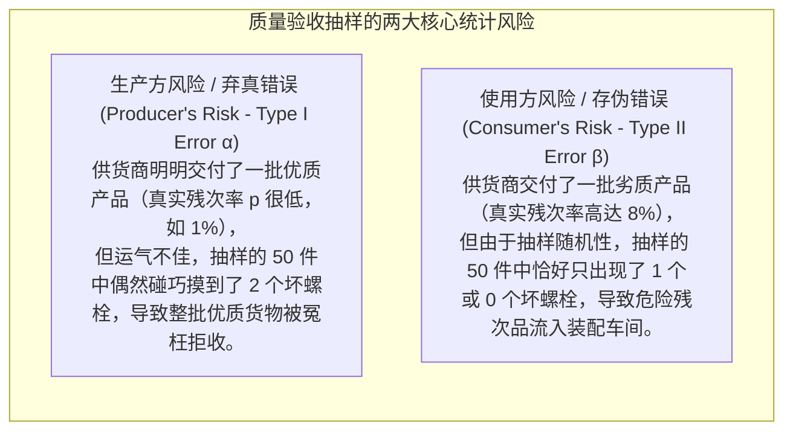

# Lec 6 二项分布与质量抽样控制：伯努利试验与批次验收

> MIT 15.063 / 15.276 · Communicating with Data · 模块六：二项过程与工业质检抽样

## TL;DR

- 伯努利过程（Bernoulli Process）是刻画商业与工业生产中“二元对立状态（成功/失败、合格/残次、转化/流失）”的基石模型。
- 二项分布 $X \sim B(n, p)$ 描述了在 $n$ 次独立同分布试验中恰好观察到 $k$ 次目标事件的精确组合概率。
- 二项分布的数学期望与方差推导：$\mathbb{E}[X] = np$，$\text{Var}(X) = np(1-p)$，方差在 $p = 0.5$ 时达到最大值，在极低或极高概率下收敛收紧。
- 掌握工业验收抽样检验（Acceptance Sampling）与统计过程控制（SPC）：严格量化生产方风险 $\alpha$（弃真风险）与使用方风险 $\beta$（存伪风险）。

## 伯努利试验与二项过程的四大前置公理

在半导体芯片晶圆制造、流水线装配检验、以及电商点击率（CTR）统计中，基础事件均表现为“非此即彼”的二元特征。一个标准的**二项试验（Binomial Experiment）**必须严格满足以下四大条件：

::: definition 二项分布概率质量函数 (Binomial PMF)
设随机变量 $X$ 表示在参数为 $n$ 和 $p$ 的二项过程中成功的总次数，则 $X \sim B(n, p)$，其在 $k \in \{0, 1, \dots, n\}$ 处的概率为：
$$P(X = k) = \binom{n}{k} p^k (1-p)^{n-k} = \frac{n!}{k!(n-k)!} p^k (1-p)^{n-k}$$
:::

## 期望与方差的理论推导与几何直觉

由于二项变量可以看作 $n$ 个相互独立的单次伯努利指示变量之和：$X = \sum_{i=1}^n I_i$，其中 $P(I_i = 1) = p$，$P(I_i = 0) = 1-p$。

1. **数学期望**：
   $$\mathbb{E}[I_i] = 1 \times p + 0 \times (1-p) = p \implies \mathbb{E}[X] = \sum_{i=1}^n \mathbb{E}[I_i] = np$$
2. **方差推导**：
   $$\text{Var}(I_i) = \mathbb{E}[I_i^2] - (\mathbb{E}[I_i])^2 = p - p^2 = p(1-p)$$
   由于试验相互独立，协方差为零，方差可直接累加：
   $$\text{Var}(X) = \sum_{i=1}^n \text{Var}(I_i) = np(1-p)$$
   $$\sigma = \text{SD}(X) = \sqrt{np(1-p)}$$

::: insight 方差对称性与预测确定性
二项分布的方差函数 $f(p) = p(1-p)$ 是一条关于 $p = 0.5$ 严格对称的抛物线：
- **最大不确定性**：当 $p = 0.5$（如掷硬币、势均力敌的两党选举）时，系统方差达到理论峰值 $\frac{n}{4}$，预测最不可控。
- **高确定性收敛**：在现代六西格玛（Six Sigma）质量管理中，芯片缺陷率通常在 $p = 0.001$ 级别，此时方差极小，绝大部分批次的缺陷数高度收敛在均值附近。
:::

## 工业实战：验收抽样方案（Acceptance Sampling）

假设波音公司（Boeing）从某精密仪器供应商处按批次采购航空特种螺栓，每批数量庞大（如 10,000 件）。对螺栓进行全检（100% 破坏性拉力测试）在商业上是不可行的。质量工程团队设计了**抽样检验方案 $(n, c)$**：
- 从每批中随机无偏抽取 $n = 50$ 件进行严格测试；
- 若发现的不合格品数量 $k \le c$（设合格判定数 $c = 1$），则全盘接收整批货物；
- 若 $k > c$（发现 2 件及以上缺陷），则全盘拒收并退回整批。

### 生产方风险 $\alpha$ 的精确计算推演：
假设供应商的生产线处于受控优秀状态，真实缺陷率仅为 $p = 1\%$（$0.01$）。此时优质批次被错误拒收的概率 $\alpha$ 是多少？
- 拒收条件为 $X \ge 2$，即 $\alpha = P(X \ge 2) = 1 - P(X = 0) - P(X = 1)$
- **计算 $P(X = 0)$**：
  $$P(X = 0) = \binom{50}{0} (0.01)^0 (0.99)^{50} = (0.99)^{50} \approx 0.6050$$
- **计算 $P(X = 1)$**：
  $$P(X = 1) = \binom{50}{1} (0.01)^1 (0.99)^{49} = 50 \times 0.01 \times (0.99)^{49} \approx 0.50 \times 0.6111 \approx 0.3056$$
- **求和得拒收概率**：
  $$\alpha = 1 - (0.6050 + 0.3056) = 1 - 0.9106 = 0.0894 \quad (8.94\%)$$
- **商业结论**：在该抽样规则下，即使供应商的产品完全符合高品质标准（缺陷率仅 1%），仍有接近 **$9\%$ 的高概率** 会被客户错误退货！这要求质检部门必须根据供应链博弈成本，优化调整抽样参数 $(n, c)$。

## 我的理解

::: insight 抽样检验不是追求完美，而是设计风险契约
初级采购人员往往抱着理想主义的幻觉：“我们的质量抽样方案必须保证零缺陷流入生产线，同时绝不能冤枉任何合格供应商。”

数理统计学用冰冷的二项公式击碎了这种幻想：
在抽样规模有限的前提下，**生产方风险 $\alpha$ 与使用方风险 $\beta$ 是一对不可调和的跷跷板**——你如果把门槛 $c$ 设得极严（如 $c = 0$），固然降低了使用方风险，却必然导致供应商被大量误杀，推高采购溢价；你如果放宽门槛，又必然放过残次品。

唯一的出路是系统性算清经济账：
- 如果放过一个缺陷螺栓的代价只是生产线上多花 10 秒钟拧下重装，那么承担稍高的 $\beta$ 风险在财务上完全合理；
- 如果放过一个缺陷螺栓的代价是发动机空中起火，那么抽样检验本身就是完全错误的工具，必须转向基于防呆设计（Poka-Yoke）的连续自动化传感监控。

卓越的数据分析师懂得在数学模型的边界之外，寻找商业代价与统计风险的最优平衡点。
:::
