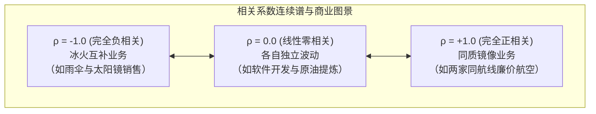
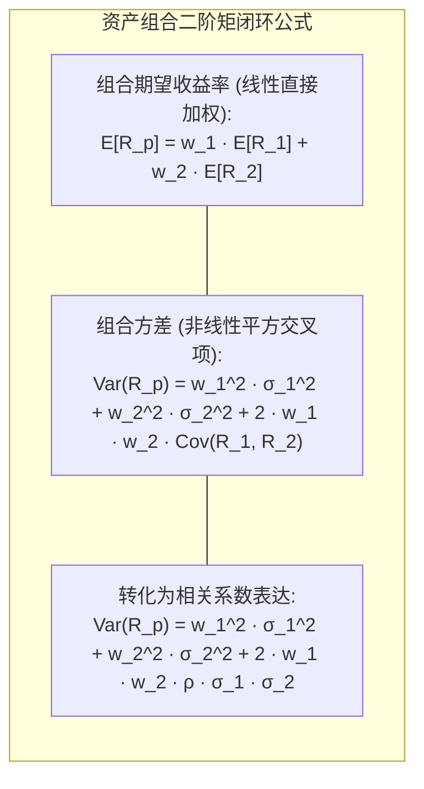
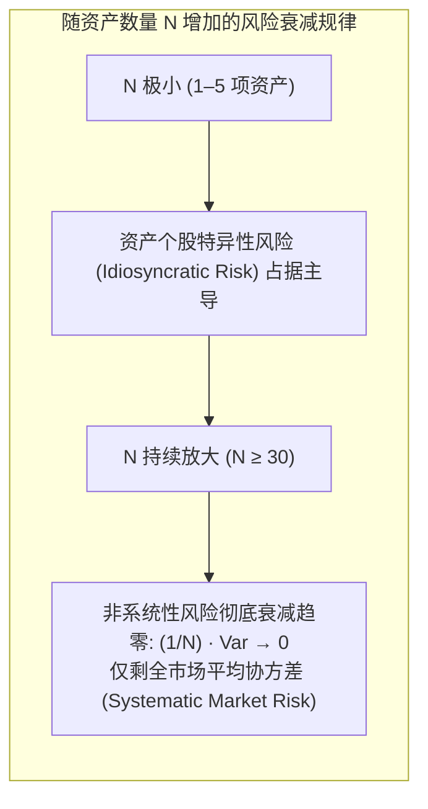

# Lec 7 资产组合风险管理：协方差、相关性与分散化红利

> MIT 15.063 / 15.276 · Communicating with Data · 模块七：多维随机变量与马科维茨投资组合理论

## TL;DR

- 单一资产的收益率波动性（方差）无法孤立反映其在全局业务中的风险贡献，多变量交互取决于协方差（Covariance）与相关系数（Correlation）。
- 线性相关系数 $\rho \in [-1, 1]$ 度量了两个业务变量之间的标准化共变趋势，$\rho = 0$ 仅代表无线性关联，并不等同于统计独立。
- 马科维茨现代投资组合理论（MPT）：只要资产间的相关系数严格小于 1（$\rho < 1$），组合的整体波动率必将严格小于单个资产波动率的加权平均值。
- 资产分散化（Diversification）是金融与企业战略中唯一的“免费午餐”，能够系统化消解非系统性特质风险，但无法消除全行业系统性风险。

## 联合随机变量、协方差与相关系数

在企业经营与金融投资中，决策者极少面对孤立的单变量。销售额与研发投入、汇率波动与大宗原材料价格、不同子公司的利润回报之间普遍存在交织共变关系。

::: definition 协方差 (Covariance)
度量两个随机变量偏离各自均值的协同变动方向与程度的二阶联合统计量：
$$\text{Cov}(X, Y) = \sigma_{XY} = \mathbb{E}\left[(X - \mu_X)(Y - \mu_Y)\right] = \mathbb{E}[XY] - \mathbb{E}[X]\mathbb{E}[Y]$$
- $\text{Cov}(X, Y) > 0$：两变量倾向于同向变动（一者偏高时，另一者往往也偏高）；
- $\text{Cov}(X, Y) < 0$：两变量倾向于反向变动（一者偏高时，另一者往往偏低）；
- 协方差自身的协方差即为方差：$\text{Cov}(X, X) = \text{Var}(X)$。
:::

### 皮尔逊相关系数（Pearson Correlation Coefficient）
协方差的数值受两变量原始物理量纲的影响（如将美元换算为日元，协方差暴增百倍），不具备可比性。为此引入标准化度量：

$$\rho_{XY} = \text{Corr}(X, Y) = \frac{\text{Cov}(X, Y)}{\sigma_X \sigma_Y}, \quad -1.0 \le \rho_{XY} \le 1.0$$

## 双资产组合的数学期望与组合方差

设企业将资金或资源按权重 $w_1$ 和 $w_2$（满足 $w_1 + w_2 = 1.0$）分别配置于两项随机收益率为 $R_1$ 和 $R_2$ 的业务：

### 分散化红利的数学严格证明

组合的标准差为 $\sigma_p = \sqrt{\text{Var}(R_p)}$。考虑极端情况：
1. **当 $\rho = +1.0$ 时（完全无对冲效应）**：
   $$\text{Var}(R_p) = (w_1 \sigma_1 + w_2 \sigma_2)^2 \implies \sigma_p = w_1 \sigma_1 + w_2 \sigma_2$$
   组合波动率等于两资产波动率的算术加权平均，**没有任何风险分散效果**。
2. **只要 $\rho < 1.0$（存在任何不完美相关）**：
   $$\text{Var}(R_p) < (w_1 \sigma_1 + w_2 \sigma_2)^2 \implies \sigma_p < w_1 \sigma_1 + w_2 \sigma_2$$
   **组合的标准差严格小于单个资产标准差的加权平均值！**
3. **当 $\rho = -1.0$ 时（完美的对冲圣杯）**：
   若令权重 $w_1 = \frac{\sigma_2}{\sigma_1 + \sigma_2}$，$w_2 = \frac{\sigma_1}{\sigma_1 + \sigma_2}$，则：
   $$\text{Var}(R_p) = (w_1 \sigma_1 - w_2 \sigma_2)^2 = 0 \implies \sigma_p = 0$$
   我们可以通过组合两个高风险资产，创造出一个**完全无风险的确定性收益组合**！

## $N$ 资产组合与系统性风险（Systematic Risk）

在现实投资组合中，当资产数量 $N$ 扩展为海量（如标普 500 指数，等权重 $w_i = 1/N$）：

$$\text{Var}(R_p) = \frac{1}{N} \overline{\text{Var}} + \left(1 - \frac{1}{N}\right) \overline{\text{Cov}}$$

::: definition 系统性风险 vs. 非系统性风险
- **非系统性风险（Idiosyncratic Risk / Unique Risk）**：源于特定企业的微观事件（如某药企专利侵权败诉、某工厂罢工）。通过在 30 只以上低相关股票中分散投资，该风险可以被完全平抑消除。
- **系统性风险（Systematic Risk / Market Risk）**：源于宏观经济共性冲击（如美联储加息、全球供应链阻断、战争通胀）。无论组合中纳入多少资产，全市场平均协方差项 $\overline{\text{Cov}}$ 永远存在，无法通过分散化消除。
:::

## 我的理解

::: insight 分散化是抵御认知自负的组织架构哲学
现代投资组合理论之父哈里·马科维茨（Harry Markowitz）曾被记者问到：“先生，既然您发明了精密的有效前沿协方差优化算法，您自己的退休金账户是怎么配置的？”

这位诺贝尔经济学奖得主坦诚回答：“我的一半资金投了股票，另一半投了债券。因为我明白：当股票暴涨时，我如果没投会感到痛苦；当股票暴跌时，我如果全投了会破产。所以我选择 50/50，以此最小化我未来的遗憾。”

这句回答蕴含着数据沟通最深邃的哲学：

投资组合理论的核心，不是为了向管理层炫耀我们计算协方差矩阵有多么精密，而是教导管理者**承认人类预测未来的局限性**。

在企业战略中，将全部宝码押注在单一技术路线或单一超级大客户身上，本质上是对自身判断力的过度狂妄。构建多元化的业务矩阵与技术对冲储备，不是为了平庸地追求折中，而是为了确保当不可预测的黑天鹅呼啸而过时，企业依然能稳健地立于不败之地。
:::
