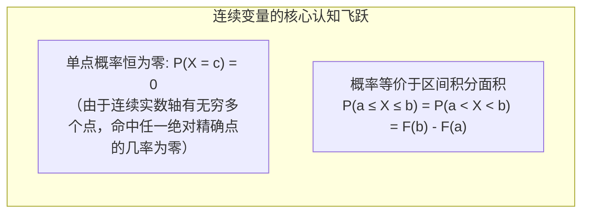
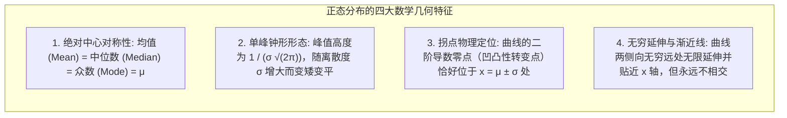
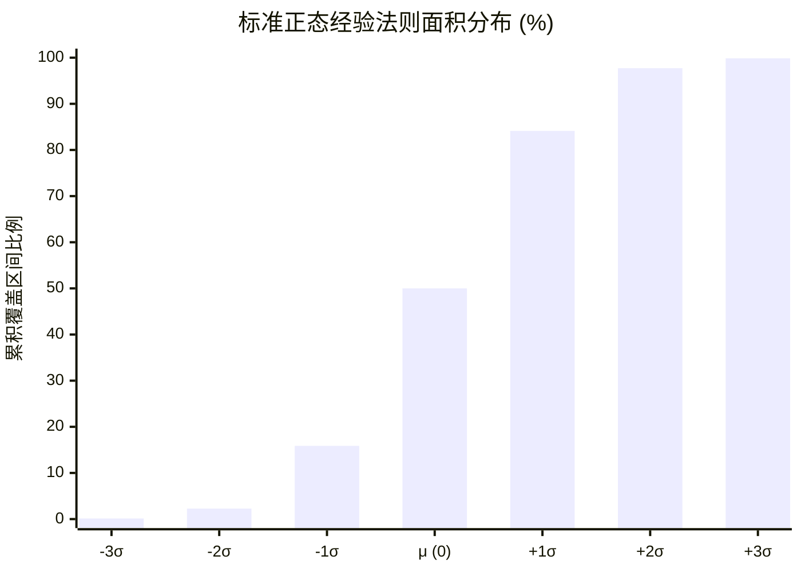

# Lec 8 正态分布与标准差经验法则：钟形曲线与质量控制

> MIT 15.063 / 15.276 · Communicating with Data · 模块八：连续随机变量与高斯正态基准

## TL;DR

- 正态分布（高斯钟形曲线）是自然界与人类社会经济活动中最普遍的连续型概率分布基准，完全由均值 $\mu$ 与标准差 $\sigma$ 唯一确定。
- 连续随机变量的单点概率恒等于零（$P(X = a) = 0$），概率必须通过概率密度函数（PDF）下的几何曲线面积进行积分求解。
- 掌握标准差经验法则（68-95-99.7 Rule）：$\mu \pm 1\sigma$ 覆盖约 $68.3\%$，$\mu \pm 2\sigma$ 覆盖约 $95.5\%$，$\mu \pm 3\sigma$ 覆盖约 $99.7\%$ 的全部观测样本。
- 熟练运用 $Z$ 分数标准化变换（$Z = \frac{X - \mu}{\sigma}$）打通任意量纲分布向标准正态 $\mathcal{N}(0, 1)$ 的映射，为六西格玛（Six Sigma）质量工程与金融在险价值（VaR）提供核心计算引擎。

## 连续型随机变量与概率密度函数（PDF）

与掷骰子或抛硬币的离散变量不同，商业运营中的“流水线零件精密尺寸”、“员工每周加班小时数”、“供应链交付等待时间”是连续平滑变化的实数：

::: definition 概率密度函数 (Probability Density Function, PDF)
对于连续型随机变量 $X$，其概率密度函数 $f(x)$ 满足非负性 $f(x) \ge 0$ 且全域积分 $\int_{-\infty}^{+\infty} f(x) dx = 1.0$。随机变量落在区间 $[a, b]$ 内的概率，等于曲线下方在该区间围成的几何面积：
$$P(a \le X \le b) = \int_{a}^{b} f(x) dx$$
:::

## 高斯正态分布的数学特征与对称美学

高斯正态分布是统计学皇冠上的明珠，记作 $X \sim \mathcal{N}(\mu, \sigma^2)$，其概率密度函数解析表达式为：

$$f(x) = \frac{1}{\sigma \sqrt{2\pi}} \exp\left(-\frac{1}{2}\left(\frac{x - \mu}{\sigma}\right)^2\right), \quad -\infty < x < +\infty$$

## 标准差经验法则（The Empirical 68-95-99.7 Rule）

对于任何严格服从或近似服从正态分布的业务数据集，其概率分布遵循极其优美的几何比例法则：

- **$\mu \pm 1\sigma$ 区间**：涵盖总体中大约 **$68.27\%$** 的样本；
- **$\mu \pm 2\sigma$ 区间**：涵盖总体中大约 **$95.45\%$** 的样本（双侧长尾各剩约 $2.28\%$）；
- **$\mu \pm 3\sigma$ 区间**：涵盖总体中大约 **$99.73\%$** 的样本（超出 $\pm 3\sigma$ 的极端离群值仅占 $0.27\%$，单侧仅为 $0.135\%$，相当于千分之一点三）。

## $Z$ 分数标准化：跨越量纲与标准正态分布

为了快速求解复杂的积分方程，无需每次手动计算高斯积分，统计学通过线性变换将任意正态随机变量映射到标准正态分布 $Z \sim \mathcal{N}(0, 1)$：

$$Z = \frac{X - \mu}{\sigma}$$

::: definition Z 分数 (Z-Score)
无量纲的相对距离度量，代表原始数据点 $X$ 与总体均值 $\mu$ 之间的物理间距相当于**多少个标准差单位（Standard Deviations）**。
- 若 $Z = +1.5$，表示该数据点位于均值右侧 1.5 个标准差处；
- 若 $Z = -2.0$，表示该数据点深陷均值左侧 2 个标准差的低位。
:::

### 实战：供应链安全库存与在险价值（VaR）
假设某芯片代理商从海外原厂提货的交货周期（Lead Time）服从均值 $\mu = 30$ 天、标准差 $\sigma = 4$ 天的正态分布。公司管理层要求维持 **$97.5\%$ 的防断供服务水平**（即断供概率控制在 $2.5\%$ 以内）。
- 查标准正态分布表，单侧上尾面积为 $2.5\%$（$0.025$）对应的临界值为 $Z_{0.975} = +1.96$（常用工程近似为 $2.0$）。
- 解方程求所需安全库存时间储备 $X_{\text{safe}}$：
  $$X_{\text{safe}} = \mu + Z \cdot \sigma = 30 + (1.96 \times 4) = 30 + 7.84 \approx 38 \text{ 天}$$
- **管理决策**：企业必须保留至少 38 天的消耗库存，才能在高管要求的 $97.5\%$ 确定性下抵御供应链海运延误风险。

## 六西格玛（Six Sigma）质量工程哲学

在摩托罗拉（Motorola）与通用电气（GE）推动的六西格玛质量运动中，将公差容忍限度设在 $\pm 6\sigma$。

::: example 为什么是六西格玛？
即使考虑了工业生产线上长期存在的 $1.5\sigma$ 均值漂移（Mean Shift），$\pm 6\sigma$ 的设计标准也能确保最终残次率控制在极其严苛的：
$$\text{Defect Rate} \le 3.4 \text{ DPMO (每百万次商业或制造机会仅允许 3.4 次缺陷)}$$
这意味着软件运行 100 万次核心事务，崩溃不可超过 3 次；航空公司起降 100 万架次，行李遗失不可超过 3 件。
:::

## 我的理解

::: insight 警惕“正态分布的催眠术”与肥尾黑天鹅
正态分布是数学上最优雅、推导最舒适的分布形态。正因如此，它在现代金融工程和管理科学中被滥用到了极其危险的地步。

华尔街投行在 2008 年次贷危机前夕建立的绝大部分风控模型，都默认资产收益率服从正态分布。在正态分布的假设下：
- 一个 $5\sigma$ 的单日下跌事件，理论上需要 14,000 年才会发生一次；
- 一个 $8\sigma$ 的市场闪崩，在整个宇宙诞生至今的 138 亿年历史中都不可能出现！

然而在 2008 年 9 月雷曼倒闭后的两周里，全球金融市场连续出现了多次“ $10\sigma$ 甚至 $25\sigma$ 的灾难性暴跌”。高管们目瞪口呆地宣布：“我们遭遇了亿年一遇的物理奇迹！”

其实根本没有什么奇迹，这只是**模型的致命狂妄**。

在人类社会的复杂网络中，由于羊群效应、杠杆强平与恐慌踩踏，金融与商业系统的真实分布从来不是平滑薄尾的正态曲线，而是充满**肥尾与幂律（Fat-Tailed Power Law）的柯西或帕累托分布**。

卓越的数据沟通者必须时刻保持敬畏：正态分布可以作为工程基准与日常平稳时期的参考，但绝不能用它来盲目为系统极端抗冲击能力背书。在黑天鹅潜伏的深水区，相信正态分布无异于在火山口上搭建积木。
:::
