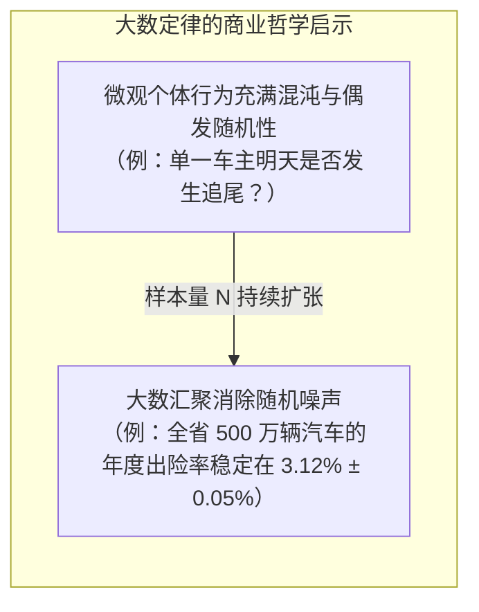
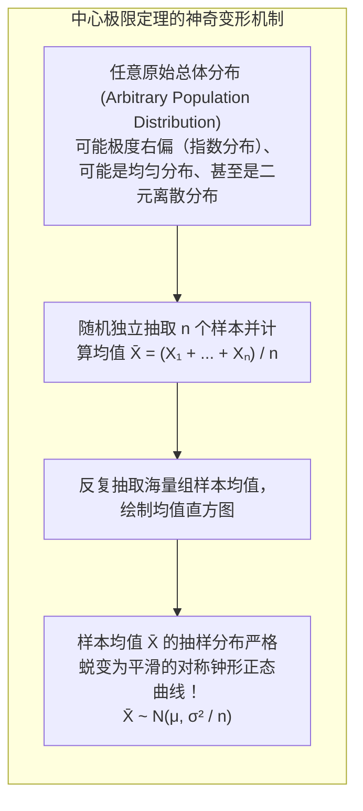
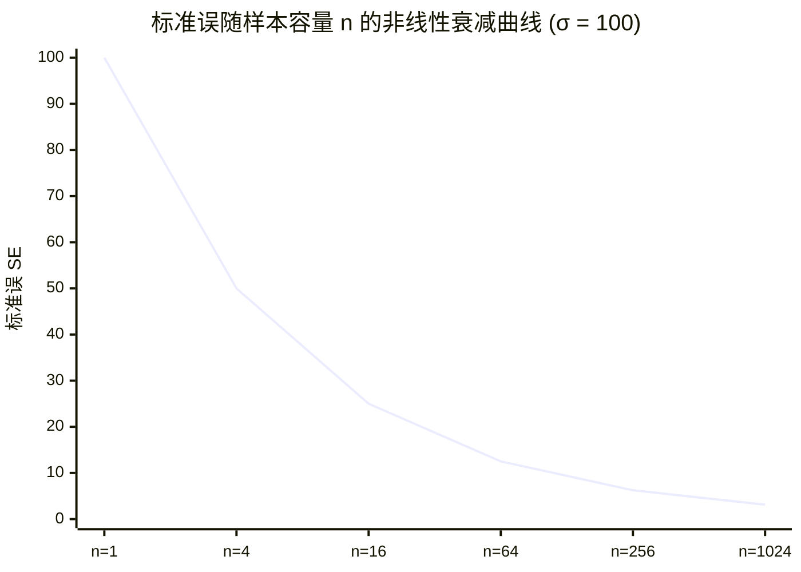
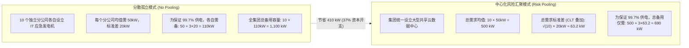

# Lec 9 中心极限定理与随机变量聚合：大数定律与样本均值分布

> MIT 15.063 / 15.276 · Communicating with Data · 模块九：渐进统计理论与中心极限魔力

## TL;DR

- 大数定律（Law of Large Numbers）保证了随着样本量 $n$ 的持续增加，样本均值 $\bar{X}_n$ 将在概率意义上收敛于真实的总体期望 $\mu$。
- 中心极限定理（CLT）是推断统计学的核心物理定律：**无论总体的原始分布多么偏态、双峰甚至极度离散，只要样本量充分大（通常 $n \ge 30$），其独立同分布样本均值的抽样分布必然近似服从高斯正态分布**。
- 样本均值的离散度被称为标准误（Standard Error）：$\text{SE} = \frac{\sigma}{\sqrt{n}}$。
- 遵循“样本量平方根收益递减律”：若想将估计误差与不确定性缩小一半，必须付出四倍（$4\times$）的样本采集成本。

## 大数定律（Law of Large Numbers, LLN）

商业世界中很多初级分析师常有困惑：“既然每一次掷硬币或单个用户的购买决策都充满了纯粹的随机性，为什么大型企业的年度总营收和保险公司的年赔付额却能够被极其精准地预测？”

答案正是雅各布·伯努利（Jacob Bernoulli）提出的大数弱定律：

::: definition 大数弱定律 (Weak Law of Large Numbers)
设随机变量序列 $X_1, X_2, \dots, X_n$ 相互独立且拥有共同的有限均值 $\mu$ 和方差 $\sigma^2$。记样本算术平均为 $\bar{X}_n = \frac{1}{n} \sum_{i=1}^n X_i$。对于任意微小的正数 $\epsilon > 0$：
$$\lim_{n \to \infty} P\left( |\bar{X}_n - \mu| < \epsilon \right) = 1.0$$
随着抽样规模 $n \to \infty$，样本均值以概率 1 收敛于总体真实均值。
:::

## 中心极限定理（The Central Limit Theorem, CLT）

如果说大数定律告诉我们样本均值会“收敛到哪里”，那么**中心极限定理（CLT）**则精确回答了当样本均值在向真值收敛的过程中，“其误差呈现出何种概率分布形态”。

::: theorem 中心极限定理 (Lindeberg-Lévy Central Limit Theorem)
设 $X_1, X_2, \dots, X_n$ 为独立同分布（i.i.d.）随机变量，其具有共同的均值 $\mu$ 与有限方差 $\sigma^2 > 0$。当样本容量 $n$ 充分大时：
1. **样本总和的分布**：
   $$S_n = \sum_{i=1}^n X_i \xrightarrow{d} \mathcal{N}(n\mu, n\sigma^2)$$
2. **样本均值的分布**：
   $$\bar{X}_n = \frac{1}{n} S_n \xrightarrow{d} \mathcal{N}\left(\mu, \frac{\sigma^2}{n}\right)$$
3. **标准化渐近形式**：
   $$Z_n = \frac{\bar{X}_n - \mu}{\sigma / \sqrt{n}} \xrightarrow{d} \mathcal{N}(0, 1)$$
:::

## 标准误（Standard Error）与样本量平方根法则

必须严格区分总体标准差（Standard Deviation）与样本均值标准误（Standard Error）：
- **总体标准差 $\sigma$**：衡量的是**个体数据点之间**的物理离散程度（不受采样影响的客观事实）。
- **标准误 $\text{SE}(\bar{X}) = \frac{\sigma}{\sqrt{n}}$**：衡量的是**我们对总体均值的估计精度**。它反映了若多次重新抽样，不同样本均值之间的晃动幅度。

::: pitfall 样本量平方根的“边际成本陷阱”
很多初级管理人员天真地认为：“要把民调的误差从 $\pm 4\%$ 降低到 $\pm 2\%$，我们只需要把调查人数翻一倍（从 1,000 人增加到 2,000 人）。”
- **数理真相**：由于公式中分母是 $\sqrt{n}$，要将标准误缩小到原来的 $\frac{1}{2}$，样本量必须扩大到原来的 **$2^2 = 4$ 倍**（从 1,000 人激增至 4,000 人）！
- **商业权衡**：调查成本随着 $n$ 线性增长，而估计精度的收益却遵循平方根边际递减。商业决策者必须在“估计精度的边际效用”与“采集数据的边际成本”之间做出清晰妥协。
:::

## 商业应用：风险汇聚（Risk Pooling）与呼叫中心容量规划

中心极限定理与独立随机变量求和法则，是现代保险公司精算、亚马逊智能物流分拨中心设计以及大型跨国银行流动性资金池运作的终极数理护城河。

在传统分散化运营模式下，由于每个独立分支机构必须各自为政抵御本地的随机峰值波动，系统整体被迫沉淀了海量冗余的安全库存与备用资本。而通过利用中心极限定理所揭示的“总需求标准差按 $\sqrt{N}$ 比例而非线性 $N$ 比例增长”的数学特性，企业可以通过物理或虚拟集中化，享受巨大的**风险汇聚红利（Risk Pooling Benefits）**：

在上面的真实案例中，仅仅通过将孤立的应急设施集中为共享资源池，在保持完全相同的 $99.7\%$ 供电可靠性标准下，全集团需要的总备用发电机容量直接从 $1,100\text{ kW}$ 断崖式下降至 $690\text{ kW}$，一次性削减了 $37\%$ 的重型固定资产投资！这种“无痛降本”的根本力量，完全来源于中心极限定理对随机波动方差的自然平抑。相同原理在现代电商区域仓整合、呼叫中心客服席位动态弹性调度中被广泛应用。

## 我的理解

::: insight 中心极限定理是造物主赐予统计学家的宽容
在整个数学史上，很少有哪个定理能够像中心极限定理一样，散发出如此震撼的哲学美感与实用价值。

试想一下：在现实商业宇宙中，每个消费者的心理动因是极其扭曲复杂的、每台机器的损耗是非线性的、全球物流的延误受制于各种奇怪的突发事件。如果统计学要求我们必须搞清楚每一个微观总体的精确函数形态才能进行推断，那么人类在面对复杂性时将陷入彻底的绝望。

然而，中心极限定理宛如造物主在宇宙底层写下的一道宽容法则：
“无论你们微观的底层世界有多么光怪陆离、混沌不均；只要你们把这些独立的微小随机扰动叠加汇聚起来，在宏观层面上，大自然最终呈现出的，永远是那条优美、对称、从容的高斯钟形曲线。”

正是这条定理，让有限的人类理性能够穿透无尽的微观噪声，在混沌的现实中建立起可被度量、可被驾驭的科学秩序。
:::
