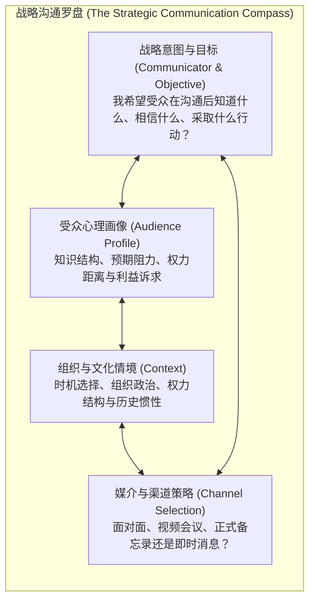
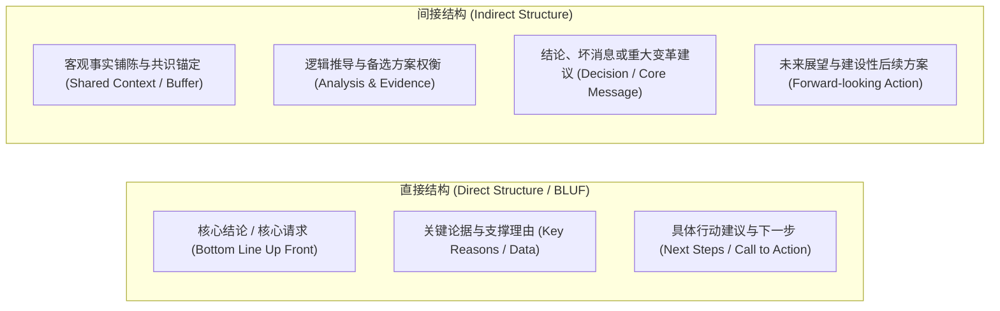

# Lec 1 战略沟通与结构选择：受众中心与直接/间接模式

> MIT 15.279 · Management Communication for Undergraduates · 模块一：沟通战略与宏观结构

## TL;DR

- 战略沟通将信息传递从“本能式倾倒”转变为“以受众目标、组织情境与战略意图为导向”的系统工程。
- 受众分析是战略决策的基石，需从受众知识储备、预期态度（支持、中立、抵触）及决策职权三个维度进行画像。
- 直接结构（Direct Structure / BLUF）以核心结论先行，适用于支持或中立受众及高管日常汇报，极大降低认知负荷。
- 间接结构（Indirect Structure）先铺陈事实与论证后得出结论，是传递坏消息、化解强烈阻力及重构心理防线的关键修辞。

## 战略沟通模型：从发射模型到情境互动

在技术和工程领域，初涉职场的管理者往往秉持“信息传输理论（Shannon-Weaver Model）”：认为沟通只要做到发送方清晰表达、信道无噪声干扰，接收方就能准确解码。然而在管理情境中，沟通从不是单向的物理传输，而是一种复杂的**认知博弈与心理影响过程**。

MIT Sloan 强调管理沟通的战略性（Strategic Communication）：**任何沟通行动在下笔或开口之前，必须系统化审视四大核心要素构成的战略罗盘**：

::: definition 战略沟通 (Strategic Communication)
以实现特定商业目标为导向，基于对受众心理、组织权力关系及情境约束的深度分析，审慎选择论证结构、修辞风格与媒介通道的系统性信息交互实践。
:::

### 受众三维画像框架

战略沟通的第一准则就是“受众中心主义（Audience-Centricity）”。有效沟通不是汇报者想说什么，而是受众需要听到什么来做出判断。分析受众必须穿透三个关键维度：

1. **知识维度（Knowledge Level）**：
   - 受众对当前议题的技术背景有多深？是否了解缩略语与专业术语？
   - *警惕“知识的诅咒”*：专家往往高估外行的理解能力，导致技术细节泛滥而战略价值隐没。
2. **态度维度（Attitudinal Stance）**：
   - **积极支持型（Receptive/Positive）**：认同提案目标，关注具体执行时间表与资源配置。
   - **中立/不熟悉型（Neutral/Uninformed）**：需要背景普及、问题重要性论证与客观可行性支撑。
   - **消极/强烈抵触型（Hostile/Resistant）**：感知到利益受损或现状被威胁，具有强烈的心理防御机制。
3. **权力与行动维度（Decision-Making Authority）**：
   - 谁是最终决策者（Primary Audience）？谁是受影响的实施者（Secondary Audience）？谁是潜在的阻碍者（Gatekeeper）？

## 宏观组织结构：直接结构与间接结构

组织结构是受众处理信息的“心智地图”。管理沟通中最经典的决策即为：**结论先行还是论证先行？**

### 直接结构（Direct Structure / BLUF）

直接结构又称“倒金字塔”或“底线先行（Bottom Line Up Front, BLUF）”。在开篇前两句话内明确阐明核心建议、请求或关键发现。

- **适用场景**：
  - 日常管理备忘录、状态更新、高管汇报。
  - 受众对你持高度信任或支持态度。
  - 受众工作节奏极快、注意力极其碎片化。
- **管理优势**：
  - 显著降低高管的认知负荷，防止听众在漫长推导中产生不耐烦情绪（“你到底想说什么？”）。
  - 为整个沟通设定明确的焦点，后续所有数据均作为证据提供支撑。

### 间接结构（Indirect Structure）

间接结构先建立共同背景与客观事实，引导受众共同经历分析过程，在逻辑推演充分后揭示最终结论或重大决策。

- **适用场景**：
  - 传达重大坏消息（裁员、项目叫停、预算削减）。
  - 提议颠覆性变革且受众存在固有利益抵触。
  - 汇报者与受众之间缺乏初始信任，或汇报者处于权力劣势。
- **管理优势**：
  - 软化情绪冲击，避免受众在开篇即触发“战或逃”心理防卫。
  - 展示推论过程的严谨性与客观性，使最终结论看似是客观事实的必然结果，而非汇报者的个人主观偏见。

::: pitfall 间接结构的滥用陷阱
很多技术人员因畏惧冲突或缺乏自信，在常规日常汇报中盲目使用间接结构，将结论藏在第 20 页 PPT 或邮件末尾。这种做法会被管理层视为缺乏决断力、浪费时间或刻意隐瞒关键问题。**默认情况下应坚决使用直接结构；只有在受众抵触或坏消息情境下，才战略性启动间接结构。**
:::

## 媒介与渠道选择矩阵

不同沟通媒介具有不同的“媒介富度（Media Richness）”与交互属性：

| 渠道类型 | 媒介富度 | 反馈即时性 | 记录持久性 | 最佳应用场景 |
|---|---|---|---|---|
| **面对面交流 (Face-to-Face)** | 极高（包含非言语线索） | 实时即时 | 低（需会议纪要） | 复杂谈判、敏感反馈、艰难对话、建立初始信任 |
| **视频会议 (Video Conference)** | 高（视听双通道） | 实时即时 | 中（可录制） | 分布式团队高层研讨、跨区域协同汇报 |
| **电话 / 语音 (Voice Call)** | 中（仅语调与声音） | 实时即时 | 低 | 快速紧急对齐、无法当面时的敏感情感沟通 |
| **管理备忘录 / 邮件 (Memo/Email)**| 低（纯文本与图表） | 异步延迟 | 极高（永久可追溯） | 正式决策批准、复杂逻辑论述、跨部门规范发布 |
| **即时通讯 (Slack/Teams)** | 低至中 | 接近即时 | 高 | 敏捷状态同步、日常运营事务协调 |

## 我的理解

::: insight 战略沟通的最高境界：受众视角的心理同频
在商业实践中，最失败的沟通往往来自“汇报者的自我中心主义”：分析人员花了三个星期建立精妙的统计回归模型，于是在向业务总裁汇报时，花了 80% 的时间展示变量筛选与异方差检验过程。然而业务总裁真正关心的只有两件事：“这个发现对我们的季度留存率有什么影响？”以及“为了拿到这个收益，我下个月需要调动多少资源？”

卓越的战略沟通者具备一种近乎本能的“受众共情切换能力”：在动笔之前，先闭上眼睛把自己代入受众的椅子——如果我是背负数千万亏损压力的事业部总经理，面对这封邮件的前五秒钟，我最恐惧什么？我最期待什么？当我能精准回答这个问题时，沟通的结构与词汇就已经自然成型了。
:::
