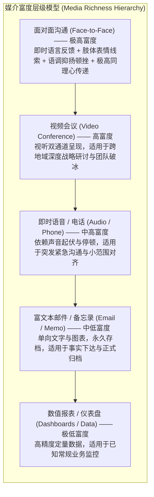
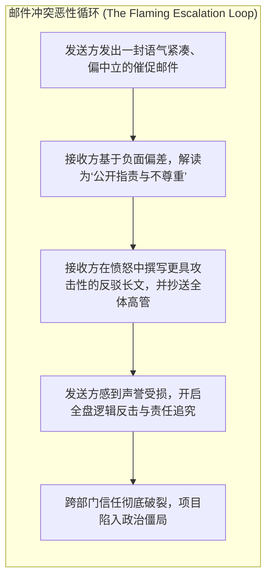
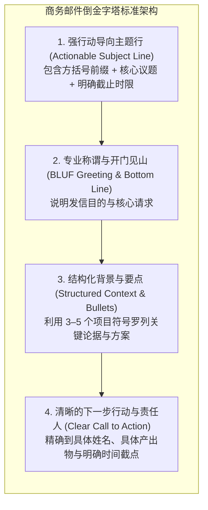

# Lec 10 数字化与电子沟通规范：电子邮件策略、虚拟协作与媒介富度

> MIT 15.279 · Management Communication for Undergraduates · 模块十：数字沟通与媒介管理

## TL;DR

- 达夫特-伦格尔媒介富度理论（Media Richness Theory）指导管理者科学匹配沟通渠道：任务模糊度与情感敏感度越高，越需要启用高富度媒介。
- 电子邮件是管理法律与事实的永久凭据，绝非即时情绪的宣泄口；缺乏非言语线索的纯文本极易触发“负面偏见（Negativity Bias）”与网络论战（Flaming）。
- 掌握专业商务邮件的倒金字塔工程学：行动导向的精准主题行、首段结论先行（BLUF）与格式化行动清单。
- 严格遵循收件人（To）、抄送（CC）与密送（BCC）的组织礼仪规范，恪守敏感冲突议题的“24 小时情绪冷却法则”。

## 媒介富度理论（Media Richness Theory）在数字化管理中的应用

理查德·达夫特（Richard Daft）与罗伯特·伦格尔（Robert Lengel）提出的媒介富度理论指出：**不同的沟通渠道在传递多元线索、即时反馈、语言多样性及个人化关注方面的能力截然不同**。管理沟通的核心能力之一，就是在任务属性与渠道富度之间建立精准匹配。

::: definition 渠道匹配黄金准则 (The Channel-Fit Law)
- **常规性、低模糊度任务（Routine/Clear Tasks）**（如项目周报发布、代码变更说明、常规审批）：优先采用**低富度媒介（邮件/工单系统）**，以最低的时间成本保证信息精确归档。
- **高模糊度、强情感敏感性任务（Equivocal/Emotional Tasks）**（如绩效低迷面谈、跨部门利益冲突调解、战略方向重大分歧）：坚决禁止使用邮件或即时聊天工具，必须启动**高富度媒介（面对面或面对面视频）**，防止文本误读造成毁灭性情绪升级。
:::

## 电子邮件的心理学陷阱：文字的冰冷与失真

纯文本沟通剥离了人际交往中 90% 以上的面部表情、肢体动作和语调起伏。在心理学上，这种“线索匮乏（Cue-Deficient）”会导致严重的认知偏见：

1. **负面偏差（Negativity Bias）**：心理学研究表明，写作者认为“语气中立”的邮件，接收者在阅读时往往会主观解读为“冷漠、不耐烦或微弱批评”；写作者认为“轻微不满”的邮件，接收者会解读为“公开宣战与严重敌意”。
2. **去抑制效应与网络论战（Flaming）**：隔着屏幕的物理阻隔削弱了人际同理心。许多在现实面对面中绝不敢说出口的过激言辞、嘲讽与诛心推测，在邮件回复中会被轻易敲下并发送，迅速演变为不可收拾的部门大战。

## 商务邮件结构工程学

一封优秀的管理邮件应当在打开后的 5 秒钟内向受众交代清楚“你到底需要我做什么”。

### 1. 打造高穿透力的主题行（Subject Line Engineering）

高管收件箱日均处理数百封邮件。平庸的主题行（如“更新”、“会议通知”、“问题”）会被直接忽略或归档：

| 失败的低效主题行 | 专业的行动导向主题行示范 |
|---|---|
| Meeting update | `[Action Required] 架构评审会议改期至周四下午 3 点` |
| Project question | `[Decision Needed] 支付网关迁移方案选型审批 - 请在周五前回复` |
| Data report | `[FYI] 2026 年 Q3 移动端用户留存分析报告（内含执行摘要）` |
| Urgent! | `[Time-Sensitive] 生产服务器 SSL 证书急需更新 - 截止今日 18:00` |

### 2. 正文编排：BLUF 与项目符号

- **首句原则**：“我写此信是为了提请批准将移动端上线时间由 10 月 15 日微调至 10 月 22 日，以便完成最终的合规压力测试。”
- **结构化清单**：杜绝整段叙事，用项目符号呈现关键事实。
- **排版降噪**：全篇字体统一，避免滥用彩色高亮、感叹号或全部大写（ALL CAPS 在网络文化中代表大声咆哮）。

## 收件人（To / CC / BCC）政治与职业操守

收件人栏不仅是技术投递地址，更是组织权力和人际关系的晴雨表：

- **收件人（To:）**：对邮件内容负有**直接行动或决策责任**的核心人员。人数应严格控制，避免“全员 To”导致责任分散（Responsibility Diffusion）。
- **抄送（CC:）**：仅需**保持知情（Keep in the Loop）**的利益相关者。默认情况下 CC 人员无需主动回复邮件。
  - *严禁“武器化抄送（Weaponized CC）”*：遇到同事工作推迟时，在不事先私下沟通的情况下，直接把对方的上级甚至大老板拉进 CC，这种公开施压的行为会永久摧毁同僚互信。
- **密送（BCC:）**：用于海量通知（防止泄露他人邮箱地址），或极个别防骚扰场景。
  - *职场红线*：在争议性讨论中秘密 BCC 上级以暗中告状，被视为极具政治算计的不可被信任行为。

## 我的理解

::: insight 邮件的“发送键延迟”是最高级的情商自律
在激烈的职场博弈中，我们每个人都曾经历过被一封不讲道理的挑衅邮件彻底激怒的时刻：肾上腺素飙升，手指在键盘上敲得啪啪作响，以无可挑剔的逻辑构思出了一篇能把对方批得体无完肤的“回击檄文”。

在这个极度危险的时刻，普通人会本能地按下 `Send`，体验那短暂的 5 秒钟报复快感，随后用未来六个月的时间去修补由此造成的跨部门政治撕裂与合作瘫痪。

而顶级高管在此时会启动一项铁律：**“24 小时情绪冷却法则”**。把写好的檄文保存在草稿箱里（并提前清空收件人地址以防手滑误触），关上电脑去跑步、睡觉。

第二天早上，当交感神经彻底平静下来，再打开草稿箱重读那篇文字时，你几乎无一例外会感到庆幸：“天哪，幸亏昨天没发出去。”然后，你会从容地删掉 80% 的情绪化词藻，只留下三句就事论事的客观事实，或者拿起电话直接拨过去：“老张，关于刚才那个接口争议，我们中午一起喝杯咖啡当面理一下吧。”

这一瞬间的撤退与克制，就是成熟管理者最坚固的护甲。
:::
