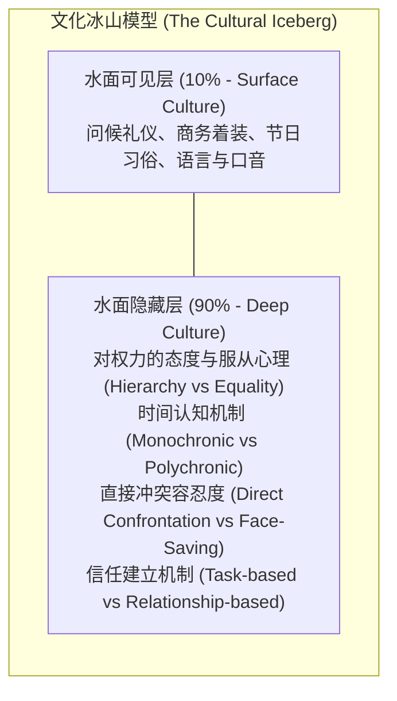
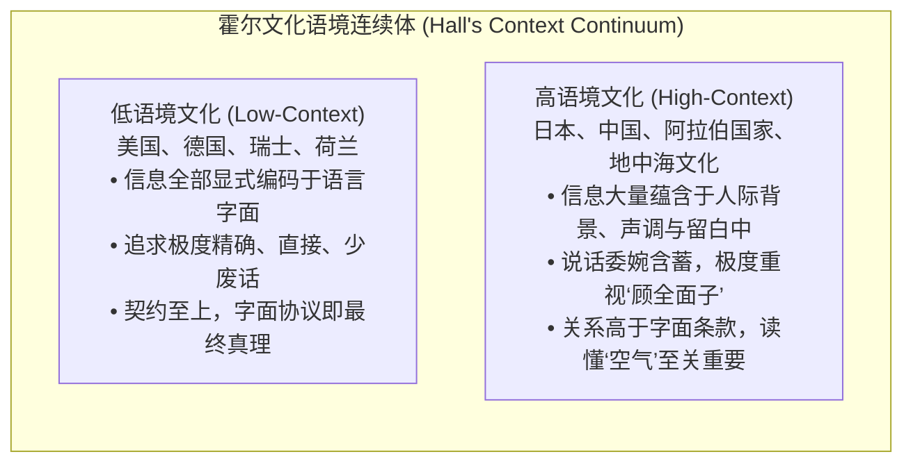
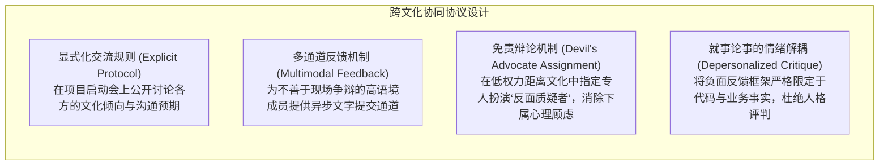

# Lec 11 跨文化商务沟通与组织多样性：文化维度、语境差异与全球化协作

> MIT 15.279 · Management Communication for Undergraduates · 模块十一：跨文化与多样性沟通

## TL;DR

- 全球化商业竞争要求领导者具备高度的文化智商（CQ），破除种族中心主义（Ethnocentrism），将文化差异转化为团队认知红利。
- 爱德华·霍尔（Edward Hall）的高语境 vs 低语境理论阐明了跨文化信息编码机制：低语境文化依赖显式精确字面义，高语境文化依赖隐性情境与人际关系网。
- 霍夫斯泰德文化六维度模型（权力距离、个人主义、不确定性规避等）为跨国团队的管理冲突与决策分歧提供了实证解析透镜。
- 掌握跨文化反馈、说服与会议编排策略，在多元团队中建立兼顾各方文化心理的“第三文化规范（Third-Culture Norms）”。

## 跨文化沟通的挑战：冰山模型与文化智商

跨文化沟通不仅是“克服语言翻译障碍”。人类学家常用“文化冰山模型（The Cultural Iceberg）”来解释：语言、饮食、服饰和礼节只是漂浮在水面之上的 10%；而深藏在水面之下的 90%，则是人们潜意识中的时间观、权力观、空间距离、沟通隐含假设与道德评判标准。

::: definition 文化智商 (Cultural Intelligence, CQ)
一种在跨越国家、地区、职能或组织文化边界时，能够有效识别、接纳不同文化行为模式，并适时调整自身沟通策略与领导风格以达成协同目标的综合心理与行为胜任力。
:::

## 爱德华·霍尔的语境与时间哲学框架

人类学家爱德华·霍尔（Edward T. Hall）提出了跨文化交际中最经典的两大分析维度：

### 1. 语境差异带来的典型管理摩擦

- **低语境经理面对高语境下属**：美籍主管认为日本或中国下属“在会议上从不主动反驳，汇报含糊其辞，缺乏透明度”。实则高语境员工是在以沉思和委婉暗示来表达保留意见，认为当面争执会彻底摧毁主管的威信。
- **高语境员工面对低语境经理**：亚洲员工认为德国或荷兰主管的批评“粗鲁、刻薄、充满人身攻击”。实则低语境主管只是在就事论事地指出代码缺陷，完全没有任何人际针对性。

### 2. 单一时间观（Monochronic）vs 多重时间观（Polychronic）

- **单一时间观文化（M-Time，如德国、瑞士、北美）**：
  - 时间是线性的、稀缺的、可量化分割的物理资产（“时间就是金钱”）。
  - 会议必须精确到分钟准时开始，议程必须严格按项推进；同时处理多项任务被视为不专业。
- **多重时间观文化（P-Time，如拉美、中东、南欧）**：
  - 时间是流动的、圆形的，人际关系维系远比冰冷的钟表时间重要。
  - 会议迟到 15 分钟是正常现象，且会议过程中随时会被重要的客户来电或人际问候打断。

## 霍夫斯泰德文化六维度模型（Hofstede Dimensions）

荷兰社会心理学家吉尔特·霍夫斯泰德（Geert Hofstede）通过对全球数十万跨国企业员工的长期实证调研，提炼出六大核心维度：

| 文化维度名称 | 维度内涵定义 | 高分文化典型特征 | 低分文化典型特征 |
|---|---|---|---|
| **权力距离 (PDI) Power Distance** | 社会中弱势群体对权力不平等分布的接受程度。 | 严格等级制度、下属不敢公开质疑上级决策（如马来西亚、墨西哥）。 | 崇尚扁平化平等、鼓励越级沟通与挑战权威（如丹麦、以色列）。 |
| **个人主义 (IDV) Individualism** | 个人与集体利益的绑定与依附程度。 | 重视个人成就、独立自主、契约自由（如美国、澳大利亚）。 | 讲求集体忠诚、家族责任、荣辱与共（如韩国、危地马拉）。 |
| **不确定性规避 (UAI) Uncertainty Avoidance** | 面对未知、模糊与无序情境时的焦虑与抵触程度。 | 依赖繁复细致的法律制度、流程规范与安全边界（如希腊、德国）。 | 容忍模糊与创新、愿意尝试实验性灰色方案（如新加坡、英国）。 |
| **长期导向 (LTO) Long-Term Orientation** | 关注未来长期回报还是当期立竿见影的收益。 | 崇尚节俭、坚韧、长期投资与战略耐心（如中国、韩国）。 | 关注季度财报、当期分红、传统与短期回报（如美国、英国）。 |

## 跨文化领导力实战：构建“第三文化规范”

在管理高度多元化的跨国工程团队时，管理者最常走入两个对立的失败极端：
- **文化沙文主义（Cultural Chauvinism）**：强硬要求所有人必须无条件服从总部母国的文化范式（例如美资企业要求所有亚洲和欧洲分支必须像硅谷一样在圆桌会上公开大声争吵），这会导致大量高语境文化的优秀技术骨干陷入长期的防御性沉默；
- **过度文化相对主义（Cultural Relativism）**：无原则地迁就每个成员的本土习惯，导致会议完全缺乏统一的工作节奏与交付纪律，组织协作陷入彻底的无政府瘫痪。

卓越的全球化管理者致力于在团队内部构建超越任何单一民族文化的**“第三文化规范（Third-Culture Norms）”**。它既不是总部文化的生硬复制，也不是各地习惯的杂乱妥协，而是一套由全体成员共同商定、专门为达成卓越项目交付而设立的超文化专业协作契约：

通过这套协议，团队在制度层面消除了文化摩擦带来的心理负担。例如，通过制度化地指定专人轮流担任“魔鬼代言人（Devil's Advocate）”，来自高权力距离文化的工程师就可以在“这是我的既定岗位职责”的安全感下，毫无顾虑地向下属或高管提出最尖锐的架构质疑，而无需背负“冒犯上级”的文化道德包袱。这就是通过精妙的沟通协议设计，将多元文化摩擦转化为全员认知红利的典范。

## 我的理解

::: insight 跨文化沟通的终极试金石是“克制道德优越感”
在跨文化管理中，人类最隐蔽也最具破坏性的心理本能是：**将文化差异上升为道德与智力评判**。

- 当看到某些文化的同仁开会极其准时但缺乏灵活性时，某些人会暗中嘲笑对方“死板教条、缺乏创新思维”；
- 当看到某些文化的伙伴花两个小时喝茶寒暄迟迟不切入正题时，又会斥责对方“浪费时间、毫无效率、充满腐朽的人情交易”。

这种“以我为准绳”的傲慢（Ethnocentrism），是全球化项目协作中绝大部分怨恨与内耗的源头。

真正的跨文化大家，心中拥有一种近乎人类学家的清醒与敬畏：
任何一种能在特定地理与历史中繁衍百年的文化沟通范式，其底层必然有着适应当地生态与博弈环境的深层理性。
当对方的反应出乎你的意料时，不要急着愤怒或鄙夷，在心里对自己轻声说一句：“有意思，这背后到底藏着什么我不知道的深层假设？”

正是这一瞬间的从容探询，将一场潜在的跨国公关危机，化作了团队深层互信的催化剂。
:::
