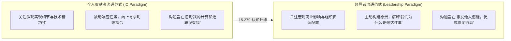
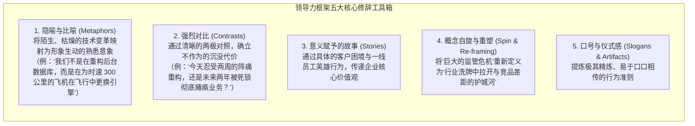
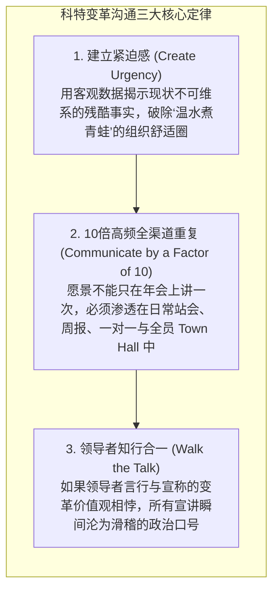

# Lec 12 管理者领导力沟通：愿景传递、动机激发与高管气场

> MIT 15.279 · Management Communication for Undergraduates · 模块十二：领导力修辞与组织变革

## TL;DR

- 从一线技术骨干晋升为卓越管理者的关键跃迁：将沟通从“个人任务汇报”重构为“组织意义赋予（Sensemaking）与愿景塑造”。
- 掌握领导力框架效应（Framing）：通过生动隐喻、对比修辞与故事叙事，为复杂的业务变革赋予深层意义与情感召唤力。
- 科特组织变革沟通模型（Kotter's Change Communication）：打破传统灌输模式，通过全渠道高频重复与领导者“知行合一（Walking the Talk）”消除变革阻力。
- 向上沟通（Managing Up）的实战准则：向高管和董事会汇报时，恪守“商业影响优先、带着方案提问题、坦诚披露下行风险”的高管对话协议。

## 从执行者到领导者：沟通范式的量子跃迁

在工程和专业技术领域，个人贡献者（Individual Contributor, IC）的核心价值在于“解决具体的技术问题”——编写高效的算法、调试复杂的系统、提交无瑕疵的分析图表。然而，当技术专家被提拔至管理岗位时，很多人遭遇了严重的胜任力危机：他们仍然试图通过“亲自做更多事情”来推动团队，结果把自己累得精疲力竭，团队却缺乏方向感。

MIT Sloan 领导力沟通教授指出：**管理者的首要工具不再是代码或模型，而是语言本身。领导力的本质不是操控流程，而是通过沟通在组织内部激活动机、编织共识与赋予崇高意义**。

## 领导力框架技术（The Art of Framing）

语言不仅被动地描述现实，语言更在主动地重构现实。认知语言学与组织沟通学者盖尔·费尔赫斯特（Gail Fairhurst）与罗伯特·萨尔（Robert Sarr）指出：卓越领导者本质上是**“意义建构（Sensemaking）与认知框架设计的大师”**。面对完全相同的一组客观商业事实，平庸的管理者只会平铺直叙地念出报表数字，而卓越的领袖懂得通过特定的修辞滤镜，重塑团队对环境挑战的认知定势与情感倾向。

人类大脑在面对海量模糊信息时，无法对所有变量进行同等权重的运算。人们下意识地依赖“框架（Frames）”来快速决定：什么信息是关键核心，什么信息可以被作为背景杂音忽略不计。领导者的核心职责，就是通过精心设计的修辞工具箱，为组织确立这一共享的认知框架：

通过这五大修辞工具，领导者能够在团队遭遇巨大挫折或外部危机时，迅速实现“认知脱困”。例如，当核心产品遭遇严厉监管处罚时，消极的框架会诱导全员陷入怨天尤人的受害者心态；而一个强大的领导者会将这一事件重新框架为：“这标志着草莽野蛮生长时代的终结，合规门槛的大幅抬升将直接帮我们清退市场上那些缺乏研发底蕴的投机竞品，这是我们建立长期技术垄断的历史机遇。”一瞬间，恐慌便转化为了求胜的战略决绝。

::: definition 领导力框架 (Leadership Framing)
领导者基于深邃的战略洞察，有选择地突出情境中的某些关键事实，同时淡化无关干扰信息，从而引导组织成员对当期事件建立特定的情感联结与行动偏向的修辞艺术。
:::

## 变革领导力沟通：科特八步法的传播精髓

哈佛商学院名誉教授约翰·科特（John Kotter）在长达数十年的企业变革跟踪研究中发现，全球超过 70% 的大型组织数字化或业务转型之所以以失败告终，根本原因并非战略方向存在硬伤，而是**组织内部的变革沟通机制出现了系统性断崖**。

许多企业的 CEO 和高管团队耗费数月闭门制定了一套宏伟的战略重组蓝图，随后在全员大会上进行了一次激情的 PPT 演讲，便想当然地以为“全员宣导已经圆满完成”。然而在现实中，一线员工面对突如其来的组织调整，感到的是强烈的身份危机、权力剥夺感与对未知未来的恐惧。在缺乏持续沟通的情况下，这种恐慌迅速发酵为消极抵抗、部门推诿与谣言横飞。

科特指出，推动成功的组织变革，必须在沟通层面严格坚守三大铁律：

特别是第二定律“10 倍高频重复”，是技术出身的管理者最难适应的沟通准则。工程师习惯于“同样的代码只写一次”，认为同一件事情重复说就是低效与啰嗦。但在人类组织心理学中，信息传递存在着巨大的损耗率：高管说了一遍，中层理解了 50%，基层接收到的只剩 10%。一个愿景只有在不同场合、通过邮件、站会、周报和面对面谈话被以不同形式重复宣导数十次以上，才有可能真正沉淀为全员的潜意识行动本能。

## 向上沟通艺术（Managing Up）：与高管及董事会对话

向上沟通是年轻管理者最容易受挫的领域。面对日程极其紧凑、注意力高度碎片化、脾气急躁的高管，必须恪守专业的高管沟通协议：

### 1. 商业影响优先（Business Impact First）
- 绝不要用 15 分钟铺陈你的团队这周加了多少班、修复了多少个 Bug。
- 开篇第一句必须是商业维度的底线影响：“由于周三的分布式缓存配置优化，核心结账页面的提速使全站跳出率降低了 2.3%，预计为本月带来 40 万美元的直接增量交易。”

### 2. 永远带着方案提问题（Bring Solutions, Not Problems）
- **平庸的抱怨式汇报**：“老板，前端团队人手严重不足，下周的上线肯定要延期了，怎么办？”
- **专业的决策型汇报**：“老板，目前前端进度落后了 3 天。为了确保核心支付模块在周五如期发布，我评估了三个备选方案：
  - *方案 A*：从搜索组借调一位资深前端，需您协助协调搜索组主管批准；
  - *方案 B*：将非核心的用户评论功能剥离至第二阶段交付；
  - *方案 C*：延期 4 天全量交付。
  我强烈建议采用方案 B，因为评论功能仅占 5% 的用户访问，而延期支付上线将面临每天 3 万美元的违约损失。不知您倾向于哪种？”

### 3. 下行风险的透明前置（Proactive Risk Transparency）
- 高管最痛恨的不是坏消息，而是**“毫无心理准备的突发坏消息（Surprises）”**。
- 一旦发现项目存在偏离风险，在风险暴露初期就必须主动同步，并附带明确的缓解预案（Mitigation Plan）。掩盖问题直到不可收拾，是对管理者专业信誉的终极毁灭。

## 我的理解

::: insight 领导力沟通是组织心智的“引力场”
在物理学中，质量巨大的天体能够弯曲周围的时空，形成引力场，引导行星的运行轨迹。

在混乱、嘈杂、充满焦虑的组织转型期，一名真正的领导者，其言语和气场就是组织内部的“引力场”。

当外部环境发生巨变、大家不知所措甚至恐慌蔓延时，平庸的管理者会跟着恐慌，要么推卸责任，要么向下传递焦虑。而卓越的领导者走进会议室的那一刻，他脸上的沉静、眼神中的笃定、以及开口第一句话所展现出的宏观格局，能够瞬间降低全场的皮质醇水平。

他不是对风险视而不见，而是他能够穿透迷雾，把当前的危机精准定位于：“这正是检验我们团队韧性的时刻，这就是我们为之奋斗的意义所在。”

当所有人因为他的一句话而重新挺起脊梁、回到战位时，这就是领导力沟通展现出的至高神迹。
:::
