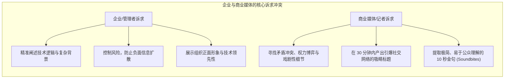
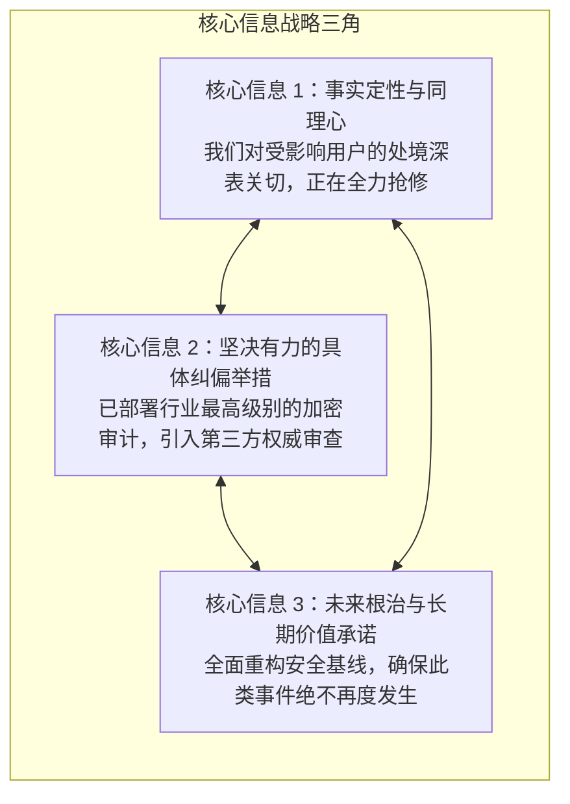
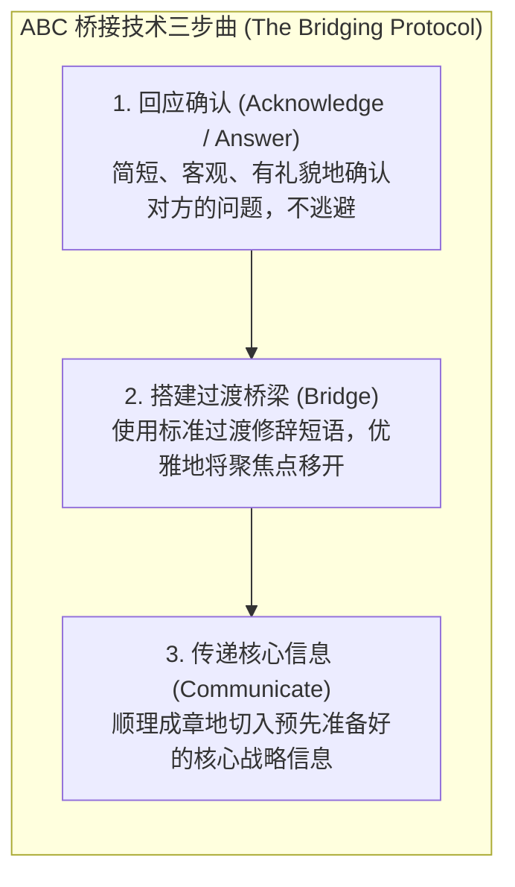
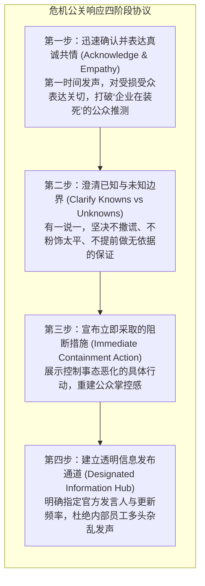

# Lec 13 危机沟通与媒体关系：桥接技术、公众发声与声誉管理

> MIT 15.279 · Management Communication for Undergraduates · 模块十三：外部公关与危机公关

## TL;DR

- 现代媒体采访是一场高度专业化的战略信息博弈：记者追求的是冲突、抓人眼球的标题与截稿线前的金句，而企业追求的是核心信息的精准传递。
- 绝不要在没有准备好“三大核心信息（Three Key Messages）”的情况下接受任何采访；“无可奉告（No Comment）”在公众心智中等同于承认有罪。
- 掌握媒体应对的黄金武器——桥接技术（The Bridging Technique / ABC 法则）：通过“回应-过渡桥接-回归核心信息”，从容驾驭挑衅性问题。
- 危机沟通必须严守“黄金一小时法则”：以同理心、事实透明度与切实补救承诺，构筑捍卫组织品牌声誉的第一道防线。

## 商业媒体生态与记者心理学

当一家科技企业遭遇数据泄露、核心系统瘫痪或重大公关危机时，工程师和技术管理者的第一本能往往是“躲避记者”或“用深奥的技术行话敷衍媒体”。这种做法往往引发灾难性的舆论海啸。

MIT Sloan 媒体沟通专家指出：**记者既不是你的公关助手，也不是你的阶级敌人。他们是背负极度苛刻截稿期限（Deadline）、面临主编点击率考核的信息专业人员**。

::: definition 媒体应对核心黄金律 (The Cardinal Rule of Media)
商业采访永远不是一场随意的闲聊（Chat），而是一次经过精密筹划的信息发布会。任何时候都不存在所谓的“不公开记录（Off the Record）”；只要麦克风和摄像头在场，你说的每一个字都随时可能出现在次日媒体的头条。
:::

## 核心信息三角与金句工程学（Soundbites）

在接受任何记者采访或新闻发布会之前，管理者必须在白板上提炼并熟背**三大核心信息（Three Key Messages）**：

### 打造 10 秒电视金句（Soundbite）的修辞技巧
- **控制长度**：金句必须能在一口气（约 8–12 秒，不超过 25 个词）内流畅说出，极易被电视新闻或社交短视频截取。
- **生动具象**：使用具体的动词和生活化意象，杜绝晦涩的代码类专有名词。
- **情感真诚**：直视镜头，展现情绪稳定与解决问题的坚定决心。

## 应对刁钻质询的核心武器：桥接技术（Bridging）

记者在采访时往往会抛出具有诱导性、预设立场或极具攻击性的“陷阱问题”。平庸的受访者要么被激怒并陷入自证陷阱，要么机械地重复“无可奉告”。专业管理者必须熟练运用**“ABC 桥接法则”**：

### 经典桥接过渡句（Bridge Phrases）实战宝典

| 挑衅性质询场景 | 记者的攻击性问题 | 专业的 ABC 桥接示范 |
|---|---|---|
| **推测未发生的事情** | “这次数据库泄露是否意味着贵司的整个云原生架构存在致命后门？” | - **Acknowledge**: “目前技术调查仍在进行中，在最终取证报告出炉前，任何猜测都是不负责任的。” - **Bridge**: “**但目前我们确切掌握的、也最关键的事实是——**” - **Communicate**: “核心数据并未离开内部合规集群，且我们在 12 分钟内阻断了所有异常请求。” |
| **虚假二分法逼问** | “你们究竟是技术能力低下，还是为了赶进度故意牺牲了用户隐私？” | - **Acknowledge**: “我完全理解公众对隐私安全的高度敏感。” - **Bridge**: “**然而，将此归结为能力或进度的二选一，忽视了真正的核心问题，那就是——**” - **Communicate**: “这是一次高度复杂的新型供应链攻击。我们不仅拦截了攻击，更在过去 48 小时内协助行业伙伴修复了同类漏洞。” |
| **逼问敏感责任人** | “到底是谁写了这段有漏洞的代码？你们会开除 CTO 吗？” | - **Acknowledge**: “企业运营的安全责任由全公司共同承担。” - **Bridge**: “**相比于个人追责，我们目前最关心的也是全体用户最关心的首要事项是——**” - **Communicate**: “确保全量业务在今天中午前无缝恢复，并向所有受影响商户提供全额损失补偿。” |

## 危机沟通的黄金一小时法则

库姆斯（W. Timothy Coombs）的情境危机传播理论（SCCT）指出，危机爆发后的**前 60 分钟（The Golden Hour）**决定了公众心智对事件的基本定性。

::: pitfall 危机公关的四大自杀行为
1. **撒谎或隐瞒关键事实**：在互联网时代，真相必然会被挖掘曝光。撒谎一旦被戳穿，危机性质就会立刻从“技术故障”升级为“道德欺诈与犯罪”。
2. **公开说“无可奉告（No Comment）”**：这会被媒体和公众直接解读为“心虚认罪并试图对抗调查”。
3. **推卸责任给基层员工或外部供应商**：公众期望看到领导者的担当；甩锅只会让管理层显得懦弱而无能。
4. **傲慢与缺乏同理心**：只谈企业的经济损失，完全忽视普通用户的痛苦与不便。
:::

## 我的理解

::: insight 媒体沟通是一面镜子，映照出企业的伦理骨相
在风平浪静的和平时期，任何企业都可以花重金聘请顶尖公关公司，把自己的品牌形象包装得光鲜亮丽、充满社会责任感。

只有在突发危机爆发的那一刻——当数以百计的记者堵在公司大门口、社交媒体上骂声震天、股价瞬间跳水时——企业的“伦理骨相”才会毫无遮掩地暴露在聚光灯下。

那些真正能在危机中实现浴火重生、甚至反向赢得公众尊重的伟大企业，在面对话筒的那一刻，从来没有巧言令色的公关话术。

他们的发言人走上台，眼神里有对受害者的深切愧疚，脊梁上有直面责任的坚毅：
“这是我们的失误，我们对此承担全部责任。我们不仅会全额赔偿每一位客户的损失，更会在未来三个月将内部所有整改细节向公众全量开源。请大家监督我们。”

在诚实与担当面前，一切修辞技巧都退居次席；真诚本身，就是无坚不摧的公关力量。
:::
