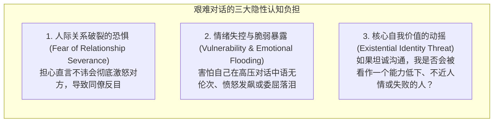
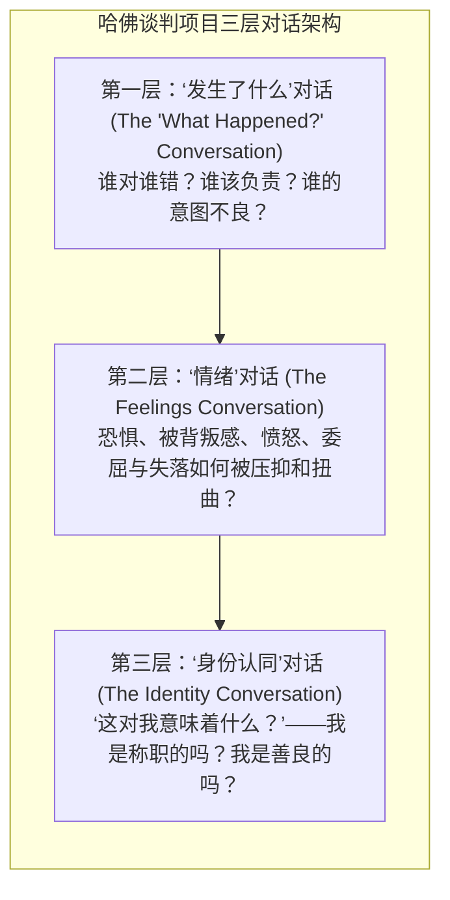
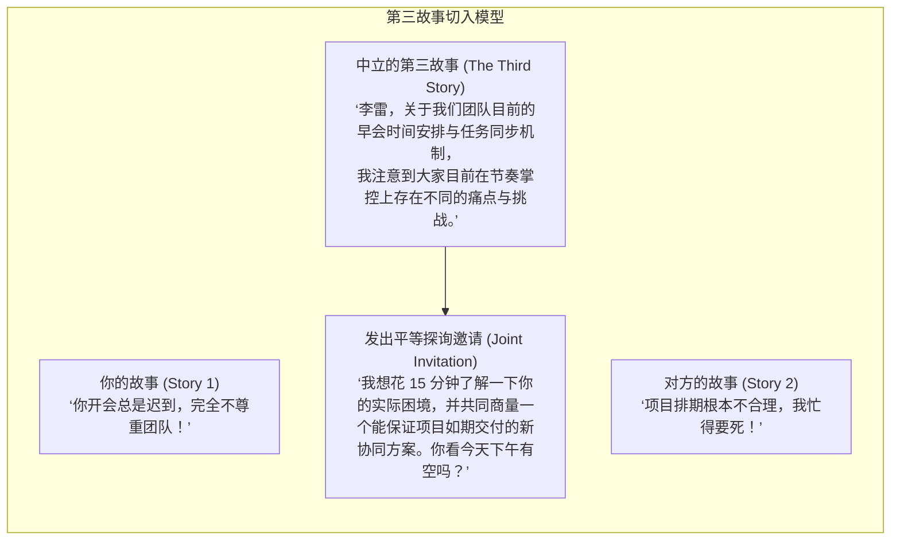

# Lec 14 职场艰难对话与冲突解决：三层对话模型、情绪归因与发声艺术

> MIT 15.279 · Management Communication for Undergraduates · 模块十四：高难度对话与人际冲突解决

## TL;DR

- 艰难对话（Difficult Conversations）普遍存在于绩效问责、利益分配、敏感身份议题与职场权力博弈中，回避冲突只会将显性矛盾恶化为组织内耗。
- 哈佛谈判项目组（Stone, Patton & Heen）三层对话模型揭示：任何表面争执都由“发生了什么对话”、“情绪对话”与“自我身份认同对话”共同交织驱动。
- 终结破坏性的指责游戏：彻底扬弃“非黑即白的真相假定”与“恶意意图揣测”，转向多因果协同贡献系统（Contribution System）。
- 启动艰难对话的黄金钥匙——“第三故事（The Third Story）”：从没有利益纠葛的中立第三方视角切入，将对抗性辩论转变为并肩解决问题的联合探索。

## 艰难对话的解剖学：为什么我们本能地逃避冲突？

在职场中，面对同事的拖延、上级的偏袒、绩效评估的分歧、或是涉及薪酬晋升的敏感谈判，绝大多数人的第一反应是**逃避（Avoidance）**。我们对自己说：“现在不是谈这个的好时机”、“说了也没用，反而把关系搞僵”。

然而，管理心理学表明：**未被言说的冲突从未真正消失，它们只会通过冷暴力、消极怠工、办公室政治传言和信任瓦解等更具破坏性的形式向外渗透**。

::: definition 艰难对话 (Difficult Conversations)
任何涉及高度个人利益冲突、伴随强烈且不稳定的情绪张力、触及各方核心自尊与身份认同，且结果具有极大不确定性的人际交流情境。
:::

## 哈佛三层对话模型（The Three Conversations Model）

哈佛谈判项目学者道格拉斯·斯通（Douglas Stone）、布鲁斯·帕顿（Bruce Patton）与希拉·希恩（Sheila Heen）指出：无论表面上争吵的是产品上线时间表还是预算分摊，任何一场艰难对话都同时在三个平行层面展开：

### 1. “发生了什么”对话的三大认知陷阱

- **陷阱一：真相假定（The Truth Assumption）**：
  - *误区*：“我是客观理智的，我掌握的是绝对真理；对方之所以反对我，是因为他愚蠢、偏执或别有用心。”
  - *重构*：放弃“辩驳谁对谁错”，转向“好奇心（Curiosity）”。双方掌握的信息源、历史经验与关注焦点不同，因此看到的世界也不同。
- **陷阱二：意图发明（The Intention Invention）**：
  - *误区*：我们习惯用对方行为对我们造成的**实际影响（Impact）**，直接推导出对方在潜意识中的**主观意图（Intent）**。因为方案被对方否决让我感到极度痛苦，所以我认定对方是故意要毁掉我。
  - *重构*：将影响与意图彻底解耦。承认自己的受损感受，但真诚向对方探询其做出该决定的真实驱动力。
- **陷阱三：指责框架（The Blame Frame）**：
  - *误区*：寻找一只替罪羊，向其倾泻全部过错。
  - *重构*：从指责转向**贡献体系（Contribution System）**。在复杂组织中，任何一个问题的产生，双方几乎都共同做出了某种“贡献”（如一方习惯含糊下达指令，另一方习惯不假思索盲目执行且从不主动提问）。

### 2. “情绪”对话：情绪不是旁观者，而是燃料本身

很多受过理工科理性训练的管理者认为“谈情绪是不专业的”，试图在对话中死守所谓的纯技术逻辑。然而，**未经承认和疏导的情绪会像高压锅里的蒸汽一样不断寻找缝隙泄漏**——表现为尖酸刻薄的语调、嘲讽的微表情、冷漠的沉默或突然爆发的人身攻击。

专业对话者懂得**显式命名情绪（Naming the Emotion）**：“在讨论这个方案前，我想坦诚地说，由于上次项目调整没有提前知会，我目前感到非常缺乏安全感与被边缘化……”当情绪被真诚命名并被对方确认接纳后，理性讨论的认知带宽才会重新释放。

### 3. “身份认同”对话：拆除“全有或全无”的心理防线

身份认同对话是三层结构中最底层、最凶险的地核。面对批评，人脑会启动极端的二元对立防御：
- “如果我承认这个 Bug 是我造成的，那我就是一个彻头彻尾的平庸程序员；”
- “如果我指责下属的过失，那我就是一个刻薄冷血、令人讨厌的领导。”

::: insight 克服二元身份防卫：接纳复杂性 (Adopt the "And Stance")
心智成熟的管理者懂得接纳自我的复杂性（The "And" Stance）：
“我是一名极其优秀的架构师，**同时**我今天确实在这个并发计算模型中犯了一个严重的疏忽；”
“我是一个充满关怀与同理心的人，**同时**为了项目的生存，我今天必须坚决执行人员优化决策。”
当你不再恐惧自己的自尊被单次过失彻底摧毁时，你就能以极度从容的姿态直面任何艰难对话。
:::

## 破局利器：“第三故事”开场技术（The Third Story）

艰难对话的成败，往往在开场的前两句话就已经决定。许多管理者好不容易鼓起勇气敲开对方的门，开口第一句却是：“李雷，我们必须谈谈你最近极其不负责任的迟到问题，你的行为已经严重破坏了团队纪律！”

这种开场直接从你自己的版本（Story 1）强硬切入，包含了强烈的“真相假定”与“恶意意图揣测”。它瞬间击穿了对方的心理防御底线，对方的神经回路会立刻切换至反唇相讥的对抗模式（Story 2）：“我哪里不负责任了？你知不知道我每天加班到凌晨两点？项目排期根本不切实际！”对话在第 5 秒钟就已经沦为了情绪肉搏。

哈佛谈判项目组指出：卓越对话者永远从**“第三故事（The Third Story）”**切入——即一位毫无利益关联的明智中立观察者所看到的情境：

第三故事的精髓在于**绝对的客观中立与不评判**：
- 它既不判定你对，也不判定对方错；
- 它将核心议题描述为一个“双方共同面对的客观协同分歧”，而非“某一方的人品或道德缺陷”；
- 随后，发出真诚的联合探询邀请（Joint Invitation），邀请对方并肩坐在一起，共同审视桌子中间摆放的那个业务难题。

这种修辞技术的切换，彻底改变了对话的引力场：你们不再是站在拳击台两侧互掷重拳的对手，而是站在同一战壕里、并肩寻找系统最优解的商业合伙人。

## 我的理解

::: insight 发声的勇气是领导力的成人礼
很多年轻同学在面对组织不公、技术路线错误或高管盲目决策时，常常选择将嘴唇紧闭。他们安慰自己：“我人微言轻，说出来只会惹麻烦；等我以后当上总裁有权力了，我再去改变这一切。”

然而，组织心理学的无数案例残酷地证明：**如果你在身为初级员工时缺乏为真理和正义发声的脊梁，随着你职位的步步攀升，你的权力固然增大了，但你所面临的利益羁绊、政治顾虑与沉没成本也会以几何倍数激增——你反而会变得比年轻时更加怯懦与圆滑**。

发声（Speaking Up）从来不是权力的附属品，发声是一种需要日复一日在微小情境中磨练的道德肌肉。

每一次当你鼓起勇气、运用理智克制的三层对话模型，心平气和地向团队指出那个被所有人视而不见的房间里的大象时；每一次当你不再逃避、主动敲开那个充满敌意的同僚办公室大门时；你都在完成一次脱胎换骨的成人礼。

领导力从不取决于你的工牌上印着什么头衔；领导力取决于，在那段注定艰难的对话降临的瞬间，你是否选择挺直脊梁，推开那扇门。
:::
