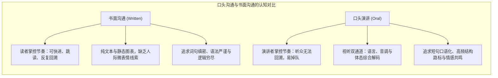

# Lec 2 商务口头演讲艺术：架构组织、肢体语言与视觉辅助

> MIT 15.279 · Management Communication for Undergraduates · 模块二：口头商务表达

## TL;DR

- 口头演讲与书面阅读存在根本认知差异：听众无法像读者那样回溯翻阅，演讲者必须提供强有力的结构路标（Signposts）与听觉缓冲。
- 商务演讲的标准三幕式架构：抓人眼球的开场锚定（Hook）、清晰的议程路线图（Roadmap）、逻辑平滑的过渡承接与掷地有声的行动号召（Call to Action）。
- 非言语沟通（目光接触、声音多样性、开放姿态与手势）塑造了演讲者超过一半的专业可信度与高管气场（Executive Presence）。
- 视觉辅助工具必须服从“断言-证据范式”：幻灯片绝不是提词板，杜绝整句要点堆砌，以直观图表与高信噪比视觉强化核心论点。

## 口头传播的认知特性：为耳朵设计信息

很多技术和商业分析人员在做演讲时，最常犯的错误是将一份优秀的 Word 报告或技术白皮书直接“读”给听众听。这种做法忽视了人类听觉处理与视觉阅读之间的生理机制差异：

1. **线性和不可逆性（Linear & Ephemeral）**：书面读者如果走神或未理解某个公式，可以随时倒退回看；而演讲听众一旦错过某个逻辑转折，就会彻底掉队并放弃后续全部内容。
2. **工作记忆极易过载（Working Memory Vulnerability）**：人脑瞬时记忆容量极其有限。长句、复杂的定语从句和无层次的数字罗列会导致听觉认知超载。
3. **多模态感知协同（Multimodal Perception）**：听众在接收语言内容（Verbal）的同时，大脑正高度敏感地解码演讲者的语调（Vocalics）、眼神、微表情与肢体姿势（Nonverbal）。

## 商务演讲的三幕架构工程学

一场成功的管理层汇报应当遵循经过实证检验的结构工程学，引导听众平稳穿越认知之旅：

```mermaid
flowchart LR
    subgraph Act1["开篇：建立连接与预期"]
        direction TB
        A1["引人入胜的开场白 (The Hook)"]
        A2["明确商业相关性 (WIIFM: What's In It For Me)"]
        A3["阐明清晰议程图 (Agenda / Roadmap)"]
    end

    subgraph Act2["正文：论据递进与路标引导"]
        direction TB
        B1["核心论点 1 (Assertion + Evidence)"]
        B2["显式过渡路标 (Transitions & Signposts)"]
        B3["核心论点 2 / 核心论点 3"]
    end

    subgraph Act3["收尾：决策收敛与行动推动"]
        direction TB
        C1["总结核心三要点 (Summary of Key Takeaways)"]
        C2["发出明确行动号召 (Call to Action / Next Steps)"]
        C3["专业 Q&A 互动管理 (Handling Questions)"]
    end

    Act1 --> Act2 --> Act3
```

### 1. 开场白（The Hook）与利益锚定

杜绝以平庸的“大家好，今天我要讲的是……”开场。前 30 秒必须抓住听众注意力并建立商业紧迫感：
- **震撼数据/反直觉事实**：“过去 12 个月里，我们 42% 的高质量技术候选人在收到 Offer 后的 48 小时内流失到了竞品……”
- **情境痛点切入**：“想象一下，周五下午 5 点生产核心数据库突然宕机，而我们的双机热备切换延迟高达 45 分钟……”
- **明确利益（WIIFM）**：“在接下来的 15 分钟里，我们将共同审议一套零硬件资本支出的架构重构方案，它能将灾备恢复时间缩短至 30 秒。”

### 2. 结构路标（Signposts & Transitions）

口头表达中必须高频使用显式路标词，充当听众认知地图上的“路牌”：
- **前瞻性路标**：“在探讨具体的四项优化举措之前，我们先来看一下当前成本结构的三个核心漏洞……”
- **回顾性路标**：“到目前为止，我们已经验证了技术可行性；现在，我们转向管理层最关心的财务回报周期……”

### 3. 强力收尾与行动号召（Call to Action）

绝不能以“呃，我要讲的就是这些了，谢谢”草草收场。收尾必须是决策的扣动扳机时刻：
- 重新强化核心结论与战略收益。
- 给出清晰、有时限的下一步请求：“为了在 Q3 顺利上线该系统，我们需要执委会在本周五前批准 15 万美元的专项云资源预算。”

## 非言语沟通：塑造高管气场（Executive Presence）

研究表明，当演讲者的口头语言与肢体语言发生冲突时，听众会压倒性地相信肢体语言所传递的信息。

::: definition 高管气场 (Executive Presence)
一种通过沉稳体态、眼神接触、声音调控与从容互动所展现出的专业自信、情绪稳定度与可信赖感，使人愿意倾听、信服并追随的综合非言语影响力。
:::

### 1. 目光接触（Eye Contact）：灯塔扫描法则

- **常见误区**：眼睛紧盯天花板、地面、演讲备忘小抄，或背对着听众念 PPT。
- **最佳实践**：**“灯塔扫描法则（The Lighthouse Technique）”**。将注意力按区域分配给全场听众。与某一位听众保持持续 3–5 秒的目光接触，完成一个完整的语义分句，再从容转向另一位听众。这不仅传递自信，更能实时监测听众的微表情反馈。

### 2. 声音控制（Vocalics）：音量、语速与关键停顿

- **语速控制**：紧张时人体肾上腺素飙升，导致语速不由自主加快。标准商务演讲语速应维持在每分钟 130–150 词（中文约 220–260 字）。
- **停顿的威力（The Power of the Pause）**：停顿是口头演讲中最强悍的标点符号。在抛出核心结论前停顿 2 秒，能制造期待感；在陈述完重要数据后停顿 2 秒，能给听众消化和吸收留出认知空间。停顿能彻底取代“嗯”、“那个”、“就是说”等低价值填充词（Filler Words）。

### 3. 躯干姿态与手势（Posture & Gestures）

- **立足根基**：双脚与肩同宽，重心均匀分布在两脚掌，身体直立但不僵硬。杜绝无意识的左右晃动、来回踱步或将双手插在裤兜里。
- **手势区域（The Power Box）**：手势应当在胸部与腰部之间的“力量方框”内自然展开。手掌向上或平推代表开放与合作；切削动作代表果断决断。手势必须与语义同步，避免机械重复的小动作（如转笔、抠指甲）。

## 视觉辅助与断言-证据幻灯片设计

幻灯片（Slide）不是给演讲者看的备忘词条，而是给听众眼睛看的认知放大器。

::: pitfall 提词板幻灯片 (Teleprompter Slide Syndrome)
在幻灯片上贴上密密麻麻的完整段落与要点列表，演讲者转过身照着读。这种做法会触发**“注意力分裂效应（Split-Attention Effect）”**：人脑无法在阅读长文本的同时有效倾听口头讲解，最终导致阅读与倾听双重崩溃。
:::

### 断言-证据范式（Assertion-Evidence Paradigm）

MIT Sloan 严密推行源自宾州州立大学 Michael Alley 的“断言-证据模型”：
1. **断言标题（Headline Assertion）**：顶部必须是一句完整、有明确主谓宾、传递核心商业洞察的断言句（不超过两行），杜绝无意义的主题词（如“财务分析”、“竞品对比”）。
2. **视觉证据正文（Visual Evidence Body）**：下方全部留给高质量的量化统计图表、系统架构图、流程示意或实物照片，并对关键数据点进行高亮标注。

## 我的理解

::: insight 演讲紧张的生理学重构：从焦虑到激情的能量重导
几乎所有初登讲台的同学都会受到演讲焦虑（Stage Fright）的困扰：心跳加速、手心出汗、咽喉发干。很多人试图通过“告诉自己不要紧张”来压制这种反应，但这在生理学上是注定失败的。

现代神经科学表明，极度紧张与极度兴奋在大脑杏仁核引发的交感神经唤醒机制完全相同——心率加快、瞳孔放大、血液流向肌肉。区别仅在于大脑前额叶皮层对这种生理信号的认知标签（Cognitive Label）：如果你把它标记为“我马上要在众人面前出丑了”，它就是破坏性的恐惧；如果你把它标记为“我的身体正在调动全部储备能量，帮助我完成一场决定性的说服”，它就是极具感染力的激情。

真正的专业演讲者从不奢望消灭恐惧，而是与身体的战备反应结盟。上台前做三次深长的横膈膜腹式呼吸，然后对自己说：“我很兴奋，因为今天我将分享一项能真正改变团队效率的关键洞察。”
:::
