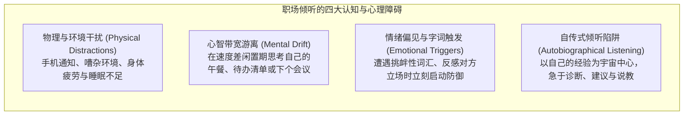
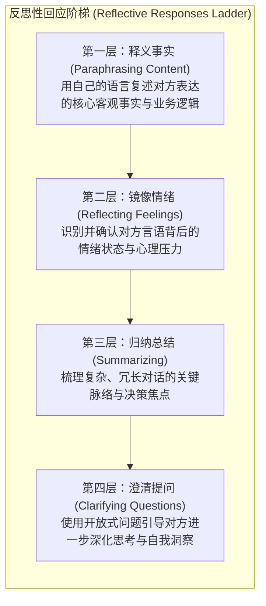
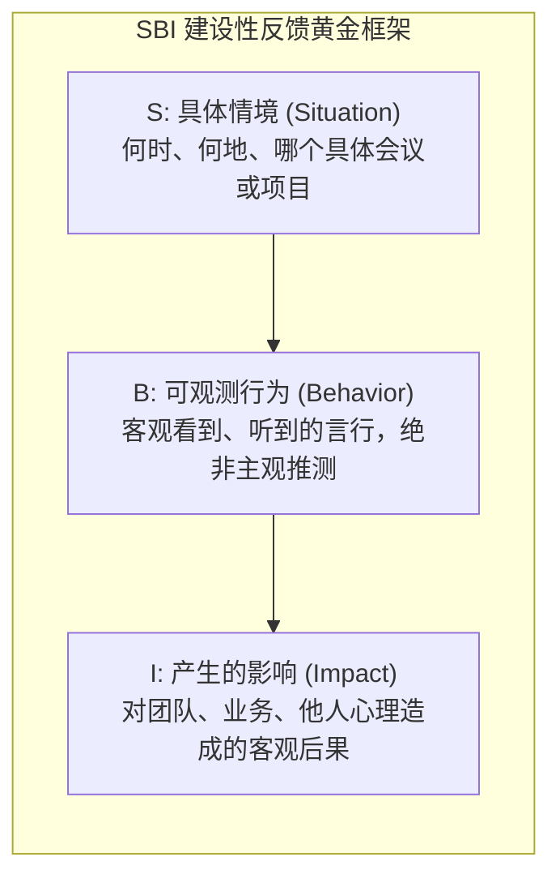

# Lec 3 积极倾听与建设性反馈：倾听障碍、反思性回应与双向赋能

> MIT 15.279 · Management Communication for Undergraduates · 模块三：人际对话与反馈工程

## TL;DR

- 倾听是管理沟通中耗时最长（占职场沟通时间 45% 以上）却被训练最少的核心胜任力，其障碍主要来自心智速度差、情绪触发与自传式评判。
- 积极倾听（Active Listening）要求倾听者暂时悬置个人预设，通过“释义事实、镜像情绪、归纳提炼与澄清提问”四层反思性回应构建双向心理安全感。
- 建设性反馈必须严格遵循 SBI（情境-行为-影响）模型，基于可观测的具体客观行为展开，坚决摒弃给对方动机与性格贴标签的惩戒式沟通。
- 接收反馈的核心在于管理三大心理防御触发器（真实性触发器、关系触发器与身份触发器），将他人反馈视为改善心智盲区的无价镜子。

## 职场倾听的认知困境与四大障碍

管理学者爱德华·沙因（Edgar Schein）指出：大部分管理者所谓的“倾听”，本质上只是在等待对方停下来说话，好让自己立刻切入并发表高见。人脑每分钟能够处理 400–600 个单词的信息，而人类正常的平均语速仅为 125–150 词。这种“思维-言语速度差（Thought-Speech Differential）”为大脑留出了巨大的闲置认知带宽，极易引发分心、游离与过早下结论。

::: definition 自传式回应 (Autobiographical Responses)
在倾听他人陈述时，未经深层理解便本能地从自身过往经验出发所做出的反应，通常表现为四种形态：
1. **评价（Evaluating）**：立刻判断对方是对是错、妥当与否。
2. **探究（Probing）**：以自己的好奇心而非对方的需要展开审问式追问。
3. **建议（Advising）**：过早提供解决方案，剥夺对方自我反思的机会。
4. **诠释（Interpreting）**：自以为是地分析对方的行为动机与心理根源。
:::

## 积极倾听：四层反思性回应阶梯

积极倾听不仅仅是“保持沉默并点头”，它是一种**通过言语和非言语行为显式向说话者验证‘我准确理解了你的信息与情绪’的互动协议**。

### 反思性回应的技术实操对比

| 回应层级 | 说话者原话示例 | 低效的回应方式 | 专业的反思性回应示范 |
|---|---|---|---|
| **释义事实** | “产品团队在发布前一天又改动了核心 API 规范，导致我们整个交付测试流程被迫重来。” | “他们怎么总是这样不守规矩？你们没签协议吗？” | “你的意思是，由于 API 在交付前夕发生变更，测试团队目前不得不从头执行全套回归验证，对吗？” |
| **镜像情绪** | “我不知道该怎么跟高层汇报这个坏消息，我感觉大家都在等着看我们部门的笑话。” | “别想太多，高层都很讲道理的，放轻松。” | “听起来你现在背负了极大的孤立感与信任压力，这确实让人感到焦虑和沉重。” |
| **归纳提炼** | *(长篇大论列举了资源不足、跨部门沟通不畅、时间节点紧张等 5 个问题)* | “行了行了，你到底想要我批多少预算？” | “总结一下你刚才提到的核心挑战，主要集中在两点：一是关键技术人员的缺口，二是需要跨部门建立每周对齐机制，是这样吗？” |
| **澄清提问** | “这个市场方案根本行不通，用户绝对不会买单。” | “你行你上啊，凭什么说行不通？” | “你能帮我具体拆解一下，哪几类核心用户在哪个具体使用环节会产生最大的阻力？” |

## 建设性反馈工程：SBI 行为反馈法则

在组织管理中，缺乏技巧的“负面反馈”不仅无法改善绩效，反而会摧毁心理安全感，激化部门对立。MIT Sloan 强烈推行经过实证验证的 **SBI（Situation-Behavior-Impact）反馈模型**。

### SBI 模型与主观评判的本质区别

- **反面典型（主观评判与动机诛心）**：
  > “李雷，你最近在项目里态度很不端正，做事情毫无责任心，开会的时候总喜欢挑刺！”
  *(后果：对方立刻开启心理防御，反驳“我哪里态度不端正了？”，对话彻底沦为情绪争吵)*
- **正面示范（遵循 SBI 框架）**：
  > - **Situation**：“在上周三下午的架构评审会议上……”
  > - **Behavior**：“当架构师提出方案 A 时，你连续三次打断了他的发言，并称该方案‘毫无技术含量’，但没有给出替代设计……”
  > - **Impact**：“这种做法导致会议偏离了技术评估的核心目标，其他几位工程师停止了发言，整个讨论陷入僵局，延误了评审进度。”
  > - **Alternative / Forward-looking**：“未来在发现方案缺陷时，我们能否先听完完整阐述，然后通过提问来指出具体的风险点？”

::: pitfall “三明治反馈”的伪善陷阱 (The Feedback Sandwich Trap)
许多传统教科书提倡“表扬-批评-表扬”的三明治模式。但在实际管理中，这种方法弊大于利：优秀员工会因为看透了这种套路而忽视前面的表扬，神经紧绷地等待着“但是”后面的重锤；而迟钝的员工则只记住了表扬，彻底忽略了核心的改进要求。**真正的专业反馈应当直接、真诚、就事论事，无需用虚假的夸赞进行包裹。**
:::

## 接收反馈的心理防御机制管理

给出反馈需要技巧，而接收反馈更考验情商与心智成熟度。哈佛谈判项目组（Stone & Heen）指出，人在接收负面反馈时会触发三大生理级心理警报：

1. **真实性触发器（Truth Triggers）**：认为反馈内容“根本不符合客观事实”、“完全是片面的错误认识”。
   - *破解心法*：将“这是错的”转变为“为什么对方会产生这种感知？我的哪些言行给对方造成了这种印象？”
2. **关系触发器（Relationship Triggers）**：由于对反馈给予者的人品、专业水平或信任度存在质疑，从而否定反馈本身（“你有什么资格对我说三道四？”）。
   - *破解心法*：将“谁说的”与“说了什么”剥离，哪怕对方动机不纯，其反馈中可能依然包含对你极其重要的客观盲区。
3. **身份触发器（Identity Triggers）**：反馈动摇了对自己核心身份认同的感知（“我是个优秀的架构师，你批评我的代码就是在全盘否定我的人生价值”）。
   - *破解心法*：确立成长型心智（Growth Mindset），区分“我的当下一项行为需要优化”与“我是一个无能的人”。

## 我的理解

::: insight 倾听是权力的隐性重构
在职场政治中，很多人误以为“掌握话语权”就是不断发言、不断打断别人、不断发表决定性意见。然而观察真正的高层博弈会发现，全场最有威慑力和掌控力的人，往往是那个在会议前 45 分钟极少发言、只用犀利提问引导他人阐述、专注记录并在脑中拆解逻辑的人。

倾听本质上是在暗中重构信息与权力的非对称优势：当你滔滔不绝时，你只是在输出已知信息，并不断暴露自己的认知边界与论证破绽；而当你深度倾听时，你在吸收对方的全部底牌、识别对方的情绪软肋与利益关切。最终，当你基于全场充分倾听后给出一句击中要害的总结与决策时，所有人都会产生一种“他洞察了一切”的心理折服。
:::
