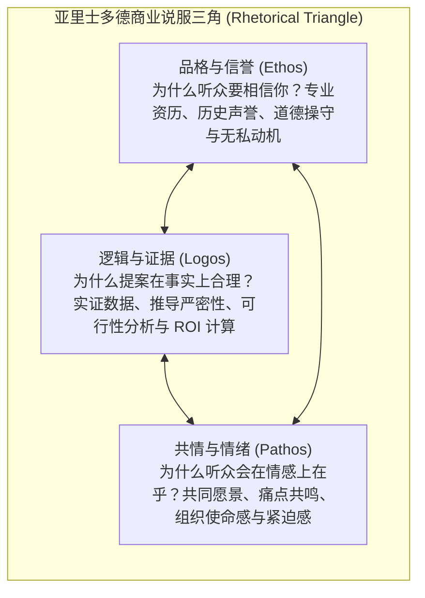
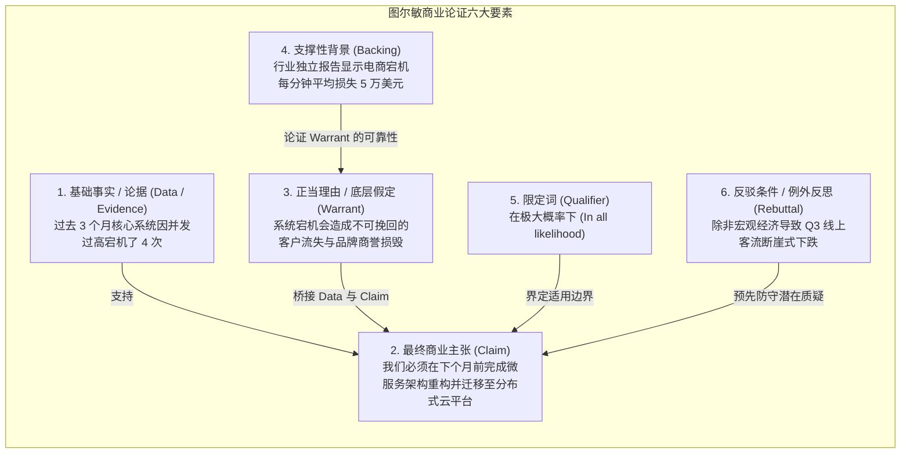
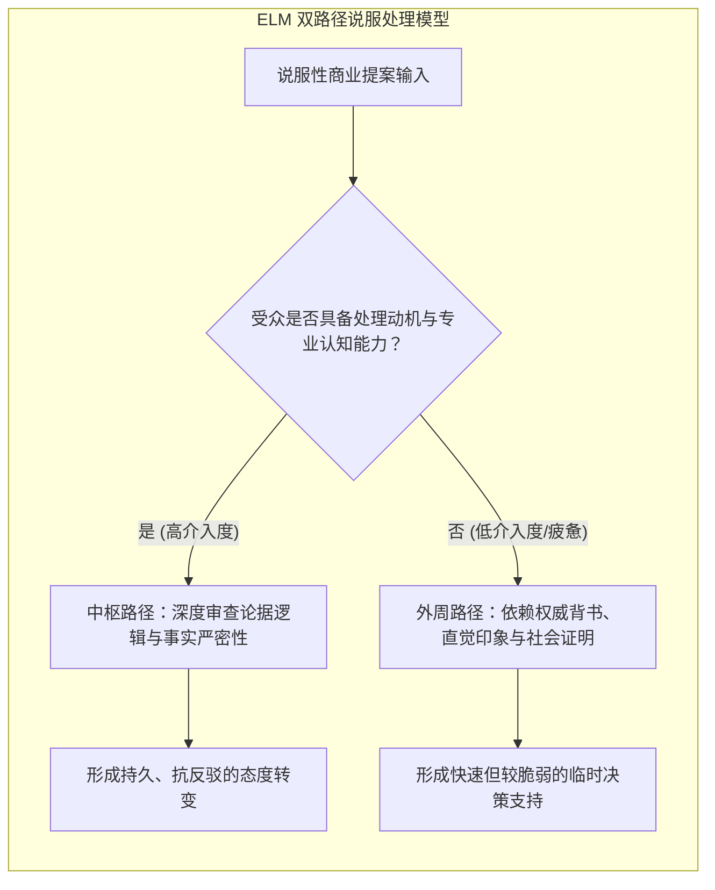

# Lec 4 管理说服与逻辑论证：图尔敏模型与认知捷径研究

> MIT 15.279 · Management Communication for Undergraduates · 模块四：说服修辞与论证工程

## TL;DR

- 商务说服不是强硬推销或权力施压，而是一个协同探索、利益校准与消除认知阻力的精密修辞过程。
- 亚里士多德修辞三角（品格 Ethos、逻辑 Logos、情感 Pathos）是现代商业说服的底层基座，任何单一维度的缺失都会导致说服坍塌。
- 图尔敏论证模型（Toulmin Model）解构了商业主张的六大组件，揭示了“论据（Data）”与“主张（Claim）”之间往往隐藏着未言明的“正当理由（Warrant）”。
- 精通认知心理学中的精细加工可能性模型（ELM）与西奥迪尼影响力武器，能在决策者面临认知疲劳与信息超载时精准构建说服路径。

## 说服修辞基石：亚里士多德修辞三角

在商业环境中，技术专家往往陷入“唯数据论”的执念：认为只要提供无可辩驳的数据图表和技术跑分，管理层就必须批准提案。然而，两千多年前亚里士多德便指出：**纯粹的逻辑（Logos）在人类决策中从不单独起作用**。

### 三大修辞要素的管理实践

1. **品格信誉（Ethos）——说服的入场券**：
   - 如果听众怀疑你的专业能力、质疑你的隐藏个人议程（如试图通过项目扩张自己部门的地盘），无论你的财务模型多么精美，对方都会本能地寻找漏洞并驳回方案。
   - *构建方式*：公开承认自身方案的局限性、主动披露潜在下行风险、引用外部权威第三方机构背书。
2. **逻辑论据（Logos）——说服的承重墙**：
   - 商业世界本质上是资源稀缺环境。高管必须在逻辑上确信方案的因果机制成立，且回报概率显著大于机会成本。
   - *构建方式*：严密的实证因果推导、控制变量测试数据、敏感性情境分析。
3. **共情共鸣（Pathos）——说服的加速器**：
   - 现代神经科学证明，失去情绪共鸣的人类大脑无法做出任何决策。冰冷的数据只能证明“什么是对的”，而对痛点的共鸣才能驱动高管“在今天签字拨款”。
   - *构建方式*：具象化的客户真实困境故事、对团队辛勤付出的认可、勾勒愿景实现后的共同自豪感。

## 论证工程学：图尔敏模型（The Toulmin Model）

哲学家斯蒂芬·图尔敏（Stephen Toulmin）提出的论证模型，是拆解商业提案与辩驳逻辑漏洞的最强分析工具。

::: definition 正当理由 (Warrant)
连接事实证据与最终主张之间的隐性桥梁，它通常是汇报者潜意识中认为“不证自明”的行业公理、管理哲学或价值判断。
:::

### 洞察 Warrant：商业辩驳的关键命门

在许多商业汇报中，双方争吵不休并非因为对“数据（Data）”有异议，而是因为双方底层的“Warrant”截然相反：
- **数据（Data）**：采用新技术方案 A 需要前期追加 500 万美元资本支出。
- **工程师的 Warrant**：技术架构的长期先进性与可维护性高于短期财务回报。$\to$ **主张**：必须立即采购方案 A。
- **CFO 的 Warrant**：企业当前现金流稳健度高于一切，未来 6 个月必须优先压缩资本开支。$\to$ **主张**：坚决冻结方案 A 采购。
- **说服突破点**：当工程师发现 CFO 的 Warrant 在于现金流保护时，单纯争论“架构有多优美”毫无意义；唯一有效的说服是证明方案 A 能在 90 天内通过降低运维人员成本，实现净现金流由负转正。

## 常见商业逻辑谬误辨析

| 逻辑谬误名称 | 核心逻辑缺陷 | 真实商业场景反面典型 | 应对与破解心法 |
|---|---|---|---|
| **事后归因 (Post Hoc Ergo Propter Hoc)** | 仅仅因为 B 发生在 A 之后，就认定 A 是 B 的原因。 | “自从我们换了新的蓝色办公椅，研发团队的交付速度提升了 15%，因此办公椅是效率引擎。” | 引入对照组分析，排查同期是否存在绩效冲刺、需求范围缩减等混杂变量。 |
| **虚假二分法 (False Dilemma)** | 人为将复杂问题简化为非黑即白的两个极端对立面。 | “我们要么不惜一切代价全盘重写底层系统，要么就等着业务彻底被竞品淘汰！” | 指出第三条温和演进道路（如渐进式绞杀者模式重构）。 |
| **滑坡谬误 (Slippery Slope)** | 在缺乏证据的情况下，断言一个微小让步必然引发灾难性后果链条。 | “如果今天同意这个客户的定制要求，全公司所有客户都会要求定制，我们最终将退化为外包小作坊。” | 建立明确的例外准入标准与安全防火墙，切断无依据的因果链条外推。 |
| **稻草人谬误 (Straw Man)** | 歪曲、夸大或简化对方的主张，然后攻击这个虚构的主张。 | “对方主张加强代码审查，这分明是不信任团队，想用官僚主义彻底拖垮敏捷开发。” | 迅速纠偏，重新明确原始主张的真实边界与初衷。 |

## 认知行为说服科学：ELM 与西奥迪尼影响力武器

当说服对象面临海量信息冲击时，人脑会启动捷径启发式处理（Heuristic Processing）。

### 1. 精细加工可能性模型（Elaboration Likelihood Model, ELM）

心理学家理查德·佩蒂（Richard Petty）与约翰·卡乔波（John Cacioppo）提出的 ELM 模型，深刻揭示了为什么同样的商业提案在不同时刻向同一位高管汇报，会得到截然相反的反馈。

人类大脑的认知资源是极其宝贵的稀缺资产。当面临复杂的说服性信息输入时，大脑并不会对每一句话都进行深度的逻辑审查，而是在潜意识中自动选择两条截然不同的信息加工路径：

- **中枢路径（Central Route）**：当受众具有高度动机、充沛精力和专业能力时触发。此时受众仔细审视每一个数据、假设与逻辑推导，对论证的因果严密性吹毛求疵。如果你的数据有漏洞，中枢路径会立刻产生反驳。应对策略：提供坚不可摧的事实证据、清晰图表、稳健的敏感性推演与同行对标数据。
- **外周路径（Peripheral Route）**：当受众精力疲惫、时间紧迫、缺乏深层专业知识或处于多任务处理状态时触发。此时大脑为了节省能量，关闭了深度批判逻辑，完全依赖外部表面线索做决策——例如汇报者的行业声望头衔、肢体气场、幻灯片的排版质感、其他资深高管是否已经点头同意。

在商业汇报实战中，卓越的说服者会同时部署双路径防御体系：一方面准备无可挑剔的底层技术与财务测算（服务于技术专家与精明 CFO 的中枢审查）；另一方面确保幻灯片视觉极简高雅、开篇引用权威第三方机构背书（服务于处于严重时间饥渴状态的 CEO 的外周决策通道）。

### 2. 西奥迪尼六大影响力武器在管理中的应用

1. **互惠原则（Reciprocity）**：先向跨部门团队主动提供资源、支持与技术协作，未来在需要对方支持提案时阻力显著减小。
2. **承诺与一致性（Commitment & Consistency）**：引导决策者在早期先对微小、不具争议的原则点头（如“我们都同意系统稳定性是今年的第一优先级”），后续提案便顺理成章。
3. **社会认同（Social Proof）**：“已有 6 个事业部成功迁移到了新架构”比“我认为新架构很好”具有高出十倍的心理安全感。
4. **权威背书（Authority）**：引用业内顶会论文、Gartner 象限报告或知名技术专家的实证结论。
5. **稀缺性（Scarcity）**：强调行动的时间窗口与失去机会的沉没成本（“云厂商提供的早期迁移专项补贴仅在 Q3 有效”）。

## 我的理解

::: insight 说服的终极形态是“让对方觉得这是他自己的主意”
初级说服者试图通过无可挑剔的辩才压倒对方，向全世界证明“我是对的，你是错的”。这种做法哪怕在表面上赢得了争论，也会在人际关系层面输掉战争，因为没有人喜欢被证明是愚蠢的。

高级说服者是精通苏格拉底产婆术的催化剂。他们从不直接把答案塞进高管的喉咙里，而是精心挑选三组客观数据，抛出两个直击核心的问题，引导决策者自己顺着逻辑推理：“既然这个瓶颈已经严重威胁到交付，那我们是不是必须在下个季度重构它？”

当决策者脱口而出这句话时，说服就已经在最高境界完成了——因为人类对于自己亲手推导出的结论，拥有近乎本能的捍卫热情。
:::
