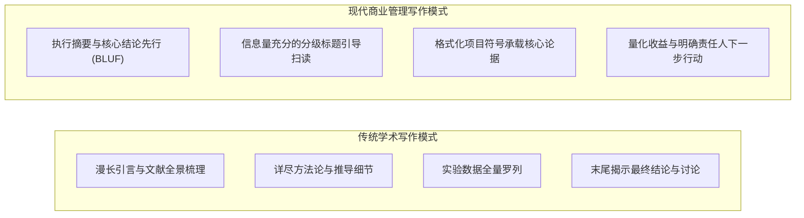
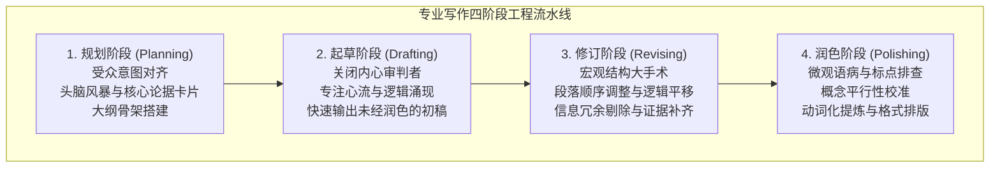

# Lec 5 高效管理写作与文档设计：结构逻辑、概念平行与极简文风

> MIT 15.279 · Management Communication for Undergraduates · 模块五：管理写作与文档工程

## TL;DR

- 管理写作是为“处于极度时间匮乏与认知疲惫中的高管读者”服务的工程，必须实现一眼可扫读（Skim-friendly）与行动导向。
- 遵循四阶段专业写作流水线（规划 $\to$ 初稿 $\to$ 结构重构 $\to$ 字符级润色），严防在思路未清时过早陷入辞藻纠结。
- 文档视觉排版即逻辑结构的外显：运用信息量充足的分级标题、慷慨的负空间（留白）与格式化项目符号提升信噪比。
- 恪守概念平行（Conceptual Parallelism）与极简语言准则，剔除名词化沉疴、官僚套话与无谓被动句，释放管理指令的穿透力。

## 管理写作的本质：从学术长文到高管扫描

大学学术写作通常鼓励学者详尽铺陈背景、引用海量文献、在文末才揭晓结论，以此彰显研究的严谨性与学识渊博。然而在商业世界中，这种写作范式是灾难性的：**高管读者永远不会逐字逐句通读一篇 10 页的备忘录，他们是在“扫读（Skimming）”中寻找关键商业风险与决策点**。

::: definition 管理写作黄金律 (The Executive Reader Law)
一篇优秀的商业管理备忘录，必须保证读者仅通过浏览第一段执行摘要、所有小标题以及图表标题，就能在 45 秒内完整理解 80% 的核心商业逻辑与决策诉求。
:::

## 专业写作四阶段流水线（The Four-Stage Writing Process）

初学者最常见的痛苦是面对空白屏幕迟迟无法下笔，或是写了删、删了写。专业写作者采用严格解耦的四步工业流水线：

1. **规划（Planning）**：占全流程 40% 的时间。明确受众诉求，列出 3–5 个支撑论据，用便签或思维导图调整论据层级。
2. **初稿（Drafting）**：占 20% 的时间。坚决关闭“边写边改错别字”的自我审查机制，以最快速度将思路具象化在纸面上。
3. **宏观修订（Revising）**：占 30% 的时间。检查直接结构是否明确、段落首句是否承担了“主题句（Topic Sentence）”功能、各章节是否符合 MECE 原则。
4. **微观润色（Polishing）**：占 10% 的时间。执行语法、拼写、标点、字体层级与视觉排版的最后对齐。

## 文档视觉设计：用排版替读者节省认知带宽

白纸黑字不仅传递文字意义，其排版本身就是一种**视觉前注意编码**。

### 1. 标题必须具备完整信息量（Talking Headings）

- **无信息弱标题（Topic Headings）**：
  > 3. 市场调研
  > 4. 财务分析
  > 5. 建议
- **行动导向强标题（Talking/Action Headings）**：
  > 3. 华东区三四线城市客群流失率突破 35%，原有渠道已触及增长天花板
  > 4. 转型直接线上交付可在前两季度降低 18% 的履约成本
  > 5. 建议在 9 月前批准 20 万美元专项资金用于私域分销体系搭建

### 2. 项目符号的结构化编排与白空间（White Space）

- 避免超过 6 行的“大铁板”纯文本段落。人眼在密集字符中会本能产生阅读抗拒。
- **项目符号法则（Bulleted Lists）**：
  - 列表必须引入一句前导介绍句（Lead-in Sentence）。
  - 列表条目建议在 3–5 项之间（不超过 7 项）。
  - 每个条目前两三个字可加粗显示关键词，形成视觉锚点。

## 概念平行性（Conceptual Parallelism）

概念平行是专业写作与业余拼凑之间最直观的分水岭。它不仅是语法上的一致，更是**逻辑分类层级严密对齐的体现**。

::: definition 概念平行性 (Conceptual Parallelism)
在同一列表、目录、并列分句或章节小标题中，所有并列项必须共享相同的语法结构（如全为动词短语、全为名词词组）与同维度的概念认知层级。
:::

### 平行性违背与修正实战

- **反面典型（语法与概念混乱交织）**：
  > 本季度业务部的核心目标包括：
  > - 降低客户获取成本（*动宾短语*）
  > - 客户留存率提升 15%（*主谓短语*）
  > - 全新 CRM 系统的上线与采购（*偏正名词短语*）
  > - 为什么我们需要重视员工满意度（*疑问从句*）
- **专业修正（统一为严谨的“动词 + 业务对象 + 目标量化”结构）**：
  > 本季度业务部的核心目标包括：
  > - **降低** 客户获客成本至 45 美元以下；
  > - **提升** 高价值客户第二季度留存率 15 个百分点；
  > - **部署** 统一销售云 CRM 系统以打通线索链路；
  > - **推行** 季度员工关怀计划以降低核心骨干流失率。

## 极简文风（Plain Language）：消灭名词化与官僚套话

文字精炼不仅是美学追求，更是对读者时间的最高尊重。

### 1. 铲除“名词化僵尸（Zombie Nouns / Nominalizations）”

把原本充满行动力的动词变成冗长抽象的名词，是导致官僚文风的第一罪魁祸首：

| 冗长臃肿的名词化表达 | 干净利落的动词化精炼表达 |
|---|---|
| We need to **conduct an investigation of** the root cause. | We need to **investigate** the root cause. |
| The team **reached an agreement on** the migration path. | The team **agreed on** the migration path. |
| The framework **provides a demonstration of** scalability. | The framework **demonstrates** scalability. |
| Management should **make a decision regarding** budget. | Management should **decide** on the budget. |

### 2. 主动语态与被动语态的战略权衡

- **默认拥抱主动语态（Active Voice）**：
  - “谁在何时做了什么”，责任主体极其明确，充满决断力。
  - *示范*：“网络安全团队在本周二成功拦截了两次 DDoS 攻击。”
- **战略性使用被动语态（Strategic Passive Voice）**：
  - 当需要淡化人际指责、维护合作关系，或动作接收者远比施加者重要时使用。
  - *反例（过于刺眼）*：“财务部小张搞丢了三份报销单据。”
  - *修正（外交官修辞）*：“有三份报销单据在内部流转过程中被遗失了。”

## 我的理解

::: insight 商业写作是代码重构的自然延伸
对于工程技术人员而言，最好的写作导师其实就是 Clean Code 原则。

一篇商业备忘录本质上就是一个软件工程项目：
- **BLUF 执行摘要** 就是 API 接口签名与函数文档——让调用者无需阅读内部实现细节，就能立刻知道输入输出与功能。
- **信息量充分的标题** 就是具备自解释性的变量名与函数名——坚决杜绝 `func1()` 或 `temp_var` 这种毫无意义的标识符。
- **概念平行** 就是接口实现的一致性契约（Liskov 替换原则）——同层级的类必须实现完全相同的抽象接口。
- **消灭名词化与冗余修饰** 就是代码重构中的 Dead Code Elimination 与提取公共函数。

当你用对待生产环境核心代码的敬畏心来审视备忘录里的每一个词、每一个段落缩进与标点时，你的商业文字就会具备和高质量架构一样的力量——简洁、优雅、无冗余、坚不可摧。
:::
