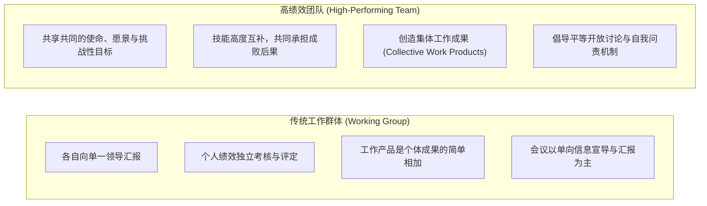
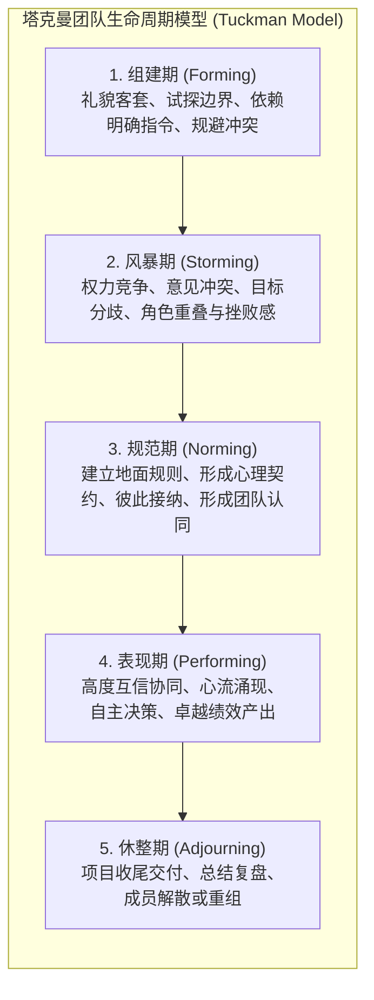
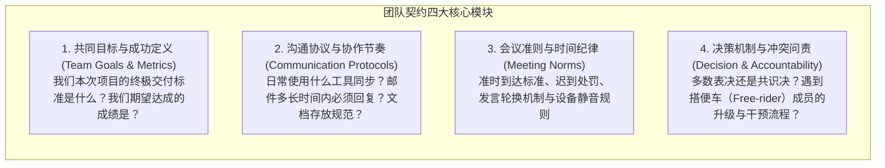

# Lec 6 高效团队协作与会议管理：阶段演进、团队契约与规范制定

> MIT 15.279 · Management Communication for Undergraduates · 模块六：团队动力学与会议工程

## TL;DR

- 区分“工作群组（Working Group）”与“高绩效团队（Real Team）”的核心在于是否存在共同的目标承诺与相互问责机制（Mutual Accountability）。
- 塔克曼团队生命周期模型（Tuckman Model）指出“风暴期（Storming）”是团队进化的必经阶段，压制健康冲突只会导致隐性破坏。
- 团队契约（Team Charter）与地面规则（Ground Rules）是化解搭便车（Free-riding）与人际摩擦的前置制度防火墙。
- 高效团队需平衡“任务角色（Task Roles）”与“维护角色（Maintenance Roles）”，会议管理必须落实议程时间盒与 WWW（Who does What by When）执行追踪。

## 工作群体 vs 高绩效团队：本质认知

在现代企业和高校实践中，“团队”一词常被严重滥用与泛化。五六个被行政命令随机指派到同一个项目组的工程师或实习生，在绝大多数情况下只是一个松散的“工作群体（Working Group）”，而非真正意义上的“高绩效团队（High-Performing Team）”。

哈佛商学院教授乔恩·卡曾巴赫（Jon Katzenbach）与道格拉斯·史密斯（Douglas Smith）通过对数百家跨国企业的深度跟踪调研发现：很多管理者误以为把一群高智商的聪明人关在同一间会议室里，团队协作就会奇迹般地自发涌现。现实却恰恰相反——在缺乏共同承诺与清晰规则的情况下，高智商个体的聚集往往会演变为恶性智力角斗、责任推诿与搭便车内耗。

要构建卓越的协作系统，首先必须从组织机制与心理契约上，彻底厘清二者的本质鸿沟：

从工作群体向高绩效团队的跨越，本质上是一场组织心理学的范式跃迁：成员必须从“我只对我自己这块代码负责”的局部防御心智，升级为“我们共同对最终系统的高可用与商业成败负连带责任”的命运共同体。这种跨越不会自发产生，它需要经历制度化的团队契约约束与阶段性的动力学洗礼。

::: definition 真正团队的定义 (Katzenbach & Smith)
由少数技能互补、共同致力于达成某项有意义的目标与具体绩效要求、并认同共同工作方法、愿意相互承担集体责任（Mutual Accountability）的人所组成的有机共同体。
:::

## 塔克曼团队演进五阶段动力学

布鲁斯·塔克曼（Bruce Tuckman）提出的团队发展模型，揭示了任何人类组织在走向卓越协作过程中不可逾越的心理规律：

### 驾驭“风暴期”的管理智慧

绝大多数失败的团队都夭折在“风暴期”。当组建期的客套面具褪去后，成员由于背景、工作节奏、沟通风格和技术偏好的差异，必然产生剧烈摩擦。
- **平庸团队的做法**：领导者强行压制不同声音，或成员彼此回避敏感议题。表面上维持“虚假和谐（Artificial Harmony）”，实则暗流涌动，产生怨恨并引发消极怠工。
- **卓越团队的做法**：将风暴期视为厘清角色、明确标准、对齐底层价值观的黄金契机。通过制度化的建设性冲突，推动团队平稳迈向“规范期”。

## 团队前置治理：团队契约与地面规则（Ground Rules）

为了防止团队在风暴期自我毁灭，最有效的手段是在项目启动之初签署一份书面的**团队契约（Team Charter）**。

::: example 团队地面规则（Ground Rules）实战条款示范
1. **会议准时性**：会议严格按照日程表时间开始，迟到 5 分钟以上需为全体团队成员购买下次会议的咖啡。
2. **沟通响应时效**：Slack 工作群内的重要 @ 通知，工作时间内需在 2 小时内确认接收；非紧急事项不在晚上 10 点后发群。
3. **分歧解决协议**：若出现技术路线争端，双方在 24 小时内准备不超过 1 页的优劣势分析备忘录，由全员投票或咨询导师做出决断；一旦做出决断，所有人必须恪守“反对但全力执行（Disagree and Commit）”原则。
4. **低绩效处理阶梯**：第一次无故旷工或未交付，由组长进行一对一私下友好提醒；第二次由全员当面诚实问责并要求制定补救计划；第三次正式报告指导教师并启动移出项目组流程。
:::

## 团队角色生态：任务角色与维护角色

组织行为学学者 Benne 与 Sheats 发现，高效团队内部存在两种不可或缺的建设性功能角色，同时必须严防破坏性角色的滋生：

| 角色类型 | 具体角色定义 | 典型行为与口头表达 | 团队价值或危害 |
|---|---|---|---|
| **任务角色 (Task Roles)** | **发起者 (Initiator)** | “我们现在明确一下今天讨论的核心目标吧。” | 推动项目进程，提供新视角。 |
| *(推动目标完成)* | **信息搜集者 (Information Seeker)** | “我们目前有实证数据支持这个假设吗？” | 确保决策基于坚实事实基础。 |
| | **综合梳理者 (Synthesizer)** | “李雷的建议和韩梅梅的架构可以这样结合……” | 打破孤岛，收敛分散观点。 |
| **维护角色 (Maintenance Roles)** | **守门员 (Gatekeeper)** | “小张刚才还没来得及说他的看法，我们先听他讲完。” | 促进全员参与，保护心理安全。 |
| *(维护团队关系与士气)* | **调解者 (Harmonizer)** | “大家虽然在实现路径上有争论，但初衷都是为了系统稳定性。” | 缓解紧张气氛，降温人际冲突。 |
| | **鼓励者 (Encourager)** | “这个创意非常独特，值得我们深入探讨一下。” | 激发团队自驱力与归属感。 |
| **破坏性角色 (Dysfunctional Roles)** | **阻碍者 (Blocker)** | “这绝对行不通，我们以前试过一次失败了。” | 无端消极否决，拒绝建设性方案。 |
| *(消耗团队能量)* | **主导者 (Dominator)** | 垄断全场 70% 发言时间，不断打断他人。 | 扼杀他人思考，制造群体沉默。 |
| | **搭便车者 (Free-rider)** | 开会挂机，认领任务拖延，享受集体成果。 | 摧毁团队互信，引发极度不公。 |

## 高效会议工程学：终结低效马拉松

不良会议是吞噬企业生产力与员工士气的最大黑洞。MIT Sloan 提倡高密度、高纪律性的会议工程：

1. **没有明确议程就没有会议（No Agenda, No Attending）**：
   - 会议发起前至少 24 小时发出包含时间盒（Timeboxing）的议程。
   - 区分“纯信息分享（无需开会，邮件即可）”、“头脑风暴研讨”与“拍板决策会议”。
2. **会议纪要三要素（WWW 黄金法则）**：
   - 严禁流水账式的纪要。会议结束前最后 5 分钟，必须现场复述并确认闭环清单：
   - **Who**（责任主体具体到个人，杜绝写“研发组”）；
   - **What**（可被量化验收的具体交付成果）；
   - **When**（精确到截止日期的具体时刻，如“本周五下午 5:00 前”）。

## 我的理解

::: insight 团队协作不是寻找克隆人，而是编排交响乐
工程技术人员在组建团队时，往往下意识地喜欢寻找“和自己一模一样的人”——技术栈相同、思维习惯相同、甚至连内向性格都相同。这种“舒适圈组队”在组建期固然和谐，但在面临复杂系统工程时却脆弱不堪：整个团队会陷入同样的盲区，产生严重的群体迷思（Groupthink），并在需要跨部门沟通和商务汇报时全员退缩。

卓越的管理者懂得主动拥抱“认知多样性（Cognitive Diversity）”：一个有战斗力的敏捷小组，既需要能天马行空提出颠覆性架构的“构思者（Plant）”，又需要对安全漏洞和测试覆盖率吹毛求疵的“完成把关者（Completer-Finisher）”；既需要专注交付的代码极客，也需要精通人际润滑和商业表达的沟通专家。

真正的团队成熟度，不在于大家有多相似，而在于成员之间能否在高度互信的契约下，像交响乐团中不同音色的乐器一样，容忍彼此的性格特质，协同奏出宏伟的乐章。
:::
