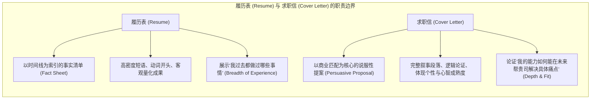
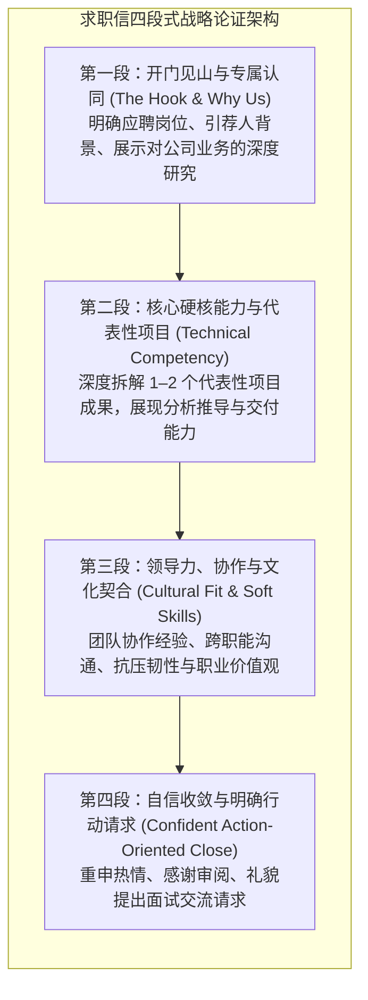

# Lec 7 说服性求职信撰写：价值主张匹配与求职叙事

> MIT 15.279 · Management Communication for Undergraduates · 模块七：职业沟通与求职文书

## TL;DR

- 求职信（Cover Letter）与履历表（Resume）有着根本的分工差异：履历是事实性的“个人历史清单”，求职信则是论证性的“量身定制说服提案”。
- 招聘官的阅读心理极为现实：在 30 秒的初筛中，他们只寻找三个答案：“你为什么选我们公司？”、“你能否胜任岗位核心挑战？”、“你是否契合团队文化？”。
- 经典的四段式战略架构（开篇锚定与岗位识别 $\to$ 硬实力与项目成果深挖 $\to$ 软实力与文化契合度展现 $\to$ 笃定收尾与行动请求），能构建极具说服力的个人价值主张闭环。
- 杜绝“我”字泛滥（“I” Syndrome）与通用模板群发，将个人经历转化为为雇主解决具体商业或工程痛点的叙事资产。

## 求职信的战略定位：从陈述事实到论证匹配

许多初入职场的工科与商科同学常陷入严重的文书误区，认为求职信（Cover Letter）不过是把履历表（Resume）里的项目要点用语法连词串成一段连贯的书面长句。在现代企业由自动化 ATS（Applicant Tracking System）关键字初筛与高级猎头日均审阅数百份简历的严苛背景下，这种机械复述简历的平庸求职信没有任何脱颖而出的可能。

在职业修辞学中，求职信与履历表承担着截然不同的心智传递功能。如果说履历表是一张冰冷、客观、高度格式化的“资产负债表”，那么求职信就是一份充满洞察、论述严密、专为目标企业量身定制的“商业投标提案（B2B Business Proposal）”。

二者的定位边界与信息密度存在根本性的战略分工：

履历表负责向算法和初级 HR 证明你的硬性学术门槛与技能标签；而求职信则是直接写给部门用人主管（Hiring Manager）看的智力对白。主管阅读求职信，不是为了核对你的绩点，而是为了考察：你是否真正理解我们团队目前最头疼的业务瓶颈？你的叙事逻辑是否自洽？你是否具备将工程专长转化为组织价值的商业成熟度？可以说，求职信才是决定你能否跨过平庸候选人群体、直接挺进终面轮次的关键决战文书。

::: definition 求职信的价值主张 (The Value Proposition)
求职者基于对目标机构商业模式、技术栈挑战与企业文化的深刻调研，将自身的学术训练、技术专长与人际领导力，精准包装为能够为该机构创造直接商业或技术增量的叙事方案。
:::

## 四段式经典求职信架构工程学

一份高命中率的求职信应控制在严格的 1 页纸以内（约 350–450 词），逻辑结构清晰且各司其职：

### 1. 第一段：精准锚定与“为什么选我们”

- **必须写明**：应聘的具体岗位、招聘编号，以及得知该职位的渠道（若有内部员工或校友引荐，必须在第一句礼貌点名）。
- **建立专属感（The Hook）**：
  - *反面典型（空洞吹捧）*：“贵司是全球著名的科技巨头，久负盛名，我从小就梦想加入贵司……”
  - *专业示范（深度调研与业务洞察）*：“拜读了贵司首席架构师关于高并发分布式缓存治理的最新工程博客，特别是针对跨地域数据一致性的 Paxos 变体实现，这与我在 MIT 期间开展的分布式系统研究方向高度契合……”

### 2. 第二段：技术实力与深度项目故事

不要机械罗列技术栈名词（Python, SQL, AWS），选择一个最能证明你工程/商业解决能力的真实案例，采用浓缩版 STAR 模型呈现：
- 你面临了什么复杂的现实挑战？
- 你采取了什么非平凡的技术或分析动作？
- 最终产出了什么可量化的客观成效？
- *语言示范*：“在主持‘无人机自主导航避障’毕业设计期间，针对弱纹理室内环境下视觉 SLAM 频繁丢帧的痛点，我提出了一种基于卡尔曼滤波与惯导紧耦合的多传感器融合算法，使系统的位姿漂移误差降低了 34%，并保证了在 60fps 实时运行下的计算稳定性……”

### 3. 第三段：软实力与团队催化效应

现代组织极度警惕“技术优秀但无法协作的有毒天才（Brilliant Jerks）”。第三段需证明你的可合作性：
- 阐述在多元化、快节奏团队中的沟通与协作角色。
- 展现如何管理时间冲突、化解团队分歧、向非技术利益相关者解释复杂方案的能力。

### 4. 第四段：自信求索与行动号召

- 简要总结个人优势与岗位的匹配度。
- 指出随信附上完整简历与项目作品集（Portfolio / GitHub）。
- 表达对进一步沟通的期待，态度自信而不自大，杜绝哀求或被动态度。

## 致命陷阱与修辞修正规范

| 常见致命陷阱 | 心理学负面感知 | 修正策略与专业示范 |
|---|---|---|
| **“我”字泛滥 (The "I" Syndrome)** | 每句话都以“I”开头（I am, I did, I want），给招聘官极度自恋、缺乏受众意识的负面印象。 | 翻转主谓结构，以业务情境、成果或雇主利益作为主语开头： *(改前)* I developed a machine learning model. *(改后)* Leveraging reinforcement learning, this project achieved a 92% accuracy rate... |
| **通用模板海投 (Generic Boilerplate)** | 信中内容换成任何一家竞品公司都完全成立，无任何定制细节。 | 针对每家公司至少投入 30 分钟进行定向调研，引用其最新财报数据、公开演讲或特定开源项目。 |
| **重复简历清单 (Resume Echo)** | 机械叙述“我在 A 公司实习过，还在 B 实验室做过助理”。 | 放弃广度，聚焦单点深挖：讲述简历单个 bullet 背后惊心动魄的思考过程。 |
| **学生心态与乞求语气 (Student Entitlement)** | “我渴望从贵司学到很多东西，希望贵司能给我一个锻炼的机会。” | 雇主招人是为了“解决问题”，不是为了“提供慈善教学”：强调你能为团队贡献什么价值。 |

## 我的理解

::: insight 求职信是职场第一场非对称商业竞标
在商业世界中，当一家软件咨询公司向跨国银行提交价值数千万的技术竞标方案时，他们绝不会在标书里写：“我们公司渴望从贵行的大型金融系统中学习经验，希望贵行给我们一个锻炼队伍的机会。”

相反，竞标书的核心永远是：
“我们调研了贵行核心清算系统面临的三大并发瓶颈；我们分析了同类银行在迁移过程中踩过的坑；我们拥有两套经过实战检验的高可用降级预案，能够确保贵行在迁移期间保持零宕机，并在 18 个月内收回架构重构成本。”

求职信本质上就是个人向企业提交的一份**微型商业投标书（B2B Proposal）**。应聘者就是投标方案的首席执行官。当你彻底摆脱“渴求一份工作的学生”心态，转变为“带着专业解决方案前来进行商务合作的专业顾问”时，你的整篇文字就会散发出一股令所有雇主都无法拒绝的成熟与笃定。
:::
