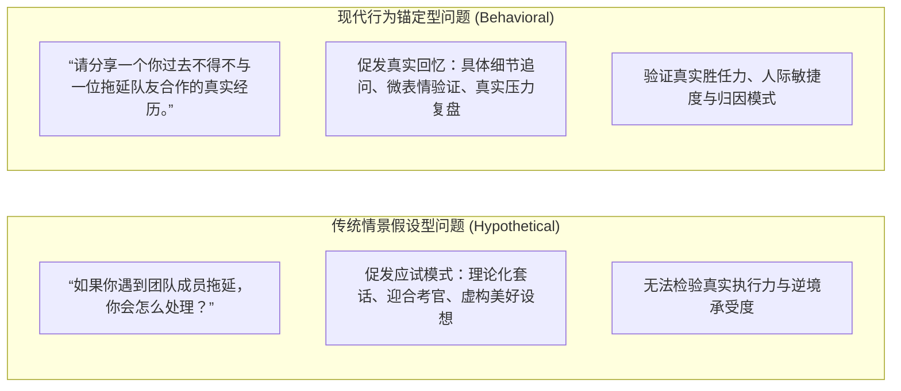
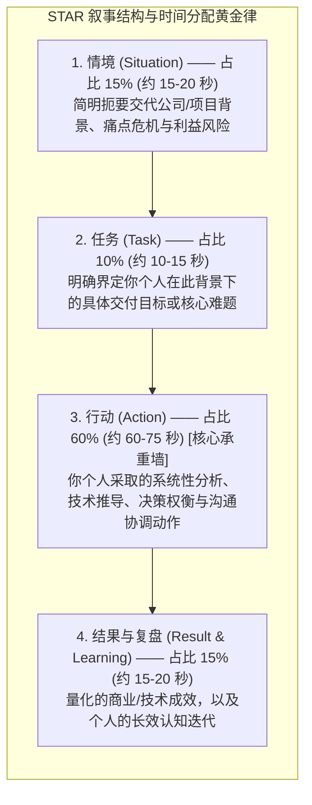

# Lec 8 战略性商务面试：行为面试、STAR 法则与高压问答

> MIT 15.279 · Management Communication for Undergraduates · 模块八：战略面试与高压问答

## TL;DR

- 现代面试已由单向考官审问演变为“双向战略咨询对话”：其底层逻辑在于验证候选人的胜任力、自我反思力与团队文化协同力。
- 行为面试法（Behavioral Interviewing）恪守核心心理学假设：**过去在具体情境中的真实行为，是预测未来绩效的最可靠指标**。
- 运用 STAR 叙事架构（情境 S $\to$ 任务 T $\to$ 个人行动 A $\to$ 量化结果 R），必须将 60% 以上的叙事重心聚焦于个人采取的独立思考与关键动作。
- 妥善化解三大经典高压问题（自我介绍、最大缺陷、惨痛失败），并在面试尾声提出展现宏观商业格局的高价值反向提问。

## 行为面试法的底层机制与招聘官心理

传统的面试问题（如“如果遇到一个不讲理的客户，你会怎么做？”）容易引发候选人的虚构与伪装——每个人都知道教科书式的标准答案。为了穿透这种面具，当代顶级跨国企业、投资银行与科技巨头普遍采用**基于胜任力的行为面试法（Competency-Based Behavioral Interviewing）**。

::: definition 行为面试法核心假设 (The Behavioral Premise)
候选人在过去面对压力、资源匮乏、技术瓶颈与人际冲突时展现出的真实应对行为与反思深度，是预测其未来在全新组织中面对相似挑战时行为模式的最强预测因子。
:::

## STAR 叙事工程学：黄金时间分配法则

在回答“请分享一个……”这一类行为问题时，初学者极易在无关紧要的背景细节上浪费 3 分钟，而在真正体现个人价值的“行动”部分寥寥两句话带过。高效的 STAR 阐述必须严格控制在 90–120 秒内，并遵循**黄金时间分配比例**：

### 聚焦个人行动（The "Action" Engine）

面试官评估的是你（候选人），而不是你所在的团队。因此在阐述 Action 阶段，必须从“我们做了什么”精准收敛到“我具体做了什么”：
- **诊断分析**：“面对并发暴跌，我首先拉取了最近三天的日志，利用 APM 工具定位到底层慢查询出现在联合索引缺失……”
- **方案权衡**：“团队内部当时有两种观点，我花了 4 个小时分别评估了水平分表与引入 Redis 缓存的实施周期与数据一致性风险……”
- **沟通推进**：“由于修改数据结构涉及跨部门接口，我主动组织了一次 20 分钟的站会，向前端主管展示了向后兼容的降级方案，消除了对方的上线顾虑……”

## 经典高压问题通关指南

### 1. “请做一下自我介绍”（Tell Me About Yourself）

- **常见陷阱**：按时间顺序把简历从高中到大学重新念一遍，流水账长达 5 分钟。
- **最佳范式：现在-过去-未来框架（Present-Past-Future Arc）**：
  - **Present（30 秒）**：“目前我是 MIT 大四学生，主修计算机与管理科学，过去一年我专注于大规模分布式系统的可观测性研究……”
  - **Past（40 秒）**：“此前在两家科技企业的实习中，我独立主导了数据管道的性能重构，培养了在高压环境下将复杂数据转化为架构决策的能力……”
  - **Future（20 秒）**：“我非常关注贵司在云原生服务网格领域的突破，我渴望将自己的工程背景与系统性思考能力投入到贵司核心基础设施的研发中。”

### 2. “谈谈你最大的缺点”（What Is Your Greatest Weakness?）

- **虚伪套路（已被考官拉黑）**：“我最大的缺点就是太追求完美了”、“我工作太拼命了，常常忘记下班”。这会被视为缺乏真诚与自我认知。
- **专业应对机制：真实盲区 + 主动防御系统**：
  - 承认一项**真实存在、但非岗位致命死穴**的职业倾向。
  - 重点讲述你为克服这一弱点所建立的**结构化工具或行为习惯**。
  - *示范*：“我过去倾向于在项目初期过度沉溺于底层细节的完美实现，有时会导致整体进度的微幅滞后。意识到这个倾向后，过去一年我引入了严格的时间盒（Timeboxing）机制，并在每个 Sprint 开始前与导师对齐 MVP 最小可行交付标准。这种自律使我本学期的三个大型工程项目均提前高质量交付。”

### 3. “分享一次你经历过的惨痛失败”（Tell Me About a Failure）

- 考官考察的不是你犯了多大的错，而是你的**责任担当度（Accountability）与抗挫韧性（Resilience）**。
- 绝不甩锅给猪队友、绝不抱怨客观环境。
- 坦诚面对错误产生的核心认知盲区，并重点展示这次失败如何升级了你的心智操作系统，成为日后成功的垫脚石。

## 反向提问策略：从应试者跃升为商业合伙人

面试尾声考官询问“你有什么问题想问我们的吗？”绝不是客套。放弃提问等于放弃了展现商业成熟度的最后一张底牌。

::: example 极具深度的反向提问示范
1. **胜任力标准验证**：“如果我未来有幸加入团队，在入职的前 90 天内，我完成哪些具体的里程碑会让您认为这次招聘是极其成功的？”
2. **战略挑战探询**：“随着贵司最近拓展国际市场业务，这个核心工程团队目前面临的最大技术或跨文化协同瓶颈是什么？”
3. **团队文化与动态**：“在这个岗位上，过去表现最卓越的员工通常具备哪些未经书面说明但极其关键的个人特质？”
:::

## 我的理解

::: insight 面试气场的本质是“脱离对 Offer 的饥渴依赖”
在很多紧张的面试中，候选人散发出一种强烈的“请务必选我，我什么都能做”的祈求感。这种心理状态会将主导权完全拱手让人，使自己处于极度被动的评估受体地位。

顶级候选人在走进面试房间的那一刻，心理坐标是完全不同的：
“我今天不是来祈求一份工作的，我是来评估这家机构值不值得我投入未来两到三年的黄金青春与智力资本的。我拥有扎实的工程推导能力和清晰的商业头脑；你们拥有平台与现实挑战。我们今天是一次平等的战略探讨，共同确认双方在价值观、技术理念与长期收益上是否互为最优解。”

当你拥有这种自信与从容时，你的眼神不会飘忽，你的回答不会讨好迎合，你的提问会直击业务本质。正是这种从容的“非饥渴感”，往往会触发雇主最强烈的争抢欲望。
:::
