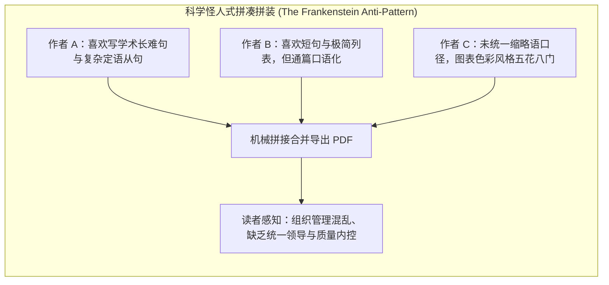
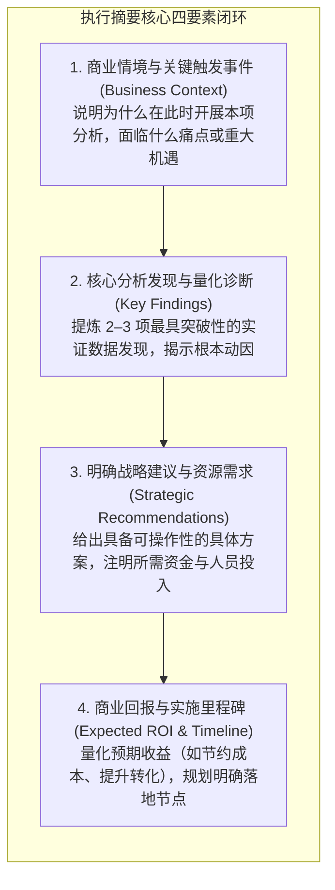
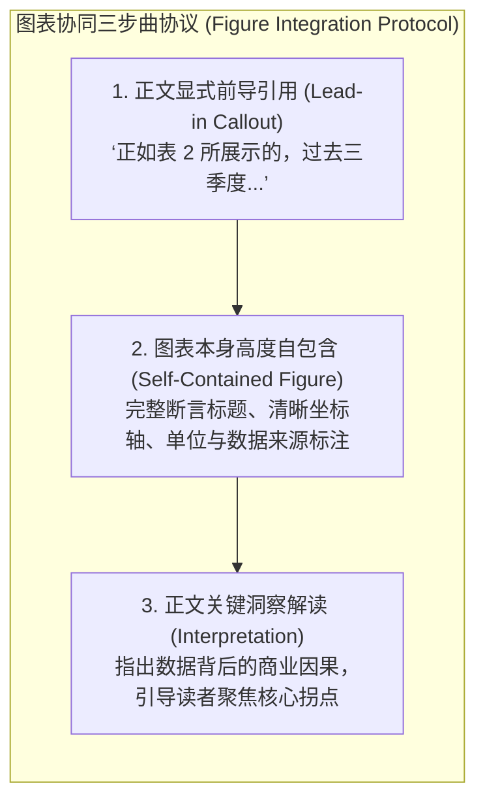

# Lec 9 团队综合报告与图表协同：执行摘要、图表整合与数据墨水

> MIT 15.279 · Management Communication for Undergraduates · 模块九：复杂商业报告工程

## TL;DR

- 多人协同编写的商业团队报告极易沦为“科学怪人式拼凑物（Frankenstein Document）”，必须通过统一规范与“主笔统一润色协议（Single-Voice Protocol）”捍卫整体连贯性。
- 执行摘要（Executive Summary）是整份商业报告最重要的独立资产：它是长篇报告的微缩全息投影，绝非简单的引言或背景介绍。
- 图表整合遵循“自包含原则（Standalone Principle）”：任何表格与图表必须拥有完整标题、坐标单位与数据来源，读者脱离正文亦能准确解读。
- 正文必须对所有图表执行“前置引导（Lead-in）与洞察解读（Interpretation）”，恪守正文聚焦决策推进、底层明细进入附录的极简原则。

## 团队协同报告的痛点：消灭“科学怪人文档”

在商业咨询与工程实践中，复杂报告几乎全部由 3–5 人的跨职能团队协作完成。最常见的灾难是：组长将报告拆成五个小章节，每个成员各自撰写一部分，在截止日期前两小时机械粘贴合并成一个文档。这种报告充满了风格脱节、词汇矛盾、排版混乱与逻辑重复，在专业读者眼中极具杀伤力。

::: definition 主笔统一润色协议 (The Single-Voice Protocol)
团队必须委任一名成员担任“总编辑（Lead Editor）”。在各模块初稿提交后，总编辑拥有重构段落衔接、统一全篇术语词表、对齐格式与图表样式的绝对裁量权，确保整篇报告读起来仿佛出自一位心智成熟的作者之手。
:::

## 执行摘要工程学（The Executive Summary Architecture）

执行摘要是整份商业报告中被阅读率最高（超过 95%）、决定项目生死存亡的一页纸。许多人误将执行摘要写成了“引言（Introduction）”，只交代背景而不揭示结论。

### 执行摘要五大质检军规

1. **绝对独立性（Standalone Comprehensiveness）**：读者无需翻阅后续任何正文章节，仅凭执行摘要就能做出批准、驳回或调整的战略决策。
2. **严禁悬念（No Cliffhangers）**：绝不写“本报告将在后文中详细探讨三种可能方案”，必须直接写明推荐方案及其核心逻辑。
3. **篇幅克制**：对于 10–30 页的商业报告，执行摘要应严格控制在 1 页纸以内（约 400–600 词）。
4. **后置撰写**：在全篇正文定稿、所有数据测算核验无误之后，方可动笔撰写执行摘要。

## 文本与图表协同法则（Text-Figure Synergy）

商业报告中的图表绝不是用于填充空白的装饰性插图。图表与正文文本必须构成相互强化的共生系统：

::: pitfall 图表孤立投毒 (Figure Dumping)
在正文段落之间毫无征兆地插入一张没有任何前导解释的复杂柱状图，然后正文若无其事地继续讨论其他话题。读者会被突然出现的图表打断阅读节奏，陷入“我为什么要看这张图？这张图想告诉我什么？”的困惑中。
:::

### 图表自包含规范（The Standalone Rule）

图表必须具备“哪怕被打印机单页截取，也能被完全读懂”的能力：
- **编号与命名**：统一采用“图 1（Figure 1）”、“表 3（Table 3）”的连续编号体系。
- **信息量标题**：标题应传递核心结论（如“图 2：采用负载均衡集群后，系统平均响应延迟由 320ms 下降至 45ms”），而非形式化名词（“图 2：响应延迟对比”）。
- **轴线与图例**：横纵坐标必须带有明确的物理或财务单位；尽可能在数据线旁边就近直接标注（Direct Labeling），避免使用远离图形且难以匹配的图例框。
- **数据来源注脚**：图表下方必须注明数据来源、采样周期及关键过滤条件。

## 正文与附录的职责解耦

商业决策者的时间极其宝贵，保持正文的“精瘦（Lean Body）”是一项关键美德：

| 模块定位 | 应当包含的内容 | 坚决禁止放入的内容 |
|---|---|---|
| **报告正文 (Report Body)** | - 核心商业论据与逻辑链条 - 关键提炼图表（高度汇总） - 战略风险评估与落地路线图 | - 冗长的原始调查问卷样卷 - 几百行的模型源代码与日志 - 庞大且未聚合的原始数据底表 |
| **报告附录 (Appendices)** | - 敏感性分析全量参数矩阵 - 复杂数学公式的详细推导过程 - 调研方法论、问卷样本分布明细 | - 影响核心商业决策的关键论点（不得埋藏在附录中） |

## 我的理解

::: insight 商业报告是纸面上的战略推演战役
在硅谷和华尔街，很多初级分析师以为写报告就是把 Excel 里的所有数字全盘搬上 Word。他们认为报告越厚、数据越多，越能证明自己的工作量与辛劳。

然而，真正的管理大师在审阅报告时，看重的永远是作者的**信息提炼力与认知过滤力**。

每一份商业报告本质上都是一场针对有限注意力资源的战役：
- 把海量杂乱无序的底层数据，提炼为三组具有因果解释力的核心指标；
- 把各抒己见的跨职能争端，统一收敛为一组权衡明确的行动方案；
- 用极度节制的排版和清晰严谨的图表，为决策者扫清一切逻辑盲区与理解摩擦。

厚度代表的是未经消化的原始材料；而薄而锋利的报告，才代表经过千锤百炼的管理智慧。
:::
