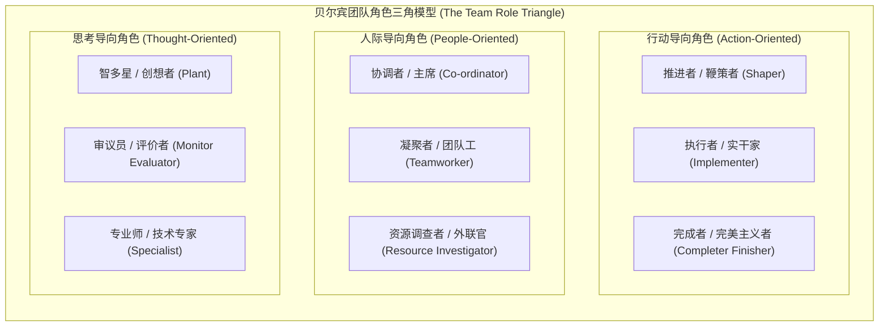
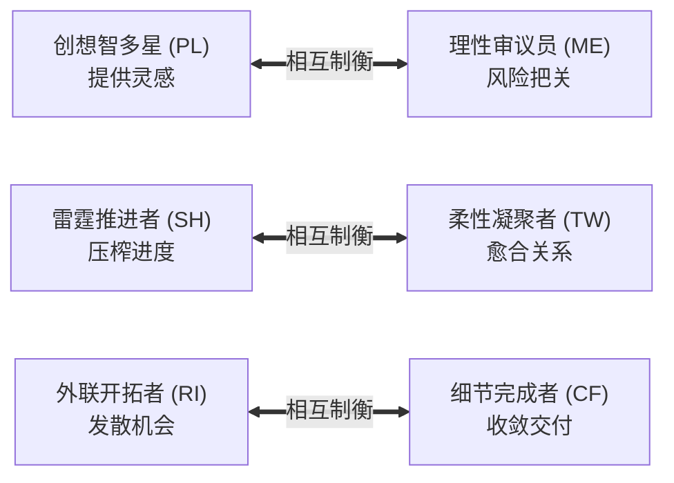

# 贝尔宾团队角色模型 (The Belbin Team Roles Model)

> 知识定位：团队动力学与高管梯队建设的核心行为分类学 · 提出者：Dr. Meredith Belbin（英国剑桥亨利管理学院）

## TL;DR

- 贝尔宾模型揭示：卓越团队并非由一群高智商精英的简单叠加而成，而是由具备互补性行为角色的个体构成的有机生态。
- 确立九大经典团队角色，横跨三大认知维度（行动导向、人际导向、思考导向），确立“角色贡献”与“可容忍弱点”并存的客观规律。
- 团队绩效取决于角色搭配与张力制衡（如创意智囊需搭配审议评判者），为管理者提供了精准诊断团队功能失调与填补协作盲区的系统罗盘。

## 概念定义与核心理论底座

在企业管理实践中，管理者经常陷入一个迷思：只要招聘最聪明、履历最辉煌的专业人才组成团队，就能产生最出色的业绩（即所谓的“阿波罗团队陷阱”）。然而，剑桥大学亨利管理学院的梅雷迪思·贝尔宾（Meredith Belbin）博士在长达九年的实证研究中发现：全由高智商专家组成的团队往往表现极差，成员陷入无休止的智力争论、争夺主导权，却无人关注推进落地与细节质量。

::: definition 贝尔宾团队角色 (Belbin Team Roles)
贝尔宾将“团队角色”严格定义为：**“个体在团队内部与他人互动、做出特定贡献以及表现出的特征行为倾向。”**  
它独立于技术性工作职称（如架构师、产品经理、财务总监），反映了个体在群体决策与协作过程中的深层行为模式。高效团队的关键不在于消灭成员的缺点，而在于通过角色的结构性互补，形成无盲区的能力网络。
:::

为了系统化表征这些复杂的人际行为倾向，贝尔宾模型构建了一个多维的行为分类罗盘。这一分类学将个体对团队的贡献切分为三个核心支柱：思考维度、行动维度与人际维度。通过这三大支柱的动态张力平衡，团队得以在发散创想、收敛执行与维系和谐之间维持稳态，避免陷入单一维度的功能亢进或瘫痪：

这种三角拓扑关系揭示了团队运行的基本物理学：思考导向的角色负责为团队提供智慧弹药与理性审查；行动导向的角色负责将抽象的战略转化为具体的时间表与高质量交付；而人际导向的角色则作为不可或缺的粘合剂，确保多元化的个体在高压环境中不至于离心离德。任何一个维度的坍塌，都会直接导致整体团队效能的雪崩。

## 九大团队角色的贡献与可容忍弱点

贝尔宾模型最深刻的洞见在于：**卓越往往与某种特定缺陷共生**。高效领导者必须学会包容并引导这些“可容忍弱点（Allowable Weaknesses）”，而非徒劳地要求每个人成为全能完人。

| 角色分类 | 团队角色 | 核心贡献 (Contribution) | 可容忍弱点 (Allowable Weaknesses) | 典型行为特质 |
|---|---|---|---|---|
| **思考导向** | **智多星 (Plant, PL)** | 创造性天才，提出颠覆性构想，解决极其棘手的战略死结。 | 不食人间烟火，忽视实操细节与组织既定目标，容易有个人思想所有权执念。 | 独立、非传统、智力卓越、极富想象力。 |
|  | **审议员 (Monitor Evaluator, ME)** | 严密的批判性思维，客观评估各类方案的可行性，阻止荒谬构想。 | 缺乏热情与激励他人能力，过于冷酷挑剔，容易被视为冷水浇灭者。 | 清醒、冷静、具有高度战略眼光、客观公正。 |
|  | **专业师 (Specialist, SP)** | 奉献精神高，在高度狭窄的特定技术领域提供不可替代的专业深度。 | 视野狭窄，“只见树木不见森林”，过分沉溺于技术细枝末节。 | 专心致志、自我驱动、追求专业极致。 |
| **行动导向** | **推进者 (Shaper, SH)** | 注入动能，挑战团队惰性与自满情绪，在高压下带领团队冲锋。 | 容易急躁发脾气，言辞过激容易伤害团队情感，有强硬专断倾向。 | 外向、精力充沛、勇于冒险、渴望胜利。 |
|  | **执行者 (Implementer, IM)** | 严密的组织力，将宏观概念系统转化为可落地的行动步骤与操作规程。 | 面对突发变化适应慢，对未经测试的新想法持保守甚至抗拒态度。 | 务实、自律、可靠、忠实履行计划。 |
|  | **完成者 (Completer Finisher, CF)** | 追求极致品质，排查一切隐性疏漏与差错，建立团队终极安全网。 | 容易过度焦虑与完美主义，难以放手授权，为鸡毛蒜皮的小事忧心忡忡。 | 严谨、专注细节、守时、责任感极强。 |
| **人际导向** | **协调者 (Co-ordinator, CO)** | 明确团队目标，推动集体决策，善于识别各人潜能并进行高效授权。 | 有时被误解为推卸个人事务，利用他人成果，“荣耀窃取者”。 | 成熟、自信、公正、沉稳、具备天然威信。 |
|  | **凝聚者 (Teamworker, TW)** | 调解人际冲突，维护团队士气，充当润滑剂与倾听者。 | 在高压争议时刻犹豫不决，回避冲突，难以做出艰难的问责决定。 | 善解人意、温和、敏感、善于人际周旋。 |
|  | **资源调查者 (Resource Investigator, RI)** | 敏锐嗅觉，开拓外部人脉与新机会，跨边界为团队搜集情报与资源。 | 热情来得快去得快，三分钟热度，后续跟踪与闭环能力薄弱。 | 外向、热情、好奇心强、善于公关社交。 |

## 团队角色张力制衡与生命周期动态

### 1. 结构性配对与张力中和
在组织配置中，单一角色的过度聚集必然引发灾难：
- **智多星 (PL) 必须搭配 审议员 (ME)**：PL 能产生一千个天马行空的狂想，但九百九十个可能让公司破产；ME 的存在能冷静筛选出最有商业价值的那一个。
- **推进者 (SH) 必须搭配 凝聚者 (TW)**：SH 驱动进度的雷霆手段往往会撕裂人际关系，TW 则在幕后修补裂痕、恢复团队心理安全感。
- **资源调查者 (RI) 必须搭配 完成者 (CF)**：RI 不断将外部新概念引入团队，CF 则强行收敛范围，确保既定交付不延期。

### 2. 团队发展阶段与角色介入律
根据布鲁斯·塔克曼（Bruce Tuckman）的团队动力学模型，团队在不同发展阶段所亟需的贝尔宾主导角色存在显著规律：
1. **组建期 (Forming)**：亟需 **协调者 (CO)** 明确方向，与 **资源调查者 (RI)** 探索边界；
2. **震荡期 (Storming)**：亟需 **凝聚者 (TW)** 缓和摩擦，与 **审议员 (ME)** 客观评估争议；
3. **规范期 (Norming)**：亟需 **执行者 (IM)** 确立 SOP 规则，团队达成心理契约；
4. **成熟期 (Performing)**：**推进者 (SH)** 全力催化突破，**完成者 (CF)** 守死交付质量。

::: insight 贝尔宾视角的领导力诊断
管理者在使用贝尔宾模型时，最致命的误区是将测试结果当成人格的“永久烙印”。一个健康成熟的个体通常拥有 1–2 个主导角色（Preferred Roles）、2–3 个可调适角色（Manageable Roles）以及 1–2 个回避角色（Least Preferred Roles）。  
卓越领导者的艺术，是在团队出现特定角色缺位时，自觉调动自身的可调适角色进行**“动态补位”**；而当团队走向功能失调时，跳出局部的业务争端，从“过程咨询（Process Consultation）”的元维度审视角色生态的平衡。
:::
