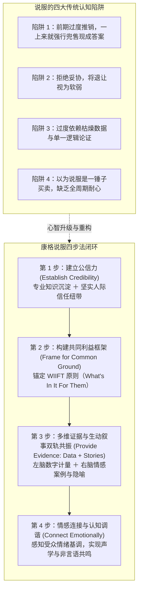

# 康格说服与激励模型 (Conger's Persuasion & Inspiration Framework)

> 知识定位：领导力修辞与组织说服的核心方法论 · 提出者：Jay A. Conger（南加州大学马歇尔商学院教授、《哈佛商业评论》经典著作作者）

## TL;DR

- 破除将说服等同于“施压、操纵或强行推销”的陈旧偏见，确立“说服是一种动态谈判与共同学习过程”的领导力新共识。
- 确立康格说服四步法黄金闭环：建立公信力、构建共同利益框架（WIIFT）、提供证据与故事的双轨验证、达成情感共鸣与音调调谐。
- 区分日常“说服（Persuade）”与高阶“激励（Inspire）”，领导者善用比喻、价值观锚定与非言语声学感染力，激发组织超常承诺。

## 概念定义与说服本质的重构

在商业世界中，许多管理者错误地将“说服力”理解为口若悬河的辩才、压倒性的逻辑碾压，或是利用职权施加心理暗示。杰伊·康格（Jay A. Conger）在其发表于《哈佛商业评论》的里程碑式论文《说服的必备艺术》（*The Necessary Art of Persuasion*）中颠覆了这种传统观点。

::: definition 康格说服模型 (The Conger Persuasion Model)
康格认为：**真正的说服不是单向的观点灌输，而是一个集成了发现、准备、妥协与共同学习的双向谈判过程**。卓越的说服者不是为了“赢得辩论”，而是为了引导受众自愿得出与领导者一致的行动共识。
:::

很多初入职场的管理者之所以在推动变革时屡遭挫败，主要是因为无意识地践行着早已被证明无效的陈旧套路。康格深入剖析了组织中最普遍存在的四种说服谬误，并针锋相对地提出了一套严谨的四步闭环模型。这一范式跃迁强调将说服的重心从“自我立场的捍卫”彻底转移到“受众心智的共创”：

从左侧的四大陷阱向右侧的四步闭环迁移，标志着管理者从初阶“业务执行者”向成熟“影响力领袖”的蜕变。只有当汇报者彻底放弃以强凌弱的辩论姿态，真正将受众视为主权独立的合作者时，深层的组织认同与行动承诺才会自然涌现。

## 康格说服四步法的核心机制

### 1. 建立公信力 (Establish Credibility)
公信力是说服的入场券。康格指出，公信力由两个独立维度乘积决定：
- **专业资质（Expertise）**：受众对你在特定领域的知识深度、判断力和过往成功记录的认可；
- **人际信任（Relationships）**：受众确信你真诚关切他们的利益，具有高道德水准，且言行一致。  
若缺乏专业公信力，受众会质疑你的方案可行性；若缺乏人际公信力，受众会怀疑你的隐藏议程。

### 2. 构建共同利益框架 (Frame for Common Ground)
卓越说服者从不以“我想要什么”开场，而是深度分析受众的痛点与渴望。必须回答核心问题：**“这对他们有什么好处（WIIFT: What's In It For Them）？”**  
通过将团队的变革目标嵌入到受众自身的事业成功、风险防范或组织荣誉中，将阻力化为合力。

### 3. 多维证据与生动叙事双轨共振 (Evidence: Data + Stories)
很多技术型管理者只擅长列出密密麻麻的数据报表，结果导致受众认知疲劳。康格强调：
- **量化数据**满足了受众理性检验（Head）的需求，证明问题的普遍性与严峻性；
- **真实故事与生动比喻**则激发受众感性直觉（Heart），赋予抽象数字以血肉和迫切感。没有数据的叙事是空洞的口号，缺乏叙事的数据是冰冷的死石。

### 4. 情感连接与认知调谐 (Connect Emotionally)
优秀的领导者是情绪敏锐的共情者。他们不仅倾听受众的言语，更能捕捉受众在面对变革时的恐惧、怀疑或倦怠。领导者需要调整自身表达的能量水平（Emotional Tenor），让受众感受到双方处在同一频率上。

## 从“说服”到“激励”：领导者的语言艺术

在康格的另一部经典研究《激励他人：领导者的语言》（*Inspiring Others: The Language of Leadership*）中，他进一步剖析了从常规商务说服迈向**领导力激励演说（Inspiring Speech）**的关键维度：

::: definition 领导力语言的两大支柱 (The Architecture of Leadership Language)
1. **框架塑造 (Framing the Message)**：
   - **使命与愿景定义**：用高度精炼、富有感召力的语言阐明“我们为什么存在”与“我们终将去向何方”；
   - **核心价值观锚定**：将日常业务指标与团队的尊严、卓越追求或改变产业格局的理想紧密缝合；
   - **商业隐喻的运用**：借助生动的比喻（如“破茧成蝶”、“跨越鸿沟”、“为战舰更换引擎”）降低复杂概念的理解门槛并引发情感共鸣。
2. **声学交付工程 (Delivery Dynamics)**：
   - **音量动态 (Volume)**：利用响度变化制造重点悬停与戏剧张力；
   - **语速节奏 (Rate)**：在关键见解处放慢语速并留白停顿（Dramatic Pause），给受众消化反思的心理空间；
   - **语调起伏 (Inflection)**：摆脱单调催眠的平直语调，通过抑扬顿挫传递领导者的信念坚定性。
:::

::: insight 隐喻在商业领导力中的双刃剑效应
比喻是极具威力的修辞武器，能在一秒钟内点亮受众的右脑。然而，过度依赖或滥用陈词滥调的隐喻（例如泛滥的体育竞技术语“把球踢进门”、“打满全场”，或血腥的军事隐喻“消灭友商”、“抢占山头”）会适得其反。  
一方面，文化多元的跨国团队可能因缺乏特定运动背景而彻底产生理解断层；另一方面，好战的隐喻容易在组织内部激化零和博弈思维，破坏跨部门协作。卓越领导者应精选具有普适人文共鸣的成长、探索或构筑类隐喻。
:::
