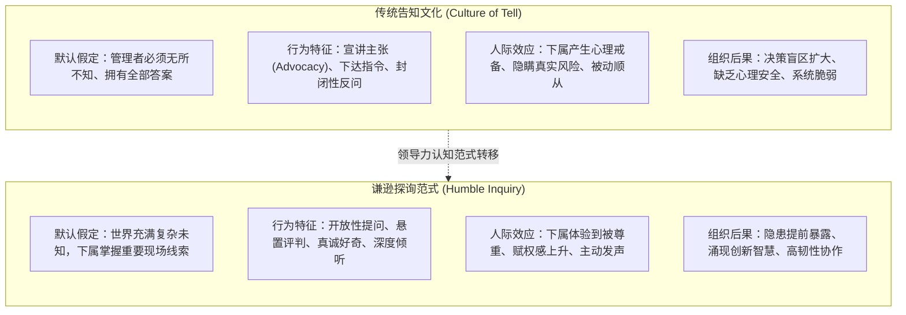
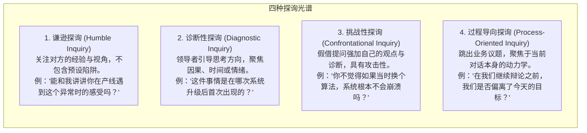

# 谦逊探询 (Humble Inquiry)

> 知识定位：组织发展与领导力沟通的革命性交往范式 · 提出者：Edgar H. Schein（MIT Sloan 组织心理学荣休教授）

## TL;DR

- 谦逊探询是领导者主动示弱、向他人提出自己“并不知道预设答案”的开放性问题的沟通艺术。
- 现代管理文化充斥着“告知文化（Culture of Tell）”，领导者误以为权威源自提供答案，却切断了组织底层向上输送真实信息的通路。
- 区分三类谦逊与四种探询类型，领导者借由“当下此地谦逊”赋能下属心理安全，在知识经济与复杂危机中构建高质量合作关系。

## 概念定义与核心哲学

在传统工业时代的科层制体系中，管理者的核心职责被定义为“计划、指挥与控制”，其沟通模式以“自上而下的告知（Telling）”为主导。然而，MIT Sloan 组织心理学大师埃德加·沙因（Edgar Schein）在其开创性著作《谦逊探询》（*Humble Inquiry: The Gentle Art of Asking Instead of Telling*）中指出：面对知识高度离散、技术日益复杂、下属在专业细节上往往远超管理层的现代组织，“告知式领导”已经成为导致盲目决策乃至组织灾难的罪魁祸首。

::: definition 谦逊探询 (Humble Inquiry)
沙因将谦逊探询严格界定为：**“一种引导他人敞开心扉的微妙艺术——向对方提出你自己事先并不知道答案的问题，并在真诚的好奇心驱动下，建立一种以关切与尊重为基石的人际协作关系。”**  
它要求领导者暂时搁置自身的地位特权，自愿在关系中处于依赖对方提供关键见解的脆弱境地（Vulnerability）。
:::

## 三类谦逊的层次划分

沙因精辟地剖析了“谦逊（Humility）”在社会心理学中的三种截然不同的形态：

| 谦逊类型 | 产生根源 | 典型情境 | 对现代领导力的启示 |
|---|---|---|---|
| **基本谦逊 (Basic Humility)** | 出身、阶级或传统社会身份等级。 | 封建社会对贵族、王室或宗教领袖的服从。 | 在平等开放的现代知识组织中已基本失效。 |
| **选择性谦逊 (Optional Humility)** | 基于后天卓越成就或职业技能的差异。 | 外科手术前向资深院士致敬；欣赏奥运冠军。 | 虽然受人尊重，但容易演变为“专家权威的自负”，抑制跨界学习。 |
| **当下此地谦逊 (Here-and-Now Humility)** | **在具体任务场景中，领导者认识到自己必须依赖他人才能达成目标。** | 医院手术室主任依赖护士核查器械清单；CEO 依赖一线工程师判断系统故障。 | **这是卓越领导力的核心心智。** 它无关身份高低，而是源于对任务现实与自身无知的诚实敬畏。 |

## 四种探询类型的诊断与对比

并非所有提问都叫“谦逊探询”。在管理者的日常沟通实践中，许多提问看似在收集信息，实则暗藏诱导或评判。沙因敏锐地指出，提问的意图、结构以及它对对话主导权的分配，深刻决定了对话是走向心理安全还是人际防御。

为了帮助管理者精准识别自身的交往盲区，沙因构建了一个四象限的探询类型光谱。这四类探询在管理互动中各自承担着不同的职能，但只有第一类才真正具备降维赋权与重建信任的革命性力量：

通过这四类探询的对比可以看出：诊断性探询虽然有助于梳理因果，但本质上依然是由提问者牢牢控制着思考框架；挑战性探询则往往伪装成关切，实则是权力的隐性施压；过程导向探询则是一种高阶的元沟通工具，适用于团队卡壳时的反思；唯有谦逊探询，将解释权与表达节奏完全交还给受访者，从而彻底打开了深度信任的通道。

::: pitfall 挑战性伪探询的毒害
在商业汇报中，最常见的破坏性提问是**假提问、真定罪**的“挑战性探询”（如：“你真的认为这个预算合理吗？”、“难道你没看昨天的业务通报吗？”）。这种提问方式本质上是伪装成问号的感叹号，会瞬间触发被提问者的杏仁核防卫机制，彻底摧毁建立心理安全感的可能性。
:::

## 谦逊探询的应用落地与心智跃迁

::: insight 为什么领导者难以做到谦逊探询？
在当今注重速度与执行力的企业文化中，“迅速给出答案”被错误地等同于高智商与领导魄力。提问、尤其是承认自己“不知道”，往往被管理者潜意识误视为软弱无能。  
然而，在数字化与跨界颠覆的时代，**优秀领导者的首要职责不是假装拥有终极答案，而是向团队提出足以激发全员智慧的顶级问题**。通过当下此地的谦逊探询，领导者向团队传递出最关键的信号：*“你的观察对我们至关重要，我需要你的帮助。”* 这种信号是构建团队心理安全感与高绩效信任链的黄金密钥。
:::
