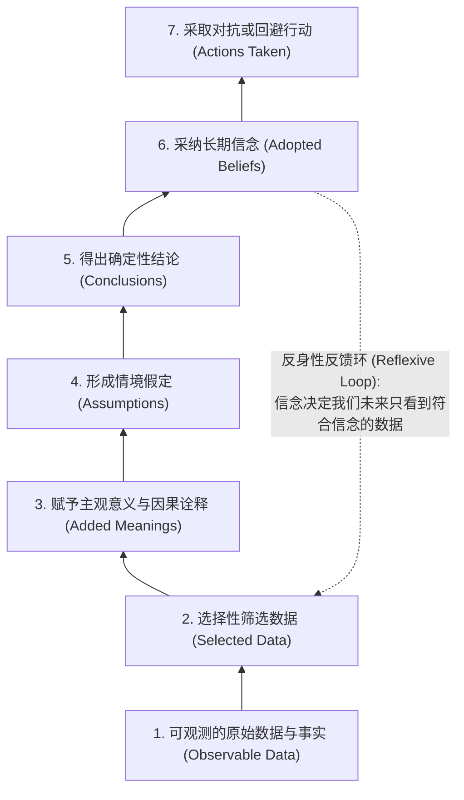
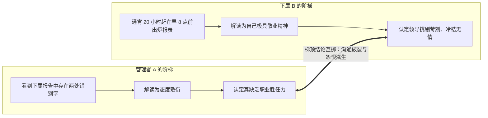

# 推论阶梯 (The Ladder of Inference)

> 知识定位：认知心理学与组织学习理论的核心思维模型 · 提出者：Chris Argyris（哈佛大学）· 普及者：Peter Senge（MIT Sloan）

## TL;DR

- 推论阶梯揭示人脑如何在亚秒级内从客观事实飞跃到主观行动：选择数据 $\to$ 赋予意义 $\to$ 形成假设 $\to$ 得出结论 $\to$ 采纳信念 $\to$ 采取行动。
- 人类具备快速“攀爬阶梯”的神经生物学本能，但在复杂人际互动中，这会导致各方“从各自阶梯顶端互相投掷结论”的沟通灾难。
- 解决人际对抗的根本路径是“倒退下梯”：主动展露自己的推论链条，并探询对方的数据筛选起点，重构共享事实底座。

## 概念定义与核心架构

推论阶梯最初由哈佛大学组织学习专家克里斯·阿吉里斯（Chris Argyris）提出，并由 MIT Sloan 教授彼得·圣吉（Peter Senge）在其经典著作《第五项修炼》（*The Fifth Discipline*）中推广为团队学习与心智模式调试的核心工具。

::: definition 推论阶梯 (The Ladder of Inference)
推论阶梯是一种描述人类认知心智处理与决策形成的递进隐喻。它表明：人类从感知现实世界到最终采取行动，必须经过多层高度自动化、往往不自知的认知加工阶梯。每一层台阶都会基于主观过往经验对信息进行过滤与扭曲：
1. **可观测的原始数据与经验 (Observable Data & Experiences)**：现实世界中客观发生的言行、数字与事实（如“张经理在会议开始 10 分钟后推门进入”）；
2. **选择性数据提取 (Selected Data)**：基于注意力偏向过滤掉绝大多数信息，仅聚焦特定数据点；
3. **文化与个人意义赋予 (Added Meanings)**：结合个人经验为选择的数据贴上标签与因果解释（“他在我发言时进门，这体现了他不重视我的汇报”）；
4. **形成情境假设 (Assumptions)**：由解释推导出未经证实的心理假定（“他不认可我们团队的业务价值”）；
5. **得出确定性结论 (Conclusions)**：将假定固化为不容置疑的事实判断（“张经理是反对这个项目的”）；
6. **采纳世界观与信念 (Adopted Beliefs)**：结论沉淀为长期心智模型，并反向指导未来的数据筛选（反身性循环）；
7. **采取具体行动 (Actions Taken)**：基于信念做出行为反应（“在下一次分配资源时不再向张经理通报”）。
:::

## 认知跃迁的必然性与组织破坏力

### 1. 神经生物学优势与“快思”依赖
正如丹尼尔·卡尼曼在双系统理论中所指出的，人类大脑如果对每一个进入感官的微观刺激都进行全量逻辑溯源，意识将彻底瘫痪。推论阶梯的闪电式攀爬（从数据瞬间直达结论），是人类祖先在丛林中生存的关键进化红利：听到草丛响动（数据），瞬间判定有捕食者（假设），立刻逃跑（行动）。在同频协作的熟悉团队中，共享的潜意识假设使团队无需反复“重新发明轮子”，极大降低了协作交易成本。

### 2. 跨团队协作的“梯顶炮轰”困境
然而，当面对跨职能团队、多元文化背景或高风险争议情境时，这种闪电式攀爬便演化为组织毒药：
- **事实与推论的等同**：当事人几乎无一例外地认为自己的“结论”就是客观“事实”。
- **反身性闭环（Reflexive Loop）**：一旦一个人形成了“某人不可信”的信念，他的认知雷达便会专门捕获该人迟到、沉默或皱眉的细节（证实偏误），彻底无视该人交付优秀成果的事实。
- **梯顶互轰（Hurling Conclusions）**：当甲和乙站在各自推论阶梯的顶端时，他们只向对方喊叫最终的结论（“你们销售部完全不顾产品质量！” vs “你们研发部根本不懂市场节奏！”）。由于双方都没展示自己脚下的阶梯是如何搭建的，对话瞬间退化为立场防御与人身指责。

## 领导力下梯协议：从梯顶退回事实底座

卓越领导者之所以具备化解深层矛盾的能力，核心在于他们掌握了**“沿梯后退（Walking Down the Ladder）”**与**“显性化阶梯（Making Thinking Visible）”**的沟通协议。

::: insight 领导者的下梯调试四步协议
1. **察觉梯顶信号**：当感到内心升起愤怒、鄙视或“这显而易见是对方的错”等绝对化情绪时，立即暂停，识别出自己已经站上了阶梯顶端；
2. **公开自己的推论链**：“我注意到（原始数据），我的理解是（赋予的意义），由此我推测（形成的假设）。我想停下来向你核对一下，你的观察是否一致？”；
3. **探寻对方的推论链**：“你能带我了解一下你的思考过程吗？你是看到了哪些我们没有注意到的数据，从而得出这个方案的？”；
4. **重构共享事实基底**：剥离两人的解释与假定，回到录像带式客观事实层，共同协商评估标准。
:::

::: pitfall 伪下梯的陷阱
许多管理者在使用推论阶梯话术时，容易陷入“审讯式下梯”：“我很好奇，是什么样荒谬的数据能让你得出这么糟糕的结论？”  
这种语言在形式上借用了“探询”的外壳，但在骨子里依然是站在梯顶的优越感俯视。没有真诚好奇心与接纳自身盲区的意愿，任何下梯技巧都会沦落为更具操纵性的伪善。
:::
