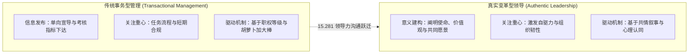
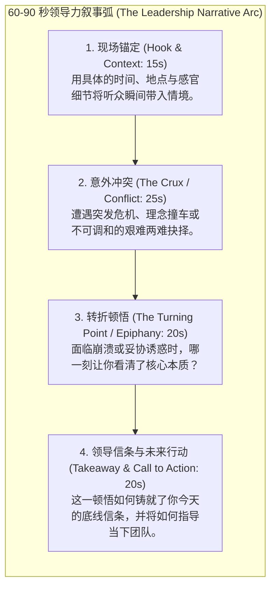

# Lec 1 领导力叙事与真实自我：意义赋予与品牌塑造 (Storytelling in Leadership & Authentic Leadership)

> MIT Course 15 · Managerial Communication · 卓越领导力沟通

## TL;DR

- 确立领导力沟通的核心等式：沟通 = 意义赋予（Meaning）+ 关系构建（Relationship）。
- 破除将领导力等同于权威下达指令的旧范式，基于比尔·乔治真实领导力理论，阐明领导者如何通过“人生熔炉（Crucibles of Leadership）”叙事沉淀个人领导品牌。
- 剖析苏珊·凯恩对内向型领导力的正名研究，破除“外向魅力垄断领导力”的神话，建立多元包容的沟通风格认知底座。
- 掌握 60–90 秒领导力叙事工程学框架：背景锚定、冲突聚焦、至暗转折、核心信念提炼与未来行动共鸣。

## 领导力的沟通本质：意义与关系的双螺旋

在现代复杂商业组织中，很多新晋管理者误以为领导力沟通就是“发布清晰的行政指令”或“进行无可挑剔的 PPT 幻灯片演讲”。然而，MIT Sloan 管理沟通资深讲师 Neal Hartman 在 15.281 课程伊始便明确指出：**管理的本质是处理事务与复杂流程，而领导力的本质是应对变革、激发潜能并赋予意义**。

通用汽车前人力资源副总裁与研究生入学管理委员会（GMAC）历年雇主调查均一致显示：在全球顶级企业对 MBA 毕业生的核心胜任力诉求中，排在首位的永远不是金融建模或技术专精，而是**高情商的人际沟通力、战略性叙事能力与跨职能共识凝聚力**。

::: definition 领导力沟通等式 (The Leadership Communication Equation)
$$\text{Leadership Communication} = \text{Meaning (意义构建)} + \text{Relationship (信任关系)}$$
- **意义赋予 (Meaning)**：领导者必须回答“我们为什么要做这件事情”、“这场变革与更崇高的社会使命有何关联”。在缺乏意义的组织中，员工仅能维持合规性服从；只有被赋予深层意义时，团队才会产生超常承诺。
- **关系构建 (Relationship)**：领导力无法脱离追随者独立存在。沟通不仅是信息的单向传输，更是双方心理契约的持续校准与共情纽带的编织。
:::

## 真实领导力与“人生熔炉”的叙事炼金术

哈佛商学院教授比尔·乔治（Bill George）在其经典研究《发现你的真实领导力》（*Discovering Your Authentic Leadership*）中指出：没有人能通过扮演他人成为伟大的领导者。那些试图模仿杰克·韦尔奇或史蒂夫·乔布斯的管理者，往往会因言行不一而迅速丧失下属的信任。

### 1. 人生熔炉 (Crucibles of Leadership)
比尔·乔治与沃伦·本尼斯（Warren Bennis）发现，几乎所有卓越的真实领导者，其核心价值观都源于生命中的某段极端考验——即所谓的“人生熔炉（Crucibles）”。这可能是一次惨痛的创业失败、一次严重的疾病、早年的被排斥边缘化，或是重大道德抉择的煎熬。

::: insight 熔炉经验的意义重构
平庸者在熔炉中沦为受害者，被痛苦与怨恨吞噬；而真实领导者在熔炉中展现出“意义重构（Reframing）”的非凡能力。他们将创伤转化为人生最重要的成长课堂，并从中提炼出不可妥协的伦理罗盘（True North）。卓越领导者的开篇故事，往往不是炫耀自己的辉煌战绩，而是真诚袒露自身在熔炉中的脆弱与觉醒。
:::

### 2. 内向者的领导力优势：打破外向霸权
长期以来，西方商业文化充斥着对外向、强势、能言善辩型领导者的盲目推崇。苏珊·凯恩（Susan Cain）在其开创性著作《安静：内向性格的竞争力》与 TED 演讲中彻底推翻了这一刻板印象：
- 外向型领导者擅长点燃全场，但在面对高度主动、富有创造力的员工时，容易压制他人主见；
- **内向型领导者具备更深度的倾听能力、更少受自大驱动、更能给予专业下属施展空间**。亚当·格兰特（Adam Grant）的实证研究证实：当团队成员高度自主自驱时，内向型领导者所领导的团队业绩显著优于外向型领导者。
领导力沟通不是比拼音量与张扬程度，而是比拼思想的深度与倾听的厚度。

## 领导力故事工程学：60–90 秒高冲击力叙事架构

在 15.281 的首次演练中，学员被要求在 3 分钟内构思并用 60–90 秒交付一个塑造自身领导力的关键故事。很多技术专家往往超时且平淡无奇，根本原因在于缺乏结构化的修辞工程学。

::: example 60 秒叙事示范：“深夜服务器崩溃的抉择”
“五年前的一个周五凌晨两点（锚定），我们核心金融支付网关突发内存泄漏，每秒钟有上千笔交易卡死。作为技术带头人，我面临两个选择（冲突）：要么立刻向高管隐瞒并重启机器，这能掩盖事故，但下周还会复发；要么按下紧急停机键全量回滚，这意味着本季度团队的 SLA 奖金全部泡汤。  
在指针跳动的第 30 秒，我看着团队通红的双眼（转折），意识到如果今天为了个人私利隐瞒缺陷，我们以后就再也没资格跟工程师谈‘工程尊严’。我亲手切断了服务并通报全员。那次事故让我明白（信条）：真正的技术领导力，不是写出从不崩溃的代码，而是在崩塌面前守住诚信的底线。这也是为什么今天面对新的架构重构，我绝不向技术债务妥协。”
:::

::: pitfall 领导力叙事的致命误区
1. **英雄自恋史**：把故事讲成“我一个人力挽狂澜拯救世界”的好莱坞大片，受众感受到的不是启发，而是油腻的炫耀；
2. **流水账罗列**：缺乏戏剧性的危机冲突与内心挣扎，平铺直叙，听众在 30 秒后注意力涣散；
3. **说教式拔高**：在结尾强行拼凑“我们要勇于担当”之类的大词，故事与结论缺乏因果内聚力。真实与脆弱，才是连接人心最强大的武器。
:::
