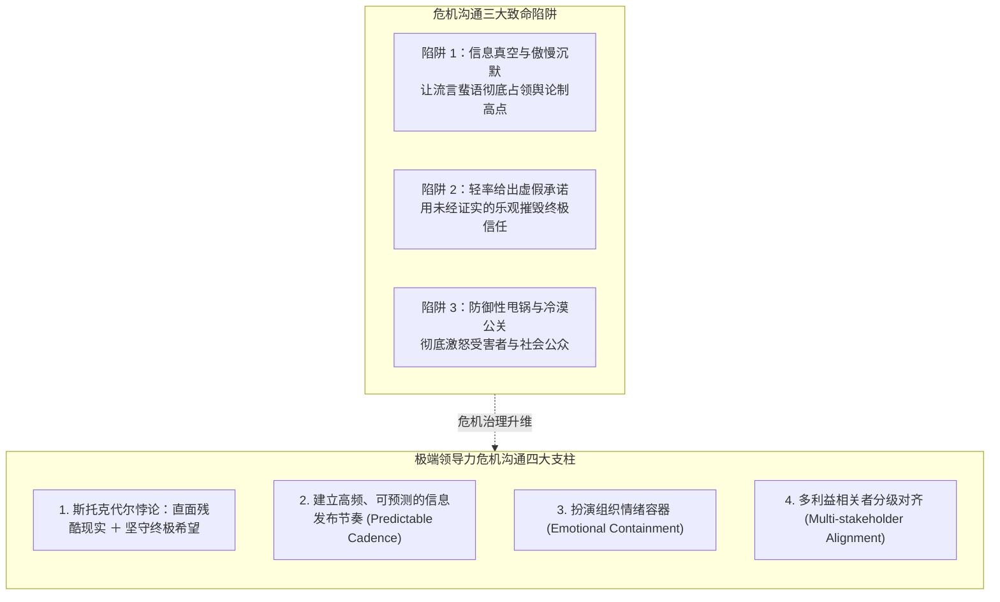
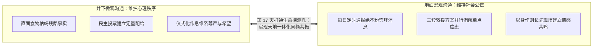

# Lec 10 危机领导力与极端沟通：不确定性下的指挥与共识 (Crisis Communication & Extreme Leadership)

> MIT Course 15 · Managerial Communication · 卓越领导力沟通

## TL;DR

- 基于 2010 年智利矿难救援经典案例，解构极端不确定性与生死危机下的双层领导力沟通模型（井下自治 vs 地面统筹）。
- 践行“斯托克代尔悖论（Stockdale Paradox）”：在最冷酷残酷的客观现实与绝不屈服的终极希望之间建立动态张力平衡。
- 确立高压危机沟通四大军规：消灭虚假希望、建立高频确定性发布节奏、情绪容器（Emotional Containment）与多方利益相关者分级对话。
- 掌握危机复盘与信任修复机制：将破坏性黑天鹅事件转化为组织价值观重塑与系统韧性跃迁的历史契机。

## 极端危机的情境特征与沟通黑洞

当组织遭遇突发危机时（如严重安全生产事故、重大数据泄露与隐私危机、资本链断裂或核心产品召回），常规管理通道会瞬间瘫痪。决策者面临三个极端的环境约束：**信息高度残缺且充斥虚假传闻、时间以秒级倒计时流逝、公众与利益相关者的恐慌与愤怒呈指数级爆发**。

在危机初期，绝大多数平庸管理层会陷入三种致命的本能错误反应：
1. **鸵鸟式缄默（Radio Silence）**：“在事实彻底调查清楚之前，我们拒绝做出任何表态。”这直接为恶意造谣与恐慌蔓延腾出了整整 48 小时的发酵真空；
2. **轻浮的虚假乐观（False Reassurance）**：“大家请放心，局势完全在掌控之中，明天就会恢复正常。”当承诺破灭时，管理层的信用彻底崩塌；
3. **官僚式推诿与辩解（Defensive Blaming）**：“这主要是由供应商的不可抗力或外部黑客袭击造成的。”这进一步激化了公众的愤慨。

MIT Sloan 管理评论经典论文《如何在危机中领导：智利矿难救援的启示》（*How to Lead During a Crisis: Lessons from the Rescue of the Chilean Miners*）为我们提供了商业组织在极端危机中进行领导力沟通的教科书级典范。

## 智利矿难救援：双层领导力沟通的经典复盘

2010 年 8 月 5 日，智利圣何塞铜矿突发大面积塌方，33 名矿工被封死在地下 700 米深的废墟避难所中。在毫无外部生还保证的绝境下，他们整整坚持了 69 天，最终全部奇迹生还。这场救援展现了井下与地面双层卓越的沟通架构：

### 1. 井下自治层：路易斯·乌尔苏亚（Luis Urzúa）的心智稳定器
在矿难发生的第一时间，值班工长乌尔苏亚迅速建立井下临时指挥中枢：
- **事实透明化与资源配给共识**：乌尔苏亚没有隐瞒食物仅够维持 48 小时的绝望事实，而是召集全体矿工直面现实，民主投票决定每 48 小时仅食用两勺金枪鱼和半杯牛奶；
- **重构组织秩序与尊严感**：设立专门的祈祷区、休息区与排泄区，保持严格的轮班作息制度。**通过维持日常微观秩序的仪式感，阻断个体精神滑向虚无崩溃**；
- **情绪容器机制**：作为领导者，他允许矿工哭泣与倾诉，但坚决制止恐慌感染，牢牢守住团队凝聚力。

### 2. 地面统筹层：劳伦斯·戈尔伯恩（Laurence Golborne）与总统决策团队
在地面救援现场，智利矿业部长戈尔伯恩面对焦急万分的家属与全球媒体，展现了顶级政治与商业家的沟通素养：
- **直面家属，消灭虚假希望**：戈尔伯恩每天数次亲自前往“希望营地”，看着家属的眼睛通报最真实的进展，包括钻头偏离、地下岩层二次坍塌等恶劣坏消息。**绝不为了安慰家属而编造虚假的乐观工期**；
- **多元技术方案并行（Plan A, B, C）**：在沟通中向公众展现三套完全不同的钻井方案同时推进。这种“战略冗余”向全社会传递出无可撼动的营救决心，即使 Plan A 失败，全员依然保有对 Plan B/C 的信心基座。

## 危机沟通的斯托克代尔悖论

管理大师吉姆·柯林斯（Jim Collins）在《从优秀到卓越》中提炼出的**斯托克代尔悖论（The Stockdale Paradox）**，是所有危机领导者必须烙刻在心智底层的信条：

::: definition 斯托克代尔悖论 (The Stockdale Paradox)
领导者必须在内心深处同时容纳两种看似绝对对立的心智力量：
1. **冷酷直面现实**：无论环境多么残酷、数据多么难看，必须以最严谨的态度直面最严峻的客观事实，绝不自欺欺人；
2. **坚守终极信念**：同时必须怀有坚不可摧的崇高信念——坚信我们终将胜出、绝不放弃走向终点的主权意志。
:::

在越南战俘营中被折磨八年的斯托克代尔将军发现，最早在营地中精神崩溃死去的，往往是那些**盲目乐观主义者**。他们总认为“感恩节前我们就能获释”，感恩节过去后又寄希望于“圣诞节”，圣诞节过去后寄希望于“复活节”，当一个又一个假想的时间节点破灭时，他们的心智在反复的失望中彻底碎裂。  
卓越的危机领导者绝不给团队虚假的死期承诺，而是大声宣布：**“前面的道路漫长而痛苦，我们必须做好打一场持久硬仗的准备；但无论经历多少风暴，我们终将把所有人安全带回家。”**

## 危机沟通的四大工程军规

在现代企业突发公关与运营灾难中，高管必须严格落地以下四项操作戒律：

::: insight 危机沟通四大实战军规
1. **建立定点定时的发布脉冲 (Predictable Cadence)**：  
   宣布“无论是否有实质进展，我们将在每天上午 9 点和下午 4 点准时举行发布会”。固定的时间表能赋予受众极强的心理确定感，彻底扑灭流言滋生的空间；
2. **第一发言人责任制 (Centralized Single Source of Truth)**：  
   在危机期间，必须严格收拢发声出口，指定唯一具备足够权威的高管担任发言人，杜绝不同部门各说各话、数据自相矛盾的次生灾害；
3. **共情在先，事实在后，行动筑底**：  
   言语框架严格遵守：首先对受灾人员所承受的痛苦表达最高规格的真诚关切与道歉（Empathy）；其次客观披露已核实的事实边界，坦承尚未明朗的疑点（Facts）；最后列出正在全力落地的纠偏救援资源（Action）；
4. **全周期危机复盘与系统补漏**：  
   危机平息后，绝不能悄悄翻篇。领导者必须带头举行彻底、公开的非惩罚性事后复盘（Blameless Post-Mortem），将制度脆弱点转化为组织长期竞争优势的坚固盾牌。
:::
