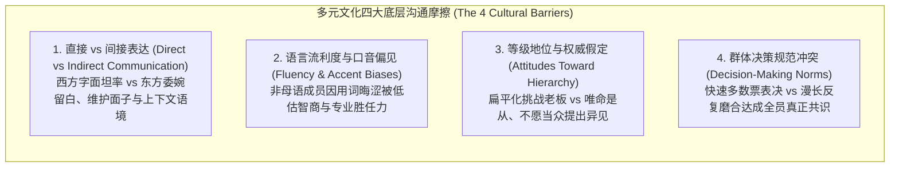
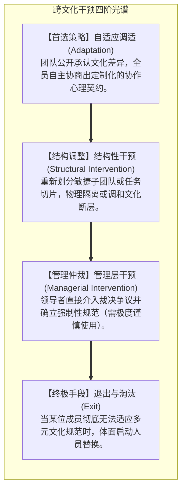
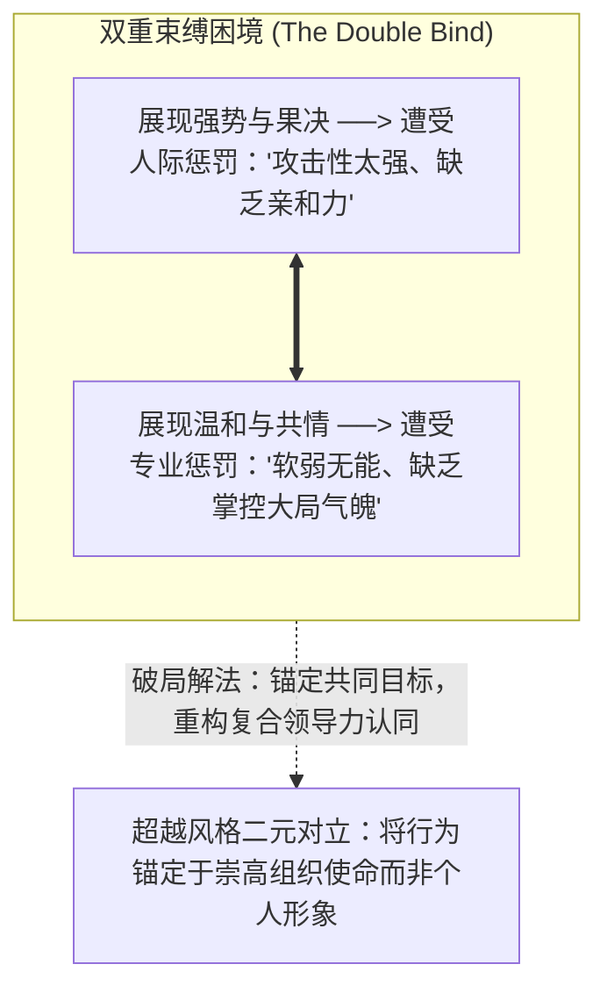

# Lec 11 多元文化团队与跨越隐性壁垒：文化摩擦、认知红利与结构化干预 (Communicating with Diverse Audiences & Multicultural Teams)

> MIT Course 15 · Managerial Communication · 卓越领导力沟通

## TL;DR

- 揭示跨国与多元文化团队中最普遍的四大文化沟通摩擦：直接 vs 间接表达、语言流利度与口音偏见、科层等级与权威态度差异、决策规范冲突。
- 掌握布雷特-贝法尔（Brett-Behfar）跨文化干预四大战略矩阵：自适应协商、结构化重组、管理者裁决介入与退出淘汰。
- 引入凯瑟琳·菲利普斯实证研究：多元化不仅是道德倡导，更是认知工程；文化异质性强迫团队跳出舒适区，激发更高质量的理性反思。
- 解构埃利-伊瓦拉“第二代性别与文化隐性壁垒”：化解领导力中的“能力-讨喜二元困境”，构建多元领导者身份认同场域。

## 多元文化的双刃剑：认知红利 vs 协作摩擦

在经济全球化与全球远程办公成为常态的今天，技术研发团队与跨国企业管理层呈现出前所未有的多元异质性：一个硅谷核心架构组可能同时汇聚了美国、印度、中国、德国与以色列的顶尖工程师。

哥伦比亚商学院凯瑟琳·菲利普斯（Katherine W. Phillips）在《科学美国人》发表的里程碑式研究《多元化如何让我们更聪明》（*How Diversity Makes Us Smarter*）中指出：
- **同质化团队（Homogeneous Teams）**：沟通极度丝滑顺畅，成员感觉非常舒适，但由于缺乏认知摩擦，极易过早达成共识，盲区巨大，方案往往充满缺陷；
- **多元化团队（Diverse Teams）**：成员之间存在明显的文化与思维落差。正因为人们预期到异见的存在，**个体在发言前被迫进行更严密的逻辑推导与更详尽的数据准备**，最终交付的创新成果与系统稳健性显著碾压同质化团队。

然而，多元化的认知红利绝非自动变现。若缺乏高超的领导力沟通设计，文化差异将直接转化为致命的误解、阵营分裂与内耗。

## 布雷特-贝法尔跨文化干预四阶矩阵

西北大学凯洛格商学院珍妮·布雷特（Jeanne Brett）与克里斯汀·贝法尔（Kristin Behfar）在《哈佛商业评论》经典论文《管理多元文化团队》（*Managing Multicultural Teams*）中，提出了著名的四阶干预模型：

| 策略类型 | 核心机制 | 最佳适用情境 | 潜在局限与风险 |
|---|---|---|---|
| **自适应调适 (Adaptation)** | 团队成员意识到摩擦源于文化差异而非恶意，自发调整沟通预期（如约定“每次提意见时允许直言不讳，对事不对人”）。 | **绝大多数跨文化协作的首选**；团队成员具备较高的反思意愿与包容性。 | 耗费较长的前期磨合时间；需要极高的团队成熟度。 |
| **结构性干预 (Structural)** | 通过重新编排工作流或指派双文化背景的成员担任“跨文化桥梁”，降低直接文化碰撞的烈度。 | 团队出现明显的按国籍或语言抱团（Sub-grouping），情绪对立严重。 | 容易强化已有的阵营标签；治标不治本，可能掩盖深层协作问题。 |
| **管理层干预 (Managerial)** | 高管作为终极仲裁人强行拍板，颁布全员统一的行为准则与决策流程。 | 团队陷入无休止的死结，时间极度紧迫，自适应完全瘫痪。 | 极易制造输家（Losers），产生被偏袒者的怨恨，削弱团队自组织能力。 |
| **退出退出 (Exit)** | 将极度固执、对其他文化抱有顽固歧视或绝对无法融入者移出团队。 | 成员价值观与多元包容原则根本冲突，破坏整体组织毒性蔓延。 | 招聘与替换成本高昂，属于所有手段穷尽后的最后兜底方案。 |

## 第二代隐性壁垒与领导力双重束缚

在多元文化与多样性（DEI）议题中，领导者面临的最隐蔽挑战不是显性的恶意歧视，而是社会心理学中的**第二代隐性壁垒（Second-Generation Gender & Cultural Bias）**。

哈佛商学院罗宾·埃利（Robin Ely）与埃米尼亚·伊瓦拉（Herminia Ibarra）在《女性崛起：看不见的壁垒》（*Women Rising: The Unseen Barriers*）中深入揭示了少数群体与女性领导者在职场上面临的**双重束缚（The Double Bind）**：

::: definition 领导力双重束缚 (The Double Bind Dilemma)
传统商业社会中沉淀的“领导力模板”高度充斥着男性化、强势、决绝的刻板特征：
- 若女性或温和文化背景的管理者展现出强硬、果决与断言风格，她会被评价为**“尖酸刻薄、具有攻击性、难以相处（Competent but Unlikable）”**；
- 若她展现出温和、倾听与同理心，她又会被评价为**“优柔寡断、缺乏领袖气魄、不够强势（Likable but Incompetent）”**。
:::

## 跨越文化断层的高管沟通法则

卓越的全球化领导者必须建立跨文化沟通的元认知体系：
1. **区分意图（Intent）与影响（Impact）**：当听到非母语员工一句极为生硬刺耳的话时，切忌瞬间跳上推论阶梯认为对方傲慢挑衅。必须认识到：对方极可能是在脑中用母语语法进行直译，其内心完全是职业善意；
2. **制度化打破母语霸权**：在跨国会议中，英语母语者往往以机关枪式的语速和俚语霸占讨论，非母语者需要几秒钟在大脑中完成实时翻译。**主持人必须强制放慢发言节奏，留出 5 秒发言缓冲窗口**，并在会后补充分发详实的书面备忘录；
3. **将隐性规则显性化（Make Implicit Norms Explicit）**：不要指望新员工能通过“察言观色”领悟团队的工作习惯。将“我们如何做出决策”、“我们如何提出不同意见”写进团队公开的协作章程中。

::: insight 跨文化领导力的终极支点：从“求同存异”到“因异而强”
在多元文化沟通中，初级管理者的策略是“求同存异”——试图寻找文化交集的公约数，尽量抹平个性与文化差异。  
然而，全球顶级领导者的心智是**“因异而强（Strength Through Diversity）”**。他们清醒地意识到，不同文化背景的成员，其思考底层搭载着不同的世界观操作系统：德国团队的严密工程风控、以色列团队的敢于挑战权威（Chutzpah）、日本团队的精益求精、美国团队的敢于冒险试错。领导力的精髓不是打造一个千人一面的单色军队，而是搭建一个能够包容多元操作系统的稳健中枢架构，让每一束不同的文化光芒都在最适合的战场发挥极致威力。
:::
