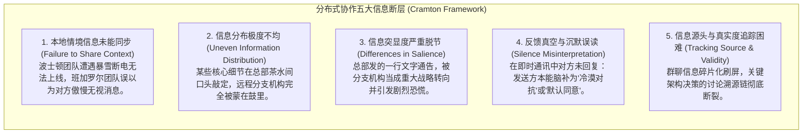
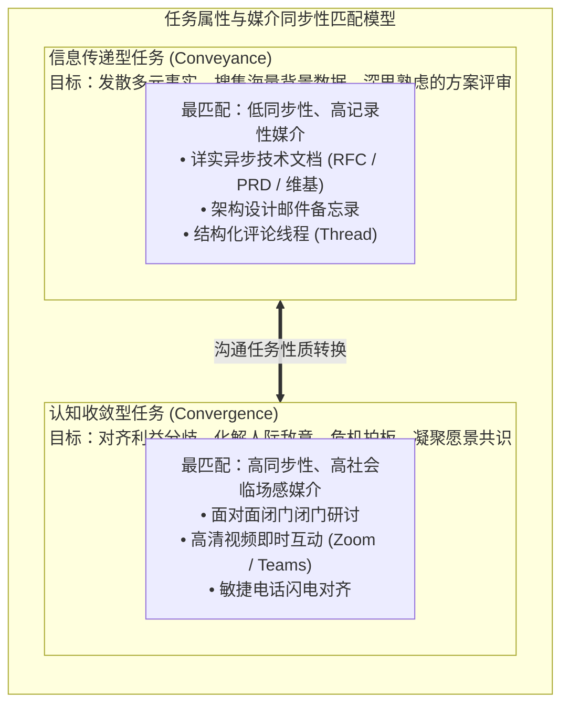
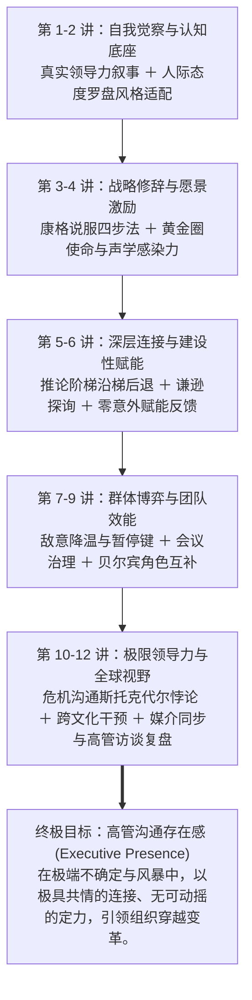

# Lec 12 分布式团队、新媒介沟通与高管访谈复盘：虚拟断层、媒介同步与领导力终身进阶 (Virtual Teams, Media Synchronicity & Executive Synthesis)

> MIT Course 15 · Managerial Communication · 卓越领导力沟通

## TL;DR

- 深度解构凯瑟琳·克兰顿（Catherine Cramton）分布式团队“共同知识断层（Mutual Knowledge Breakdown）”五大机理，阻断远程协作中的猜忌与信任崩塌。
- 基于 MIT Sloan 荣休教授 JoAnne Yates 与 Wanda Orlikowski 的媒介六维框架，确立“媒介同步理论（Media Synchronicity）”与任务契合律。
- 落地高管深度访谈（Leadership Interview）调研方法论：萃取资深商业领袖在重大战略重组与危机公关中的隐性决策智慧。
- 贯通 15.281 全景闭环：从个体叙事（Lec 1）到团队角色博弈与极端危机，铸就终身敏捷迭代的高管沟通存在感（Executive Presence）。

## 分布式团队的认知病理学：共同知识的断裂

在跨时区分布式研发与全球远程办公模式下，技术领导者最常遇到的挫败是：明明每个人都在 Slack/飞书上实时响应，但跨地域团队之间的误解与怨恨却在疯狂滋生。

乔治梅森大学组织行为学专家凯瑟琳·克兰顿（Catherine Durnell Cramton）在《寻找分布式协作的共同基础》（*Finding Common Ground in Dispersed Collaboration*）中指出：**远程团队沟通失灵的根本原因，不是网络带宽不足，而是“共同知识基底（Mutual Knowledge）”的隐性瓦解**。

::: definition 共同知识断层 (Mutual Knowledge Breakdown)
所谓共同知识，是指“我知道某事，你也知道某事，并且我们彼此都知道对方知道这件事”。  
在同一物理办公室中，员工通过共同的走廊偶遇、咖啡厅闲聊和微表情，毫不费力地维系着海量的上下文；而在分布式环境中，由于缺乏物理共场，人类的大脑会不自觉地陷入严重的**归因谬误（Attribution Error）**——将环境导致的沉默直接归咎为对方的懈怠或恶意。
:::

## 媒介同步理论与六维沟通选型

面对五花八门的沟通工具（即时通讯、异步文档、视频会议、邮件、元宇宙会议），管理者该如何科学匹配？MIT Sloan 教授琼安·耶茨（JoAnne Yates）与万达·奥利考斯基（Wanda Orlikowski）提出了理解媒介维度的六大支柱，并由 Dennis & Valacich 进一步发展为**媒介同步理论（Media Synchronicity Theory）**：

::: pitfall 媒介错配的两种灾难模式
1. **用低同步媒介解决高收敛冲突**：在 Slack 公共群聊中，两位总监就系统重构架构方案爆发激烈争吵。由于纯文字剥离了语音语调和微表情，文字看起来比当事人原本的意图冷酷十倍，几轮交锋后迅速演变为人身攻击；
2. **用高同步媒介进行低效信息传递**：召集 30 位核心工程师开两小时的视频会议，主持人一个人照本宣科地朗读 50 页 PPT 汇报。所有参会者在屏幕背后偷偷写代码或刷手机，造成巨大的组织工时浪费。
:::

## 15.281 终极战役：高管深度访谈（Leadership Interview）

作为 15.281 课程跨越学期的核心结课大作业，每位学员必须亲自物色并对一名具备 10 年以上实战管理经验的高级商业领袖（或 Sloan Fellows / EMBA）进行 20–30 分钟的结构化深度访谈，撰写一份详实的《领导力沟通启示报告（Leadership Lessons Report）》，并在全班进行复盘汇报。

### 1. 结构化高管访谈四大核心维度
Neal Hartman 教授制定的访谈规程，直击资深高管最珍贵的隐性实践智慧：
- **至暗时刻的沟通抉择**：“在您过去的职业生涯中，哪一次沟通直接决定了您事业或公司的生死存亡？您当时是如何制定说服战略的？”
- **应对剧烈组织阻力**：“当面对全员公开反对或董事会强烈质疑时，您是如何在保持坚定信念的同时化解敌意的？”
- **真实自我与领导力品牌**：“您是如何确立自己不可替代的领导风格的？您在面对不同背景的团队时如何进行风格调频？”
- **给年轻领导者的黄金建议**：“如果能回到十年前，您会在沟通与人际协作上做出哪项最关键的认知改变？”

## 15.281 全景知识体系闭环：铸就高管存在感

纵观 MIT 15.281《卓越领导力沟通》的完整历程，课程构建了一套从微观神经认知到宏观复杂组织治理的完整认知跃迁链：

::: insight 高管沟通存在感的本质
所谓的“高管存在感（Executive Presence）”，绝非笔挺昂贵的高级西装、宏亮威严的嗓音或高高在上的权威作派。  
真正的存在感，是**一种高度内化的认知从容与人际敬畏**：在风暴来临时，你能够按下本能的暂停键，直面残酷事实而不丧失终极希望；在面对异见与愤怒时，你能够以谦逊探询的姿态穿透推论阶梯，搭建心理安全的合作场域；在带领多元团队冲锋时，你能够用饱含温情与意义的语言点亮人心。沟通不仅是传递信息的工具，沟通就是领导力本身。
:::
