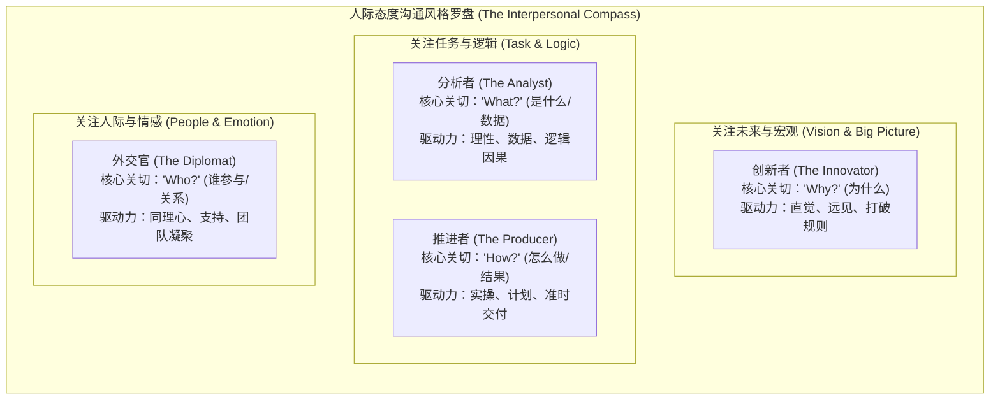
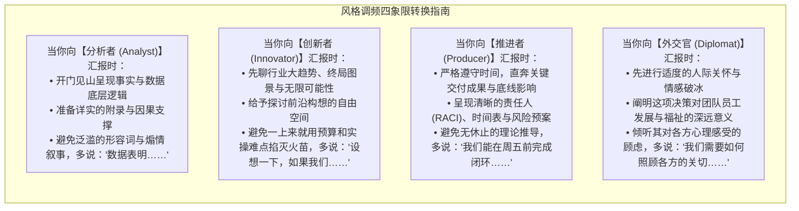

# Lec 2 沟通风格罗盘与人际行为诊断：人际态度测量与风格适配 (Communication Styles & The Interpersonal Attitude Instrument)

> MIT Course 15 · Managerial Communication · 卓越领导力沟通

## TL;DR

- 掌握人际态度测量工具（Interpersonal Attitude Instrument）的四大基础沟通风格：分析者（数据）、创新者（创意）、推进者（结果）与外交官（关系）。
- 确立“风格无优劣，差异即资源”的非评判性管理认知，剖析各类风格的思维驱动力、核心关切提问与典型行为盲区。
- 运用点数差（Point Spread）量化诊断个人的主导风格与行为适应弹性，识别被压制的弱势风格盲点。
- 建立高阶领导者的“风格调频（Style Flexing）”与跨风格协同协议，消除组织内部因沟通编码错位引发的无谓内耗。

## 人际态度罗盘：四大沟通风格解构

在跨职能团队协作与上下级汇报中，大量的摩擦并非源于智力分歧或利益冲突，而是源于**人际沟通风格的错位**。技术出身的高管常抱怨业务负责人“夸夸其谈、缺乏细节”，而业务负责人则指责技术专家“死抠数据、缺乏战略大局观”。

MIT Sloan 15.281 引入的“人际态度测评（Interpersonal Attitude Instrument）”将个体的默认沟通模式映射为四大典型风格。Neal Hartman 教授强调：**风格没有高低贵贱之分，每一种风格都是应对特定商业挑战的独特优势；但当它被过度使用或投射给不匹配的受众时，就会转化为破坏性的组织噪音**。

### 1. 分析者 (The Analyst) —— 数据与理性导向
- **核心关切**：“这背后的事实数据是什么？（What?）”
- **核心特质**：定量化、严密逻辑、崇尚理性、风险厌恶、追求技术精湛与收敛性论证。
- **价值贡献**：在狂热的市场狂欢中保持清醒，通过精密的商业模式测算阻断灾难性投资。
- **潜在盲区**：陷入“分析瘫痪（Analysis Paralysis）”，容易对缺乏严密数据的早期创新构想泼冷水，被同事视为冷漠、吹毛求疵。

### 2. 创新者 (The Innovator) —— 创意与愿景导向
- **核心关切**：“我们为什么不尝试全新的路径？（Why? / Why not?）”
- **核心特质**：想象力丰富、概念化整合、直觉敏锐、乐于冒险、反叛教条、拥抱不确定性。
- **价值贡献**：破除组织路径依赖，捕捉产业颠覆性机遇，是企业战略转型与第二曲线的拓荒者。
- **潜在盲区**：缺乏落地耐性，“想法每天换一个”，极度忽视操作细节、时间表与预算约束，让执行团队精疲力竭。

### 3. 推进者 (The Producer) —— 落地与底线导向
- **核心关切**：“这套方案具体怎么落地执行？（How?）”
- **核心特质**：注重结果（Bottom-line）、严谨守时、条理分明、建立流程（SOP）、务实可靠、注重产出。
- **价值贡献**：将虚无缥缈的战略拆解为甘特图与里程碑，确保企业承诺如期兑现。
- **潜在盲区**：过度沉迷于流程与既定时间表，在面对外部突发变化时展现出较强刚性，容易被指责为缺乏战略格局与同情心。

### 4. 外交官 (The Diplomat) —— 人文与共鸣导向
- **核心关切**：“谁会被这项决策所影响？大家感觉如何？（Who?）”
- **核心特质**：善解人意、耐心倾听、建立人际信任、感知团队士气、追求和谐多赢。
- **价值贡献**：企业文化的守护者，有效化解部门墙与跨职能人际摩擦，提升团队心理安全感。
- **潜在盲区**：过度追求表面和谐，回避必要的艰难对话与严厉问责；在需要决断时优柔寡断。

## 点数差分析与风格灵活性诊断

在测评反馈中，每个维度的得分分布构成了领导者的独特行为图谱。Neal Hartman 教授给出了三类典型的点数差（Point Spread）解读模型：

::: definition 点数差诊断法则 (Point Spread Analytics)
1. **显著主导型 ($\Delta \ge 10$ 分)**：
   - 某一项风格大幅领先其余三项。这代表该个体具备极强的特征可预测性。下属和同事清楚知道他的思考偏好，但在跨界沟通时容易引发风格排异。
2. **高度自适应型 (三项分差 $\le 4$ 分)**：
   - 三项得分极其接近，表明该个体拥有极高的“变色龙”情境适应力。他能够根据对话场景在分析、推进和关怀之间无缝切换，但需警惕缺乏鲜明的个人辨识度。
3. **盲区洼地型 (某项极度低分)**：
   - 某项风格得分悬殊过低（通常不到均值的 $1/3$）。这指明了个体职业生涯中最危险的**行为盲区与防御触发点**。
:::

::: example 极度低分引发的组织翻车案例
一位研发副总裁（超高 Analyst，极低 Diplomat）在项目攻关会上，面对一位连续加班两周导致身体虚脱的主管工程师，直接甩出一叠性能不达标的测试日志，冷冰冰地质问：“为什么吞吐量下降了 12%？请解释数据逻辑。”  
在分析者眼中，这只是探讨客观现实（What）；但在外交官与推进者眼里，这种完全漠视他人付出与身体极限的举动，瞬间触发了整个工程团队的情绪雪崩，导致骨干在会后批量提出离职。
:::

## 风格调频（Style Flexing）：高管的跨风格沟通协议

卓越领导者绝不强制要求全世界都按自己的默认编码思考。真正的领导艺术，是在开口之前敏锐诊断对方的接收模式，并主动进行**“风格调频（Style Flexing）”**。

风格调频并非意味着放弃自己的原则或伪装人格，而是在传递核心意图时，主动选择最契合对方心理防御机制的语汇、逻辑次序与证据类型。例如，当推进者面对创新者时，如果一上来就用繁杂的日常表格限制对方，创新者会立刻感到窒息并产生抗拒；反之，若先肯定其颠覆性构想的战略远见，再引导其共同审视推进里程碑，合作阻力便会消解大半。

为了在组织复杂博弈中实现精准调频，Neal Hartman 教授提炼出一套跨越四种风格的标准化操作指南。领导者在准备关键对话前，应依据下述四象限原则调整表达的侧重点：

在日常执行中，调频的最高境界是实现多维视角的立体编织。面对由多元风格组成的执行委员会，高管往往需要先用创新者的语言点燃使命，继而用分析者的数据夯实底座，再用推进者的计划锁定确定性，最后用外交官的温度凝聚团队认同。这种流转自如的调频能力，是高管跨越专业壁垒、执掌全局的核心标志。

::: insight 沟通调频与高管情商
初级管理者追求“我表达得多痛快、多精准”；高级领导者则聚焦“对方解码了多少、行动了多少”。  
所谓高情商沟通，不是虚伪迎合，而是一种**高级的利他主义认知工程**。主动以对方最舒适的波段传递信息，极大降低了对方大脑的前额叶皮层认知负荷。当你能用分析者的严密数据支撑创新者的狂野愿景，并用推进者的纪律和外交官的温度将其注入团队时，你便真正掌握了领导力沟通的完整罗盘。
:::
