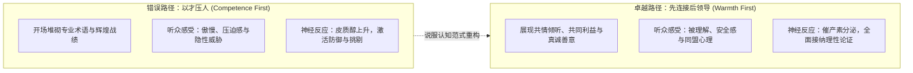
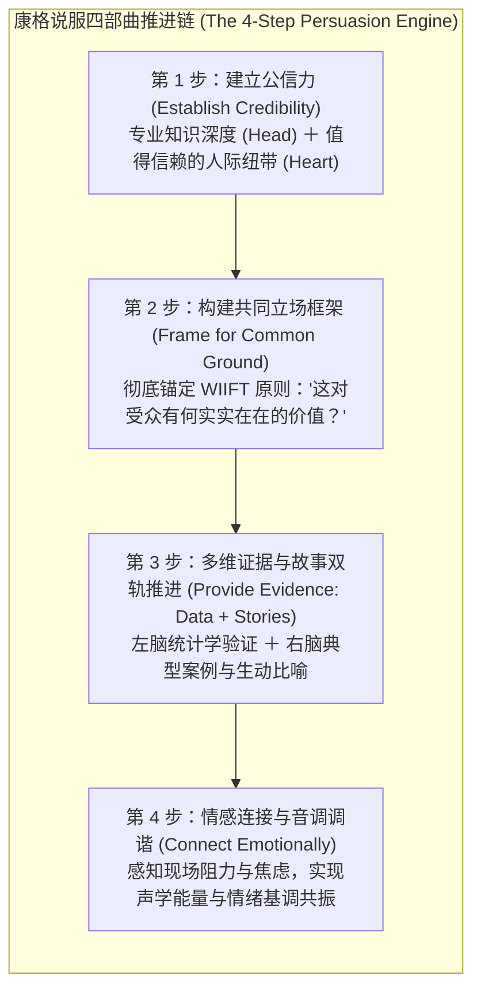
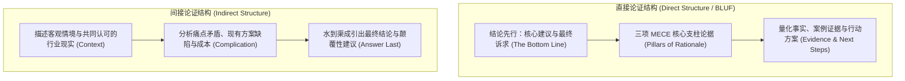

# Lec 3 领导力愿景塑造与说服架构：康格四步法与直接/间接论证 (Crafting Leadership Vision & The Architecture of Persuasion)

> MIT Course 15 · Managerial Communication · 卓越领导力沟通

## TL;DR

- 整合哈佛商学院 Amy Cuddy“先连接，后领导（Connect, Then Lead）”理论，确立人际温暖感优先于专业胜任力的信任建立机制。
- 深度拆解杰伊·康格（Jay Conger）经典说服四步法：公信力奠基、共同利益框架构建（WIIFT）、量化数据与感性叙事双轨支撑、情感频率精准调谐。
- 掌握多维受众认知解剖学，穿透理智（Head）、情感（Heart）、信任偏见与学习风格的多层受众心智。
- 确立“结论先行（Direct Structure）”与“归纳递进（Indirect Structure）”的战略选型准则，匹配受众偏好与阻力水平。

## 信任的神经认知排序：先温情，后能力

很多雄心勃勃的管理者在向高管或外部客户推销变革愿景时，往往一开场就急于展现自己卓越的智商、详尽的行业数据或无可匹敌的算法模型。然而，哈佛商学院社会心理学家艾米·卡迪（Amy Cuddy）与马修·科哈特（Matthew Kohut）在《哈佛商业评论》经典论文《先连接，后领导》（*Connect, Then Lead*）中提出了一个颠覆性的生物学发现：

::: theorem 进化心理学中的人际评估顺序
当人类在社交互动中评估一位潜在领导者时，大脑的无意识雷达会在瞬间对其做出两个维度的快速扫描：
1. **温情与信任度 (Warmth / Trustworthiness)**：“这个人对我抱有善意吗？他值得信赖吗？”
2. **能力与胜任力 (Competence / Strength)**：“这个人有能力兑现承诺吗？他强大到足以带领我们胜出吗？”  
在人类数百万年的进化历程中，**对“温情与善意”的评估在神经反射上必然优先于对“能力”的评估**。因为一个强大却心怀恶意的对手，比一个无能但心怀善意的人更具毁灭性。
:::

很多技术型专家常犯的悲剧，是误以为“只要我证明自己无比聪明（Competence），对方就会自然听从我”。现实是：**在建立温情连接之前展示的力量，不仅不会赢得尊重，反而会引发受众强烈的戒备与敌意恐惧**。唯有先通过共情、谦逊与真诚关切让对方感受到心理安全，卓越的专业能力才会转化为追随力。

## 康格说服四步法在高管沟通中的落地

在 MIT 15.281 的讲义体系中，Neal Hartman 教授将杰伊·康格（Jay Conger）的说服框架确立为高管沟通的黄金操作规程。康格明确指出：商业说服的本质不是“一场你输我赢的法庭辩论”，而是一场寻找共同利益的精密协作：

### 1. 穿透受众心智的六维分析透镜
在撰写任何商业推介之前，必须对受众进行外科手术级的深度审视：
- **受众是谁？（Who）**：真正的最终决策者（Kingmaker）是哪一位？谁具有隐性一票否决权？
- **既有偏见是什么？（Biases）**：他们过去在类似项目上有过哪些惨痛教训？他们默认站在哪一方？
- **头脑知道什么？（Head）**：他们掌握的专业背景有多深？最敏感的财务指标是毛利率还是自由现金流？
- **内心感受如何？（Heart）**：这场变革是否威胁到了他们的既得利益、部门预算或团队规模？
- **他们如何看待你？（Perception of You）**：他们认为你是一个激进的冒险家，还是一个沉稳务实的合作者？
- **认知学习偏好如何？（Learning Style）**：他们偏好视觉图表、详实备忘录，还是面对面的口头问答互动？

## 论证架构的战略抉择：直接结构 vs 间接结构

在组织论据时，管理者面临的最关键战术决策是：**将最终结论放在最开头，还是保留到最后一刻？**

Neal Hartman 在讲义中为这两种截然相反的论证范式制定了清晰的适用边界：

| 维度 | 直接结构 (Direct / Answer First) | 间接结构 (Indirect / Answer Last) |
|---|---|---|
| **核心优势** | 极大提升信息传递效率；节约高管宝贵时间；符合金字塔原理，便于理解大局。 | 逐步呈现推导逻辑；软化受众心理戒备；引导受众在思考中与你得出相同结论。 |
| **首选场景** | **几乎适用于 85% 以上的商业沟通场景**；汇报正面或中立消息；受众为结果导向型（如 CEO/COO）。 | 传达极其严重的负面消息（如裁员、业务线关停）；受众对提议抱有强烈先入为主的敌意偏见。 |
| **公信力要求** | **高公信力**。汇报者在受众心目中具备极高的专业声誉，受众愿意先听结论。 | **低公信力或新晋管理者**。若一开场就宣布激进结论，会直接触发受众的立即否决。 |
| **认知风险** | 若受众极度保守且充满怀疑，一开头的结论可能立刻引发打断与激烈反驳。 | 铺垫过长导致受众失去耐心，产生“你究竟想说什么”的烦躁与猜忌。 |

::: insight 商业高管的直接结构铁律
在 MIT Sloan 的管理沟通训练中，针对执行委员会或董事会级别的汇报，**直接结构（BLUF: Bottom Line Up Front）几乎是不可撼动的默认标准**。  
高层领导者的时间是以分钟甚至秒级计算的。很多技术汇报者试图采用“侦探小说式”的间接悬疑结构，把最关键的商业影响藏在第 30 张幻灯片结尾，以为这样能体现推导过程的严谨性。然而在现实中，董事会成员通常在第 3 张幻灯片就会感到极度不耐烦并直接打断：“直接告诉我你的要价是多少、预期回报率是多少”。在商业战场上，隐藏结论往往被视为缺乏决断力与缺乏信心的危险信号。
:::
