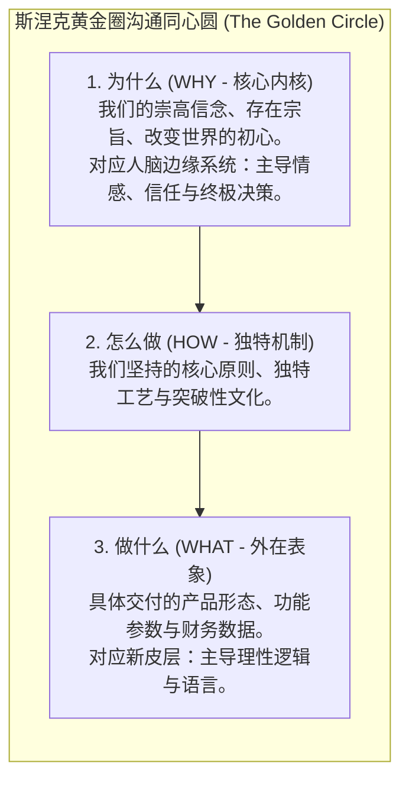
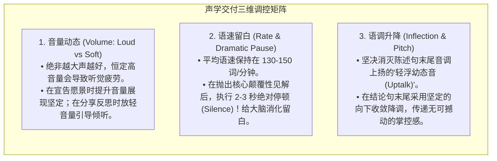

# Lec 4 激发与共鸣演说：比喻、修辞与非言语传递 (Speaking to Motivate and Inspire: Rhetoric, Metaphor & Delivery)

> MIT Course 15 · Managerial Communication · 卓越领导力沟通

## TL;DR

- 剖析商务说服（Persuade）与愿景激励（Inspire）的质的飞跃：说服诉诸理性与利益合规，而激励诉诸内心渴望与超常承诺。
- 融合西蒙·斯涅克“黄金圈法则（Why-How-What）”，确立从深层组织信仰与使命出发的演说架构。
- 掌握领导力语言工程学三大修辞利器：使命框架塑造、崇高价值观锚定、商业隐喻的运用边界与禁忌。
- 建立高级声学交付系统（Vocalics Architecture）：精准调控音量动态、语速留白与抑扬声调，铸造极具感染力的高管现场气场。

## 认知跃迁：从“说服”迈向“激励”

在企业日常运营中，管理者花费大量时间进行商务说服（Persuasion）：说服跨部门同事在排期上给予支持、说服客户签署采购合同、说服员工在周末加班完成紧急交付。这类说服主要依赖于清晰的业务逻辑、量化的投资回报率（ROI）以及利益互换。

然而，当组织面临生死攸关的战略转型、极端市场萧条或向未知领域发起冲锋时，单纯的利益说服会瞬间失效。此时，领导者必须调动更高阶的修辞力量——**愿景激励（Inspiration）**。

::: definition 说服与激励的双轨矩阵
正如杰伊·康格在《激励他人：领导者的语言》中所概括：卓越的领导者绝不排斥说服的基础要素（专业信誉、逻辑论据、共同利益），而是**在坚实的理性骨架之上，包裹上极具穿透力的人文情感肌肉**。没有逻辑骨架的激励是轻浮的煽动，而缺乏情感肌肉的说服则是枯燥的催眠。
:::

## 斯涅克黄金圈：伟大的领导者如何由内而外思考

西蒙·斯涅克（Simon Sinek）在其开创性的 TED 演讲与理论著作中提出了著名的**黄金圈模型（The Golden Circle）**。他指出，平庸的组织和管理者在沟通时总是习惯从外向内表达（从“我们做什么”到“我们怎么做”，极少提及“为什么”）；而历史上所有极具感召力的领导者（从马丁·路德·金到史蒂夫·乔布斯），其思考与演说路径完全是**由内向外（From Inside Out）**逆向展开的：

::: insight 边缘系统与决策的神经生物学真相
人脑的新皮层（Neocortex）负责处理复杂的量化数据和逻辑分析，但**它并不控制决策**；真正驱动人类做出决断并产生忠诚感的，是位于大脑更深层的边缘系统（Limbic System），它负责产生直觉情感、爱恨与信念，却没有任何语言能力。  
当你不断向受众轰炸海量功能特性（What）时，你只是在喂养他们的新皮层；而当你大声宣告“我们为什么相信这项事业”（Why）时，你正在直接与受众掌控行动决断的边缘系统进行深层对话。**“人们买的不是你做出了什么，而是你为什么要做它。”**
:::

## 领导力修辞工程学：商业隐喻的威力与误区

在 MIT 15.281 的讲义中，Neal Hartman 教授专门用多个课件深入剖析了商业隐喻（Metaphor）在领导力沟通中的战略价值。

::: definition 商业隐喻 (Business Metaphor)
隐喻是一种将某个陌生、抽象的领域概念，投射到受众极其熟悉、直观的经验领域的认知修辞机制。  
例如：将初创公司的早期培育比喻为“生根发芽、破土而出”，将臃肿的业务剥离比喻为“外科手术切除肿瘤”，将云原生技术改造比喻为“在万米高空为波音 747 更换喷气式引擎”。
:::

### 1. 隐喻的积极认知杠杆
- **闪电式压缩复杂性**：几句话就能让非技术受众直观体会到技术挑战的严峻程度；
- **激发具身认知情绪**：使用“破土而出”、“绝地反击”能瞬间唤醒受众骨子里的战斗意愿与自豪感。

### 2. 隐喻滥用的三大致命陷阱
Neal Hartman 在课堂中展示了商业漫画以幽默警示管理层：
1. **体育竞技隐喻的文化排异**：美国管理者极度偏爱美式橄榄球与棒球术语（如“Touchdown”、“Home run”、“Bunt”）。但在多元文化的跨国团队中，非美国籍员工往往根本不知道这些规则，从而产生强烈的心理疏离感与排斥；
2. **血腥战争隐喻引发内部零和对抗**：过分使用“歼灭战”、“刺刀见红”、“攻占山头”，容易让员工误以为职场就是弱肉强食的角斗场，在跨部门协作时树立高墙；
3. **过度修辞与滑稽拼凑**：一场演讲中混杂了“大象起舞”、“弯道超车”、“涅槃重生”等五花八门的陈词滥调，不仅无法激励他人，反而沦为员工私下嘲讽的笑柄。

## 高管声学交付系统（Vocalics Architecture）

演说内容仅仅完成了激励的一半，另一半取决于你的**非言语声学武器库（Vocal Delivery）**。很多管理者以为演说的关键是“流利不卡顿”，但实际上，机械式的无休止流利是催眠的同义词。

::: pitfall 激励演说中的幼态语调（Uptalk）陷阱
在商务演讲中，最具破坏性的声学缺陷就是“句尾上扬（Uptalk / High Rising Terminal）”——即明明是在表达一个确定性的战略主张，结尾的语调却像是在向听众寻求许可和提问一样向上扬起。  
这种语调在潜意识中向受众释放出“我不确定自己的提议是否正确”、“我缺乏底气”的弱者信号。高管沟通要求句尾必须平稳下降，用声学的重力牢牢锚定受众的确定感。
:::
