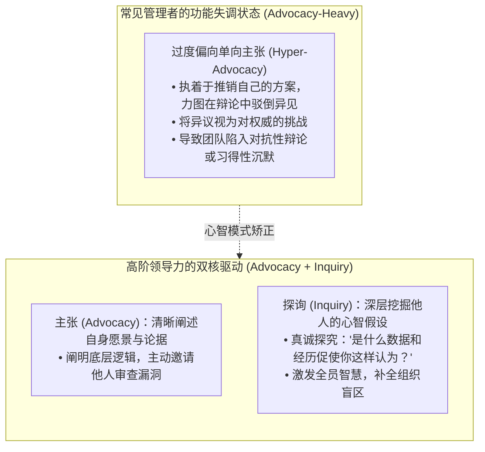
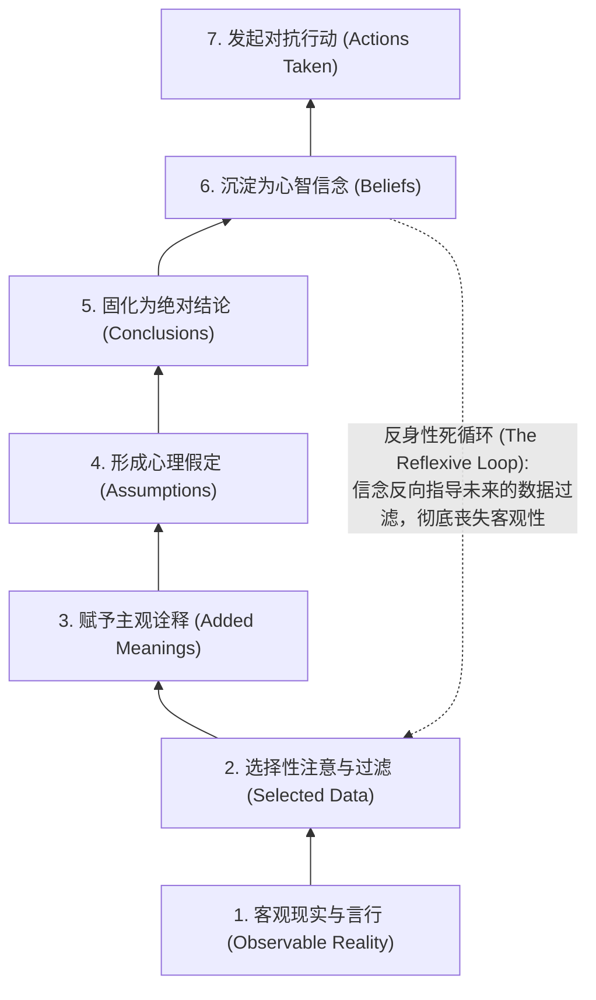
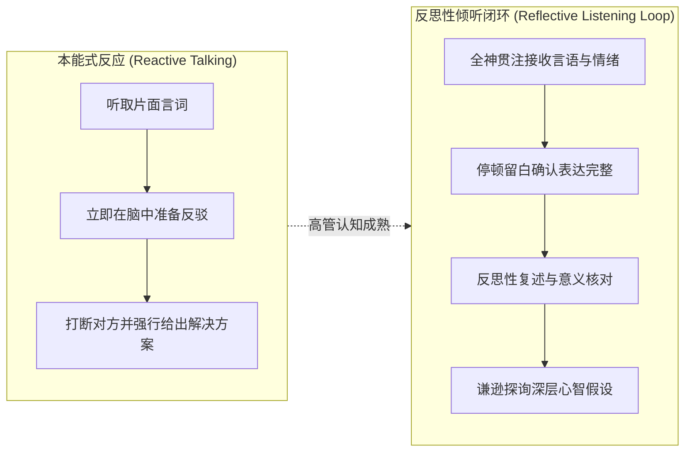

# Lec 5 倾听艺术、谦逊探询与推论阶梯：深层倾听与认知解构 (Listening, Humble Inquiry & The Ladder of Inference)

> MIT Course 15 · Managerial Communication · 卓越领导力沟通

## TL;DR

- 揭示现代职场中最讽刺的“倾听悖论”：职业人超 40% 的沟通时间用于倾听，但在传统商业教育中几乎从未受过系统训练。
- 剖析领导力沟通中“主张（Advocacy）”与“探询（Inquiry）”的致命失衡，打破领导者必须“时刻展现观点输出”的陈腐心智。
- 深度解构阿吉里斯推论阶梯（The Ladder of Inference）：从数据截取到反身性偏见的自动化跳跃，阻断“在梯顶互相投掷结论”的人际惨剧。
- 落地埃德加·沙因“谦逊探询（Humble Inquiry）”的操作协议：在当下此地主动示弱，运用反思性倾听构筑组织无畏发声的心理安全基底。

## 职场倾听悖论与“主张/探询”失衡

在现代商业世界中，几乎所有商学院课程都在全力教授学生如何演讲、如何撰写商业计划书、如何进行激辩。然而，跨国管理实证调研显示，管理者日常沟通的时间分配呈现出极为鲜明的倒金字塔结构：

::: definition 管理者日常沟通时间分配 (Communication Time Audit)
- **倾听 (Listening)**：占全部沟通时间的 **40%**；
- **言说 (Talking)**：占 **35%**；
- **阅读 (Reading)**：占 **16%**；
- **书写 (Writing)**：仅占 **9%**。
:::

这是极具讽刺意味的对比：占据时间最多的倾听，却被绝大多数管理者视为一种“无需训练的被动生理机能”。许多管理者在下属发言时，其大脑根本没有在倾听，而是在高速运转、构思自己下一轮反驳的措辞，或者急不可耐地寻找打断对方的切口。

Neal Hartman 教授指出，卓越的领导力沟通必须建立在**主张（Advocacy）**与**探询（Inquiry）**的精妙平衡之上：

## 推论阶梯：人脑如何无意识制造冲突

为什么两个原本极度聪明且心怀善意的管理者，在面对同一项业务决策时会产生势同水火的人际敌意？哈佛大学组织学习大师克里斯·阿吉里斯（Chris Argyris）提出的**推论阶梯（The Ladder of Inference）**，为我们提供了最深刻的认知解剖学。

::: definition 推论阶梯的七层认知跃迁
人脑在毫秒级时间内沿着阶梯飞速攀爬：
1. **现实池**：现实中发生的全部可观测事实与数据；
2. **选择性数据**：我们基于既往习惯截取的极小局部切片；
3. **主观赋义**：根据个人背景为切片赋予特定的因果解释；
4. **情境假定**：未经核实便假定对方的动机；
5. **确定性结论**：将假定直接上升为不容置疑的事实判断；
6. **采纳信念**：形成关于该人或该部门的长期固化信念；
7. **采取行动**：基于信念发动攻击、防御或冷漠孤立。
:::

### 梯顶互轰（Hurling Conclusions）的组织灾难
当两位管理者站在各自推论阶梯的顶端时，由于双方都误以为自己的结论就是客观事实，对话便退化为彼此指责：“你根本不懂用户需求！” vs “你们技术部门只会自嗨！”。双方互掷结论，却无人愿意后退一步，展示自己脚下的阶梯究竟是如何一步步搭建的。

## 埃德加·沙因的“谦逊探询”艺术

面对复杂的知识型组织，MIT Sloan 组织心理学宗师埃德加·沙因（Edgar Schein）开出了一剂根本解药——**谦逊探询（Humble Inquiry）**。

::: definition 谦逊探询的哲学定义
谦逊探询要求领导者在对话中自觉放弃“无所不知的裁判者”假象，主动承认：**“由于任务的复杂性与分工的离散性，在此时此地，我必须依赖你的一线洞察才能做出正确判断。”**  
领导者提出的不是预设陷阱的封闭式逼问，而是真正好奇、渴望向对方学习的开放式问题。
:::

### 落地谦逊探询与反思性倾听的四项心智戒律
Neal Hartman 教授在演练中强调，真正的深度倾听必须贯彻以下操作规程：
1. **管住舌头，允许沉默（Hold the Pause Button）**：当下属讲完一句话后，不要立即抢话，强迫自己停顿 2–3 秒，确认对方已经充分表达完毕；
2. **彻底悬置评价与建议（Withhold Judgment & Advice）**：管理者最恶劣的习惯是一边听一边急于开处方。必须在倾听过程中完全关闭“给出解决方案”的本能反应；
3. **反思性复述与校验（Reflective Paraphrasing）**：“为了确保我准确理解了你的关切，你的核心顾虑是……对吗？我有没有遗漏关键细节？”；
4. **探询底层阶梯（Exploring the Ladder）**：“你能帮我梳理一下，是哪些具体的现场数据或用户反馈，让你得出了这个紧急预警的？”。

::: insight 倾听不是让步，而是最高形式的智力领导
很多强势的领导者担心：如果我花大量时间倾听甚至反思性复述对方的观点，会不会让对方误以为我完全同意他的方案？  
**“理解”绝不等于“认同”**。倾听的目的，是在心理层面彻底解除对方的防御戒备。当一个人真切感受到自己被全然听见、被充分尊重之后，他大脑中的杏仁核警报才会解除，前额叶皮层才会重新开启，此时他才真正具备了倾听领导者不同意见与严密逻辑的心智容量。不听者，人亦不听之。
:::
