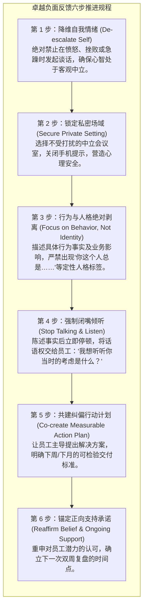

# Lec 6 赋能型反馈对话与建设性问责：行为描述与防卫消除 (Maximizing Feedback Conversations & Constructive Accountability)

> MIT Course 15 · Managerial Communication · 卓越领导力沟通

## TL;DR

- 确立卓越反馈的六大黄金支柱：具体详实、具有建设性、基于描述性事实、高度相关、及时交付与建立接受意愿。
- 深度解构组织中最普遍的“十大反馈灾难”：从路怒式随意表扬（Drive-by Praise）到年终考评的“惊雷突袭”。
- 确立严格的负面反馈交付工程学：情绪去极化、私密场域设定、剥离人格与行为、强制闭嘴倾听以及共建可复查行动闭环。
- 贯彻绩效考核的两大不可动摇铁律：年终考评“零意外原则”与书面评价与口头对话的绝对对应。

## 反馈的双重含义：从“评判定罪”到“系统校准”

在绝大多数商业企业中，“绩效反馈”已经沦为管理者和员工共同恐惧的年度苦差事。领导者视其为不得不硬着头皮进行的严厉问责，下属则将其视为充满防御、焦虑与自我辩护的审判法庭。

塔米·埃里克森（Tammy Erickson）在《哈佛商业评论》指出：**“反馈（Feedback）”一词在现代控制论与日常职场中存在着悲剧性的语义分裂**。在工程学中，反馈是系统为了实现目标不断进行的微小偏差校准机制；而在官僚体系中，反馈却被扭曲为“上级对下级过往过失的历史清算”。

MIT Sloan 15.281 强调：**反馈的唯一合法目的，不是为了证明谁犯了错，而是为了赋能员工未来的卓越表现**。

::: definition 高质量反馈的六大核心支柱 (The 6 Pillars of Effective Feedback)
1. **具体明确 (Concrete & Specific)**：杜绝“你最近工作态度不够积极”之类的模糊判断，精确指出具体事件与数据；
2. **富有助益 (Helpful & Actionable)**：提供可落地的资源支持与解题思路，而非宣泄沮丧情绪；
3. **描述优先 (Descriptive First)**：如实描述客观行为及其引发的连锁业务后果，严格避免对人品、动机做定性判断；
4. **高度相关 (Relevant)**：反馈重点必须直接挂钩核心业务里程碑与员工的个人成长规划；
5. **高度及时 (Timely)**：在问题发生后尽可能短的时间内介入，严禁“攒到半年后总清算”；
6. **唤起渴求 (Desired)**：通过营造支持性氛围，让受众主动意识到反馈是自身职业跃迁的宝贵资源。
:::

## 组织中最致命的十大反馈灾难

Neal Hartman 教授在讲义中梳理了日常管理中最常见、却极具破坏力的十种反馈恶习：

| 反馈误区 | 典型表现 | 潜在毁灭性后果 |
|---|---|---|
| **1. 唯事故发声** | 平时视优秀交付为理所当然，只有系统宕机或数据出错时才突然现身咆哮。 | 员工形成条件反射：只要领导找我，准没好事；彻底摧毁信任。 |
| **2. 飞驰式敷衍表扬 (Drive-by Praise)** | 擦肩而过时抛下一句“干得漂亮！”，却说不出到底漂亮在哪里。 | 员工无法复现成功行为，认为表扬是廉价的官僚套话。 |
| **3. 临终关怀式拖延** | 早就发现员工行为偏离轨道，却一直隐忍不发，直到绩效彻底崩溃才引爆。 | 错失最佳修正窗口，对员工的职业生涯造成不可挽回的伤害。 |
| **4. 迟到半年的翻旧账** | 在 Q4 考评会上突然拿出一月份的某次迟到或小失误进行扣分。 | 员工感到被算计和暗算，产生极度强烈的委屈与不公感。 |
| **5. 转移责任甩锅高层** | “不是我想给你这个评分，这是上面大老板定下来的指标。” | 彻底丧失一线领导者的权威与公信力，被视为软弱的传话筒。 |
| **6. 依赖邮件/即时通讯** | 面对敏感负面绩效，因为害怕面对面冲突而发一封冷冰冰的长邮件。 | 剥离了非言语线索，文字的冷酷感被放大十倍，极易引发严重误读。 |
| **7. 大庭广众公开处刑** | 在部门周会上直接当着全员的面点名批评某人的代码缺陷或提案硬伤。 | 彻底摧毁员工的自尊心与身份认同，把同事变成看客，逼其走向对立面。 |
| **8. 只批不教，缺乏建策** | 痛斥“这个方案完全不达标”，却给不出任何修改方向或示范标杆。 | 让员工陷入习得性无助与盲目乱撞的恐慌。 |
| **9. 缺乏后续闭环跟踪** | 谈话时痛心疾首，谈完后置之不理，从未跟进改进进展。 | 员工迅速明白这只是走形式，一切照旧。 |
| **10. 形式主义无序考评** | 缺乏定期、可预测的一对一沟通，绩效管理完全取决于领导的个人情绪起伏。 | 团队处于长期不可预测的慢性压力中，核心骨干流失。 |

## 负面反馈的标准操作工程（SOP）

当不得不进行高风险的负面反馈或绩效改进对话时，管理者必须摒弃即兴发挥的侥幸心理，遵循一套精密的工程化操作规程。这一流程的目标是最大限度降低员工的心理防卫，将双方的注意力从对抗性的自责与推诿，引导至建设性的行为修正与未来能力跃迁上。

在 MIT 15.281 的实战训练中，学员必须严格遵循这套六步推进规程。每一步都对应着特定心理防御机制的消解：

通过这一闭环规程，管理者向团队传递出一种确定的信号：反馈是一项制度化的成长赋能工具，而非任性惩治的私刑。当员工意识到对话的终点是为其提供资源与纠偏支持时，抵触情绪便会转化为主动协作。

::: insight 反馈对话中的权力降维与赋权
许多新手管理者在开展负面反馈时，最害怕遭遇员工的沉默或反驳，因此习惯于从头到尾唱独角戏，用高密度的说教堵住对方的嘴。  
然而，**反馈成败的真正分水岭，恰恰发生在第 4 步——你停止说话的那一瞬间**。卓越的领导者敢于忍受 5 秒钟的空气安静，将对话的解释权与解题主导权完全移交给下属。只有当下属亲口说出“我明白了，下周起我将通过……来调整”时，行为改变的神经突触才真正开始连接。由管理者强加的方案只是外部命令，由员工自发建构的方案才是内化承诺。
:::

## 绩效管理的双重铁律

Neal Hartman 教授在课程最后给出了所有高管必须恪守的底线纪律：

::: theorem 领导者绩效沟通的两大不可违抗铁律
1. **零意外原则 (The No-Surprise Rule)**：  
   在年度或季度正式绩效考评会上，**绝对不能出现任何让员工感到震惊的意外评价**。如果某位员工在年终拿到不合格评级，而他在过去十一个月中从未从你这里收到过正式的预警对话，那么真正该拿不合格评级的是作为领导者的你自己。
2. **口头与书面的一致性铁律 (The Direct Correlation Principle)**：  
   在正式书面报告中记录的评语，必须与你在闭门一对一谈话中口头告知的内容具有百分之百的对应性。绝不能在面谈时为了当好人而满脸堆笑、含糊过关，转头却在 HR 系统里写下一整页严厉的负面判词。这种言行割裂是职场中最具毁灭性的信用自杀。
:::
