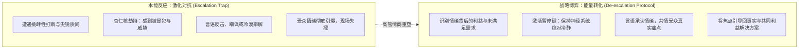
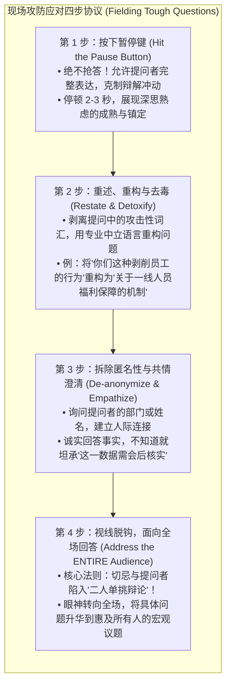

# Lec 7 应对敌意与挑战性听众：高阻力情境博弈 (Handling Hostility & Presenting to Hostile Audiences)

> MIT Course 15 · Managerial Communication · 卓越领导力沟通

## TL;DR

- 确立在敌意与高阻力情境下的五大战略目标：探明深层根因、化解对立情绪、维持公信力底座、清晰传递核心事实、掌握互动的体面收敛权。
- 掌握言语降温五联法（承认情绪、积极倾听、共情表达、深层探询与感谢质疑）与非言语从容气场构建。
- 落实应对刁钻提问的“暂停键机制（Hit the Pause Button）”与“去匿名化”策略，严禁陷入与个别挑衅者的单挑陷阱。
- 贯彻“回答属于全体听众”的视线分配法则，融合跨文化沟通维度，在高压打断中牢牢锚定主场控制力。

## 敌意情境的本质：阻力即投入

在高管的职业生涯中，最严峻的考验往往不是面对赞同你的支持者，而是被推上充满敌意、怀疑与攻击性的演讲台：面对因裁员而群情激愤的员工大会（Town Hall）、面对因产品延期而失去耐心的核心客户董事会，或是面对被外部激进做空机构围攻的新闻发布会。

平庸的汇报者在面对攻击时，往往本能地启动“战斗或逃跑（Fight or Flight）”机制：要么面红耳赤地与挑衅者展开对骂互撕，要么惊慌失措、语无伦次地退缩回避。这两种反应都会瞬间摧毁领导者的公信力。

MIT Sloan 15.281 强调：**敌意与质疑不是你的敌人，漠不关心才是**。当受众表现出愤怒与对抗时，表明他们对这项决策高度在乎。卓越领导者的核心胜任力，是将破坏性的敌意能量转化为推动共识的建设性契约。

::: definition 应对敌意受众的五大战略目标 (Strategic Goals in Hostility)
1. **探明深层现实 (Gain Fuller Understanding)**：刺破情绪表象，搞清受众究竟为什么如此恐慌和愤怒；
2. **消融对立情绪 (Diffuse Hostility)**：通过制度化降温技术，将对抗氛围拉回到理性协商轨道；
3. **稳住公信力底座 (Remain Calm & Retain Credibility)**：在聚光灯下展现出如泰山般不可撼动的专业气度；
4. **澄清核心事实 (Defend Self & Get Facts Out)**：消除谣言与误导，让真正的事实和备用数据得以完整呈现；
5. **受控收敛对话 (End Interaction in a Controlled Manner)**：在规定的时间内体面、果断地收敛争端，确立后续跟踪机制。
:::

## 言语降温与非言语从容气场

在 15.281 的讲义体系中，Neal Hartman 教授将应对敌意的策略明确划分为言语（Verbal）与非言语（Nonverbal）两大防御支柱：

### 1. 言语降温五部曲 (Verbal Best Practices)
- **公开承认敌意 (Acknowledge Hostility)**：绝对不要装作没看见房间里的大象。“我能非常真切地感受到，大家对这次薪酬调整方案充满了焦虑与愤怒”；
- **积极倾听 (Listen Actively)**：不打断对方的情绪宣泄，让子弹飞一会儿；
- **展现共情 (Show Empathy)**：“如果我是你们，在经历过去三年的拼搏后突然听到这个调整，我也会产生同样的沮丧”；
- **深层探询 (Probe for Better Understanding)**：“你能告诉我，大家目前最担心发生的极端后果是什么吗？”；
- **表达真诚感谢 (Be Appreciative)**：“感谢你直言不讳地指出这个漏洞，这正是我们今天来到现场的目的”。

### 2. 非言语姿态的稳态控制 (Nonverbal Composure)
人类的大脑镜像神经元能够极度敏锐地捕捉演讲者的微表情。若你的言语在示好，但下颌紧绷、眼神闪躲、双手抱胸，听众会立刻感知到你的虚伪防御。
- **目光接触 (Steady Eye Contact)**：用坦然、温和且坚定的眼神注视提问者，不可游移不定；
- **开放体态 (Open Center Posture)**：肩膀下沉，胸腔打开，双脚扎实抓地，双手自然置于腰部以上作开放性手势，杜绝手指指点或交叉抱臂；
- **呼吸与语速降调**：在遭遇攻击后，先深呼吸一次，有意识地将语速降低 20%，语调沉稳向下，用声学的沉着强行锚定全场的躁动。

## 应对刁钻提问与现场打断的黄金协议

在 15.281 的经典模拟演练（如 Fast Food Fiasco 危机模拟）中，学员被置于狂风暴雨般的敌对媒体与愤怒消费者包围中，必须经历连续不断的尖锐打断与质疑攻击。面对这种极高压场域，即兴反驳必然漏洞百出。

为此，Hartman 教授提炼出一套极高实操价值的**“现场防守协议（Fielding Tough Questions Protocol）”**。这一四步闭环将原本不可控的敌对质询，转化为展现专业素养与领导力气场的最佳舞台：

通过严格落实这四步操作，高管能够将每一次恶意的攻击转化为全场利益相关的公共议题。这不仅化解了提问者的锋芒，更向所有旁观者证明了汇报者掌控极端复杂局面的从容定力。

::: insight 掌控高压现场的元认知定力
当面对充满敌意的提问者时，平庸的汇报者在心理上把自己当成“被告”，而把对方当成“法官”，因此每一句回答都在拼命自我辩护；  
**卓越的领导者则在心理上始终把自己定位为“全场的主持人与护航者”**。你不是在接受审判，你是在借由这位提问者的尖锐关切，向在场的所有人澄清事实、凝聚共识。一旦完成这种心智定位转换，对方言语中的刺痛感就会瞬间蒸发，取而代之的是纯粹的战略定力。
:::

::: pitfall 视线锁定与单挑陷阱 (The Duel Trap)
很多演讲者在面对攻击性提问时，犯下的最大错误是：**整整五分钟里，眼睛死死盯住提问者一个人，并只对他一个人争辩**。  
此时，你已经彻底沦为被提问者操控的提线木偶，其余 99% 的听众瞬间变成了“看热闹的看客”，主场控制力荡然无存。卓越的高管在听取问题时注视提问者；但在开口回答的第 3 秒，**必须坚决将目光切断，扫视全场每一位听众**。通过将个体的攻击性问题转化为全场共同关心的战略课题，你瞬间将挑衅者孤立为一个普通的发言者，重新夺回演说的主导权。
:::

## 跨文化冲突视角的调适

在高压对抗情境中，文化的隐性假设扮演着决定性角色：
- **断言度 (Assertiveness) 的文化差异**：在低语境文化（如美国、荷兰、德国）中，直截了当的冲突与反问被视为透明和职业坦诚；但在高语境文化（如东亚、拉美）中，当众公开质疑往往被视为不可容忍的“让人丢面子（Loss of Face）”，直接引发终身人际仇恨；
- **层级权力距离 (Power Distance)**：在注重平等的组织中，下属可以直接对 CEO 的逻辑发起冲击；但在高权力距离环境中，向上质疑必须经过精密的委婉修饰；
- **直接 vs 间接信息解码**：当跨文化受众感到不满时，他们可能不会公开咆哮，而是通过意味深长的沉默、含糊的“这可能比较困难”来表达强烈的抗拒。高管沟通必须具备穿透文化表象的雷达敏感度。
