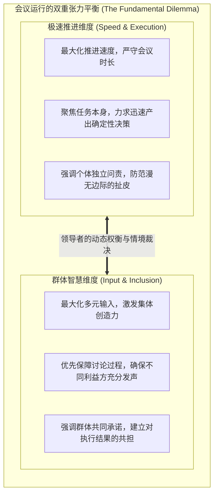
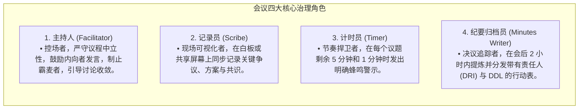

# Lec 8 团队赋能与高效会议：角色编排与决策收敛 (Running Effective Meetings & Group Decision-Making)

> MIT Course 15 · Managerial Communication · 卓越领导力沟通

## TL;DR

- 确立会议管理的第一工程性法则：严格权衡“决策速度（Speed）”与“全员投入（Input）”之间的组织张力。
- 落地会议筹划的 5W1H 前置清单与议程架构设计，消灭无目的、无准备、无产出的“三无恶性会议”。
- 实行会议四大治理角色的显性化编排：主持人（Facilitator）、记录员（Scribe）、计时员（Timer）与纪要归档员（Minutes Writer）职责分离。
- 比较高管决策三大模式（独断决策、多数表决、共识达成）的战略边界，运用结构化协议规避“群体迷思（Groupthink）”。

## 会议的组织病理学：从时间黑洞到协同引擎

在现代企业组织中，“开会”往往是员工抱怨最多、效率最为低下、资源浪费最严重的管理活动。根据哈佛商学院对全球跨国企业的实证调研，高管每周平均花费超过 23 小时在各种会议中，其中超过一半被评估为“毫无建设性、完全是在浪费生命”。

MIT Sloan 资深讲师 Neal Hartman 在发表于《福布斯》的专栏文章《组织最高效会议的七个步骤》（*Seven Steps to Running the Most Effective Meeting Possible*）中一针见血地指出：**劣质会议的本质，是管理者用群体沟通的形式，掩盖自身在目标设定、责任拆解与决断力上的平庸与怠惰**。

卓越的会议绝非随性的漫谈，而是一场经过精密流程设计的**高能耗认知工程**。

## 会议前置筹备清单：消灭无准备之战

Neal Hartman 总结了所有会议发起者必须在发出日历邀请前强制回答的 5W1H 清单：

::: definition 会议筹划六维审核清单 (Meeting Planning Checklist)
1. **为什么开？(Why meet?)**：明确会议的唯一定位。是识别问题？发散创意？信息同步？还是做出重大资源拍板？（如果只是信息同步，严禁开会，改发邮件或异步文档）；
2. **谁必须在场？(Who to include?)**：践行亚马逊“两个披萨原则”或 Google 高效会议守则。参会者必须是利益相关者或事实掌握者，剔除“仅仅为了陪会”的闲杂人员；
3. **讨论什么议题？(What to discuss?)**：议程必须在会前 24 小时以上分发，每一项议题必须标注预期耗时与期望交付成果；
4. **如何记录思想？(How to record ideas?)**：准备白板、共享协作文档或思维导图，确保认知过程可视化；
5. **在何处开展？(Where to meet?)**：物理会议室 vs 远程视频会议的声学与工具配置；
6. **达成何种成果？(What is the deliverable?)**：确立会议结束时必须签字画押的行动清单（Action Items）。
:::

## 角色编排制度化：四权分立治理架构

许多会议之所以陷入混乱与超时，是因为主持人一人包揽了所有职能：一边阐述观点、一边维持秩序、一边盯着手表、一边还要低头打字记录。这种严重的认知过载必然导致控场失败。当主持人既当运动员又当裁判员时，参会者也会质疑其公正性，导致会议沦为单向霸麦。

为了从制度层面根治这一痛点，MIT 15.281 倡导将会议权力解耦为四大互不重叠的核心治理角色。在开场的第一分钟，全员必须明确知晓每项职责由谁担任：

这种“四权分立”的治理结构彻底解放了管理者的精力：
- **主持人专注于交互动力学**：不再分心记录，敏锐观察谁在保持沉默并适时点名邀请输入，察觉争论走向人身攻击时及时喊停；
- **记录员保障认知透明度**：所有观点被即时投射在大屏幕上，参会者无需重复表达已被记录的意见，极大压缩重复发言时间；
- **计时员提供客观节拍器**：将“催促进度”的恶名从主持人身上剥离，转由客观的倒计时工具承担，避免引发人际不满；
- **纪要员锁定执行责任链**：消灭会后“大家各自按不同理解执行”的致命脱节，确保每一次沟通都闭环为明确的商业行动。

## 高管决策的三种底层机制与边界

当发散讨论充分展开后，会议必须进入“决策收敛阶段”。Neal Hartman 在讲义中辨析了三种经典的群体决策模式：

| 决策机制 | 适用场景 | 核心优势 | 潜在组织风险 |
|---|---|---|---|
| **1. 独断/专家裁决 (Executive / Expert)** | 突发危机时刻；信息高度不对称；必须在数分钟内做出极速响应。 | 速度极快，责任主体完全唯一，杜绝扯皮推诿。 | 决策质量高度依赖单个人；团队缺乏拥有感，执行易打折扣。 |
| **2. 多数表决制 (Majority Vote)** | 常规战术选择；存在多个旗鼓相当的备选方案；时间受限。 | 规则客观清晰，打破僵局，体现表面程序正义。 | 制造“胜者与败者”对立；少数派容易在会后消极怠工或暗中使绊。 |
| **3. 共识达成法 (Consensus Decision)** | 关乎企业生死的战略转型；跨部门深层协同；需要全员高度承诺。 | 全员具有极高的主人翁意识，执行阻力最小，方案更周密。 | 耗时漫长；极易为了追求表面一团和气而退化为妥协平庸的折中方案。 |

## 警惕群体迷思：红队机制与异见保护

在追求共识的会议中，领导者最需要警惕的隐形杀手是**群体迷思（Groupthink）**——团队成员由于害怕被排斥或不愿挑战权威，盲目顺从主流观点，导致灾难性后果（如挑战者号航天飞机发射悲剧）。

::: insight 规避群体迷思的领导力议事规程
1. **领导者最后发言 (Leader Speaks Last)**：高管在会议开场时只定义问题与约束，严禁过早表态自己的倾向，避免权威对下属思考产生锚定碾压；
2. **设立指定反对派（Red Team / Devil's Advocate）**：制度化指定一名资深成员专门扮演“挑刺者”，其考核指标就是找出当前最优方案中的三大致命致命伤；
3. **书面匿名发散，口头交叉辩护**：在开展讨论前，全员静音 5 分钟在共享文档上写下自己的真实顾虑，剥离身份地位对观点的干扰。
:::
