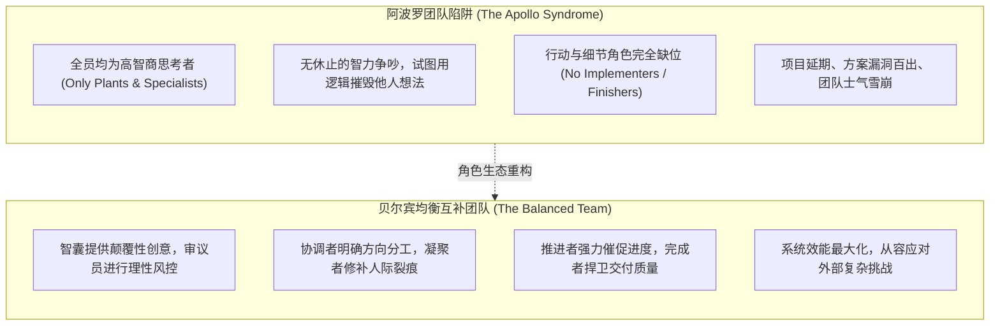
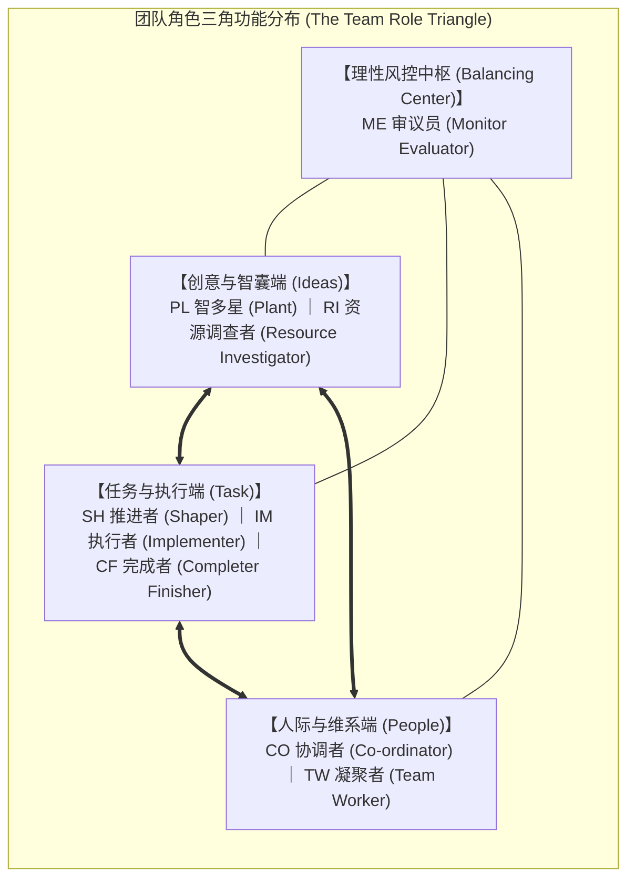
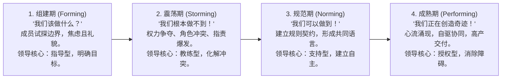

# Lec 9 团队角色动力学：贝尔宾模型与过程咨询 (Working with Teams: The Belbin Model & Process Consultation)

> MIT Course 15 · Managerial Communication · 卓越领导力沟通

## TL;DR

- 铭记尼采对群体行为的深刻洞察：“在个人身上，疯狂是罕见的；但在群体中，疯狂却是普遍法则”。
- 掌握贝尔宾（Belbin）九大团队角色的核心贡献、可容忍弱点及其在“任务-人际-创意”三角模型中的动态制衡。
- 贯通布鲁斯·塔克曼（Tuckman）团队发展四大生命周期（形成、震荡、规范、成熟），匹配不同阶段的核心主导角色。
- 引入埃德加·沙因“过程咨询（Process Consultation）”高管透镜：将注意力从显性的“讨论内容（Content）”转移到隐性的“群体交互过程（Process）”。

## 群体协作的非理性规律与“阿波罗陷阱”

在管理学经典实证研究中，英国剑桥亨利管理学院的梅雷迪思·贝尔宾（Meredith Belbin）博士曾组织过多场商业模拟沙盘竞赛。为了测试智力对团队绩效的决定性影响，他将所有智商测试位列前 1% 的顶尖学者、金融精英和技术极客专门组合成一支超级队伍（代号“阿波罗团队”）。

几乎所有观察者都预测阿波罗团队将毫无悬念地碾压其他对手。然而实验结果令人大为震惊：在多轮复杂的市场博弈与危机模拟中，**阿波罗团队的表现屡屡垫底**。复盘分析显示：
- 成员之间花费大量时间互相进行高智商的挑刺与反驳，证明自己比别人更聪明；
- 每个人都热衷于提出颠覆性构想，却没有人愿意埋头梳理财务明细、跟进供应链琐碎进度或检查报告疏漏；
- 团队缺乏公认的推进者，陷入严重的决策瘫痪与相互抱怨。

贝尔宾由此得出了划时代的结论：**卓越团队的灵魂不是智商的军备竞赛，而是行为角色的生态互补**。

## 贝尔宾九大团队角色的张力矩阵

Neal Hartman 教授在讲义中引入了“任务-人际-创意”三角模型（Task-People-Ideas Triangle），清晰界定了九大角色的功能定位：

### 九大角色的精细化诊断与互补律
1. **智多星 (PL) vs 审议员 (ME)**：PL 负责天马行空的发散，ME 负责冷酷无情的收敛。没有 PL，团队平庸僵化；没有 ME，团队容易因冒进而破产；
2. **推进者 (SH) vs 凝聚者 (TW)**：SH 是推土机，不惜撕破脸皮也要确保项目上线；TW 是润滑油，负责安抚被 SH 刺伤的成员情绪。两者并存方能既保证速度又维持组织黏性；
3. **资源调查者 (RI) vs 执行者 (IM)**：RI 从外部引入前沿的技术概念与商业伙伴；IM 则将这些飘在空中的概念编制为 SOP 流程和测试用例；
4. **协调者 (CO) vs 完成者 (CF)**：CO 宏观把握全局战略与人力调度；CF 守在最后一公里，死抠格式规范、标点符号与安全隐患。

## 团队发展的四大生命周期律

许多新晋管理者在组建新团队时，常常抱有一种不切实际的幻想：只要把一群优秀的人聚在一起，团队就会立刻进入高效产出状态。一旦遇到激烈的争吵或进度停滞，管理者便容易陷入自责或怀疑团队成员的职业素养。

然而，俄亥俄州立大学组织心理学家布鲁斯·塔克曼（Bruce Tuckman）的经典团队发展模型表明：**任何团队从初创走向卓越，都必须经历一段不可跨越的生理与心理演化阵痛**。冲突与混乱不仅不可避免，而且是团队走向成熟的必经仪式：

在不同的生命周期阶段，领导者必须匹配截然不同的沟通策略：
1. **组建期（Forming）**：成员内心充满对未知的不安全感，言行高度谨慎客套。此时领导者切忌过度民主授权，必须采取**指导型沟通（Directing）**，清晰定义团队目标、个人职责与行为底线；
2. **震荡期（Storming）**：随着业务深入，个体的真实性格与利益诉求开始碰撞，争夺主导权与方法论分歧爆发。管理者绝不能用高压手段压制分歧，而应采取**教练型沟通（Coaching）**，引导双方运用三层对话与推论阶梯，将人际对抗转化为建设性冲突；
3. **规范期（Norming）**：团队经历磨合，自发沉淀出独特的协作黑话、工作节奏与互信契约。领导者应逐步后撤，转向**支持型沟通（Supporting）**，强化团队归属感与仪式感；
4. **成熟期（Performing）**：团队进入心流涌现的高绩效状态，成员之间能够自发补位与决策收敛。领导者的终极艺术是**彻底授权（Delegating）**，将重心转移至从外部争取战略资源与扫清组织官僚障碍。

## 沙因的过程咨询：穿透“内容”看“交互”

在团队管理中，大多数领导者容易被会议的**显性内容（Content）**完全吸附：代码架构怎么设计、定价策略定多少、市场推广预算怎么砍。然而，MIT Sloan 组织发展宗师埃德加·沙因（Edgar Schein）在《过程咨询》（*Process Consultation*）中提出：**决定团队成败的往往不是讨论的具体内容，而是成员之间正在发生的隐性交互过程（Process）**。

::: definition 过程咨询视角 (The Process Consultation Lens)
过程咨询要求领导者在团队会议中抽离出一只“元认知之眼（Meta-Eye）”，实时监测团队当下的动力学健康度：
- **谁在主导话语权？** 少数几位强势者是否霸占了 80% 的发言时间？
- **谁在保持沉默？** 为什么最懂这门技术的资深工程师整场会议一言不发？他在恐惧什么？
- **争论是任务冲突还是人际冲突？** 表面上是在讨论技术方案优劣，底下是否是两个部门总监在争夺主导权？
- **决策是如何做出的？** 是通过真正的充分论证，还是因为大家疲惫不堪而随大流妥协？
:::

::: insight 领导者的角色补位艺术
贝尔宾模型与过程咨询绝不是用来给人“贴死标签”的宿命论。一个成熟的高管，其核心能力是**“组织生态的隐形补位者”**。  
当团队所有人都在发散狂想（全是 PL/RI）时，领导者必须自觉扮演挑剔的审议员（ME）和严谨的完成者（CF）；而当整个团队陷入僵化死寂、人人害怕担责（全是 IM/CF）时，领导者必须主动扮演狂放的智多星（PL）和果决的推进者（SH）。卓越的领导力沟通，是根据系统当前的失衡，向团队注入其最匮乏的那味关键要素。
:::
