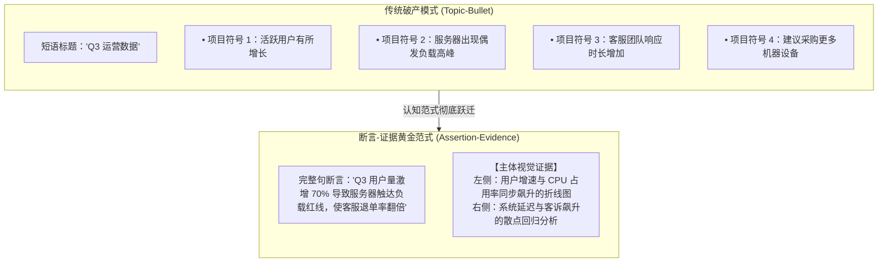

# 断言-证据架构范式 (The Assertion-Evidence Model)

> MIT Sloan 15.286 · Communicating with Data · 核心概念

## TL;DR

- 阐明宾夕法尼亚州立大学 Michael Alley 开创的“断言-证据（Assertion-Evidence）”幻灯片黄金架构。
- 核心定义：顶部采用 1-2 行完整句子直接阐明核心战略断言，正文区域由高纯度视觉证据（图表/流程）完全主导。
- 彻底废除传统幻灯片中割裂思维、诱发视听冗余冲突的项目符号列表（Bullet Points）。
- 基于 Mayer 多媒体认知学习理论，实现视觉通道（看图）与听觉通道（听讲）的最高效无冲突协同。

## 概念起源与定义

**断言-证据范式（The Assertion-Evidence Model）**由宾夕法尼亚州立大学工程沟通教授 Michael Alley 及其研究团队于 21 世纪初创立。该架构最初旨在解决科研人员、工程师与医学专家在向资助机构和决策者汇报技术方案时“PPT 充斥密密麻麻的小字公式、听众完全不知所云”的深层痛点。随后，该范式被 MIT Sloan、斯坦福商学院与顶级科技企业广泛采纳为现代数据演示的黄金标准。

::: definition 断言-证据范式 (Assertion-Evidence Model)
断言-证据范式是一种**重构单页演示切片的工程化设计准则**。它规定每一页演示文档必须由且仅由以下两个紧密共振的组件构成：
1. **断言标题（Assertion Headline）**：置于幻灯片最顶端，严格使用**语法完整的陈述句（Complete Sentence）**，直接宣告该页所要论证的核心商业发现、技术主张或战略建议；
2. **视觉证据（Visual Evidence）**：占据幻灯片下方 80% 以上的主体区域，由**高信息密度的统计图表、因果架构图、实物对比或流程图**构成，直接为顶部的断言提供毋庸置疑的客观证据。
:::

## 与传统“话题-项目符号”模板的对照矩阵

| 评估维度 | 传统模式 (Topic + Bullet Points) | 断言-证据范式 (Assertion-Evidence) |
|---|---|---|
| **标题属性** | 泛化的抽象名词短语（如“市场分析”） | 语法完整的结论句，蕴含明确因果与行动取向 |
| **正文主体** | 破碎的文字列表（4-6 个圆点短句） | 高信噪比统计图表、结构模型或对比实证 |
| **认知负荷机制** | 强迫听众在阅读屏幕文字与听讲解之间内耗 | 眼睛看图（视觉通道），耳朵听讲（听觉通道），无缝协同 |
| **汇报者角色** | “背对听众读 PPT”的提词器奴隶 | 站在数据之上、自信引领商业洞察的战略顾问 |
| **离线阅读体验** | 脱离口头讲解后，仅留下无意义的名词堆砌 | 翻阅各页标题即可在 60 秒内串联起严密的战略备忘录 |

## 认知心理学底层理论：双通道与冗余消除

加州大学圣塔芭芭拉分校著名心理学家 Richard E. Mayer 的**多媒体学习认知理论**，为断言-证据范式提供了坚如磐石的神经科学依据：

::: theorem 通道分离与冗余消除定理
人类大脑处理工作记忆的带宽是高度分工的：**视觉通道**专司图像、空间与几何轨迹的处理；**听觉/语音通道**专司口语流与语调重音的处理。
1. **通道分离（Modality Effect）**：当信息同时以“图像（屏幕） + 口语解说（汇报者）”的形式输入时，两个通道的认知带宽被同时最大化激活；
2. **冗余消除（Redundancy Effect）**：如果屏幕上打印出整段文字、汇报者同时口头朗读该文字，大脑的语音回路会因为试图同时处理读音与听音而引发剧烈交通拥堵，受众的理解深度会断崖式暴跌。
:::

## 实践陷阱与高阶认知洞察

::: pitfall 伪断言陷阱：依然在写描述而非论点
许多初学者误以为只要把标题写长就是断言。例如将标题写为：“**关于公司在四个不同主要业务线上的获客成本综合比较分析情况说明**”。  
**这依然是垃圾标题**。这只是把原本的短语拉长成了无病呻吟的客观描述。真正的断言必须含有**主谓宾与清晰的判断**，必须敢于给出定性或定量结论：“**新零售业务线的获客成本比传统电商高出 45%，且尚未展现出更高的复购粘性**”。
:::

::: insight 断言标题是技术人员建立职业担当的试金石
为什么许多人抗拒写断言标题？因为在顶层写下一个斩钉截铁的结论，意味着**汇报者必须为自己的判断承担责任**。写“第四季度销售概览”是安全的，因为这不代表任何立场；而写“第四季度销售暴跌由新渠道定价混乱直接导致”，则需要真正的专业勇气与底气。  
**断言-证据范式，是优秀数据专家从‘跑数工具人’蜕变为‘业务决策者’的核心分水岭**。
:::

## 关联讲义与跨领域连接

- [Lec 1 认知负荷与知识的诅咒](./../lec1.md)：深入理解工作记忆瓶颈与外在认知负荷的消除。
- [Lec 5 幻灯片架构与断言-证据范式](./../lec5.md)：断言-证据范式在商业与科研汇报中的具体落地指南。
- [金字塔原理与 MECE 准则](./pyramid-principle.md)：断言标题与金字塔各层级论点的严格映射。
