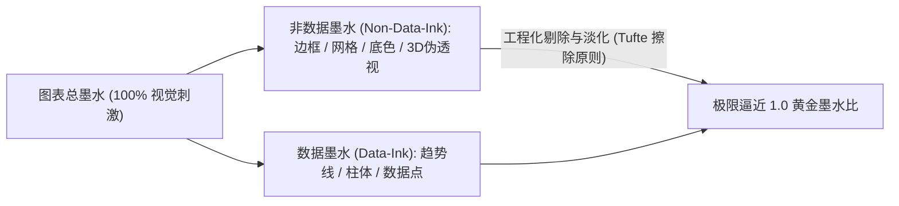

# 数据墨水比 (Data-to-Ink Ratio)

> MIT Sloan 15.286 · Communicating with Data · 核心概念

## TL;DR

- 数据墨水比由 Edward Tufte 提出，用于量化衡量图表每一滴“油墨/像素”传达真实信息的有效密度。
- 核心公式定义为数据不可替代墨水占图表总消耗墨水的比值，目标是在不损失信息的前提下最大化该比率。
- 落地策略聚焦于合理擦除非数据墨水（网格、边框、阴影、背景）与擦除冗余数据墨水。
- 必须严格警惕过度擦除（Over-erasure），避免因盲目极简而剥离受众理解所需的物理量纲与基准上下文。

## 概念定义与数学表征

在数据可视化与信息设计领域，**数据墨水比（Data-to-Ink Ratio）**是衡量图表信息纯度与认知信噪比的最高行业基准。该概念由统计学先驱 Edward R. Tufte 在 1983 年出版的《The Visual Display of Quantitative Information》中正式确立。

::: definition 数据墨水比 (Data-to-Ink Ratio)
数据墨水比是指图表中用于**直接传达真实量化数据的非冗余墨水**，占整个图表所耗费的**总墨水（或总像素）**的数学比率：

$$\text{Data-Ink Ratio} = \frac{\text{Data-Ink}}{\text{Total ink used to print the graphic}} = 1.0 - \text{Proportion of graphic that can be erased without loss of data}$$

- **数据墨水（Data-Ink）**：代表数值本身不可分割的几何实体。例如折线图中的走势曲线、散点图中的数据点、条形图代表数值的柱体。如果擦除这部分墨水，数据内容将不可逆地丧失；
- **非数据墨水（Non-Data-Ink）**：所有与数据本身无关的辅助性、装饰性或多余视觉元素。例如厚重的外框线、密集的深色网格、多余的阴影与纯装饰性背景色。
:::

## Tufte 的两大设计公理与降噪法则

为了将数据墨水比提升至最优状态，Tufte 确立了两大操作公理：

1. **合理擦除非数据墨水（Erase non-data-ink, within reason）**：
   - **消灭图表垃圾（Chartjunk）**：彻底剔除 3D 浮雕透视、高光渐变阴影、莫尔条纹视觉震颤以及无意义的装饰剪贴画；
   - **释放网格牢笼**：完全移除围绕图表的闭合外边框；将强对比度的深黑网格线降低为几乎不可见的极浅灰色虚线，或者完全依靠空白背景实现视线穿透。
2. **合理擦除冗余数据墨水（Erase redundant data-ink, within reason）**：
   - 如果柱状图已经在每根柱子顶端明确标注了具体数值，那么纵向 Y 坐标轴上的密集数字与刻度线就属于冗余重复墨水，可以果断淡化或精简。

::: example 极简条形图的蜕变
- **传统劣质图表**：带有 3D 灰色圆柱体、纯黑实线外框、灰白相间的背景横向条纹、右上角悬挂着带有独立边框的图例，墨水比约为 **0.15**（85% 的像素都是视觉杂讯）；
- **极简专业图表**：纯白平底、彻底删除外框与竖轴线、柱体采用平坦深海蓝色、数值与类别名称紧贴柱体左侧和顶端直接排版，墨水比跃升至 **0.85**。受众读取并理解该图表的速度提升了 3 倍以上。
:::

## 极简主义的边界与认知误区

数据墨水比的推行必须兼顾人类认知的人性化需求，绝不能陷入病态的极端原教旨主义。

::: pitfall 过度擦除陷阱 (Over-Erasure Trap)
部分设计者为了盲目刷高数学上的墨水比，把图表的坐标轴物理量纲（如“单位：千万元”）、核心参考基准线（如“50% 盈亏平衡线”）、甚至统计置信区间阴影全部当成“非数据墨水”强行删光。  
**后果**：图表变成了只有几根孤零零几何线条的抽象艺术画，决策者完全无法判断数据的物理意义与严肃边界。**辅助理解所必需的上下文标尺，绝不是非数据垃圾**。
:::

::: insight 数据墨水比的心理学本质：尊重决策者的大脑算力
数据墨水比看似是一个关于“像素与线条”的美学概念，其实质是一门**认知能量管理学**。每一滴多余的无意义墨水，都会在受众的大脑视网膜和视觉皮层上强行激活一组神经元进行无谓的电信号处理。  
**最大化数据墨水比，本质上是沟通者对决策者时间与脑力代谢成本的最高敬意**。通过主动在设计阶段承担严密的清洗与降噪痛苦，你把最纯净、无阻力的认知通道完整留给了决策者。
:::

## 关联讲义与跨领域连接

- [Lec 2 视觉感知机理与格式塔法则](./../lec2.md)：深入理解人脑如何通过格式塔知觉自动补全被擦除的轮廓边界。
- [Lec 4 极简主义与信噪比最大化](./../lec4.md)：数据墨水比在复杂商业报表中的完整工程落地指南。
- [前注意视觉属性](./pre-attentive-attributes.md)：探讨如何利用最小的墨水突显最关键的商业洞察。
