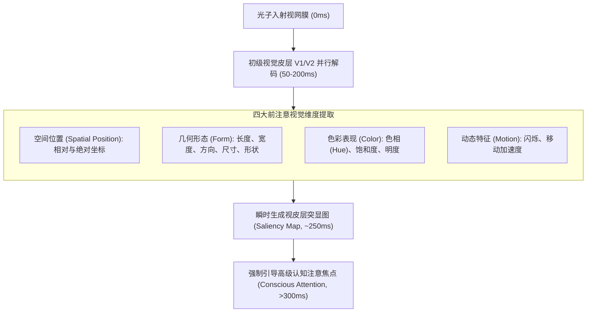

# 前注意视觉属性 (Pre-attentive Visual Attributes)

> MIT Sloan 15.286 · Communicating with Data · 核心概念

## TL;DR

- 揭示人类大脑初级视觉皮层在 250 毫秒内完成的大规模并行、自动化信息捕获机制。
- 归纳四大前注意维度：空间位置、几何形态（长度/尺寸/角度）、色彩感知（色相/饱和度）与动态运动。
- 结合 Cleveland & McGill 精度实验，确立位置编码为定量误差最小、最具穿透力的核心视觉通道。
- 确立克制唯一的视觉突显律：消灭全彩泛滥的“拉斯维加斯效应”，用单一前注意锚点掌控决策视线。

## 概念定义与神经生理学机理

在认知心理学与神经科学中，**前注意处理（Pre-attentive Processing）**是指人类视觉系统在有意识的注意力尚未聚焦之前，以极高速度自动进行的第一阶段信息过滤机制。

::: definition 前注意视觉属性 (Pre-attentive Visual Attributes)
前注意属性是指在人眼视网膜受到光刺激后的 **200 至 250 毫秒** 之内，由大脑枕叶初级视觉皮层（V1/V2 区域）以**完全自动化、高度并行计算（Massively Parallel）**的方式提取出来的低维视觉特征。  
在这一阶段：
- 受众**无需动用系统 2 的有意识深思熟虑**；
- 受众**无需进行串行眼动搜索（Saccadic Eye Movements）**；
- 目标元素会从背景杂讯中瞬间“自发跳跃出来（Pop-Out Effect）”，其识别速度与背景元素的数量无关（搜索耗时斜率几乎为零）。
:::

## 四大前注意属性维度全景归纳

Colin Ware 在《Information Visualization: Perception for Design》中将前注意属性系统归纳为四大工程类别：

| 属性大类 | 具体几何/物理变量 | 在数据图表中的具体映射场景 |
|---|---|---|
| **1. 空间位置 (Position)** | 二维空间坐标（X 轴 / Y 轴对齐） | 散点图中的数据点定位、柱状图顶端的绝对高度标定 |
| **2. 几何形态 (Form)** | • 长度（Length） • 宽度（Width） • 方向/斜率（Orientation） • 尺寸（Size） • 形状（Shape） • 封闭/包围（Enclosure） | • 条形图柱体长度 • 趋势线粗细对比 • 折线图上升或下降坡度 • 气泡图面积（需警惕感知非线性） • 散点图中区分类别（圆点 vs 三角） • 底色块高亮特定异常时间段 |
| **3. 色彩感知 (Color)** | • 色相（Hue / 颜色种类） • 饱和度/深浅（Intensity） | • 用单一鲜明色相标识目标竞品 • 热力图（Heatmap）中用色彩深浅表达密度 |
| **4. 动态运动 (Motion)** | 闪烁（Flicker）、相对位移（Movement） | 实时商业大屏监控系统中的异常报警动效 |

## 感知精度递减阶梯：Cleveland & McGill 实证法则

并非所有前注意属性在人类大脑中都具备同等的量化解码精度。贝尔实验室统计学家 Cleveland & McGill 的经典实验证明：**不同属性在人脑中的相对误差率存在天壤之别**：

::: theorem 图形感知精度递减定律 (Perceptual Precision Hierarchy)
1. **最高精度（误差 < 5%）**：**相同刻度基准线上的空间位置（Position on a common scale）**。人脑判断点或线在统一标尺上的高低位置最为敏锐；
2. **次高精度（误差约 5%-15%）**：**非对齐基线上的空间位置**，紧接着是**长度（Length）**与**方向/斜率（Direction / Slope）**；
3. **极低精度（误差 > 25%）**：**面积（Area）**、**角度（Angle）**与**色彩饱和度（Color Saturation）**。人脑在通过视觉估算二维面积与色彩深度时，表现出极强的系统性压缩失真。
:::

::: example 精度定律指导下的图表降维
如果你需要让董事会看清“五大核心业务线连续三年的净利润率增长差距”：
- **绝对错误方案**：绘制由不同尺寸、不同透明度彩色气泡组成的气泡图，或者画五组饼图切片。决策者的大脑完全无法判断面积与角度的微小差距；
- **绝对科学方案**：绘制基于统一横轴时间的**坡度图（Slope Chart）**或**对齐条形图**。利用“空间位置”与“线条斜率”前注意属性，让谁在飞速拉升、谁在滞后一目了然。
:::

## 实践误区与高阶认知洞察

::: pitfall 拉斯维加斯效应与前注意属性滥用
前注意属性的生效，建立在**“背景极度克制、目标极度稀缺”**的前提下。  
如果一张幻灯片里，既有红色的标题、黄色的背景块、加粗倾斜的文字，又有 6 种不同颜色的柱子，人脑的初级视觉皮层就会遭遇多重强电信号的猛烈撞击，瞬间触发“前注意机制崩溃”。**当每一个元素都在试图争抢注意力时，最终没有任何元素能被注意**。
:::

::: insight 视觉突显性是沟通者的“隐形导游”
高阶数据沟通者不应该依赖“请大家看右上角”这种苍白的口头呼唤。  
**前注意属性是你直接写在受众视网膜上的自动化代码**。在受众眨眼的 200 毫秒间，通过一个孤立的高饱和度蓝色锚点与大片安静的浅灰色底色，你已经神不知鬼不觉地把对方数亿个视神经元引流到了你最希望他思考的战略核心上。
:::

## 关联讲义与跨领域连接

- [Lec 2 视觉感知机理与格式塔法则](./../lec2.md)：前注意属性与格式塔知觉律的完整实战融合。
- [Lec 4 极简主义与信噪比最大化](./../lec4.md)：如何通过灰度基底为前注意属性提供纯净的对比画布。
- [数据墨水比](./data-ink-ratio.md)：非数据墨水的擦除是让前注意属性脱颖而出的先决条件。
