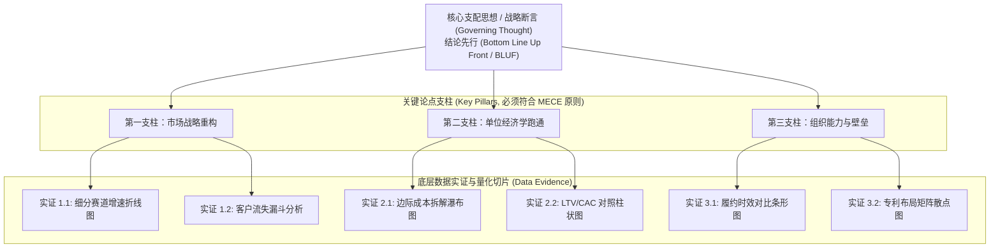

# 金字塔原理与 MECE 准则 (The Minto Pyramid Principle & MECE)

> MIT Sloan 15.286 · Communicating with Data · 核心概念

## TL;DR

- 阐明麦肯锡芭芭拉·明托金字塔原理的核心逻辑：自上而下表达、自下而上支撑、横向严格归类。
- 强制实行结论先行（BLUF）管理沟通范式，在开篇第一分钟确立核心支配思想（Governing Thought）。
- 严密贯彻 MECE 准则（相互独立、完全穷尽），杜绝论据之间的重叠冲突与遗漏盲区。
- 揭示金字塔结构是克服人类工作记忆瓶颈与多任务信息碎片化的终极思考脚手架。

## 概念定义与结构化架构

**金字塔原理（The Minto Pyramid Principle）**由麦肯锡公司首位女性咨询顾问芭芭拉·明托（Barbara Minto）在 20 世纪 70 年代创立，是现代商业战略咨询、高管汇报与复杂决策分析领域最具统治力的思维与沟通范式。

::: definition 金字塔原理 (The Pyramid Principle)
金字塔原理是一种**层次化的逻辑组织与表达架构**。它要求沟通者将复杂的分析与事实，组织为一个由单一核心结论（Governing Thought）统领的多层树状结构。其核心特征表现为：
1. **纵向自上而下表达（Top-Down Expression）**：先向受众抛出最顶层的核心断言，再逐层展开支撑论据；
2. **纵向自下而上归纳（Bottom-Up Summarization）**：上层的每一个论点，必须是其下一层子论点的严密因果提炼与数学概括；
3. **横向分类归组（Horizontal Congruence）**：处于同一层次的各个子论点，必须属于同一逻辑范畴，并严格遵循 MECE 准则。
:::

## MECE 准则的核心内涵与四种工程拆解模型

金字塔横向维度的灵魂是 **MECE（Mutually Exclusive, Collectively Exhaustive）原则**：

::: definition MECE 原则 (相互独立，完全穷尽)
- **相互独立（Mutually Exclusive）**：各个逻辑切片之间没有交集、互不重叠。同一个数据点、成本项或业务原因绝不出现在两个不同分支中，消灭重复计算（Double-Counting）；
- **完全穷尽（Collectively Exhaustive）**：所有逻辑切片的合集完整覆盖了问题空间的整体，没有任何盲区、遗漏项或未被讨论的暗角。
:::

在面对复杂商业问题时，构建 MECE 结构最常用的四种模型包括：

| 模型类型 | 构建方法与逻辑机理 | 商业数据应用实例 |
|---|---|---|
| **1. 数学因式分解模型 (Mathematical Formula)** | 依据纯粹的代数公式进行变量乘法或加法分解。 | $\text{总利润} = (\text{客单价} \times \text{交易频次} \times \text{用户规模}) - \text{固定成本} - \text{可变成本}$ |
| **2. 时序流程模型 (Process / Chronological)** | 按照事情发生的客观时间先后阶段严格切分。 | 用户生命周期：拉新获客（Acquisition）$\to$ 激活转化（Activation）$\to$ 留存复购（Retention）$\to$ 流失召回（Referral） |
| **3. 二分/对立结构模型 (Binary / Polar)** | 将整体分为互补的两半（A 与 非A）。 | 内部因素 vs 外部因素；线上渠道 vs 线下渠道；变动成本 vs 固定成本 |
| **4. 经典商业矩阵模型 (Matrix / Framework)** | 借用久经考验的管理学框架进行全景映射。 | 营销 4P（Product, Price, Place, Promotion）；波特五力模型；PEST 宏观环境分析 |

## 实践陷阱与高阶认知洞察

::: pitfall “杂物箱”与伪 MECE 陷阱
很多汇报者在尝试列出 MECE 支柱时，发现归纳不完全，于是习惯性地加上最后一项——“**其他因素（Others）**”。  
在严肃的管理决策中，“其他”往往是懒惰与逻辑未闭合的遮羞布。如果“其他”所占的数据权重超过了 5%，说明当前的分类维度存在结构性缺陷，必须彻底推倒重构，直到无需“其他”即可自然实现穷尽。
:::

::: insight 金字塔原理是高管决策的心理减震器
为什么顶级 CEO 极度偏爱金字塔架构？因为商业决策在本质上是一场在高度不确定性中承担风险的博弈。  
当汇报者采用金字塔原理时，你向高管传达的潜意识信号是：“**我已经完整遍历了这片森林的所有树木，我清楚每一条可能的死胡同，我为你挑选出的是一条经过穷尽推演后的最优路径**”。这种结构化的秩序感，是化解高管焦虑、建立战略信任的终极心智工具。
:::

## 关联讲义与跨领域连接

- [Lec 1 认知负荷与知识的诅咒](./../lec1.md)：从工作记忆局限性探讨为何大脑天然偏好分层金字塔。
- [Lec 5 幻灯片架构与断言-证据范式](./../lec5.md)：金字塔顶端思想在单页 PPT 完整句标题中的直接投影。
- [Lec 6 逻辑金字塔与 MECE 原则](./../lec6.md)：金字塔原理在整套商业汇报骨架搭建中的系统实操。
